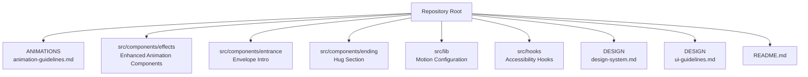
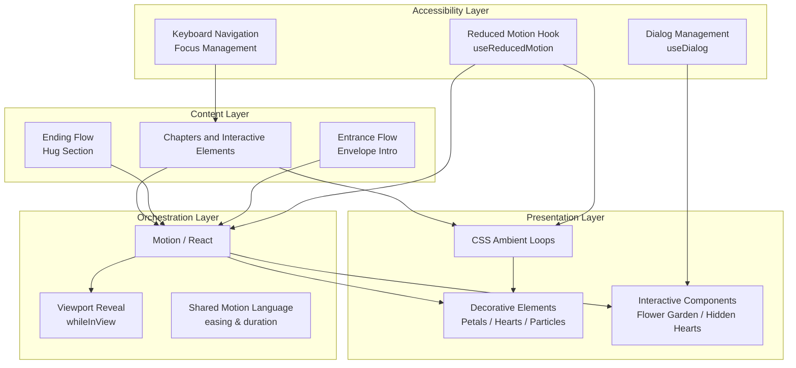
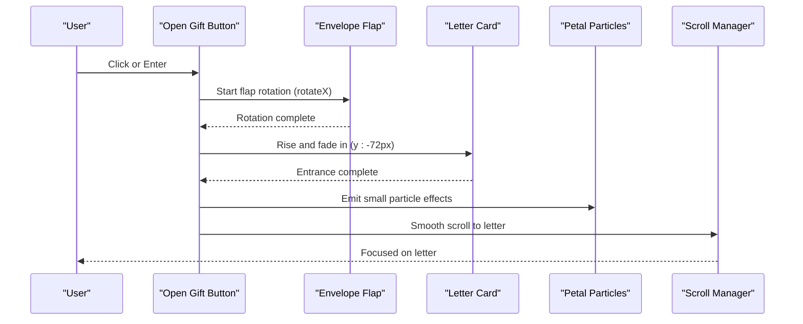
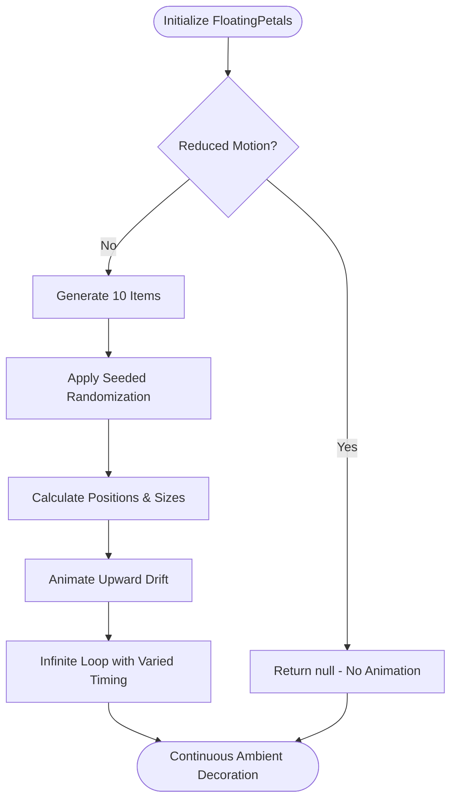
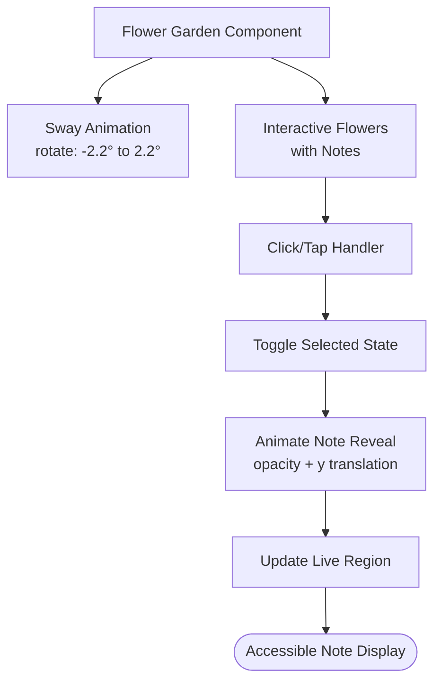
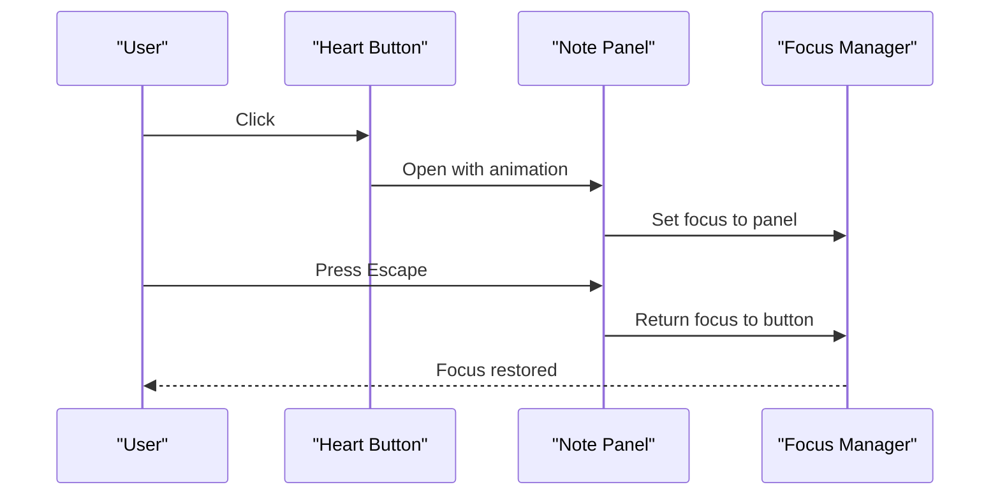
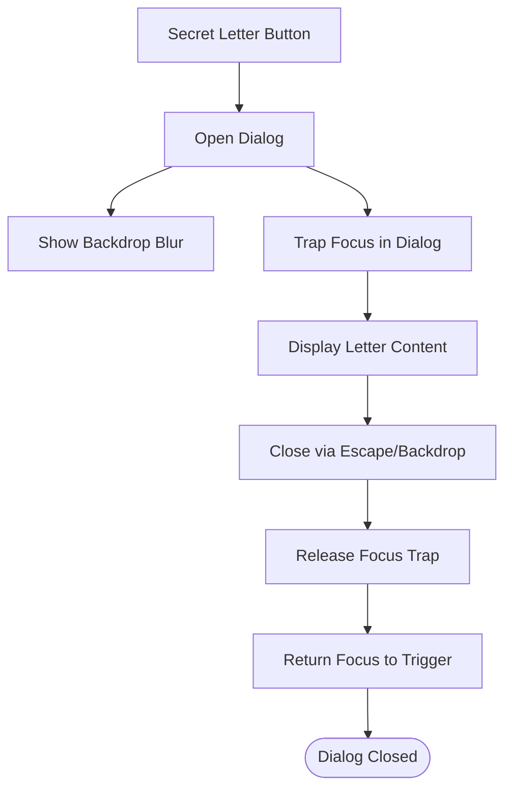
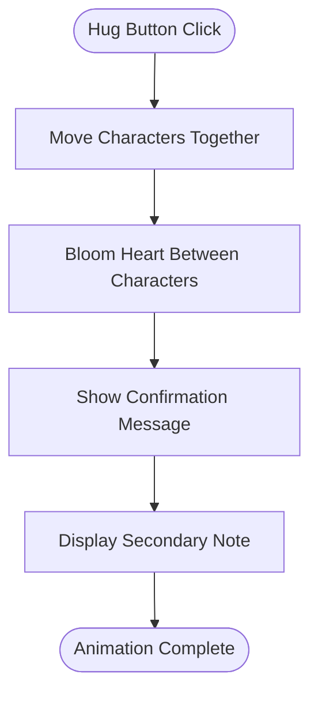
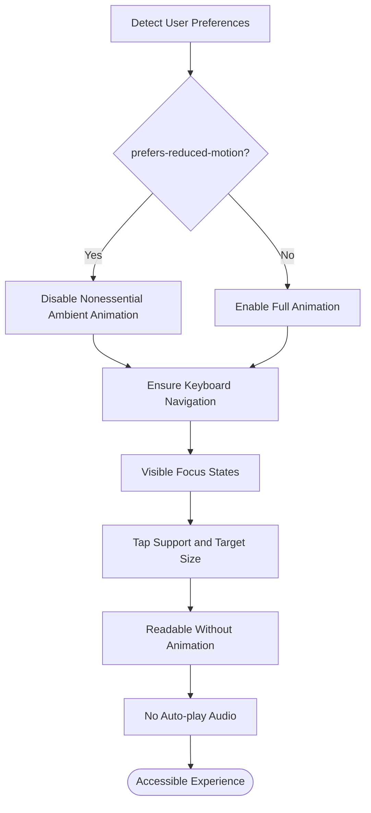
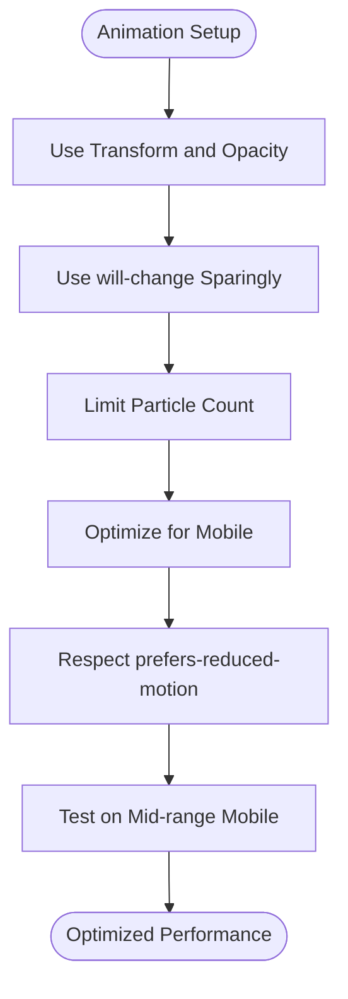

# Animation and Interaction Guidelines

<cite>
**Referenced Files in This Document**
- [animation-guidelines.md](file://A-Little-World-For-You-Design-Asset-Pack/ANIMATIONS/animation-guidelines.md)
- [design-system.md](file://A-Little-World-For-You-Design-Asset-Pack/DESIGN/design-system.md)
- [ui-guidelines.md](file://A-Little-World-For-You-Design-Asset-Pack/DESIGN/ui-guidelines.md)
- [README.md](file://A-Little-World-For-You-Design-Asset-Pack/README.md)
- [FloatingPetals.tsx](file://src/components/effects/FloatingPetals.tsx)
- [FlowerGarden.tsx](file://src/components/effects/FlowerGarden.tsx)
- [HiddenHearts.tsx](file://src/components/effects/HiddenHearts.tsx)
- [SecretLetter.tsx](file://src/components/effects/SecretLetter.tsx)
- [EnvelopeIntro.tsx](file://src/components/entrance/EnvelopeIntro.tsx)
- [HugSection.tsx](file://src/components/ending/HugSection.tsx)
- [motion.ts](file://src/lib/motion.ts)
- [useReducedMotion.ts](file://src/hooks/useReducedMotion.ts)
</cite>

## Update Summary
**Changes Made**
- Enhanced animation system documentation with sophisticated visual effects
- Added detailed component analysis for floating petals, flower garden, hidden hearts, and secret letter components
- Updated motion library integration patterns with practical implementation examples
- Expanded accessibility considerations with reduced motion support
- Added performance optimization techniques for smooth animations across devices

## Table of Contents
1. [Introduction](#introduction)
2. [Project Structure](#project-structure)
3. [Core Components](#core-components)
4. [Architecture Overview](#architecture-overview)
5. [Detailed Component Analysis](#detailed-component-analysis)
6. [Motion Library Integration](#motion-library-integration)
7. [Accessibility and Reduced Motion Support](#accessibility-and-reduced-motion-support)
8. [Performance Optimization](#performance-optimization)
9. [Troubleshooting Guide](#troubleshooting-guide)
10. [Conclusion](#conclusion)

## Introduction
This document defines the animation and interaction guidelines for a gentle, romantic, watercolor-inspired experience. The enhanced animation system uses Motion (`motion/react`) for orchestrated UI animation while maintaining CSS-based ambient loops for subtle background motion. The system focuses on implementing soft, organic motion that feels like a handmade storybook—calm, slow enough to be tender, and supportive rather than distracting.

The animation architecture includes sophisticated visual effects such as floating petals, flower gardens, hidden hearts, and secret letters, all designed to create an intimate, sincere experience while maintaining full accessibility and performance across devices.

**Section sources**
- [README.md:5-10](file://A-Little-World-For-You-Design-Asset-Pack/README.md#L5-L10)
- [design-system.md:3-4](file://A-Little-World-For-You-Design-Asset-Pack/DESIGN/design-system.md#L3-L4)

## Project Structure
The animation guidance lives under the `ANIMATIONS` folder, while the enhanced animation system is implemented throughout the `src/components/effects` directory. Visual and interaction principles are defined in `DESIGN`, and the repository includes comprehensive UI chapter flows that inform how animations should behave during user journeys.

**Diagram sources**
- [animation-guidelines.md:1-29](file://A-Little-World-For-You-Design-Asset-Pack/ANIMATIONS/animation-guidelines.md#L1-L29)
- [FloatingPetals.tsx:1-71](file://src/components/effects/FloatingPetals.tsx#L1-L71)
- [FlowerGarden.tsx:1-131](file://src/components/effects/FlowerGarden.tsx#L1-L131)
- [HiddenHearts.tsx:1-85](file://src/components/effects/HiddenHearts.tsx#L1-L85)
- [SecretLetter.tsx:1-96](file://src/components/effects/SecretLetter.tsx#L1-L96)

**Section sources**
- [README.md:12-17](file://A-Little-World-For-You-Design-Asset-Pack/README.md#L12-L17)

## Core Components
The enhanced animation system is built around these core components:

### Primary Animation Components
- **FloatingPetals**: Ambient drifting petals and hearts with deterministic positioning
- **FlowerGarden**: Interactive flower strip with swaying animations and note reveals
- **HiddenHearts**: Accessible heart panels with focus management
- **SecretLetter**: Dialog-based letter reveal with proper accessibility

### Supporting Infrastructure
- Motion-driven orchestration for React components using shared motion language
- CSS-based ambient loops for subtle background motion
- Viewport-triggered reveals for sections using `whileInView`
- Lightweight decorative elements (petals, hearts, particles)
- Accessible interactions with keyboard and focus management
- Reduced-motion fallbacks through centralized hook

Key implementation rules:
- Use Motion (`motion/react`) for orchestrated UI animation; use CSS for ambient loops.
- Prefer transform and opacity over layout-heavy properties.
- Keep most transitions between 350–700ms.
- Ambient loops should be slow (4–12s) and low amplitude.
- Respect `prefers-reduced-motion`.
- Avoid excessive parallax, rapid bouncing, flashing, or constant movement behind text.
- Ensure content remains readable if animations fail.

**Section sources**
- [animation-guidelines.md:3-11](file://A-Little-World-For-You-Design-Asset-Pack/ANIMATIONS/animation-guidelines.md#L3-L11)
- [animation-guidelines.md:21-29](file://A-Little-World-For-You-Design-Asset-Pack/ANIMATIONS/animation-guidelines.md#L21-L29)
- [FloatingPetals.tsx:15-18](file://src/components/effects/FloatingPetals.tsx#L15-L18)
- [FlowerGarden.tsx:23-26](file://src/components/effects/FlowerGarden.tsx#L23-L26)

## Architecture Overview
The enhanced animation architecture separates orchestration from decoration with sophisticated visual effects:

- **Orchestration layer**: Motion controls component-level animations (entrance, hover, transitions)
- **Presentation layer**: CSS handles ambient loops and lightweight decorative motion
- **Accessibility layer**: Reduced-motion checks and keyboard navigation ensure inclusive experiences
- **Content layer**: Chapters and interactive elements remain readable without animation

**Diagram sources**
- [motion.ts:3-6](file://src/lib/motion.ts#L3-L6)
- [useReducedMotion.ts:5-8](file://src/hooks/useReducedMotion.ts#L5-L8)
- [EnvelopeIntro.tsx:84-176](file://src/components/entrance/EnvelopeIntro.tsx#L84-L176)
- [HugSection.tsx:16-148](file://src/components/ending/HugSection.tsx#L16-L148)

## Detailed Component Analysis

### Envelope Opening and Letter Unfolding
The entrance sequence introduces the experience through an illustrated envelope with sophisticated animation details.

Behavior:
- On click, the envelope flap rotates around its top edge using 3D transforms
- The letter rises slightly and fades in with staggered timing
- A gentle scroll moves the view toward the letter
- Small petal particles escape from the open envelope

Implementation patterns:
- Use Motion for flap rotation and letter rise/fade with custom easing
- Animate transform and opacity only for optimal performance
- Trigger once per session with proper state management
- Provide visible focus state and keyboard activation for the CTA
- Integrate with FloatingPetals for ambient background motion

**Diagram sources**
- [EnvelopeIntro.tsx:49-80](file://src/components/entrance/EnvelopeIntro.tsx#L49-L80)
- [EnvelopeIntro.tsx:95-109](file://src/components/entrance/EnvelopeIntro.tsx#L95-L109)

**Section sources**
- [EnvelopeIntro.tsx:15-82](file://src/components/entrance/EnvelopeIntro.tsx#L15-L82)
- [EnvelopeIntro.tsx:84-176](file://src/components/entrance/EnvelopeIntro.tsx#L84-L176)

### Floating Petals and Hearts Drift
The enhanced floating petals system provides sophisticated ambient decoration with deterministic positioning and accessibility support.

Behavior:
- 10 small petals or hearts drift upward with varied delays and durations
- Movement distance spans the viewport height (-96vh) with horizontal drift
- Deterministic positions keep SSR and hydration identical
- Completely disabled when reduced motion is preferred

Implementation patterns:
- Use Motion for continuous looping animations with linear easing
- Implement seeded randomization for consistent positioning across renders
- Support both petal and heart variants with SVG graphics
- Complete removal from DOM when reduced motion is detected
- Proper aria-hidden attributes for screen readers

**Diagram sources**
- [FloatingPetals.tsx:19-32](file://src/components/effects/FloatingPetals.tsx#L19-L32)
- [FloatingPetals.tsx:40-52](file://src/components/effects/FloatingPetals.tsx#L40-L52)

**Section sources**
- [FloatingPetals.tsx:1-71](file://src/components/effects/FloatingPetals.tsx#L1-L71)

### Flower Garden with Interactive Notes
The flower garden creates an interactive botanical scene with swaying animations and accessible note reveals.

Behavior:
- Three interactive flowers hold notes that open on click/tap
- Decorative flowers sway gently with varied timing
- Notes appear below the garden with smooth transitions
- Full keyboard navigation and screen reader support

Implementation patterns:
- Use Motion for gentle swaying animations with easeInOut curves
- Implement proper button semantics with aria-expanded states
- Manage selected state for single-note opening
- Provide live regions for dynamic content updates
- Respect reduced motion by disabling nonessential animations

**Diagram sources**
- [FlowerGarden.tsx:32-38](file://src/components/effects/FlowerGarden.tsx#L32-L38)
- [FlowerGarden.tsx:48-90](file://src/components/effects/FlowerGarden.tsx#L48-L90)
- [FlowerGarden.tsx:102-127](file://src/components/effects/FlowerGarden.tsx#L102-L127)

**Section sources**
- [FlowerGarden.tsx:1-131](file://src/components/effects/FlowerGarden.tsx#L1-L131)

### Hidden Hearts with Accessible Panels
Hidden hearts provide subtle interactive elements with comprehensive accessibility support including focus management and keyboard navigation.

Behavior:
- Small heart icons trigger expandable panels with personal messages
- Panels animate with scale and position changes
- Focus is properly managed when panels open/close
- Escape key closes panels and returns focus to trigger

Implementation patterns:
- Use AnimatePresence for smooth panel transitions
- Implement proper dialog semantics with role="note"
- Manage focus with refs and event listeners
- Provide aria-expanded and aria-controls for screen readers
- Handle pointer events outside panels for closing

**Diagram sources**
- [HiddenHearts.tsx:25-47](file://src/components/effects/HiddenHearts.tsx#L25-L47)
- [HiddenHearts.tsx:51-81](file://src/components/effects/HiddenHearts.tsx#L51-L81)

**Section sources**
- [HiddenHearts.tsx:1-85](file://src/components/effects/HiddenHearts.tsx#L1-L85)

### Secret Letter Dialog
The secret letter component implements a fully accessible dialog with proper focus trapping and modal behavior.

Behavior:
- Opens a modal dialog with backdrop blur
- Traps focus within the dialog while open
- Closes on Escape key or backdrop click
- Returns focus to trigger element on close
- Includes proper ARIA attributes for screen readers

Implementation patterns:
- Use useDialog hook for focus management
- Implement proper dialog semantics with role="dialog"
- Manage modal state with AnimatePresence
- Provide accessible close button with proper labeling
- Lock page scrolling when dialog is open

**Diagram sources**
- [SecretLetter.tsx:17-19](file://src/components/effects/SecretLetter.tsx#L17-L19)
- [SecretLetter.tsx:23-34](file://src/components/effects/SecretLetter.tsx#L23-L34)
- [SecretLetter.tsx:36-92](file://src/components/effects/SecretLetter.tsx#L36-L92)

**Section sources**
- [SecretLetter.tsx:1-96](file://src/components/effects/SecretLetter.tsx#L1-L96)

### Heart Bloom and Final Hug
The closing moment uses sophisticated character animations and heart bloom effects to convey warmth and intimacy.

Behavior:
- Two characters move toward each other with smooth translations
- A heart blooms between them with scale and rotation animations
- Confirmation message appears with gentle fade-in
- Optional secondary note provides additional context

Implementation patterns:
- Use Motion for character positioning and heart bloom effects
- Implement proper state management for hug counter
- Provide accessible confirmation messages with aria-live regions
- Respect reduced motion by disabling nonessential character movements
- Include hidden hearts for additional interactive elements

**Diagram sources**
- [HugSection.tsx:69-100](file://src/components/ending/HugSection.tsx#L69-L100)
- [HugSection.tsx:104-140](file://src/components/ending/HugSection.tsx#L104-L140)

**Section sources**
- [HugSection.tsx:1-149](file://src/components/ending/HugSection.tsx#L1-L149)

## Motion Library Integration
The enhanced animation system leverages Motion with a shared motion language that ensures consistency across all components.

### Shared Motion Configuration
The motion configuration provides consistent easing curves, durations, and viewport settings:

- **Easing curves**: `soft` and `gentle` cubic-bezier curves for natural motion
- **Duration tokens**: `quick` (350ms), `standard` (550ms), `slow` (700ms), `ambient` (9s)
- **Viewport settings**: Consistent `once: true, amount: 0.35` for section reveals
- **Animation variants**: Predefined `fadeUp`, `fadeIn`, `scaleIn` patterns
- **Stagger containers**: Configurable stagger timing for sequential animations
- **Spring physics**: Soft spring configuration for natural bounce effects

### Implementation Patterns
Components consistently use:
- `useReducedMotion()` hook for accessibility compliance
- Shared easing and duration tokens for visual consistency
- Viewport detection with `whileInView` for scroll-triggered animations
- Proper state management for complex animation sequences
- AnimatePresence for conditional rendering with transitions

**Section sources**
- [motion.ts:1-62](file://src/lib/motion.ts#L1-L62)
- [useReducedMotion.ts:1-12](file://src/hooks/useReducedMotion.ts#L1-L12)

## Accessibility and Reduced Motion Support
The enhanced animation system prioritizes accessibility with comprehensive reduced motion support and keyboard navigation.

### Reduced Motion Implementation
All components respect user preferences through the centralized `useReducedMotion` hook:

- **Complete disabling**: FloatingPetals returns null when reduced motion is preferred
- **Animation suppression**: FlowerGarden disables swaying animations
- **Fallback behavior**: All interactive elements remain functional without animations
- **Consistent source**: Single hook ensures uniform reduced motion handling

### Keyboard Navigation and Focus Management
Components implement comprehensive keyboard support:

- **Proper semantics**: All interactive elements use appropriate HTML semantics
- **Focus management**: HiddenHearts and SecretLetter manage focus traps
- **Escape key support**: Modal dialogs close on Escape key press
- **Visible focus states**: All interactive elements have clear focus indicators
- **Screen reader support**: Proper ARIA attributes and live regions

**Diagram sources**
- [useReducedMotion.ts:5-11](file://src/hooks/useReducedMotion.ts#L5-L11)
- [FloatingPetals.tsx:20-21](file://src/components/effects/FloatingPetals.tsx#L20-L21)
- [FlowerGarden.tsx:28-38](file://src/components/effects/FlowerGarden.tsx#L28-L38)

**Section sources**
- [animation-guidelines.md:11](file://A-Little-World-For-You-Design-Asset-Pack/ANIMATIONS/animation-guidelines.md#L11)
- [animation-guidelines.md:26-27](file://A-Little-World-For-You-Design-Asset-Pack/ANIMATIONS/animation-guidelines.md#L26-L27)
- [ui-guidelines.md:48-55](file://A-Little-World-For-You-Design-Asset-Pack/DESIGN/ui-guidelines.md#L48-L55)
- [design-system.md:42-48](file://A-Little-World-For-You-Design-Asset-Pack/DESIGN/design-system.md#L42-L48)

## Performance Optimization
The enhanced animation system includes multiple performance optimization techniques for smooth animations across devices.

### Animation Performance Best Practices
- **Transform and opacity only**: All animations use GPU-accelerated properties
- **Minimal will-change usage**: Applied sparingly and only where needed
- **Controlled particle counts**: FloatingPetals limits to 10 elements maximum
- **Efficient re-rendering**: Proper state management prevents unnecessary re-renders
- **Deterministic positioning**: Prevents hydration mismatches and layout shifts

### Device-Specific Optimizations
- **Mobile simplification**: Ambient animations simplified or stopped on mobile devices
- **Reduced motion support**: Complete animation disabling when preferred
- **Mid-range device testing**: Ensures smooth performance on lower-end devices
- **Memory management**: Proper cleanup of event listeners and timeouts

**Diagram sources**
- [animation-guidelines.md:23-26](file://A-Little-World-For-You-Design-Asset-Pack/ANIMATIONS/animation-guidelines.md#L23-L26)
- [animation-guidelines.md:28-29](file://A-Little-World-For-You-Design-Asset-Pack/ANIMATIONS/animation-guidelines.md#L28-L29)

**Section sources**
- [animation-guidelines.md:23-29](file://A-Little-World-For-You-Design-Asset-Pack/ANIMATIONS/animation-guidelines.md#L23-L29)

## Troubleshooting Guide
Common issues and resolutions for the enhanced animation system:

### Animation Quality Issues
- **Animations feel too fast or mechanical**: Adjust easing curves to use `gentle` or `soft` presets
- **Content becomes unreadable during animation**: Ensure text remains visible and avoid heavy motion behind text
- **Excessive jank on mobile**: Reduce particle counts, disable ambient loops, and test on mid-range devices

### Accessibility Issues
- **Reduced-motion not respected**: Verify checks for `useReducedMotion()` and disable nonessential motion accordingly
- **Keyboard navigation broken**: Ensure focus management and visible focus rings for all interactive elements
- **Screen reader problems**: Check ARIA attributes and semantic HTML structure

### Performance Issues
- **Memory leaks**: Ensure proper cleanup of event listeners and timeouts
- **Hydration mismatches**: Use deterministic positioning and client-only animations
- **Slow initial load**: Consider lazy loading for complex animation components

**Section sources**
- [animation-guidelines.md:9-11](file://A-Little-World-For-You-Design-Asset-Pack/ANIMATIONS/animation-guidelines.md#L9-L11)
- [animation-guidelines.md:26-29](file://A-Little-World-For-You-Design-Asset-Pack/ANIMATIONS/animation-guidelines.md#L26-L29)
- [ui-guidelines.md:48-55](file://A-Little-World-For-You-Design-Asset-Pack/DESIGN/ui-guidelines.md#L48-L55)

## Conclusion
These enhanced animation guidelines create a gentle, romantic, watercolor-inspired experience that feels handmade and sincere. The sophisticated animation system, featuring floating petals, flower gardens, hidden hearts, and secret letters, delivers a warm, inclusive journey while maintaining excellent performance and accessibility. By orchestrating Motion-driven animations, leveraging CSS for ambient motion, respecting reduced-motion preferences, and ensuring comprehensive accessibility, the application provides a truly intimate and thoughtful user experience.

The implementation demonstrates best practices for modern web animations, including proper accessibility support, performance optimization, and consistent design patterns that can be applied across the entire application.