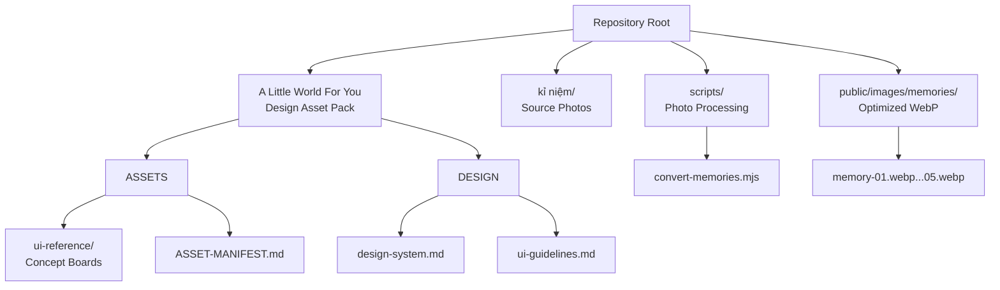
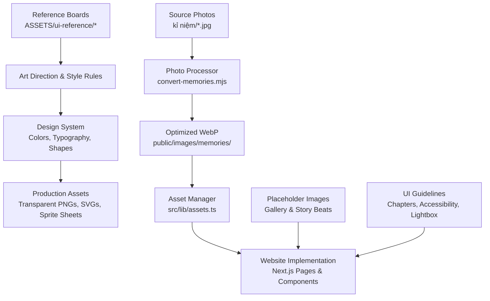
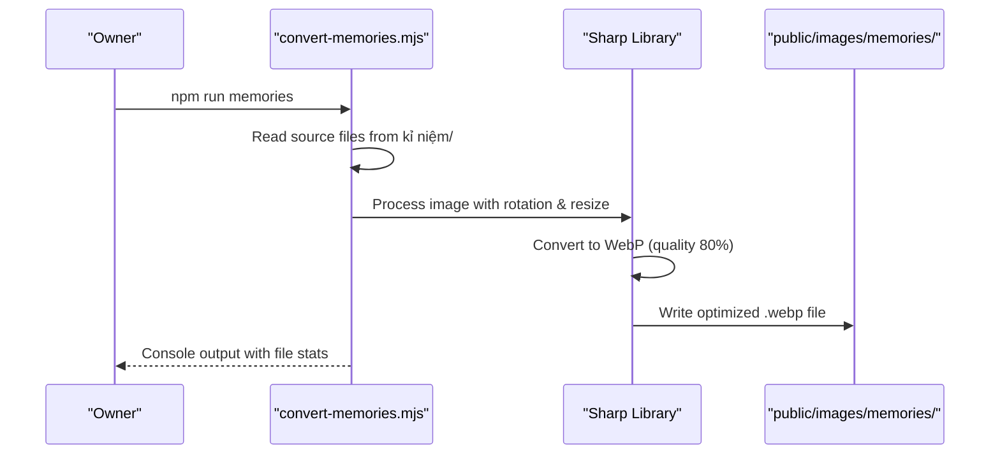
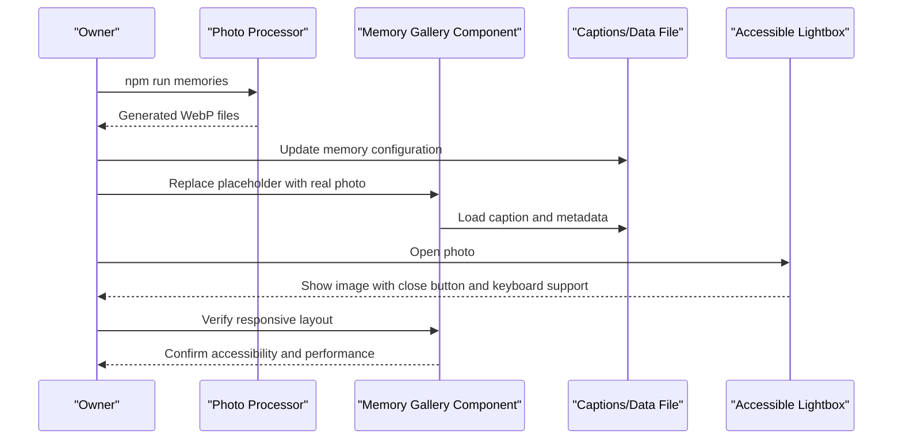
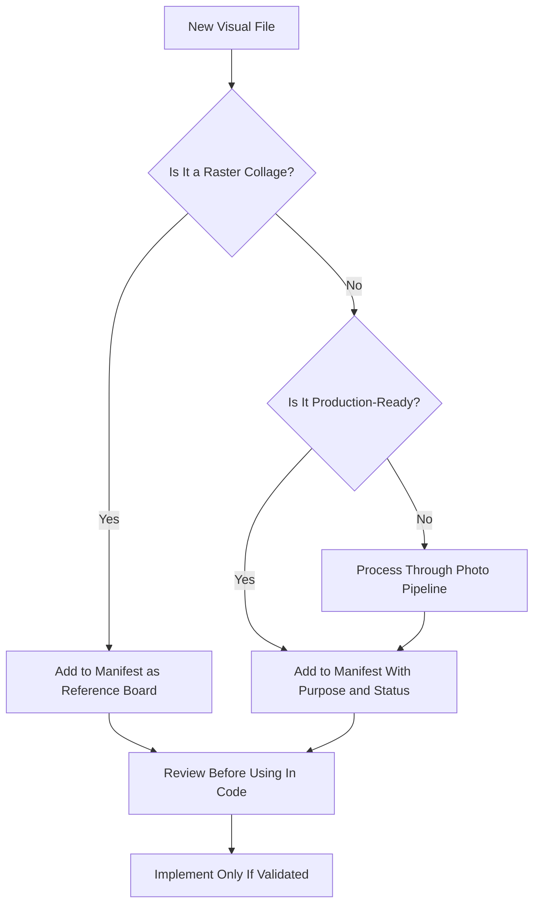
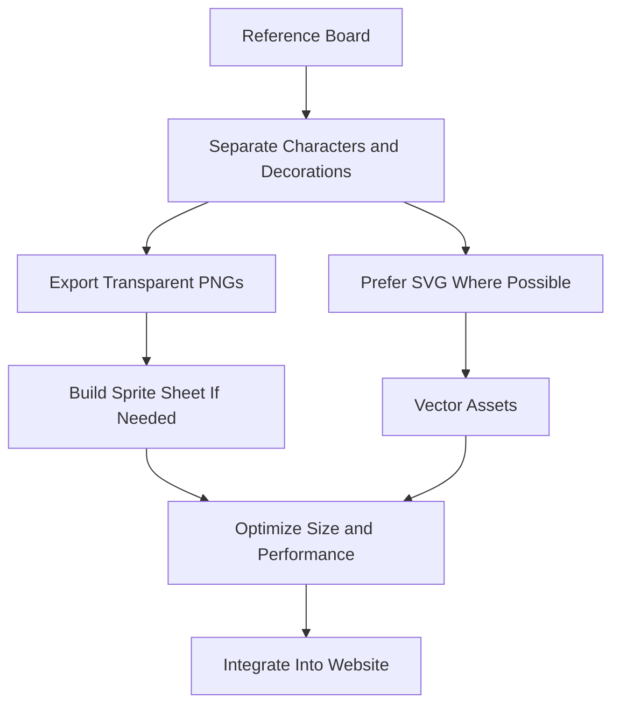
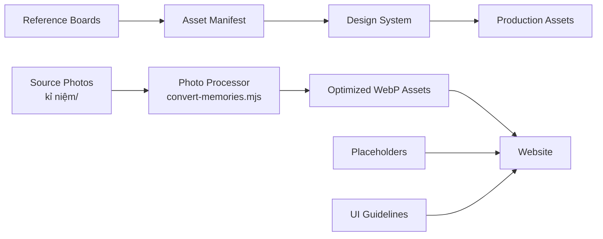

# Asset Management and References

<cite>
**Referenced Files in This Document**
- [README.md](file://A-Little-World-For-You-Design-Asset-Pack/README.md)
- [ASSET-MANIFEST.md](file://A-Little-World-For-You-Design-Asset-Pack/ASSETS/ASSET-MANIFEST.md)
- [convert-memories.mjs](file://scripts/convert-memories.mjs)
- [assets.ts](file://src/lib/assets.ts)
- [memories.ts](file://src/data/memories.ts)
- [MemoryGallery.tsx](file://src/components/memories/MemoryGallery.tsx)
- [MemoryLightbox.tsx](file://src/components/memories/MemoryLightbox.tsx)
- [package.json](file://package.json)
</cite>

## Update Summary
**Changes Made**
- Added comprehensive photo processing pipeline with WebP conversion script
- Updated asset directory structure for organized image management
- Integrated optimized delivery pipeline with Next.js Image optimization
- Enhanced asset manifest to include real memory photos workflow
- Added detailed guidance on photo processing and optimization

## Table of Contents
1. [Introduction](#introduction)
2. [Project Structure](#project-structure)
3. [Core Components](#core-components)
4. [Architecture Overview](#architecture-overview)
5. [Photo Processing Pipeline](#photo-processing-pipeline)
6. [Detailed Component Analysis](#detailed-component-analysis)
7. [Dependency Analysis](#dependency-analysis)
8. [Performance Considerations](#performance-considerations)
9. [Troubleshooting Guide](#troubleshooting-guide)
10. [Conclusion](#conclusion)

## Introduction
This document explains how to manage visual references, concept boards, and production assets for the romantic website "A Little World For You." It clarifies the difference between concept boards/moodboards and production-ready assets, defines a safe workflow for replacing placeholder content with real photographs and illustrations, and provides guidance on asset naming, transparency, sprite sheets, optimized formats, and copyright/licensing considerations.

The project now includes a comprehensive asset management system with automated photo processing, organized directory structures, and an optimized delivery pipeline that converts real memories to WebP format for optimal performance.

## Project Structure
The design asset pack organizes reference materials, design rules, and story content separately from implementation code. The relevant folders for asset management are:

- `ASSETS/ui-reference/`: Concept boards and moodboards used as visual direction only.
- `ASSETS/ASSET-MANIFEST.md`: A manifest describing each reference file and its production status.
- `DESIGN/design-system.md`: Color tokens, typography, shape language, layout, and UI rules that guide asset creation.
- `DESIGN/ui-guidelines.md`: Chapter-by-chapter UX expectations, including where placeholders should be used and how real images should integrate later.
- `kỉ niệm/`: Source directory for owner-supplied real photographs (original high-resolution files).
- `public/images/memories/`: Optimized WebP output directory for processed memory photos.
- `scripts/convert-memories.mjs`: Automated photo processing script for converting source images to WebP format.
- `src/lib/assets.ts`: Centralized asset path management and URL generation.
- `src/data/memories.ts`: Memory data configuration with optimized image sources.

**Diagram sources**
- [README.md:12-20](file://A-Little-World-For-You-Design-Asset-Pack/README.md#L12-L20)
- [ASSET-MANIFEST.md:1-12](file://A-Little-World-For-You-Design-Asset-Pack/ASSETS/ASSET-MANIFEST.md#L1-L12)
- [convert-memories.mjs:16-18](file://scripts/convert-memories.mjs#L16-L18)

**Section sources**
- [README.md:12-20](file://A-Little-World-For-You-Design-Asset-Pack/README.md#L12-L20)
- [ASSET-MANIFEST.md:1-12](file://A-Little-World-For-You-Design-Asset-Pack/ASSETS/ASSET-MANIFEST.md#L1-L12)

## Core Components
This section summarizes the key asset-related components and their responsibilities.

- Concept boards and moodboards
  - Located under `ASSETS/ui-reference/`.
  - Provide overall art direction, character style, color palette, background ideas, and UI inspiration.
  - Are raster collages and must not be used directly as website backgrounds or sliced arbitrarily into production assets.

- Photo processing pipeline
  - Automated script (`scripts/convert-memories.mjs`) that converts high-resolution source photos to optimized WebP format.
  - Processes images from `kỉ niệm/` directory to `public/images/memories/` with metadata stripping and size optimization.
  - Uses Sharp library for professional-grade image processing with EXIF rotation correction.

- Asset path management
  - Centralized in `src/lib/assets.ts` providing consistent URL generation for all assets.
  - Supports multiple asset types: memories, illustrations, flowers, decorations, letters, and audio.
  - Generates optimized WebP URLs automatically through the `memorySrc()` function.

- Memory data configuration
  - Defined in `src/data/memories.ts` with structured metadata for each photograph.
  - Includes alt text descriptions, captions, rotation angles, and featured status.
  - Integrates seamlessly with the asset path management system.

**Section sources**
- [README.md:19-23](file://A-Little-World-For-You-Design-Asset-Pack/README.md#L19-L23)
- [ASSET-MANIFEST.md:1-12](file://A-Little-World-For-You-Design-Asset-Pack/ASSETS/ASSET-MANIFEST.md#L1-L12)
- [convert-memories.mjs:1-42](file://scripts/convert-memories.mjs#L1-L42)
- [assets.ts:1-25](file://src/lib/assets.ts#L1-L25)
- [memories.ts:1-59](file://src/data/memories.ts#L1-L59)

## Architecture Overview
The asset architecture separates reference material from production assets and ties both to the design system and UI guidelines, with an integrated photo processing pipeline for optimal performance.

**Diagram sources**
- [README.md:19-30](file://A-Little-World-For-You-Design-Asset-Pack/README.md#L19-L30)
- [ASSET-MANIFEST.md:1-12](file://A-Little-World-For-You-Design-Asset-Pack/ASSETS/ASSET-MANIFEST.md#L1-L12)
- [convert-memories.mjs:16-41](file://scripts/convert-memories.mjs#L16-L41)
- [assets.ts:8-17](file://src/lib/assets.ts#L8-L17)

## Photo Processing Pipeline
The project includes a sophisticated photo processing pipeline that transforms high-resolution source photographs into web-optimized WebP format.

### Source Image Management
Original photographs are stored in the `kỉ niệm/` directory with their original filenames (typically hash-like names from social media platforms). These files are typically ~2000px night shots that are far heavier than what the gallery needs.

### Automated Conversion Process
The `scripts/convert-memories.mjs` script handles the complete conversion process:

1. **Input Processing**: Reads source images from `kỉ niệm/` directory
2. **EXIF Correction**: Automatically rotates images based on EXIF orientation data
3. **Size Optimization**: Resizes to maximum 1200px long edge while maintaining aspect ratio
4. **Format Conversion**: Converts to WebP format with quality setting of 80%
5. **Metadata Stripping**: Removes EXIF/GPS metadata for privacy and performance
6. **Output Generation**: Saves optimized files as `memory-01.webp` through `memory-05.webp`

### Execution and Integration
The processing pipeline is executed via `npm run memories` command, which runs the Node.js script using the Sharp library for professional-grade image processing. The script is idempotent, meaning it can be safely re-run without issues.

**Diagram sources**
- [convert-memories.mjs:1-42](file://scripts/convert-memories.mjs#L1-L42)
- [package.json:10-11](file://package.json#L10-L11)

**Section sources**
- [convert-memories.mjs:1-42](file://scripts/convert-memories.mjs#L1-L42)
- [package.json:10-11](file://package.json#L10-L11)

## Detailed Component Analysis

### Concept Boards vs Production-Ready Assets
Concept boards and moodboards are high-level visual references. They communicate:
- Overall watercolor style
- Character appearance and consistency
- Background atmosphere
- UI tone and composition

They are not:
- Separated layer files
- Transparent PNG characters
- Sprite sheets
- Optimized production images

The correct approach is to use them as inspiration while creating individual assets that match the design system and can be safely embedded in the website.

**Diagram sources**
- [README.md:19-23](file://A-Little-World-For-You-Design-Asset-Pack/README.md#L19-L23)
- [ASSET-MANIFEST.md:1-12](file://A-Little-World-For-You-Design-Asset-Pack/ASSETS/ASSET-MANIFEST.md#L1-L12)

**Section sources**
- [README.md:19-23](file://A-Little-World-For-You-Design-Asset-Pack/README.md#L19-L23)
- [ASSET-MANIFEST.md:1-12](file://A-Little-World-For-You-Design-Asset-Pack/ASSETS/ASSET-MANIFEST.md#L1-L12)

### Workflow for Replacing Placeholder Content With Real Photographs
The UI guidelines define a placeholder gallery for memories. When real photos are available, follow this enhanced workflow:

1. **Prepare source photographs** in the `kỉ niệm/` directory with original filenames.
2. **Run the processing pipeline** using `npm run memories` to convert to WebP format.
3. **Verify generated files** in `public/images/memories/` directory.
4. **Update memory data** in `src/data/memories.ts` if adding new photos.
5. **Replace placeholder images** with the real photographs through the centralized asset manager.
6. **Ensure captions and metadata** remain editable through the data file.
7. **Verify lightbox behavior**, keyboard support, and accessibility attributes.
8. **Test at multiple screen sizes** and confirm reduced-motion compatibility.

**Diagram sources**
- [convert-memories.mjs:1-42](file://scripts/convert-memories.mjs#L1-L42)
- [memories.ts:1-59](file://src/data/memories.ts#L1-L59)
- [MemoryGallery.tsx:17-119](file://src/components/memories/MemoryGallery.tsx#L17-L119)

**Section sources**
- [convert-memories.mjs:1-42](file://scripts/convert-memories.mjs#L1-L42)
- [memories.ts:1-59](file://src/data/memories.ts#L1-L59)
- [MemoryGallery.tsx:17-119](file://src/components/memories/MemoryGallery.tsx#L17-L119)

### Asset Manifest Structure and Naming Conventions
The asset manifest documents each reference file, its purpose, and whether it is production-ready. For consistency:

- Keep the manifest updated whenever new reference files are added.
- Use descriptive filenames that indicate role and order.
- Mark non-separable boards as "Reference board" rather than production assets.
- Treat any raster collage as inspiration, not as a final asset.
- Include source image paths and processed output specifications.

Current manifest entries include:
- Master watercolor moodboard for overall art direction.
- Character and story design board for character, background, UI, and story reference.
- Five real couple photos in `kỉ niệm/` folder marked as owner-supplied, usable after WebP conversion.

**Diagram sources**
- [ASSET-MANIFEST.md:1-12](file://A-Little-World-For-You-Design-Asset-Pack/ASSETS/ASSET-MANIFEST.md#L1-L12)

**Section sources**
- [ASSET-MANIFEST.md:1-12](file://A-Little-World-For-You-Design-Asset-Pack/ASSETS/ASSET-MANIFEST.md#L1-L12)

### Creating Transparent PNG Characters, Sprite Sheets, and Optimized Image Formats
Because the concept boards are not pre-separated layers, transparent PNG characters and sprite sheets must be created separately. Follow these principles:

- Transparent PNG characters
  - Export one character per file.
  - Preserve consistent proportions and watercolor style.
  - Avoid embedding background unless it is part of the intended scene.
  - Keep alpha edges clean to avoid harsh pixel borders.

- Sprite sheets
  - Group related small icons or decorative elements.
  - Maintain consistent spacing and alignment.
  - Prefer CSS/SVG/DOM animations where possible instead of heavy raster sprites.

- Optimized image formats
  - Use lightweight vector graphics (SVG) for scalable decorations.
  - Compress raster images appropriately.
  - Avoid large full-screen raster backgrounds; prefer CSS gradients, subtle textures, or vector scenes.
  - Utilize WebP format for photographs with automatic optimization through the processing pipeline.

These practices align with the design system's emphasis on gentle watercolor aesthetics, readable layouts, and restrained decoration.

**Diagram sources**
- [README.md:19-23](file://A-Little-World-For-You-Design-Asset-Pack/README.md#L19-L23)
- [ASSET-MANIFEST.md:1-12](file://A-Little-World-For-You-Design-Asset-Pack/ASSETS/ASSET-MANIFEST.md#L1-L12)

**Section sources**
- [README.md:19-23](file://A-Little-World-For-You-Design-Asset-Pack/README.md#L19-L23)
- [ASSET-MANIFEST.md:1-12](file://A-Little-World-For-You-Design-Asset-Pack/ASSETS/ASSET-MANIFEST.md#L1-L12)

### Copyright Considerations and Licensing Requirements
When using third-party visual assets in the romantic website:

- Confirm licensing terms before importing any external illustration, font, texture, or stock photo.
- Attribute assets if required by the license.
- Avoid using copyrighted artwork without permission.
- Prefer assets that allow modification and commercial or personal use according to your project needs.
- Keep records of licenses and attribution in a dedicated location alongside the asset manifest.
- Remember that concept boards are reference material only; do not assume they grant rights to reuse their contents.
- Be aware of privacy considerations when processing real photographs, especially regarding visible identification information.

This guidance supports ethical and legal use of visuals while preserving the intimate, sincere tone of the project.

[No sources needed since this section provides general compliance guidance]

## Dependency Analysis
The asset pipeline depends on clear separation between reference material and production assets, guided by the design system and UI guidelines, with integrated photo processing capabilities.

**Diagram sources**
- [ASSET-MANIFEST.md:1-12](file://A-Little-World-For-You-Design-Asset-Pack/ASSETS/ASSET-MANIFEST.md#L1-L12)
- [convert-memories.mjs:16-41](file://scripts/convert-memories.mjs#L16-L41)

**Section sources**
- [ASSET-MANIFEST.md:1-12](file://A-Little-World-For-You-Design-Asset-Pack/ASSETS/ASSET-MANIFEST.md#L1-L12)
- [convert-memories.mjs:16-41](file://scripts/convert-memories.mjs#L16-L41)

## Performance Considerations
- Avoid using full-size moodboards as website backgrounds.
- Prefer CSS, SVG, and lightweight DOM animations over heavy raster assets.
- Use the automated photo processing pipeline to convert source images to WebP format for optimal performance.
- Keep gallery images optimized and lazy-load where appropriate.
- Respect reduced-motion preferences and ensure animations do not block reading.
- Maintain readable text contrast and avoid overly saturated colors for long body copy.
- Leverage Next.js Image component for automatic optimization and responsive image serving.
- Strip metadata from processed images to reduce file size and protect privacy.

[No sources needed since this section provides general guidance]

## Troubleshooting Guide
Common issues and resolutions:

- Using a moodboard as a background
  - Symptom: Heavy page load, inconsistent scaling, loss of detail.
  - Resolution: Replace with a scene built from the design system or an optimized background asset.

- Slicing a concept board into characters
  - Symptom: Poor edge quality, inconsistent style, broken layout.
  - Resolution: Create separate transparent PNGs or SVGs aligned with the design system.

- Missing captions or inaccessible lightbox
  - Symptom: Users cannot navigate or understand gallery images.
  - Resolution: Update captions via the data file and verify keyboard support and alt text.

- Placeholder images still present after update
  - Symptom: Old images appear in the gallery.
  - Resolution: Run `npm run memories` to process source images and replace placeholders with optimized WebP files.

- Photo processing script errors
  - Symptom: WebP files not generated or incorrect file paths.
  - Resolution: Verify source images exist in `kỉ niệm/` directory and check script permissions.

- Performance issues with large images
  - Symptom: Slow loading times, poor mobile experience.
  - Resolution: Ensure all images go through the WebP conversion pipeline and use appropriate sizing.

**Section sources**
- [convert-memories.mjs:1-42](file://scripts/convert-memories.mjs#L1-L42)
- [memories.ts:1-59](file://src/data/memories.ts#L1-L59)

## Conclusion
Effective asset management for this project requires treating concept boards as inspiration, not production assets. The new comprehensive asset management system with automated photo processing, organized directory structure, and optimized delivery pipeline ensures that real photographs are efficiently converted to WebP format while maintaining visual quality and performance. Use the asset manifest to track references, follow the design system for visual consistency, replace placeholders with real photographs responsibly through the processing pipeline, and ensure all assets are optimized, accessible, and properly licensed. This approach keeps the romantic, heartfelt experience smooth, respectful, and technically sound while providing a streamlined workflow for managing both conceptual and production assets.

[No sources needed since this section summarizes without analyzing specific files]