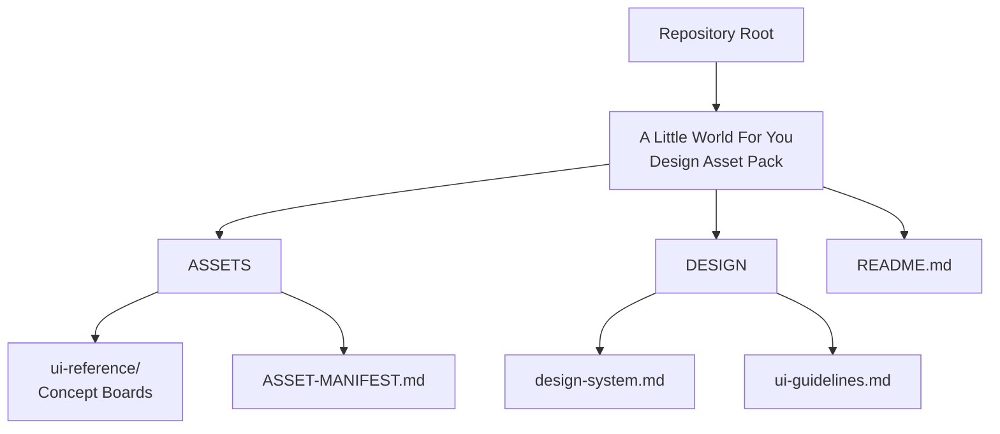
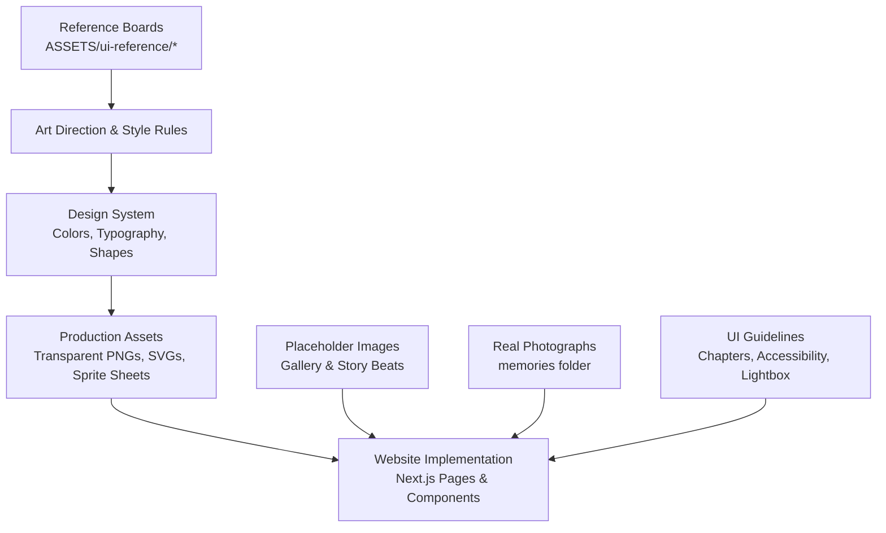
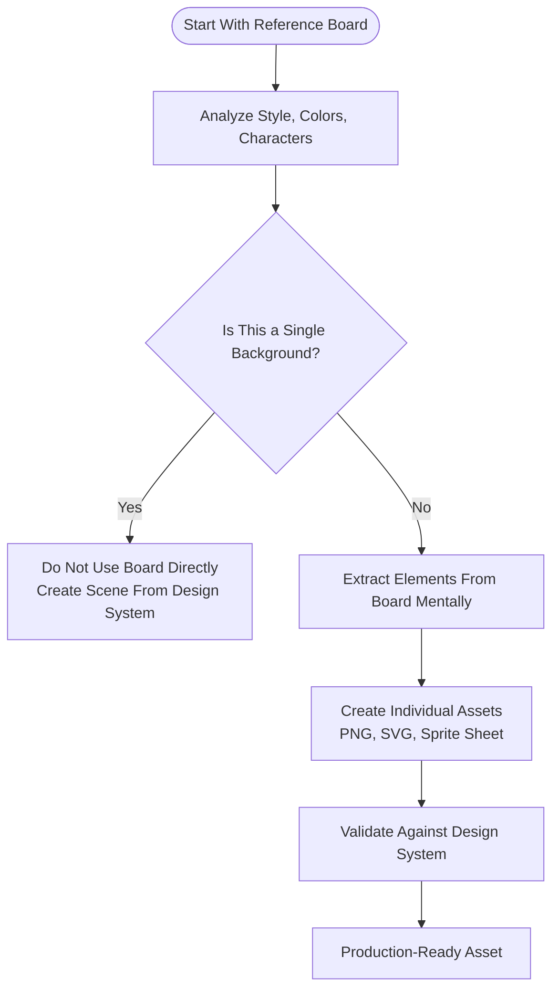
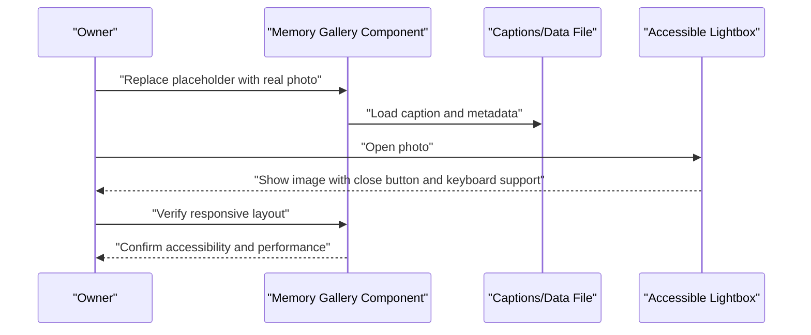
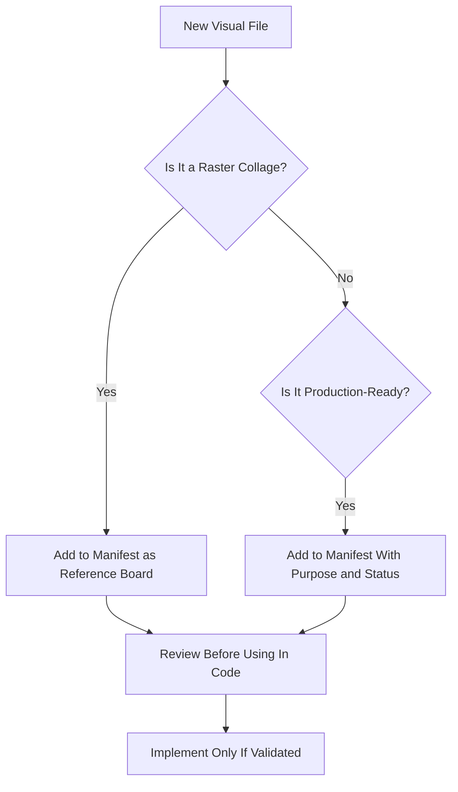
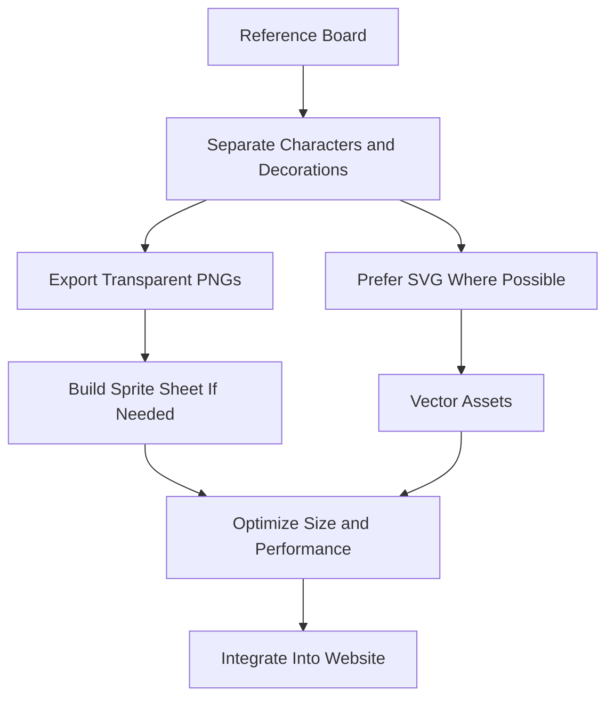
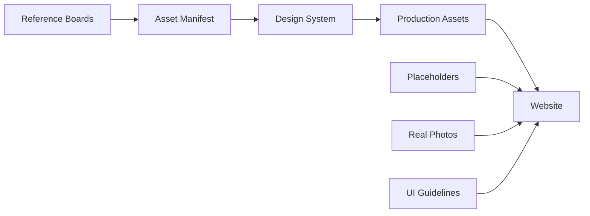

# Asset Management and References

<cite>
**Referenced Files in This Document**
- [README.md](file://A-Little-World-For-You-Design-Asset-Pack/README.md)
- [ASSET-MANIFEST.md](file://A-Little-World-For-You-Design-Asset-Pack/ASSETS/ASSET-MANIFEST.md)
- [design-system.md](file://A-Little-World-For-You-Design-Asset-Pack/DESIGN/design-system.md)
- [ui-guidelines.md](file://A-Little-World-For-You-Design-Asset-Pack/DESIGN/ui-guidelines.md)
</cite>

## Table of Contents
1. [Introduction](#introduction)
2. [Project Structure](#project-structure)
3. [Core Components](#core-components)
4. [Architecture Overview](#architecture-overview)
5. [Detailed Component Analysis](#detailed-component-analysis)
6. [Dependency Analysis](#dependency-analysis)
7. [Performance Considerations](#performance-considerations)
8. [Troubleshooting Guide](#troubleshooting-guide)
9. [Conclusion](#conclusion)

## Introduction
This document explains how to manage visual references, concept boards, and production assets for the romantic website “A Little World For You.” It clarifies the difference between concept boards/moodboards and production-ready assets, defines a safe workflow for replacing placeholder content with real photographs and illustrations, and provides guidance on asset naming, transparency, sprite sheets, optimized formats, and copyright/licensing considerations.

The goal is to keep the project visually consistent, performant, accessible, and legally compliant while allowing easy updates when real photos become available.

## Project Structure
The design asset pack organizes reference materials, design rules, and story content separately from implementation code. The relevant folders for asset management are:

- `ASSETS/ui-reference/`: Concept boards and moodboards used as visual direction only.
- `ASSETS/ASSET-MANIFEST.md`: A manifest describing each reference file and its production status.
- `DESIGN/design-system.md`: Color tokens, typography, shape language, layout, and UI rules that guide asset creation.
- `DESIGN/ui-guidelines.md`: Chapter-by-chapter UX expectations, including where placeholders should be used and how real images should integrate later.
- `README.md`: High-level usage notes, style summary, and instructions for swapping placeholder images into the Next.js repository.

**Diagram sources**
- [README.md:12-20](file://A-Little-World-For-You-Design-Asset-Pack/README.md#L12-L20)
- [ASSET-MANIFEST.md:1-9](file://A-Little-World-For-You-Design-Asset-Pack/ASSETS/ASSET-MANIFEST.md#L1-L9)
- [design-system.md:1-49](file://A-Little-World-For-You-Design-Asset-Pack/DESIGN/design-system.md#L1-L49)
- [ui-guidelines.md:1-56](file://A-Little-World-For-You-Design-Asset-Pack/DESIGN/ui-guidelines.md#L1-L56)

**Section sources**
- [README.md:12-20](file://A-Little-World-For-You-Design-Asset-Pack/README.md#L12-L20)
- [ASSET-MANIFEST.md:1-9](file://A-Little-World-For-You-Design-Asset-Pack/ASSETS/ASSET-MANIFEST.md#L1-L9)

## Core Components
This section summarizes the key asset-related components and their responsibilities.

- Concept boards and moodboards
  - Located under `ASSETS/ui-reference/`.
  - Provide overall art direction, character style, color palette, background ideas, and UI inspiration.
  - Are raster collages and must not be used directly as website backgrounds or sliced arbitrarily into production assets.

- Asset manifest
  - Defined in `ASSET-MANIFEST.md`.
  - Lists each reference file, its purpose, and its production status.
  - Clarifies that boards are reference-only and animation/production assets should be built using DOM/SVG/CSS or created as separate consistent assets later.

- Design system
  - Defines color tokens, typography, shape language, layout constraints, and UI rules.
  - Guides how new assets should look and behave so they remain consistent with the watercolor, scrapbook-inspired aesthetic.

- UI guidelines
  - Describe chapter flows, interaction patterns, accessibility requirements, and where placeholders should live until real photos are ready.
  - Specify that placeholder images should be replaced with actual photographs in the Next.js repository’s image directory when available.

**Section sources**
- [README.md:19-23](file://A-Little-World-For-You-Design-Asset-Pack/README.md#L19-L23)
- [ASSET-MANIFEST.md:1-9](file://A-Little-World-For-You-Design-Asset-Pack/ASSETS/ASSET-MANIFEST.md#L1-L9)
- [design-system.md:1-49](file://A-Little-World-For-You-Design-Asset-Pack/DESIGN/design-system.md#L1-L49)
- [ui-guidelines.md:28-34](file://A-Little-World-For-You-Design-Asset-Pack/DESIGN/ui-guidelines.md#L28-L34)

## Architecture Overview
The asset architecture separates reference material from production assets and ties both to the design system and UI guidelines.

**Diagram sources**
- [README.md:19-30](file://A-Little-World-For-You-Design-Asset-Pack/README.md#L19-L30)
- [ASSET-MANIFEST.md:1-9](file://A-Little-World-For-You-Design-Asset-Pack/ASSETS/ASSET-MANIFEST.md#L1-L9)
- [design-system.md:1-49](file://A-Little-World-For-You-Design-Asset-Pack/DESIGN/design-system.md#L1-L49)
- [ui-guidelines.md:28-56](file://A-Little-World-For-You-Design-Asset-Pack/DESIGN/ui-guidelines.md#L28-L56)

## Detailed Component Analysis

### Concept Boards vs Production-Ready Assets
Concept boards and moodboards are high-level visual references. They communicate:
- Overall watercolor style
- Character appearance and consistency
- Background atmosphere
- UI tone and composition

They are not:
- Separated layer files
- Transparent PNG characters
- Sprite sheets
- Optimized production images

The correct approach is to use them as inspiration while creating individual assets that match the design system and can be safely embedded in the website.

**Diagram sources**
- [README.md:19-23](file://A-Little-World-For-You-Design-Asset-Pack/README.md#L19-L23)
- [ASSET-MANIFEST.md:1-9](file://A-Little-World-For-You-Design-Asset-Pack/ASSETS/ASSET-MANIFEST.md#L1-L9)
- [design-system.md:1-49](file://A-Little-World-For-You-Design-Asset-Pack/DESIGN/design-system.md#L1-L49)

**Section sources**
- [README.md:19-23](file://A-Little-World-For-You-Design-Asset-Pack/README.md#L19-L23)
- [ASSET-MANIFEST.md:1-9](file://A-Little-World-For-You-Design-Asset-Pack/ASSETS/ASSET-MANIFEST.md#L1-L9)

### Workflow for Replacing Placeholder Content With Real Photographs
The UI guidelines define a placeholder gallery for memories. When real photos are available, follow this workflow:

1. Prepare real photographs in the Next.js repository’s image directory.
2. Replace placeholder images with the real photographs.
3. Ensure captions and metadata remain editable through the data file.
4. Verify lightbox behavior, keyboard support, and accessibility attributes.
5. Test at multiple screen sizes and confirm reduced-motion compatibility.

**Diagram sources**
- [ui-guidelines.md:28-34](file://A-Little-World-For-You-Design-Asset-Pack/DESIGN/ui-guidelines.md#L28-L34)
- [ui-guidelines.md:48-56](file://A-Little-World-For-You-Design-Asset-Pack/DESIGN/ui-guidelines.md#L48-L56)
- [README.md:24-30](file://A-Little-World-For-You-Design-Asset-Pack/README.md#L24-L30)

**Section sources**
- [ui-guidelines.md:28-34](file://A-Little-World-For-You-Design-Asset-Pack/DESIGN/ui-guidelines.md#L28-L34)
- [ui-guidelines.md:48-56](file://A-Little-World-For-You-Design-Asset-Pack/DESIGN/ui-guidelines.md#L48-L56)
- [README.md:24-30](file://A-Little-World-For-You-Design-Asset-Pack/README.md#L24-L30)

### Asset Manifest Structure and Naming Conventions
The asset manifest documents each reference file, its purpose, and whether it is production-ready. For consistency:

- Keep the manifest updated whenever new reference files are added.
- Use descriptive filenames that indicate role and order.
- Mark non-separable boards as “Reference board” rather than production assets.
- Treat any raster collage as inspiration, not as a final asset.

Current manifest entries include:
- Master watercolor moodboard for overall art direction.
- Character and story design board for character, background, UI, and story reference.

**Diagram sources**
- [ASSET-MANIFEST.md:1-9](file://A-Little-World-For-You-Design-Asset-Pack/ASSETS/ASSET-MANIFEST.md#L1-L9)

**Section sources**
- [ASSET-MANIFEST.md:1-9](file://A-Little-World-For-You-Design-Asset-Pack/ASSETS/ASSET-MANIFEST.md#L1-L9)

### Creating Transparent PNG Characters, Sprite Sheets, and Optimized Image Formats
Because the concept boards are not pre-separated layers, transparent PNG characters and sprite sheets must be created separately. Follow these principles:

- Transparent PNG characters
  - Export one character per file.
  - Preserve consistent proportions and watercolor style.
  - Avoid embedding background unless it is part of the intended scene.
  - Keep alpha edges clean to avoid harsh pixel borders.

- Sprite sheets
  - Group related small icons or decorative elements.
  - Maintain consistent spacing and alignment.
  - Prefer CSS/SVG/DOM animations where possible instead of heavy raster sprites.

- Optimized image formats
  - Use lightweight vector graphics (SVG) for scalable decorations.
  - Compress raster images appropriately.
  - Avoid large full-screen raster backgrounds; prefer CSS gradients, subtle textures, or vector scenes.

These practices align with the design system’s emphasis on gentle watercolor aesthetics, readable layouts, and restrained decoration.

**Diagram sources**
- [README.md:19-23](file://A-Little-World-For-You-Design-Asset-Pack/README.md#L19-L23)
- [ASSET-MANIFEST.md:1-9](file://A-Little-World-For-You-Design-Asset-Pack/ASSETS/ASSET-MANIFEST.md#L1-L9)
- [design-system.md:1-49](file://A-Little-World-For-You-Design-Asset-Pack/DESIGN/design-system.md#L1-L49)

**Section sources**
- [README.md:19-23](file://A-Little-World-For-You-Design-Asset-Pack/README.md#L19-L23)
- [ASSET-MANIFEST.md:1-9](file://A-Little-World-For-You-Design-Asset-Pack/ASSETS/ASSET-MANIFEST.md#L1-L9)
- [design-system.md:1-49](file://A-Little-World-For-You-Design-Asset-Pack/DESIGN/design-system.md#L1-L49)

### Copyright Considerations and Licensing Requirements
When using third-party visual assets in the romantic website:

- Confirm licensing terms before importing any external illustration, font, texture, or stock photo.
- Attribute assets if required by the license.
- Avoid using copyrighted artwork without permission.
- Prefer assets that allow modification and commercial or personal use according to your project needs.
- Keep records of licenses and attribution in a dedicated location alongside the asset manifest.
- Remember that concept boards are reference material only; do not assume they grant rights to reuse their contents.

This guidance supports ethical and legal use of visuals while preserving the intimate, sincere tone of the project.

[No sources needed since this section provides general compliance guidance]

## Dependency Analysis
The asset pipeline depends on clear separation between reference material and production assets, guided by the design system and UI guidelines.

**Diagram sources**
- [ASSET-MANIFEST.md:1-9](file://A-Little-World-For-You-Design-Asset-Pack/ASSETS/ASSET-MANIFEST.md#L1-L9)
- [design-system.md:1-49](file://A-Little-World-For-You-Design-Asset-Pack/DESIGN/design-system.md#L1-L49)
- [ui-guidelines.md:28-56](file://A-Little-World-For-You-Design-Asset-Pack/DESIGN/ui-guidelines.md#L28-L56)

**Section sources**
- [ASSET-MANIFEST.md:1-9](file://A-Little-World-For-You-Design-Asset-Pack/ASSETS/ASSET-MANIFEST.md#L1-L9)
- [design-system.md:1-49](file://A-Little-World-For-You-Design-Asset-Pack/DESIGN/design-system.md#L1-L49)
- [ui-guidelines.md:28-56](file://A-Little-World-For-You-Design-Asset-Pack/DESIGN/ui-guidelines.md#L28-L56)

## Performance Considerations
- Avoid using full-size moodboards as website backgrounds.
- Prefer CSS, SVG, and lightweight DOM animations over heavy raster assets.
- Keep gallery images optimized and lazy-load where appropriate.
- Respect reduced-motion preferences and ensure animations do not block reading.
- Maintain readable text contrast and avoid overly saturated colors for long body copy.

[No sources needed since this section provides general guidance]

## Troubleshooting Guide
Common issues and resolutions:

- Using a moodboard as a background
  - Symptom: Heavy page load, inconsistent scaling, loss of detail.
  - Resolution: Replace with a scene built from the design system or an optimized background asset.

- Slicing a concept board into characters
  - Symptom: Poor edge quality, inconsistent style, broken layout.
  - Resolution: Create separate transparent PNGs or SVGs aligned with the design system.

- Missing captions or inaccessible lightbox
  - Symptom: Users cannot navigate or understand gallery images.
  - Resolution: Update captions via the data file and verify keyboard support and alt text.

- Placeholder images still present after update
  - Symptom: Old images appear in the gallery.
  - Resolution: Replace placeholders with real photographs in the designated image directory and rebuild.

**Section sources**
- [README.md:19-30](file://A-Little-World-For-You-Design-Asset-Pack/README.md#L19-L30)
- [ui-guidelines.md:28-56](file://A-Little-World-For-You-Design-Asset-Pack/DESIGN/ui-guidelines.md#L28-L56)

## Conclusion
Effective asset management for this project requires treating concept boards as inspiration, not production assets. Use the asset manifest to track references, follow the design system for visual consistency, replace placeholders with real photographs responsibly, and ensure all assets are optimized, accessible, and properly licensed. This approach keeps the romantic, heartfelt experience smooth, respectful, and technically sound.

[No sources needed since this section summarizes without analyzing specific files]