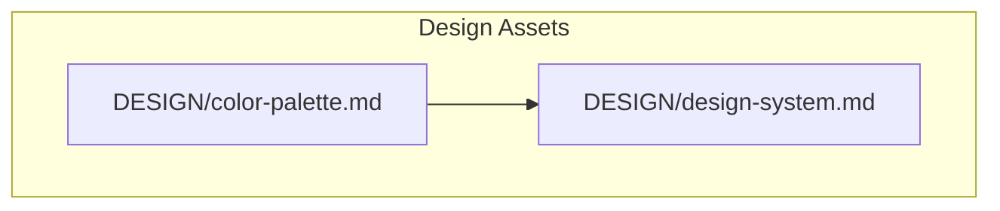
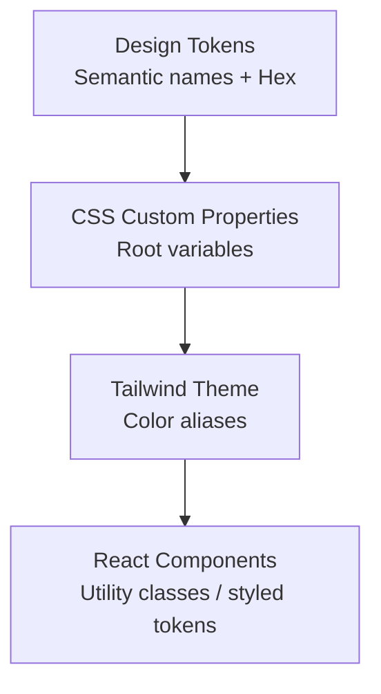
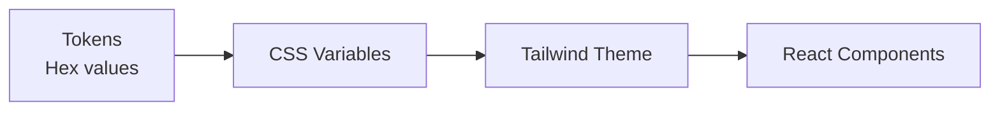

# Color Palette & Tokens

<cite>
**Referenced Files in This Document**
- [color-palette.md](file://A-Little-World-For-You-Design-Asset-Pack/DESIGN/color-palette.md)
- [design-system.md](file://A-Little-World-For-You-Design-Asset-Pack/DESIGN/design-system.md)
</cite>

## Table of Contents
1. [Introduction](#introduction)
2. [Project Structure](#project-structure)
3. [Core Components](#core-components)
4. [Architecture Overview](#architecture-overview)
5. [Detailed Component Analysis](#detailed-component-analysis)
6. [Dependency Analysis](#dependency-analysis)
7. [Performance Considerations](#performance-considerations)
8. [Troubleshooting Guide](#troubleshooting-guide)
9. [Conclusion](#conclusion)

## Introduction
This document defines the watercolor-inspired color palette and tokens for a warm, romantic design system. It explains semantic meanings, usage contexts, and practical implementation guidance for CSS custom properties and Tailwind configuration. It also provides examples of applying tokens in React components while maintaining accessible contrast ratios, plus state variations and responsive considerations.

## Project Structure
The color system is defined within the design assets:
- A concise palette with hex values and balance guidance.
- A token table mapping semantic names to hex values and usage.

**Diagram sources**
- [color-palette.md:1-22](file://A-Little-World-For-You-Design-Asset-Pack/DESIGN/color-palette.md#L1-L22)
- [design-system.md:1-49](file://A-Little-World-For-You-Design-Asset-Pack/DESIGN/design-system.md#L1-L49)

**Section sources**
- [color-palette.md:1-22](file://A-Little-World-For-You-Design-Asset-Pack/DESIGN/color-palette.md#L1-L22)
- [design-system.md:1-49](file://A-Little-World-For-You-Design-Asset-Pack/DESIGN/design-system.md#L1-L49)

## Core Components
The palette centers on a warm ivory/paper background with soft blush, rose, peach, sky blue, and sage accents, grounded by ink and muted text colors. The suggested distribution emphasizes cream/paper as the dominant tone, with smaller proportions for accent hues to create visual rhythm without overwhelming the interface.

Key principles:
- Warm, romantic, watercolor feel.
- Avoid loud saturated pink; prefer gentle tints.
- Alternate backgrounds (paper, pale sky, botanical tones) to maintain rhythm.
- Keep body text readable; avoid pale pink for long paragraphs.

**Section sources**
- [color-palette.md:1-22](file://A-Little-World-For-You-Design-Asset-Pack/DESIGN/color-palette.md#L1-L22)
- [design-system.md:6-20](file://A-Little-World-For-You-Design-Asset-Pack/DESIGN/design-system.md#L6-L20)

## Architecture Overview
The color system flows from design tokens into application styles:
- Design tokens define semantic names and hex values.
- CSS custom properties expose tokens at the root level.
- Tailwind configuration maps theme utilities to those tokens.
- React components consume tokens via CSS classes or inline style references.

[No sources needed since this diagram shows conceptual workflow, not actual code structure]

## Detailed Component Analysis

### Watercolor-Inspired Colors and Tokens
Below are the core tokens, their hex values, and intended usage. These come directly from the design documentation.

| Token | Hex | Semantic Meaning | Usage Context |
|---|---|---|---|
| `--color-cream` | `#FFF9F2` | Main page background | Base canvas for pages and sections |
| `--color-paper` | `#FFFDF9` | Paper surface | Letter/card surfaces, content panels |
| `--color-blush` | `#F7DCE2` | Soft section tint | Backgrounds for gentle sections |
| `--color-rose` | `#D98FA0` | Primary accent | Buttons, highlights, decorative elements |
| `--color-rose-deep` | `#A85F72` | Text/accent on light surfaces | Headings, emphasis text, icons |
| `--color-peach` | `#F5C7AE` | Secondary accent | Highlights, badges, subtle decorations |
| `--color-sky` | `#DCEAF2` | Cool contrast | Alternating section backgrounds |
| `--color-sage` | `#C8D2BE` | Botanical accent | Decorative motifs, secondary highlights |
| `--color-ink` | `#59464A` | Main text | Body copy, headings |
| `--color-muted` | `#927D7D` | Secondary text | Captions, helper text, disabled states |

Implementation notes:
- Use cream/paper as the base to keep the experience warm and paper-like.
- Apply blush, sky, and sage as alternating section backgrounds to create rhythm.
- Reserve rose and deep rose for primary actions and emphasis.
- Use peach and sage sparingly for accents and illustrations.
- Keep body text in ink or muted; avoid pale pink for long text.

**Section sources**
- [design-system.md:6-20](file://A-Little-World-For-You-Design-Asset-Pack/DESIGN/design-system.md#L6-L20)
- [color-palette.md:1-22](file://A-Little-World-For-You-Design-Asset-Pack/DESIGN/color-palette.md#L1-L22)

### Implementing Colors in CSS Custom Properties
Expose tokens at the root so they can be consumed globally:
- Define CSS custom properties using the semantic names and hex values from the token table.
- Reference these variables in component styles and utility layers.
- Ensure fallbacks exist if variables are missing.

Practical guidance:
- Group related tokens under logical namespaces (e.g., backgrounds, accents, text).
- Provide clear comments linking each variable to its design intent.
- Test contrast against both cream and paper backgrounds.

**Section sources**
- [design-system.md:6-20](file://A-Little-World-For-You-Design-Asset-Pack/DESIGN/design-system.md#L6-L20)

### Configuring Tailwind
Map semantic tokens to Tailwind’s color palette:
- Extend the Tailwind theme with aliases that point to the same hex values as your CSS variables.
- Use consistent naming across CSS variables and Tailwind utilities to reduce confusion.
- Prefer utility classes for common patterns (backgrounds, text colors, borders).

Accessibility tip:
- Do not rely solely on color; ensure sufficient contrast between text and background.
- Validate combinations using an accessibility checker before shipping.

**Section sources**
- [design-system.md:6-20](file://A-Little-World-For-You-Design-Asset-Pack/DESIGN/design-system.md#L6-L20)

### Applying Tokens in React Components
Use tokens consistently across components:
- For styling, apply Tailwind utilities mapped to your tokens.
- For dynamic themes, read CSS custom properties and pass them to components.
- Keep interactive elements clearly distinguishable through color and focus indicators.

Examples of usage patterns:
- Cards: use paper background with subtle shadow and rose/deep rose borders or accents.
- Buttons: primary buttons use rose with deep rose hover; secondary buttons use peach or sage.
- Typography: main text uses ink; captions and helper text use muted.

**Section sources**
- [design-system.md:6-20](file://A-Little-World-For-You-Design-Asset-Pack/DESIGN/design-system.md#L6-L20)

### Accessibility and Contrast Ratios
Guidelines:
- Maintain WCAG-compliant contrast for all text.
- Avoid pale pink for long body text; prefer ink or muted for readability.
- Use deep rose for emphasis on light backgrounds when appropriate.
- Provide visible focus states for keyboard navigation.
- Test color combinations with automated tools and manual checks.

**Section sources**
- [design-system.md:20](file://A-Little-World-For-You-Design-Asset-Pack/DESIGN/design-system.md#L20)

### State Variations (Hover, Active, Disabled)
Recommendations based on the palette:
- Hover: darken rose slightly or increase saturation; ensure contrast remains compliant.
- Active: deepen rose further or add a subtle inner shadow to indicate press.
- Disabled: use muted for text and a lighter tint of the relevant accent for backgrounds/borders.
- Focus: outline or ring using ink or deep rose to maintain visibility.

Note: Adjust shades conservatively to preserve the watercolor aesthetic.

**Section sources**
- [design-system.md:6-20](file://A-Little-World-For-You-Design-Asset-Pack/DESIGN/design-system.md#L6-L20)

### Responsive Considerations
Mobile-first approach:
- On small screens, favor larger spacing and clearer hierarchy.
- Reduce decorative density; prioritize readability and touch targets.
- Alternate section backgrounds (paper, sky, sage) thoughtfully to avoid visual clutter.
- Ensure text sizes and line lengths remain comfortable on mobile.

Layout guidance:
- Mobile-first layout.
- Comfortable reading width around 620–720px.
- Generous vertical spacing between sections.

**Section sources**
- [design-system.md:35-40](file://A-Little-World-For-You-Design-Asset-Pack/DESIGN/design-system.md#L35-L40)

## Dependency Analysis
The color system depends on:
- Design tokens defined in the design documentation.
- CSS custom properties exposing tokens to the app.
- Tailwind theme mapping utilities to tokens.
- React components consuming tokens via classes or styles.

[No sources needed since this diagram shows conceptual workflow, not actual code structure]

## Performance Considerations
- Minimize repeated color definitions; centralize tokens.
- Prefer CSS variables for runtime theme changes.
- Avoid heavy gradients or excessive shadows; keep the watercolor feel light.
- Lazy-load decorative assets to improve perceived performance.

[No sources needed since this section provides general guidance]

## Troubleshooting Guide
Common issues and resolutions:
- Low contrast: Replace pale pink with ink/muted for body text; verify with contrast checkers.
- Inconsistent accents: Align Tailwind aliases with CSS variables to prevent drift.
- Overuse of pink: Follow the suggested balance and alternate backgrounds to maintain rhythm.
- Poor mobile readability: Increase spacing, simplify decorations, and ensure adequate text size.

**Section sources**
- [color-palette.md:14-21](file://A-Little-World-For-You-Design-Asset-Pack/DESIGN/color-palette.md#L14-L21)
- [design-system.md:20](file://A-Little-World-For-You-Design-Asset-Pack/DESIGN/design-system.md#L20)

## Conclusion
The watercolor-inspired palette delivers a warm, romantic, and intimate experience. By defining semantic tokens, exposing them via CSS variables, mapping them to Tailwind, and applying them thoughtfully in React components, you can achieve a cohesive, accessible, and responsive design. Adhering to the suggested balance, contrast guidelines, and state variations will keep the interface beautiful and usable across devices.

[No sources needed since this section summarizes without analyzing specific files]