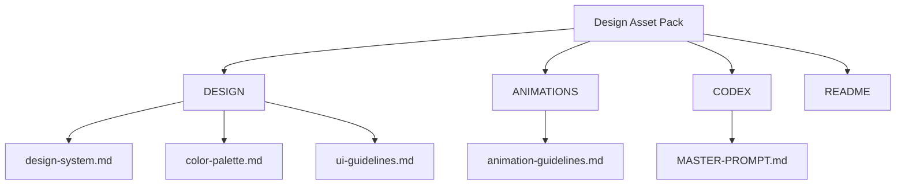
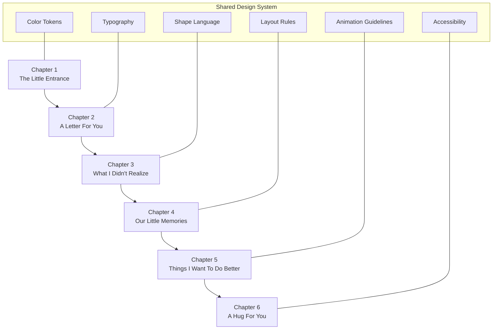
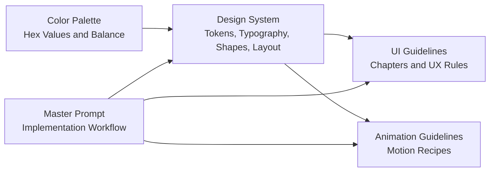
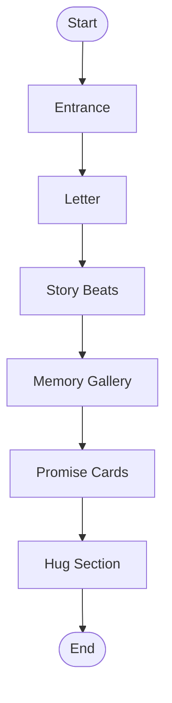

# Design System Reference

<cite>
**Referenced Files in This Document**
- [README.md](file://A-Little-World-For-You-Design-Asset-Pack/README.md)
- [design-system.md](file://A-Little-World-For-You-Design-Asset-Pack/DESIGN/design-system.md)
- [color-palette.md](file://A-Little-World-For-You-Design-Asset-Pack/DESIGN/color-palette.md)
- [ui-guidelines.md](file://A-Little-World-For-You-Design-Asset-Pack/DESIGN/ui-guidelines.md)
- [animation-guidelines.md](file://A-Little-World-For-You-Design-Asset-Pack/ANIMATIONS/animation-guidelines.md)
- [MASTER-PROMPT.md](file://A-Little-World-For-You-Design-Asset-Pack/CODEX/MASTER-PROMPT.md)
</cite>

## Table of Contents
1. [Introduction](#introduction)
2. [Project Structure](#project-structure)
3. [Core Components](#core-components)
4. [Architecture Overview](#architecture-overview)
5. [Detailed Component Analysis](#detailed-component-analysis)
6. [Dependency Analysis](#dependency-analysis)
7. [Performance Considerations](#performance-considerations)
8. [Troubleshooting Guide](#troubleshooting-guide)
9. [Conclusion](#conclusion)
10. [Appendices](#appendices)

## Introduction
This design system reference documents the watercolor-inspired visual identity for a romantic, story-driven website called “A Little World For You.” The system emphasizes warmth, intimacy, sincerity, and gentle storytelling over corporate or glossy UI patterns. It defines color tokens, typography, shape language, layout principles, UI rules, animation behavior, and accessibility expectations so that developers can implement consistent romantic interface elements across React components.

The aesthetic is built around soft watercolor washes, paper-like surfaces, warm cream backgrounds, blush pink, peach, muted rose, pale sky blue, and sage accents. Typography pairs elegant serif display faces with friendly sans-serif body text and uses handwritten accents sparingly. Layouts are mobile-first, narrative-driven, and intentionally spacious to support reading comfort and emotional pacing.

## Project Structure
The design asset pack organizes guidance into clear areas:
- `DESIGN/`: core design system, color palette, and UI/UX guidelines.
- `ANIMATIONS/`: motion principles and implementation recipes.
- `CODEX/MASTER-PROMPT.md`: end-to-end implementation instructions for building the website.
- `README.md`: overview of style direction, asset usage, and workflow.

**Diagram sources**
- [README.md:12-17](file://A-Little-World-For-You-Design-Asset-Pack/README.md#L12-L17)
- [design-system.md:1-49](file://A-Little-World-For-You-Design-Asset-Pack/DESIGN/design-system.md#L1-L49)
- [color-palette.md:1-22](file://A-Little-World-For-You-Design-Asset-Pack/DESIGN/color-palette.md#L1-L22)
- [ui-guidelines.md:1-56](file://A-Little-World-For-You-Design-Asset-Pack/DESIGN/ui-guidelines.md#L1-L56)
- [animation-guidelines.md:1-29](file://A-Little-World-For-You-Design-Asset-Pack/ANIMATIONS/animation-guidelines.md#L1-L29)
- [MASTER-PROMPT.md:1-223](file://A-Little-World-For-You-Design-Asset-Pack/CODEX/MASTER-PROMPT.md#L1-L223)

**Section sources**
- [README.md:1-30](file://A-Little-World-For-You-Design-Asset-Pack/README.md#L1-L30)

## Core Components
This section summarizes the foundational design tokens and rules that should be applied consistently across all components.

### Color Tokens
Use CSS custom properties or Tailwind theme tokens mapped from the following palette:

| Token | Hex | Usage Guidance |
|---|---|---|
| `--color-cream` | `#FFF9F2` | Main page background |
| `--color-paper` | `#FFFDF9` | Letter/card surface |
| `--color-blush` | `#F7DCE2` | Soft section tint |
| `--color-rose` | `#D98FA0` | Primary accent |
| `--color-rose-deep` | `#A85F72` | Text/accent on light surfaces |
| `--color-peach` | `#F5C7AE` | Secondary accent |
| `--color-sky` | `#DCEAF2` | Cool contrast |
| `--color-sage` | `#C8D2BE` | Botanical accent |
| `--color-ink` | `#59464A` | Main text |
| `--color-muted` | `#927D7D` | Secondary text |

Balance the palette approximately as:
- 55% cream / paper
- 20% blush / pale pink
- 10% peach
- 10% sky / sage
- 5% rose accents

Avoid making every section pink; alternate warm paper, pale sky, and botanical tones to create visual rhythm. Do not use pale pink for long body text.

### Typography Scale
- Display and headings: elegant serif such as Playfair Display or Cormorant Garamond.
- Body: friendly sans-serif such as Nunito or Quicksand.
- Handwritten accent: Caveat or Pacifico, used only for short decorative notes.
- Prefer web font loading via a supported mechanism; otherwise provide sensible serif/sans fallbacks.

Apply a clear hierarchy:
- H1/H2 for chapter titles.
- H3/H4 for card titles and small sections.
- Body copy sized for comfortable reading width.
- Handwritten type reserved for signatures, tiny labels, or decorative captions.

### Shape Language
- Cards: rounded corners around 20–28px.
- Buttons: pill-shaped or softly rounded with large corner radius.
- Letter panels: paper-like borders, subtle shadows, and slightly imperfect decorative edges implemented through CSS/SVG.
- Polaroids: white border, slight rotation, soft shadow.
- Decorative watercolor marks should be sparse and intentional.

### Layout Principles
- Mobile-first responsive structure.
- Max content width around 1080–1160px.
- Comfortable reading width around 620–720px.
- Generous vertical spacing between sections.
- Clear vertical narrative flow; avoid dense dashboard layouts.
- One primary action per section.

**Section sources**
- [design-system.md:6-49](file://A-Little-World-For-You-Design-Asset-Pack/DESIGN/design-system.md#L6-L49)
- [color-palette.md:1-22](file://A-Little-World-For-You-Design-Asset-Pack/DESIGN/color-palette.md#L1-L22)

## Architecture Overview
The design system maps directly onto a single-page romantic storybook experience composed of six chapters. Each chapter has distinct visual treatment while sharing the same tokens, typography, shape language, and interaction principles.

**Diagram sources**
- [ui-guidelines.md:6-47](file://A-Little-World-For-You-Design-Asset-Pack/DESIGN/ui-guidelines.md#L6-L47)
- [MASTER-PROMPT.md:54-98](file://A-Little-World-For-You-Design-Asset-Pack/CODEX/MASTER-PROMPT.md#L54-L98)

## Detailed Component Analysis

### Watercolor Visual Identity Implementation
The watercolor aesthetic is achieved through layered, restrained techniques rather than heavy assets:

- Soft edges: Use generous border-radius on cards and buttons; apply subtle SVG filters or CSS blur where appropriate for decorative shapes.
- Gentle gradients: Blend cream, blush, peach, sky, and sage at low opacity to simulate watercolor washes. Avoid hard transitions or saturated gradients.
- Paper-like textures: Use off-white backgrounds like `--color-paper` and `--color-cream`, combined with faint noise or texture overlays when needed. Keep it subtle so text remains readable.
- Organic decorations: Small flowers, petals, hearts, envelopes, and garden scenes should feel hand-drawn and sparse.
- Consistent illustration style: If using vector illustrations, keep line weight, color saturation, and edge softness consistent across characters and scenes.

Implementation recommendations:
- Prefer CSS variables for colors and Tailwind theme mappings for consistency.
- Use lightweight SVG decorations instead of heavy PNGs whenever possible.
- Reserve complex illustrations for key moments such as the envelope, polaroid gallery, or final hug scene.
- Ensure all decorative visuals have empty alt attributes when they do not convey meaning.

**Section sources**
- [design-system.md:1-49](file://A-Little-World-For-You-Design-Asset-Pack/DESIGN/design-system.md#L1-L49)
- [MASTER-PROMPT.md:29-52](file://A-Little-World-For-You-Design-Asset-Pack/CODEX/MASTER-PROMPT.md#L29-L52)

### UI Component Guidelines
Create reusable romantic UI components that follow these rules:

- Envelope Intro: Centered illustrated envelope on warm cream; gentle flap opening animation; letter rises and fades; smooth scroll to next section.
- Love Letter Card: Paper-like surface, serif heading, readable body copy, handwritten signature area; reveal with fade/slide; avoid slow typewriter effects.
- Story Beat Cards: Three illustrated beats with accountable, non-blaming copy; keep tone sincere and reflective.
- Memory Gallery: Polaroid-style cards with placeholders until real photos are provided; accessible lightbox with close button and keyboard support.
- Promise Cards: Three realistic promises presented as calm, behavior-focused statements.
- Hug Section: Soft watercolor garden or sunset feeling; optional heart bloom animation; no guilt-inducing copy if the user does not interact.

Interaction rules:
- One primary action per section.
- Buttons must have clear labels and visible focus states.
- No auto-play audio.
- No forced tasks or pressure to respond.
- All important text must remain readable without animation.
- Provide reduced-motion support.

**Section sources**
- [ui-guidelines.md:6-56](file://A-Little-World-For-You-Design-Asset-Pack/DESIGN/ui-guidelines.md#L6-L56)
- [MASTER-PROMPT.md:54-98](file://A-Little-World-For-You-Design-Asset-Pack/CODEX/MASTER-PROMPT.md#L54-L98)

### Animation and Motion Recipes
Motion should feel calm, organic, and tender:

- Timing: Most transitions 350–700ms; ambient loops 4–12s with low amplitude.
- Techniques: Prefer transform and opacity; avoid animating layout-heavy properties.
- Triggers: Use viewport-based reveals once per section; avoid excessive parallax or constant movement behind text.
- Accessibility: Respect `prefers-reduced-motion`; disable nonessential ambient animation when reduced motion is requested.
- Performance: Limit simultaneous particles; use `will-change` only where needed; test on mid-range mobile devices.

Suggested recipes:
- Envelope open: flap rotates around top edge; letter rises and fades in.
- Floating petals/hearts: small decorative elements drift upward with varied delays; simplify on mobile.
- Section reveal: opacity and vertical translation once per section.
- Polaroid hover/tap: tiny rotation; lightbox fades and scales gently.
- Final hug: small heart bloom with a few particles.

**Section sources**
- [animation-guidelines.md:1-29](file://A-Little-World-For-You-Design-Asset-Pack/ANIMATIONS/animation-guidelines.md#L1-L29)

### Practical Examples of Applying Design Tokens in React Components
When building React components, map design tokens to component props and styles:

- Color application:
  - Backgrounds: use `--color-cream` for page backgrounds and `--color-paper` for cards.
  - Accents: use `--color-rose` for primary actions and `--color-rose-deep` for readable text on light surfaces.
  - Tints: use `--color-blush`, `--color-peach`, `--color-sky`, and `--color-sage` for section backgrounds and decorative washes.
- Typography application:
  - Headings: apply serif display fonts.
  - Body: apply sans-serif fonts with comfortable line height.
  - Handwritten: apply only to short labels, signatures, or decorative captions.
- Shape application:
  - Cards: apply 20–28px border-radius.
  - Buttons: apply pill or large rounded corners.
  - Polaroids: add white border, slight rotation, and soft shadow.
- Layout application:
  - Constrain main content width.
  - Maintain comfortable reading width.
  - Use generous vertical spacing between sections.
- Interaction application:
  - Ensure visible focus states.
  - Provide reduced-motion variants.
  - Avoid auto-playing media.

Component composition pattern:
- Page layout composes sections.
- Sections compose reusable UI components.
- Data files hold copy, memories, names, dates, and image paths.
- Assets are replaceable through a central configuration.

**Section sources**
- [design-system.md:6-49](file://A-Little-World-For-You-Design-Asset-Pack/DESIGN/design-system.md#L6-L49)
- [MASTER-PROMPT.md:131-162](file://A-Little-World-For-You-Design-Asset-Pack/CODEX/MASTER-PROMPT.md#L131-L162)

### Responsive Design Considerations
Mobile-first responsive behavior is essential:

- Test at common breakpoints: 360px, 390px, 430px, 768px, 1024px, 1440px, and wider.
- Prevent horizontal overflow.
- Keep text width and line-height comfortable.
- Ensure tap targets are at least around 44px.
- Stack scrapbook cards elegantly on narrow screens.
- Keep decorative elements away from text.
- Do not rely on hover for important actions; support tap.
- Use responsive images and lazy-load below-the-fold imagery.
- Test portrait and landscape mobile layouts.

**Section sources**
- [ui-guidelines.md:48-56](file://A-Little-World-For-You-Design-Asset-Pack/DESIGN/ui-guidelines.md#L48-L56)
- [MASTER-PROMPT.md:112-129](file://A-Little-World-For-You-Design-Asset-Pack/CODEX/MASTER-PROMPT.md#L112-L129)

### Accessibility Requirements
Accessibility ensures the warm, intimate style remains usable for everyone:

- Semantic HTML and logical heading hierarchy.
- Keyboard-operable interactions.
- Visible focus rings.
- Alt text for meaningful images; empty alt for decoration.
- Sufficient color contrast; avoid pale pink for long body text.
- Reduced-motion support.
- Accessible dialog/lightbox behavior.
- No autoplay audio; require explicit user action for any sound.
- Ensure all primary interactions work on touch screens.

**Section sources**
- [design-system.md:42-49](file://A-Little-World-For-You-Design-Asset-Pack/DESIGN/design-system.md#L42-L49)
- [ui-guidelines.md:48-56](file://A-Little-World-For-You-Design-Asset-Pack/DESIGN/ui-guidelines.md#L48-L56)
- [MASTER-PROMPT.md:173-185](file://A-Little-World-For-You-Design-Asset-Pack/CODEX/MASTER-PROMPT.md#L173-L185)

## Dependency Analysis
The design system depends on shared tokens and guidelines that influence every component and section:

**Diagram sources**
- [design-system.md:1-49](file://A-Little-World-For-You-Design-Asset-Pack/DESIGN/design-system.md#L1-L49)
- [color-palette.md:1-22](file://A-Little-World-For-You-Design-Asset-Pack/DESIGN/color-palette.md#L1-L22)
- [ui-guidelines.md:1-56](file://A-Little-World-For-You-Design-Asset-Pack/DESIGN/ui-guidelines.md#L1-L56)
- [animation-guidelines.md:1-29](file://A-Little-World-For-You-Design-Asset-Pack/ANIMATIONS/animation-guidelines.md#L1-L29)
- [MASTER-PROMPT.md:1-223](file://A-Little-World-For-You-Design-Asset-Pack/CODEX/MASTER-PROMPT.md#L1-L223)

**Section sources**
- [design-system.md:1-49](file://A-Little-World-For-You-Design-Asset-Pack/DESIGN/design-system.md#L1-L49)
- [MASTER-PROMPT.md:1-223](file://A-Little-World-For-You-Design-Asset-Pack/CODEX/MASTER-PROMPT.md#L1-L223)

## Performance Considerations
- Prefer transform and opacity animations to avoid layout thrashing.
- Limit particle counts and continuous ambient motion.
- Use viewport-triggered animations once per section.
- Disable nonessential animations under reduced-motion preferences.
- Optimize images and lazy-load below-the-fold assets.
- Avoid unnecessary dependencies and heavy assets.
- Test on mid-range mobile devices to ensure smooth performance.

[No sources needed since this section provides general guidance]

## Troubleshooting Guide
Common issues and resolutions:

- Colors look too pink or unreadable:
  - Increase contrast by using `--color-ink` or `--color-rose-deep` for body text.
  - Reduce blush/pink coverage and alternate with paper, sky, or sage tints.
- Animations feel overwhelming:
  - Shorten transition durations and reduce amplitude.
  - Simplify floating decorations on mobile.
  - Honor `prefers-reduced-motion`.
- Layout feels cramped:
  - Increase vertical spacing between sections.
  - Constrain content width and maintain comfortable reading width.
- Interactions fail on mobile:
  - Ensure tap targets are at least around 44px.
  - Avoid hover-only behaviors; support tap and keyboard navigation.
- Images or assets break:
  - Replace placeholders with real assets through a central configuration.
  - Verify paths and alt attributes.
- Audio causes problems:
  - Never autoplay audio; require explicit user action.
  - Provide a disabled placeholder if no audio file exists.

**Section sources**
- [design-system.md:6-49](file://A-Little-World-For-You-Design-Asset-Pack/DESIGN/design-system.md#L6-L49)
- [animation-guidelines.md:1-29](file://A-Little-World-For-You-Design-Asset-Pack/ANIMATIONS/animation-guidelines.md#L1-L29)
- [MASTER-PROMPT.md:173-185](file://A-Little-World-For-You-Design-Asset-Pack/CODEX/MASTER-PROMPT.md#L173-L185)

## Conclusion
This design system establishes a warm, intimate, watercolor-inspired visual identity grounded in clear tokens, thoughtful typography, gentle shape language, and respectful layout principles. By applying these guidelines consistently across React components, teams can build a romantic, story-driven interface that feels handmade, sincere, and accessible. The system balances aesthetic tenderness with practical constraints: readable contrast, reduced-motion support, responsive layouts, and performance-aware animations.

[No sources needed since this section summarizes without analyzing specific files]

## Appendices

### Chapter Flow Reference

**Diagram sources**
- [ui-guidelines.md:6-47](file://A-Little-World-For-You-Design-Asset-Pack/DESIGN/ui-guidelines.md#L6-L47)