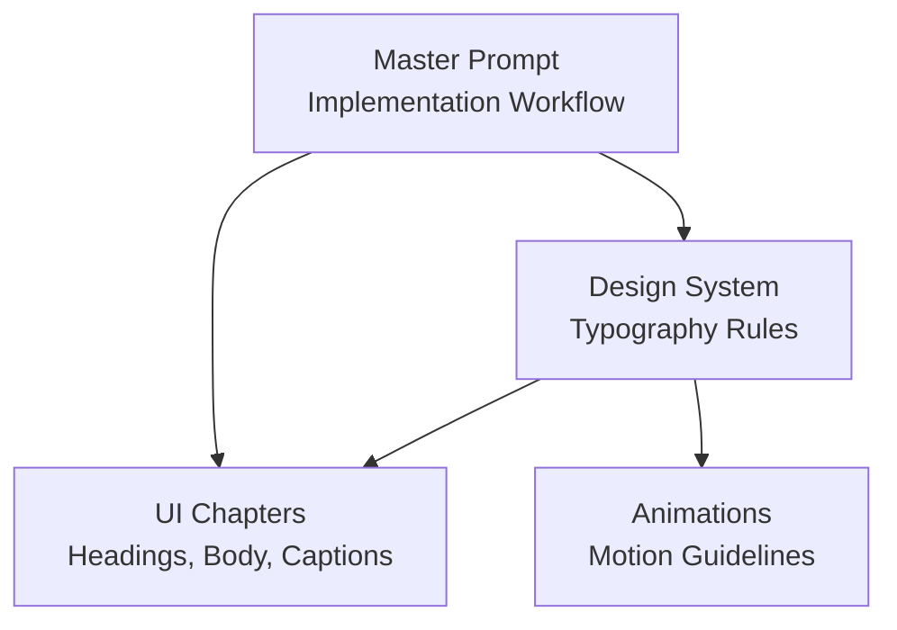
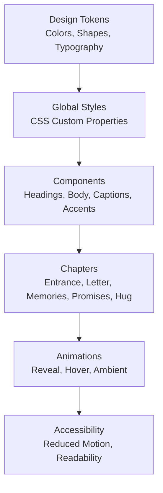
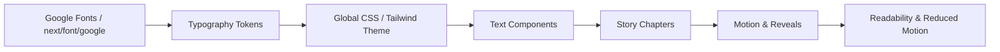

# Typography & Font System

<cite>
**Referenced Files in This Document**   
- [design-system.md](file://A-Little-World-For-You-Design-Asset-Pack/DESIGN/design-system.md)
- [ui-guidelines.md](file://A-Little-World-For-You-Design-Asset-Pack/DESIGN/ui-guidelines.md)
- [animation-guidelines.md](file://A-Little-World-For-You-Design-Asset-Pack/ANIMATIONS/animation-guidelines.md)
- [master-prompt.md](file://A-Little-World-For-You-Design-Asset-Pack/CODEX/master-prompt.md)
</cite>

## Table of Contents
1. [Introduction](#introduction)
2. [Project Structure](#project-structure)
3. [Core Components](#core-components)
4. [Architecture Overview](#architecture-overview)
5. [Detailed Component Analysis](#detailed-component-analysis)
6. [Dependency Analysis](#dependency-analysis)
7. [Performance Considerations](#performance-considerations)
8. [Troubleshooting Guide](#troubleshooting-guide)
9. [Conclusion](#conclusion)

## Introduction
This document defines the typography and font system for the “A Little World For You” project. It consolidates the design-system guidance into a practical, implementation-ready hierarchy for headings, body text, captions, and decorative elements. It also explains how to integrate Google Fonts in Next.js, how to create consistent text styles with CSS custom properties or Tailwind utilities, how to support Vietnamese content, and how to optimize web fonts for performance and accessibility.

The typography should feel gentle, warm, and storybook-like: elegant serif display faces for headings, friendly sans-serif faces for readable body copy, and handwritten accents only for short decorative notes.

## Project Structure
Typography rules are defined in the design-system documentation and applied across UI components, chapters, and animations. The relevant files include:

- Design system tokens and typography choices
- UI guidelines describing where headings, body copy, and handwritten signatures appear
- Animation guidelines that affect readability during motion
- Master prompt instructions that tie typography to the overall implementation workflow

**Diagram sources**
- [design-system.md:22-26](file://A-Little-World-For-You-Design-Asset-Pack/DESIGN/design-system.md#L22-L26)
- [ui-guidelines.md:6-46](file://A-Little-World-For-You-Design-Asset-Pack/DESIGN/ui-guidelines.md#L6-L46)
- [animation-guidelines.md:1-29](file://A-Little-World-For-You-Design-Asset-Pack/ANIMATIONS/animation-guidelines.md#L1-L29)
- [master-prompt.md:187-220](file://A-Little-World-For-You-Design-Asset-Pack/CODEX/master-prompt.md#L187-L220)

**Section sources**
- [design-system.md:22-26](file://A-Little-World-For-You-Design-Asset-Pack/DESIGN/design-system.md#L22-L26)
- [ui-guidelines.md:6-46](file://A-Little-World-For-You-Design-Asset-Pack/DESIGN/ui-guidelines.md#L6-L46)
- [animation-guidelines.md:1-29](file://A-Little-World-For-You-Design-Asset-Pack/ANIMATIONS/animation-guidelines.md#L1-L29)
- [master-prompt.md:187-220](file://A-Little-World-For-You-Design-Asset-Pack/CODEX/master-prompt.md#L187-L220)

## Core Components
The typography system is built around four main roles:

| Role | Purpose | Recommended Face(s) | Notes |
|---|---|---|---|
| Display / Headings | Chapter titles, hero headings, emotional anchors | `Playfair Display` or `Cormorant Garamond` | Elegant serif; use for short, impactful text |
| Body | Long-form letter copy, explanations, promises | `Nunito` or `Quicksand` | Friendly sans-serif optimized for readability |
| Caption | Photo captions, small labels, secondary metadata | Same as body or a lighter weight | Keep concise and legible |
| Decorative Accent | Short handwritten notes, signatures, playful remarks | `Caveat` or `Pacifico` | Use sparingly; not for long paragraphs |

Font loading guidance:
- Prefer `next/font/google` when the network/build environment supports it.
- Provide sensible serif/sans fallbacks when Google Fonts cannot be loaded.

**Section sources**
- [design-system.md:22-26](file://A-Little-World-For-You-Design-Asset-Pack/DESIGN/design-system.md#L22-L26)

## Architecture Overview
The typography architecture connects design tokens, component usage, and runtime behavior:

**Diagram sources**
- [design-system.md:22-48](file://A-Little-World-For-You-Design-Asset-Pack/DESIGN/design-system.md#L22-L48)
- [ui-guidelines.md:6-46](file://A-Little-World-For-You-Design-Asset-Pack/DESIGN/ui-guidelines.md#L6-L46)
- [animation-guidelines.md:1-29](file://A-Little-World-For-You-Design-Asset-Pack/ANIMATIONS/animation-guidelines.md#L1-L29)

## Detailed Component Analysis

### Typography Hierarchy
Define a clear hierarchy so readers can scan the page while enjoying the storybook tone.

| Level | Usage | Face Family | Weight Guidance | Size Guidance | Line Height | Letter Spacing |
|---|---|---|---|---|---|---|
| Hero Heading | Entrance title | Serif (display) | Bold or semibold | Large, mobile-first base | Comfortable, slightly generous | Neutral or very slight tracking |
| Section Heading | Chapter titles | Serif (display) | Semibold | Medium-large | Comfortable | Neutral |
| Subheading | Card titles, photo captions | Sans (body) | Medium | Small-medium | Comfortable | Neutral |
| Body Text | Letter copy, explanations | Sans (body) | Regular | Base reading size | Generous for long text | Neutral |
| Caption | Polaroid captions, metadata | Sans (body) | Light or regular | Small | Compact but readable | Slight positive tracking if needed |
| Handwritten Accent | Signature, short note | Script/accent | Normal | Small | Comfortable | Neutral |

Guidelines:
- Keep headings elegant but not overwhelming.
- Prioritize body readability over stylistic flair.
- Avoid pale pink for long body text; use ink or muted tones for contrast.
- Maintain comfortable vertical rhythm between sections.

**Section sources**
- [design-system.md:22-26](file://A-Little-World-For-You-Design-Asset-Pack/DESIGN/design-system.md#L22-L26)
- [design-system.md:20-20](file://A-Little-World-For-You-Design-Asset-Pack/DESIGN/design-system.md#L20-L20)
- [ui-guidelines.md:14-19](file://A-Little-World-For-You-Design-Asset-Pack/DESIGN/ui-guidelines.md#L14-L19)

### Font Families and Fallback Strategy
- Primary display face: `Playfair Display` or `Cormorant Garamond`.
- Primary body face: `Nunito` or `Quicksand`.
- Decorative accent face: `Caveat` or `Pacifico`.
- Fallback strategy:
  - If Google Fonts load successfully, use the chosen family.
  - If they fail, fall back to a generic serif for headings and a generic sans-serif for body text.
  - Ensure all text remains readable without animation or custom fonts.

**Section sources**
- [design-system.md:22-26](file://A-Little-World-For-You-Design-Asset-Pack/DESIGN/design-system.md#L22-L26)

### Google Fonts Integration in Next.js
Recommended approach:
- Use `next/font/google` to import and apply Google Fonts at build time or runtime depending on your setup.
- Assign the imported font to semantic elements such as headings, paragraphs, and captions.
- Provide fallback families in CSS custom properties so the site degrades gracefully.

Typical pattern:
- Import the desired Google font via `next/font/google`.
- Apply the font to global styles or layout components.
- Map CSS custom properties like `--font-heading`, `--font-body`, and `--font-accent` to the selected families.
- Use those variables in component styles for consistency.

When the environment does not support `next/font/google`:
- Fall back to system serif/sans stacks.
- Keep the same visual hierarchy and spacing.

**Section sources**
- [design-system.md:22-26](file://A-Little-World-For-You-Design-Asset-Pack/DESIGN/design-system.md#L22-L26)

### Creating Consistent Text Styles
Two common approaches:

#### CSS Custom Properties
- Define tokens for font families, weights, sizes, line heights, and letter spacing.
- Apply tokens globally so every component inherits consistent typography.
- Example token names:
  - `--font-heading`
  - `--font-body`
  - `--font-accent`
  - `--text-size-base`
  - `--text-line-height-body`
  - `--text-tracking-caption`

#### Tailwind Utilities
- Create utility classes or extend Tailwind’s theme for typography tokens.
- Use semantic class names such as:
  - `heading-display`
  - `heading-section`
  - `body-text`
  - `caption-text`
  - `handwritten-accent`
- Keep Tailwind configuration aligned with the design system’s font families and spacing.

Both approaches should enforce:
- Readable contrast using the ink/muted color tokens.
- Comfortable line height for long text.
- Clear distinction between headings, body, and captions.

**Section sources**
- [design-system.md:22-26](file://A-Little-World-For-You-Design-Asset-Pack/DESIGN/design-system.md#L22-L26)

### Vietnamese Language Support
Vietnamese content appears throughout the UI, including chapter headings, supporting lines, promises, and closing messages. To ensure correct rendering:

- Choose fonts that include Latin Extended characters and diacritics commonly used in Vietnamese.
- Verify that both serif and sans-serif families render Vietnamese text clearly.
- Test Vietnamese strings at heading, body, and caption sizes.
- Adjust line height and letter spacing if diacritics overlap or feel cramped.
- Avoid overly tight tracking on Vietnamese body text.

Where Vietnamese text appears:
- Chapter headings and supporting lines
- Letter body copy
- Promise cards
- Closing message

**Section sources**
- [ui-guidelines.md:6-19](file://A-Little-World-For-You-Design-Asset-Pack/DESIGN/ui-guidelines.md#L6-L19)
- [ui-guidelines.md:35-46](file://A-Little-World-For-You-Design-Asset-Pack/DESIGN/ui-guidelines.md#L35-L46)

### Font Loading Strategies
- Prefer `next/font/google` when available for better control and reduced layout shift.
- If network access is unreliable, provide fallback stacks.
- Avoid blocking critical rendering with heavy font loads.
- Keep decorative script fonts separate from critical content when possible.
- Ensure text remains readable even if fonts fail to load.

**Section sources**
- [design-system.md:22-26](file://A-Little-World-For-You-Design-Asset-Pack/DESIGN/design-system.md#L22-L26)

### Performance Optimization for Web Fonts
- Limit the number of font families; use one display face, one body face, and one accent face.
- Load only the required weights and character subsets.
- Avoid animating layout-heavy properties; prefer transform and opacity.
- Respect `prefers-reduced-motion` to reduce unnecessary work.
- Keep ambient animations subtle and avoid dozens of simultaneous particles.
- Test on mid-range mobile devices to catch performance issues early.

**Section sources**
- [animation-guidelines.md:1-29](file://A-Little-World-For-You-Design-Asset-Pack/ANIMATIONS/animation-guidelines.md#L1-L29)

### Accessibility Considerations
Typography accessibility focuses on readability, structure, and screen-reader compatibility:

- Use semantic headings (`h1`, `h2`, `h3`) to establish a clear outline.
- Maintain sufficient color contrast between text and background.
- Do not rely on hover-only interactions; support tap and keyboard navigation.
- Provide visible focus states for interactive elements.
- Keep animated text readable even when animations fail or are disabled.
- Use alt text for meaningful images and empty alt for decorative images.
- Ensure minimum comfortable tap targets around 44px.
- Test at multiple viewport widths including small mobile screens.

**Section sources**
- [ui-guidelines.md:48-55](file://A-Little-World-For-You-Design-Asset-Pack/DESIGN/ui-guidelines.md#L48-L55)
- [animation-guidelines.md:5-11](file://A-Little-World-For-You-Design-Asset-Pack/ANIMATIONS/animation-guidelines.md#L5-L11)

## Dependency Analysis
Typography depends on design tokens, UI structure, and animation behavior:

**Diagram sources**
- [design-system.md:22-26](file://A-Little-World-For-You-Design-Asset-Pack/DESIGN/design-system.md#L22-L26)
- [ui-guidelines.md:6-46](file://A-Little-World-For-You-Design-Asset-Pack/DESIGN/ui-guidelines.md#L6-L46)
- [animation-guidelines.md:1-29](file://A-Little-World-For-You-Design-Asset-Pack/ANIMATIONS/animation-guidelines.md#L1-L29)

**Section sources**
- [design-system.md:22-26](file://A-Little-World-For-You-Design-Asset-Pack/DESIGN/design-system.md#L22-L26)
- [ui-guidelines.md:6-46](file://A-Little-World-For-You-Design-Asset-Pack/DESIGN/ui-guidelines.md#L6-L46)
- [animation-guidelines.md:1-29](file://A-Little-World-For-You-Design-Asset-Pack/ANIMATIONS/animation-guidelines.md#L1-L29)

## Performance Considerations
- Use one elegant serif for display and one friendly sans-serif for body text.
- Reserve handwritten accents for short decorative text only.
- Keep font loading non-blocking and provide fallbacks.
- Avoid excessive animations behind text.
- Respect user preferences for reduced motion.
- Validate performance on mobile profiles.

[No sources needed since this section provides general guidance]

## Troubleshooting Guide
Common typography issues and resolutions:

| Issue | Likely Cause | Resolution |
|---|---|---|
| Vietnamese diacritics look cramped | Tight line height or negative tracking | Increase line height; neutralize tracking for body text |
| Headings feel too heavy | Too bold or oversized | Reduce weight to semibold; adjust size to match hierarchy |
| Body text hard to read | Low contrast or wrong color token | Use ink or muted tokens; avoid pale pink for long text |
| Fonts fail to load | Network or build limitation | Provide fallback serif/sans stacks |
| Text becomes unreadable during animation | Layout shifts or excessive motion | Prefer transform/opacity; respect `prefers-reduced-motion` |
| Screen readers miss structure | Missing semantic headings | Use proper heading levels and landmarks |

**Section sources**
- [design-system.md:20-26](file://A-Little-World-For-You-Design-Asset-Pack/DESIGN/design-system.md#L20-L26)
- [ui-guidelines.md:48-55](file://A-Little-World-For-You-Design-Asset-Pack/DESIGN/ui-guidelines.md#L48-L55)
- [animation-guidelines.md:5-11](file://A-Little-World-For-You-Design-Asset-Pack/ANIMATIONS/animation-guidelines.md#L5-L11)

## Conclusion
The typography system for “A Little World For You” balances elegance and readability. Use a serif display face for headings, a friendly sans-serif for body and captions, and a handwritten accent only for short decorative notes. Implement fonts through `next/font/google` when possible, define consistent tokens via CSS custom properties or Tailwind utilities, and validate Vietnamese support thoroughly. Optimize font loading and animations for performance, and prioritize accessibility by maintaining semantic structure, contrast, and reduced-motion support.

[No sources needed since this section summarizes without analyzing specific files]