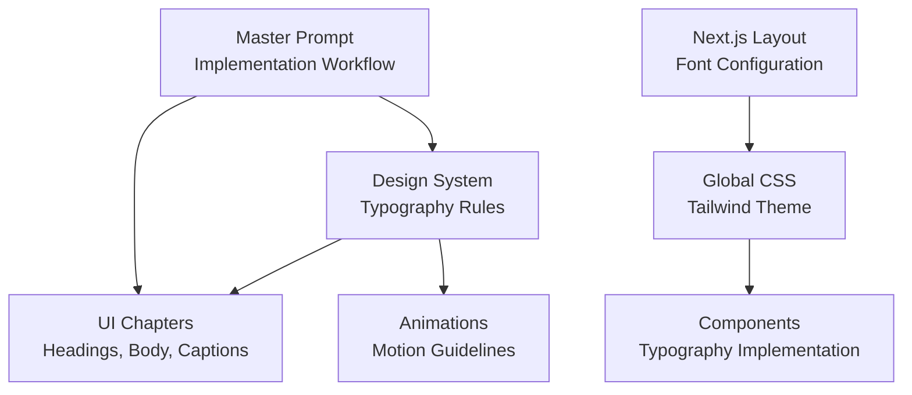
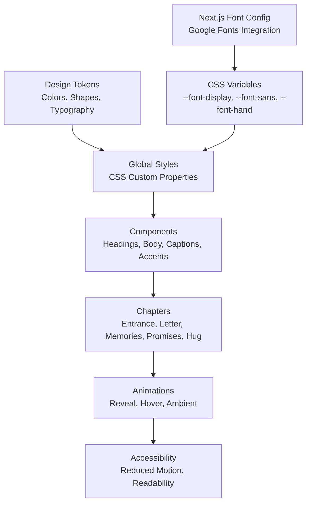
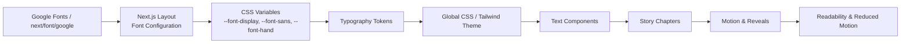

# Typography & Font System

<cite>
**Referenced Files in This Document**   
- [design-system.md](file://A-Little-World-For-You-Design-Asset-Pack/DESIGN/design-system.md)
- [ui-guidelines.md](file://A-Little-World-For-You-Design-Asset-Pack/DESIGN/ui-guidelines.md)
- [master-prompt.md](file://A-Little-World-For-You-Design-Asset-Pack/CODEX/MASTER-PROMPT.md)
- [layout.tsx](file://src/app/layout.tsx)
- [globals.css](file://src/app/globals.css)
- [SectionHeading.tsx](file://src/components/ui/SectionHeading.tsx)
- [LoveLetter.tsx](file://src/components/letter/LoveLetter.tsx)
</cite>

## Update Summary
**Changes Made**   
- Updated font family specifications to reflect the three-font system (Playfair Display, Nunito, Pacifico)
- Added detailed Next.js font configuration with Vietnamese subset support
- Enhanced CSS custom properties and Tailwind theme integration
- Updated component examples to show actual implementation patterns
- Expanded Vietnamese language support documentation with specific diacritic handling

## Table of Contents
1. [Introduction](#introduction)
2. [Project Structure](#project-structure)
3. [Core Components](#core-components)
4. [Architecture Overview](#architecture-overview)
5. [Detailed Component Analysis](#detailed-component-analysis)
6. [Dependency Analysis](#dependency-analysis)
7. [Performance Considerations](#performance-considerations)
8. [Troubleshooting Guide](#troubleshooting-guide)
9. [Conclusion](#conclusion)

## Introduction
This document defines the typography and font system for the "A Little World For You" project. It consolidates the design-system guidance into a practical, implementation-ready hierarchy for headings, body text, captions, and decorative elements. The system uses a carefully curated three-font approach: elegant serif display faces for headings, friendly sans-serif faces for readable body copy, and handwritten accents only for short decorative notes.

The typography should feel gentle, warm, and storybook-like: elegant serif display faces for headings, friendly sans-serif faces for readable body copy, and handwritten accents only for short decorative notes. All fonts are configured with Vietnamese subset support to ensure proper rendering of diacritic characters throughout the application.

## Project Structure
Typography rules are defined in the design-system documentation and applied across UI components, chapters, and animations. The relevant files include:

- Design system tokens and typography choices
- UI guidelines describing where headings, body copy, and handwritten signatures appear
- Animation guidelines that affect readability during motion
- Master prompt instructions that tie typography to the overall implementation workflow
- Next.js layout configuration with Google Fonts integration
- Global CSS with Tailwind theme customization



**Diagram sources**
- [design-system.md:22-26](file://A-Little-World-For-You-Design-Asset-Pack/DESIGN/design-system.md#L22-L26)
- [ui-guidelines.md:6-46](file://A-Little-World-For-You-Design-Asset-Pack/DESIGN/ui-guidelines.md#L6-L46)
- [master-prompt.md:152-169](file://A-Little-World-For-You-Design-Asset-Pack/CODEX/MASTER-PROMPT.md#L152-L169)
- [layout.tsx:10-29](file://src/app/layout.tsx#L10-L29)
- [globals.css:28-32](file://src/app/globals.css#L28-L32)

**Section sources**
- [design-system.md:22-26](file://A-Little-World-For-You-Design-Asset-Pack/DESIGN/design-system.md#L22-L26)
- [ui-guidelines.md:6-46](file://A-Little-World-For-You-Design-Asset-Pack/DESIGN/ui-guidelines.md#L6-L46)
- [master-prompt.md:152-169](file://A-Little-World-For-You-Design-Asset-Pack/CODEX/MASTER-PROMPT.md#L152-L169)

## Core Components
The typography system is built around four main roles with a strict three-font architecture:

| Role | Purpose | Recommended Face(s) | Notes |
|---|---|---|---|
| Display / Headings | Chapter titles, hero headings, emotional anchors | `Playfair Display` | Elegant serif; use for short, impactful text |
| Body | Long-form letter copy, explanations, promises | `Nunito` | Friendly sans-serif optimized for readability |
| Caption | Photo captions, small labels, secondary metadata | Same as body or a lighter weight | Keep concise and legible |
| Decorative Accent | Short handwritten notes, signatures, playful remarks | `Pacifico` | Use sparingly; not for long paragraphs |

**Updated** The system now exclusively uses these three fonts with Vietnamese subset support. Caveat is deliberately excluded due to lack of Vietnamese character support.

Font loading guidance:
- Prefer `next/font/google` when the network/build environment supports it.
- Provide sensible serif/sans fallbacks when Google Fonts cannot be loaded.
- All fonts must include the `vietnamese` subset for proper diacritic rendering.

**Section sources**
- [design-system.md:22-28](file://A-Little-World-For-You-Design-Asset-Pack/DESIGN/design-system.md#L22-L28)
- [master-prompt.md:152-169](file://A-Little-World-For-You-Design-Asset-Pack/CODEX/MASTER-PROMPT.md#L152-L169)

## Architecture Overview
The typography architecture connects design tokens, component usage, and runtime behavior through a centralized font configuration:



**Diagram sources**
- [design-system.md:22-48](file://A-Little-World-For-You-Design-Asset-Pack/DESIGN/design-system.md#L22-L48)
- [ui-guidelines.md:6-46](file://A-Little-World-For-You-Design-Asset-Pack/DESIGN/ui-guidelines.md#L6-L46)
- [layout.tsx:10-29](file://src/app/layout.tsx#L10-L29)
- [globals.css:28-32](file://src/app/globals.css#L28-L32)

## Detailed Component Analysis

### Typography Hierarchy
Define a clear hierarchy so readers can scan the page while enjoying the storybook tone.

| Level | Usage | Face Family | Weight Guidance | Size Guidance | Line Height | Letter Spacing |
|---|---|---|---|---|---|---|
| Hero Heading | Entrance title | Playfair Display | Bold or semibold | Large, mobile-first base | Comfortable, slightly generous | Neutral or very slight tracking |
| Section Heading | Chapter titles | Playfair Display | Semibold | Medium-large | Comfortable | Neutral |
| Subheading | Card titles, photo captions | Nunito | Medium | Small-medium | Comfortable | Neutral |
| Body Text | Letter copy, explanations | Nunito | Regular | Base reading size | Generous for long text | Neutral |
| Caption | Polaroid captions, metadata | Nunito | Light or regular | Small | Compact but readable | Slight positive tracking if needed |
| Handwritten Accent | Signature, short note | Pacifico | Normal (400 only) | Small | Comfortable | Neutral |

Guidelines:
- Keep headings elegant but not overwhelming.
- Prioritize body readability over stylistic flair.
- Avoid pale pink for long body text; use ink or muted tones for contrast.
- Maintain comfortable vertical rhythm between sections.
- Pacifico is restricted to single weight 400 - no synthetic bold.

**Section sources**
- [design-system.md:22-28](file://A-Little-World-For-You-Design-Asset-Pack/DESIGN/design-system.md#L22-L28)
- [master-prompt.md:162-169](file://A-Little-World-For-You-Design-Asset-Pack/CODEX/MASTER-PROMPT.md#L162-L169)

### Font Families and Fallback Strategy
**Updated** The system now implements a strict three-font architecture:

- Primary display face: `Playfair Display` (weights: 400, 500, 600, 700)
- Primary body face: `Nunito` (weights: 300, 400, 500, 600, 700)
- Decorative accent face: `Pacifico` (weight: 400 only)
- Fallback strategy:
  - If Google Fonts load successfully, use the chosen family.
  - If they fail, fall back to generic serif (`Georgia`) for headings and generic sans-serif (`system-ui`) for body text.
  - Ensure all text remains readable without animation or custom fonts.
  - Pacifico falls back to `"Segoe Script", cursive` for handwritten accents.

**Section sources**
- [layout.tsx:10-29](file://src/app/layout.tsx#L10-L29)
- [globals.css:108-114](file://src/app/globals.css#L108-L114)

### Google Fonts Integration in Next.js
**Updated** The implementation uses `next/font/google` with comprehensive Vietnamese support:

Recommended approach:
- Import fonts via `next/font/google` with explicit Vietnamese subset configuration.
- Configure each font with appropriate weights and CSS custom properties.
- Apply fonts globally through Tailwind theme variables.
- Set `display: 'swap'` for optimal loading performance.

Typical pattern:
```typescript
// In layout.tsx
const playfair = Playfair_Display({
  subsets: ["latin", "vietnamese"],
  weight: ["400", "500", "600", "700"],
  variable: "--font-playfair",
  display: "swap",
});

const nunito = Nunito({
  subsets: ["latin", "vietnamese"], 
  weight: ["300", "400", "500", "600", "700"],
  variable: "--font-nunito",
  display: "swap",
});

const pacifico = Pacifico({
  subsets: ["latin", "vietnamese"],
  weight: "400",
  variable: "--font-pacifico", 
  display: "swap",
});
```

CSS custom properties mapping:
```css
@theme inline {
  --font-display: var(--font-playfair);
  --font-sans: var(--font-nunito);
  --font-hand: var(--font-pacifico);
}
```

When the environment does not support `next/font/google`:
- Fall back to system serif/sans stacks.
- Keep the same visual hierarchy and spacing.

**Section sources**
- [layout.tsx:10-29](file://src/app/layout.tsx#L10-L29)
- [globals.css:28-32](file://src/app/globals.css#L28-L32)

### Creating Consistent Text Styles
Two common approaches are implemented in this project:

#### CSS Custom Properties with Tailwind
- Define tokens for font families, weights, sizes, line heights, and letter spacing.
- Apply tokens globally through Tailwind's `@theme` directive.
- Use semantic class names like `font-display`, `text-[size]`, `leading-[height]`.

Example implementations:
```css
/* Global font variables */
@theme inline {
  --font-display: var(--font-playfair);
  --font-sans: var(--font-nunito);
  --font-hand: var(--font-pacifico);
}

/* Component-specific styles */
.hand {
  font-family: var(--font-hand), "Segoe Script", cursive;
  font-weight: 400;
  letter-spacing: 0.01em;
  line-height: 1.4;
}

.letter-body {
  font-size: 1.0625rem;
  line-height: 1.9;
  color: var(--color-ink);
}
```

#### Component-Based Typography
- Create reusable components that enforce consistent typography.
- Use Tailwind utility classes for responsive sizing and spacing.
- Example from SectionHeading component shows proper heading hierarchy.

Both approaches should enforce:
- Readable contrast using the ink/muted color tokens.
- Comfortable line height for long text.
- Clear distinction between headings, body, and captions.
- Vietnamese diacritic support across all text levels.

**Section sources**
- [globals.css:28-32](file://src/app/globals.css#L28-L32)
- [globals.css:108-126](file://src/app/globals.css#L108-L126)
- [SectionHeading.tsx:33-47](file://src/components/ui/SectionHeading.tsx#L33-L47)

### Vietnamese Language Support
**Enhanced** Vietnamese content appears throughout the UI, including chapter headings, supporting lines, promises, and closing messages. The three-font system provides comprehensive Vietnamese support:

- **Playfair Display**: Includes Vietnamese subset for proper diacritic rendering in headings
- **Nunito**: Full Vietnamese support for body text, UI elements, and captions  
- **Pacifico**: Vietnamese subset for handwritten signatures and decorative text
- **Caveat exclusion**: Deliberately avoided due to lack of Vietnamese character support

To ensure correct rendering:
- Choose fonts that include Latin Extended characters and diacritics commonly used in Vietnamese.
- Verify that both serif and sans-serif families render Vietnamese text clearly.
- Test Vietnamese strings at heading, body, and caption sizes.
- Adjust line height and letter spacing if diacritics overlap or feel cramped.
- Avoid overly tight tracking on Vietnamese body text.

Where Vietnamese text appears:
- Chapter headings and supporting lines
- Letter body copy with extensive Vietnamese content
- Promise cards with Vietnamese commitments
- Closing message with emotional Vietnamese text
- Handwritten signatures and decorative elements

**Section sources**
- [ui-guidelines.md:6-19](file://A-Little-World-For-You-Design-Asset-Pack/DESIGN/ui-guidelines.md#L6-L19)
- [ui-guidelines.md:35-46](file://A-Little-World-For-You-Design-Asset-Pack/DESIGN/ui-guidelines.md#L35-L46)
- [master-prompt.md:152-169](file://A-Little-World-For-You-Design-Asset-Pack/CODEX/MASTER-PROMPT.md#L152-L169)

### Font Loading Strategies
**Updated** The implementation uses advanced Next.js font loading strategies:

- Prefer `next/font/google` when available for better control and reduced layout shift.
- Configure each font with explicit subsets (`latin`, `vietnamese`) to minimize bundle size.
- Use `display: 'swap'` to prevent invisible text during font loading.
- If network access is unreliable, provide fallback stacks.
- Avoid blocking critical rendering with heavy font loads.
- Keep decorative script fonts separate from critical content when possible.
- Ensure text remains readable even if fonts fail to load.

**Section sources**
- [layout.tsx:10-29](file://src/app/layout.tsx#L10-L29)
- [design-system.md:22-28](file://A-Little-World-For-You-Design-Asset-Pack/DESIGN/design-system.md#L22-L28)

### Performance Optimization for Web Fonts
**Enhanced** Performance considerations for the three-font system:

- Limit the number of font families; use one display face, one body face, and one accent face.
- Load only the required weights and character subsets (latin + vietnamese).
- Pacifico ships in a single weight (400), reducing bundle size.
- Avoid animating layout-heavy properties; prefer transform and opacity.
- Respect `prefers-reduced-motion` to reduce unnecessary work.
- Keep ambient animations subtle and avoid dozens of simultaneous particles.
- Test on mid-range mobile devices to catch performance issues early.
- Use CSS custom properties for efficient font switching.

**Section sources**
- [master-prompt.md:162-169](file://A-Little-World-For-You-Design-Asset-Pack/CODEX/MASTER-PROMPT.md#L162-L169)

### Accessibility Considerations
Typography accessibility focuses on readability, structure, and screen-reader compatibility:

- Use semantic headings (`h1`, `h2`, `h3`) to establish a clear outline.
- Maintain sufficient color contrast between text and background.
- Do not rely on hover-only interactions; support tap and keyboard navigation.
- Provide visible focus states for interactive elements.
- Keep animated text readable even when animations fail or are disabled.
- Use alt text for meaningful images and empty alt for decorative images.
- Ensure minimum comfortable tap targets around 44px.
- Test at multiple viewport widths including small mobile screens.
- Validate Vietnamese diacritic rendering across all font families.

**Section sources**
- [ui-guidelines.md:48-55](file://A-Little-World-For-You-Design-Asset-Pack/DESIGN/ui-guidelines.md#L48-L55)

## Dependency Analysis
Typography depends on design tokens, UI structure, and animation behavior through a centralized font configuration:



**Diagram sources**
- [layout.tsx:10-29](file://src/app/layout.tsx#L10-L29)
- [globals.css:28-32](file://src/app/globals.css#L28-L32)
- [design-system.md:22-28](file://A-Little-World-For-You-Design-Asset-Pack/DESIGN/design-system.md#L22-L28)

**Section sources**
- [layout.tsx:10-29](file://src/app/layout.tsx#L10-L29)
- [globals.css:28-32](file://src/app/globals.css#L28-L32)
- [design-system.md:22-28](file://A-Little-World-For-You-Design-Asset-Pack/DESIGN/design-system.md#L22-L28)

## Performance Considerations
- Use one elegant serif (Playfair Display) for display and one friendly sans-serif (Nunito) for body text.
- Reserve handwritten accents (Pacifico) for short decorative text only.
- Keep font loading non-blocking and provide fallbacks.
- Avoid excessive animations behind text.
- Respect user preferences for reduced motion.
- Validate performance on mobile profiles.
- Ensure Vietnamese diacritic support doesn't impact loading performance.

## Troubleshooting Guide
Common typography issues and resolutions:

| Issue | Likely Cause | Resolution |
|---|---|---|
| Vietnamese diacritics look cramped | Tight line height or negative tracking | Increase line height; neutralize tracking for body text |
| Headings feel too heavy | Too bold or oversized | Reduce weight to semibold; adjust size to match hierarchy |
| Body text hard to read | Low contrast or wrong color token | Use ink or muted tokens; avoid pale pink for long text |
| Fonts fail to load | Network or build limitation | Provide fallback serif/sans stacks |
| Text becomes unreadable during animation | Layout shifts or excessive motion | Prefer transform/opacity; respect `prefers-reduced-motion` |
| Screen readers miss structure | Missing semantic headings | Use proper heading levels and landmarks |
| Vietnamese characters not displaying | Missing Vietnamese subset | Ensure fonts are configured with `vietnamese` subset |
| Pacifico appears bold unexpectedly | Synthetic weight application | Remove any bold styling; Pacifico only supports weight 400 |
| Handwritten text looks inconsistent | Wrong font family applied | Verify Pacifico is used only for short decorative text |

**Section sources**
- [design-system.md:22-28](file://A-Little-World-For-You-Design-Asset-Pack/DESIGN/design-system.md#L22-L28)
- [master-prompt.md:162-169](file://A-Little-World-For-You-Design-Asset-Pack/CODEX/MASTER-PROMPT.md#L162-L169)

## Conclusion
The typography system for "A Little World For You" balances elegance and readability through a carefully curated three-font approach. Playfair Display provides elegant serif headings, Nunito ensures readable body and caption text, and Pacifico adds handwritten accents for short decorative elements. All fonts are configured with Vietnamese subset support to ensure proper diacritic rendering throughout the application.

The implementation leverages Next.js font optimization with `next/font/google`, CSS custom properties for consistent theming, and Tailwind utilities for responsive typography. The system prioritizes accessibility by maintaining semantic structure, adequate contrast ratios, and reduced-motion support. By strictly limiting the font palette to three carefully selected families and validating Vietnamese support comprehensively, the typography system creates a cohesive, performant, and accessible reading experience that honors the intimate, storybook nature of the project.