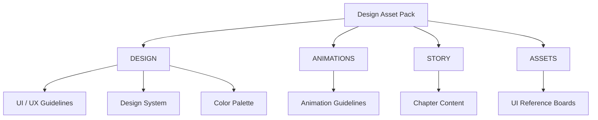
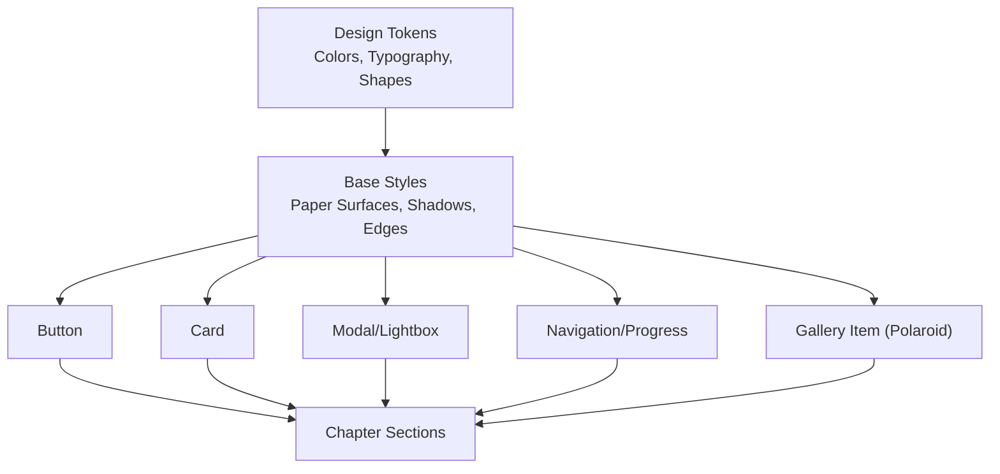
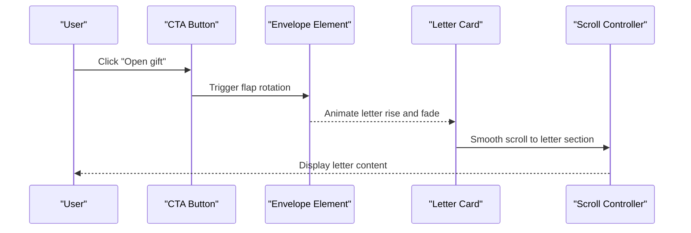
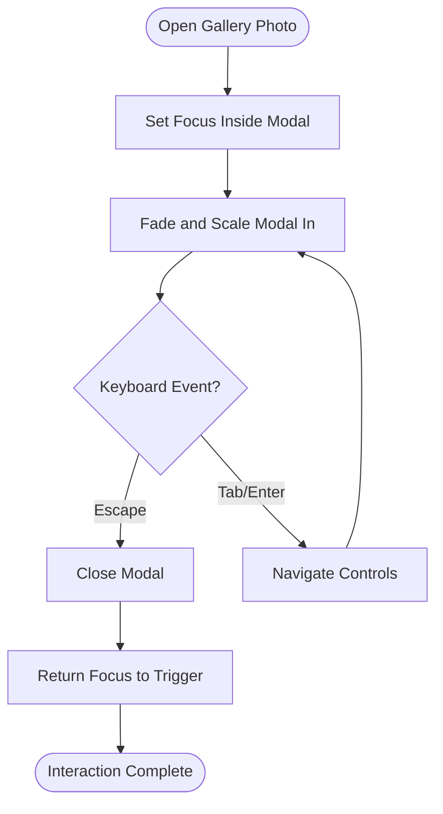
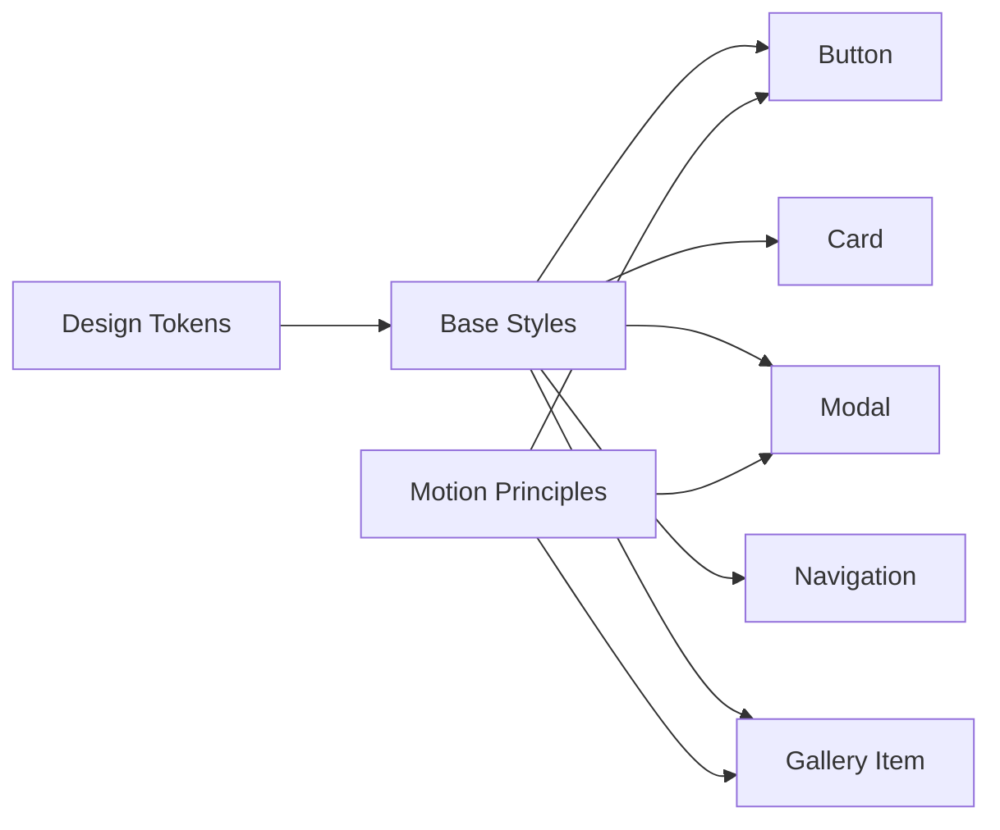

# UI Component Guidelines

<cite>
**Referenced Files in This Document**   
- [ui-guidelines.md](file://A-Little-World-For-You-Design-Asset-Pack\DESIGN\ui-guidelines.md)
- [design-system.md](file://A-Little-World-For-You-Design-Asset-Pack\DESIGN\design-system.md)
- [color-palette.md](file://A-Little-World-For-You-Design-Asset-Pack\DESIGN\color-palette.md)
- [animation-guidelines.md](file://A-Little-World-For-You-Design-Asset-Pack\ANIMATIONS\animation-guidelines.md)
- [README.md](file://A-Little-World-For-You-Design-Asset-Pack\README.md)
- [story-overview.md](file://A-Little-World-For-You-Design-Asset-Pack\STORY\story-overview.md)
</cite>

## Table of Contents
1. [Introduction](#introduction)
2. [Project Structure](#project-structure)
3. [Core Components](#core-components)
4. [Architecture Overview](#architecture-overview)
5. [Detailed Component Analysis](#detailed-component-analysis)
6. [Dependency Analysis](#dependency-analysis)
7. [Performance Considerations](#performance-considerations)
8. [Troubleshooting Guide](#troubleshooting-guide)
9. [Conclusion](#conclusion)
10. [Appendices](#appendices)

## Introduction
This document defines the UI component guidelines for a romantic, intimate single-page experience. The design system emphasizes a gentle watercolor storybook aesthetic with warm paper-like surfaces, soft edges, and calm motion. The goal is to create buttons, cards, modals, and navigation components that feel handmade, sincere, and accessible, while supporting mobile-first responsive behavior and keyboard/screen reader interactions.

The overall emotional arc guides how components should behave: curiosity, sincerity, recognition, warmth, commitment, and gentle closure. UI elements must never pressure the recipient; they should remain readable without animation and support reduced-motion preferences.

**Section sources**
- [README.md:5-10](file://A-Little-World-For-You-Design-Asset-Pack\README.md#L5-L10)
- [story-overview.md:6-19](file://A-Little-World-For-You-Design-Asset-Pack\STORY\story-overview.md#L6-L19)

## Project Structure
The design asset pack organizes guidance into clear areas:
- DESIGN: design system, color palette, and UI/UX guidelines.
- ANIMATIONS: motion principles and technical requirements.
- STORY: chapter-by-chapter narrative context.
- ASSETS: concept boards and references.

**Diagram sources**
- [README.md:12-17](file://A-Little-World-For-You-Design-Asset-Pack\README.md#L12-L17)

**Section sources**
- [README.md:12-17](file://A-Little-World-For-You-Design-Asset-Pack\README.md#L12-L17)

## Core Components
This section establishes reusable UI building blocks aligned with the design system. Each component follows the watercolor aesthetic, accessibility rules, and responsive patterns defined by the project.

### Buttons
- Shape: pill or softly rounded corners.
- Surface: rose accent on cream/paper backgrounds; deep rose text/accent on light surfaces.
- States: default, hover, focus, active, disabled.
- Focus: visible focus ring; ensure sufficient contrast.
- Size: minimum comfortable tap target around 44px.
- Behavior: one primary action per section; avoid auto-play audio; do not force user tasks.

Implementation notes:
- Use semantic `<button>` elements.
- Provide clear labels and aria attributes where needed.
- Keep animations subtle (e.g., gentle scale or fade).
- Respect `prefers-reduced-motion`.

**Section sources**
- [design-system.md:28-33](file://A-Little-World-For-You-Design-Asset-Pack\DESIGN\design-system.md#L28-L33)
- [design-system.md:42-48](file://A-Little-World-For-You-Design-Asset-Pack\DESIGN\design-system.md#L42-L48)
- [ui-guidelines.md:48-55](file://A-Little-World-For-You-Design-Asset-Pack\DESIGN\ui-guidelines.md#L48-L55)

### Cards
- Shape: rounded 20–28px.
- Surface: paper-like border, subtle shadow, slightly imperfect decorative edges using CSS.
- Content: serif headings, readable body copy, handwritten accents only for short notes.
- States: default, hover, focus, selected (if applicable), disabled.
- Interactions: gentle reveal via opacity and transform; avoid layout-heavy animations.

Implementation notes:
- Use semantic containers (`<article>`, `<section>`) when appropriate.
- Maintain comfortable reading width (620–720px) within card content.
- Ensure alt text for meaningful images; empty alt for decoration.

**Section sources**
- [design-system.md:22-33](file://A-Little-World-For-You-Design-Asset-Pack\DESIGN\design-system.md#L22-L33)
- [ui-guidelines.md:14-19](file://A-Little-World-For-You-Design-Asset-Pack\DESIGN\ui-guidelines.md#L14-L19)

### Modals and Lightboxes
- Purpose: accessible lightbox for photo gallery and optional confirmations.
- Behavior: fade and scale from 0.98→1; close button present; keyboard support.
- Accessibility: trap focus inside modal; return focus to trigger on close; announce open/close to screen readers.
- Motion: gentle transitions; respect reduced-motion.

Implementation notes:
- Use native dialog or ARIA modal patterns.
- Provide keyboard shortcuts (Escape to close).
- Avoid forcing completion; allow dismissal at any time.

**Section sources**
- [ui-guidelines.md:28-33](file://A-Little-World-For-You-Design-Asset-Pack\DESIGN\ui-guidelines.md#L28-L33)
- [ui-guidelines.md:48-55](file://A-Little-World-For-You-Design-Asset-Pack\DESIGN\ui-guidelines.md#L48-L55)
- [animation-guidelines.md:21-28](file://A-Little-World-For-You-Design-Asset-Pack\ANIMATIONS\animation-guidelines.md#L21-L28)

### Navigation and Progress Indicators
- Style: minimal, non-dominant progress indicator if used.
- Behavior: smooth scroll between chapters; maintain readability without animation.
- Accessibility: landmarks, semantic headings, keyboard-operable interactions.

Implementation notes:
- Use semantic navigation elements (`<nav>`, `<ul>`, `<li>`).
- Provide skip links and visible focus states.
- Keep progress indicators subtle and optional.

**Section sources**
- [ui-guidelines.md:3-5](file://A-Little-World-For-You-Design-Asset-Pack\DESIGN\ui-guidelines.md#L3-L5)
- [ui-guidelines.md:48-55](file://A-Little-World-For-You-Design-Asset-Pack\DESIGN\ui-guidelines.md#L48-L55)

### Gallery Items (Polaroids)
- Shape: white border, slight rotation, soft shadow.
- Interaction: tiny rotation on hover/tap; opens accessible lightbox.
- Content: captions editable in data file; placeholders until real photos are added.

Implementation notes:
- Use image elements with descriptive alt text.
- Provide caption text below or within accessible structure.
- Ensure lightbox supports keyboard navigation and screen readers.

**Section sources**
- [design-system.md:32-33](file://A-Little-World-For-You-Design-Asset-Pack\DESIGN\design-system.md#L32-L33)
- [ui-guidelines.md:28-33](file://A-Little-World-For-You-Design-Asset-Pack\DESIGN\ui-guidelines.md#L28-L33)

## Architecture Overview
The UI architecture centers on a small set of reusable components built on the design tokens and motion principles. Components compose into chapter-based sections following a vertical narrative flow.

**Diagram sources**
- [design-system.md:6-33](file://A-Little-World-For-You-Design-Asset-Pack\DESIGN\design-system.md#L6-L33)
- [ui-guidelines.md:3-5](file://A-Little-World-For-You-Design-Asset-Pack\DESIGN\ui-guidelines.md#L3-L5)

## Detailed Component Analysis

### Watercolor Aesthetic Application
- Soft edges: use rounded corners for cards and buttons; avoid sharp angles.
- Gentle shadows: subtle elevation for cards and polaroids; keep shadows soft and low-opacity.
- Paper-like textures: apply paper surface colors and borders; use CSS to simulate slightly imperfect decorative edges sparingly.
- Color balance: alternate warm paper, pale sky, and botanical tones to create visual rhythm; avoid making every section pink.

Implementation notes:
- Apply tokenized colors consistently across components.
- Limit decorative watercolor elements to enhance intimacy without clutter.
- Ensure text remains readable against varied backgrounds.

**Section sources**
- [design-system.md:6-33](file://A-Little-World-For-You-Design-Asset-Pack\DESIGN\design-system.md#L6-L33)
- [color-palette.md:14-22](file://A-Little-World-For-You-Design-Asset-Pack\DESIGN\color-palette.md#L14-L22)

### Component States and Interactions
- Default: calm, readable, inviting.
- Hover: gentle scale/fade; avoid rapid bouncing or flashing.
- Focus: visible focus ring; ensure high contrast.
- Active: subtle press effect; maintain clarity.
- Disabled: muted state; clearly indicate non-interactivity.
- Reduced motion: disable ambient loops and simplify transitions.

Implementation notes:
- Use transform and opacity for animations; avoid layout-heavy properties.
- Keep transition durations within 350–700ms for most interactions.
- Respect `prefers-reduced-motion` for all interactive elements.

**Section sources**
- [animation-guidelines.md:5-11](file://A-Little-World-For-You-Design-Asset-Pack\ANIMATIONS\animation-guidelines.md#L5-L11)
- [animation-guidelines.md:21-28](file://A-Little-World-For-You-Design-Asset-Pack\ANIMATIONS\animation-guidelines.md#L21-L28)

### Responsive Behavior Patterns
- Mobile-first layout; main content max width 1080–1160px.
- Comfortable reading width 620–720px.
- Generous spacing: 88–120px desktop, 56–76px mobile.
- Test at 360px, 390px, 768px, 1024px, and wide desktop.
- Support tap targets around 44px; do not rely on hover.

Implementation notes:
- Use fluid typography and spacing scales.
- Ensure gallery items stack gracefully on small screens.
- Keep modals accessible on mobile; provide easy dismiss actions.

**Section sources**
- [design-system.md:35-40](file://A-Little-World-For-You-Design-Asset-Pack\DESIGN\design-system.md#L35-L40)
- [ui-guidelines.md:48-55](file://A-Little-World-For-You-Design-Asset-Pack\DESIGN\ui-guidelines.md#L48-L55)

### Practical React Component Patterns
Reusable React components should encapsulate:
- Props for label, variant, size, disabled, and accessibility attributes.
- Internal state for focus management and modal visibility.
- Animation hooks respecting reduced motion.
- Semantic HTML output with proper ARIA roles and labels.

Recommended patterns:
- Button: `<Button variant="primary" onClick={...} aria-label={...}>`
- Card: `<Card as="article">...</Card>`
- Modal: `<Modal isOpen={isOpen} onClose={handleClose} title="...">`
- GalleryItem: `<GalleryItem src="..." alt="..." caption="...">`
- Navigation: `<Nav items={...} activeIndex={...} />`

Accessibility checklist:
- Keyboard operable: Tab order logical; Enter/Space triggers actions; Escape closes modals.
- Screen reader support: Announce dynamic changes; provide descriptive labels; use landmarks.
- Visible focus: Custom focus rings styled with high contrast.
- Reduced motion: Disable nonessential animations when requested.

[No code snippets included; implement according to these patterns.]

**Section sources**
- [design-system.md:42-48](file://A-Little-World-For-You-Design-Asset-Pack\DESIGN\design-system.md#L42-L48)
- [ui-guidelines.md:48-55](file://A-Little-World-For-You-Design-Asset-Pack\DESIGN\ui-guidelines.md#L48-L55)
- [animation-guidelines.md:21-28](file://A-Little-World-For-You-Design-Asset-Pack\ANIMATIONS\animation-guidelines.md#L21-L28)

### Sequence: Envelope Open and Letter Reveal

**Diagram sources**
- [ui-guidelines.md:6-12](file://A-Little-World-For-You-Design-Asset-Pack\DESIGN\ui-guidelines.md#L6-L12)
- [animation-guidelines.md:13-18](file://A-Little-World-For-You-Design-Asset-Pack\ANIMATIONS\animation-guidelines.md#L13-L18)

### Flowchart: Accessible Modal/Lightbox Interaction

**Diagram sources**
- [ui-guidelines.md:28-33](file://A-Little-World-For-You-Design-Asset-Pack\DESIGN\ui-guidelines.md#L28-L33)
- [ui-guidelines.md:48-55](file://A-Little-World-For-You-Design-Asset-Pack\DESIGN\ui-guidelines.md#L48-L55)

## Dependency Analysis
Components depend on shared design tokens and motion principles. Coupling is minimized by keeping base styles separate from component logic.

**Diagram sources**
- [design-system.md:6-33](file://A-Little-World-For-You-Design-Asset-Pack\DESIGN\design-system.md#L6-L33)
- [animation-guidelines.md:5-11](file://A-Little-World-For-You-Design-Asset-Pack\ANIMATIONS\animation-guidelines.md#L5-L11)

**Section sources**
- [design-system.md:6-33](file://A-Little-World-For-You-Design-Asset-Pack\DESIGN\design-system.md#L6-L33)
- [animation-guidelines.md:5-11](file://A-Little-World-For-You-Design-Asset-Pack\ANIMATIONS\animation-guidelines.md#L5-L11)

## Performance Considerations
- Prefer transform and opacity for animations; avoid layout-heavy properties.
- Use viewport-triggered reveals once per section; avoid redundant animations.
- Limit simultaneous particles and ambient loops; stop or simplify on mobile.
- Respect `prefers-reduced-motion`; disable nonessential ambient animation.
- Test on mid-range mobile devices; ensure smooth scrolling and touch interactions.

**Section sources**
- [animation-guidelines.md:21-28](file://A-Little-World-For-You-Design-Asset-Pack\ANIMATIONS\animation-guidelines.md#L21-L28)

## Troubleshooting Guide
Common issues and resolutions:
- Missing focus ring: ensure custom focus styles have high contrast and are applied to interactive elements.
- Screen reader announcements missing: add ARIA live regions or roles where dynamic content updates occur.
- Excessive motion causing discomfort: honor `prefers-reduced-motion`; reduce amplitude and frequency.
- Tap targets too small: increase to at least 44px; avoid hover-only interactions.
- Images lacking alt text: provide meaningful alt descriptions; use empty alt for decorative images.

**Section sources**
- [ui-guidelines.md:48-55](file://A-Little-World-For-You-Design-Asset-Pack\DESIGN\ui-guidelines.md#L48-L55)

## Conclusion
These UI component guidelines establish a cohesive, romantic, and accessible design system. By applying watercolor aesthetics through soft edges, gentle shadows, and paper-like textures, and by enforcing thoughtful interactions and responsive behavior, the interface will feel intimate and sincere. Prioritizing accessibility and reduced-motion support ensures inclusivity across devices and abilities.

[No sources needed since this section summarizes without analyzing specific files]

## Appendices

### Color Usage Summary
- Primary background: warm ivory.
- Paper surface: off-white.
- Accents: blush, rose, peach, sky blue, sage.
- Text: ink and muted tones.
- Balance: alternate warm paper, pale sky, and botanical tones; limit pink usage.

**Section sources**
- [color-palette.md:1-22](file://A-Little-World-For-You-Design-Asset-Pack\DESIGN\color-palette.md#L1-L22)

### Typography Summary
- Headings: serif fonts like Playfair Display or Cormorant Garamond.
- Body: sans-serif fonts like Nunito or Quicksand.
- Handwritten accents: Caveat or Pacifico, used sparingly.

**Section sources**
- [design-system.md:22-27](file://A-Little-World-For-You-Design-Asset-Pack\DESIGN\design-system.md#L22-L27)