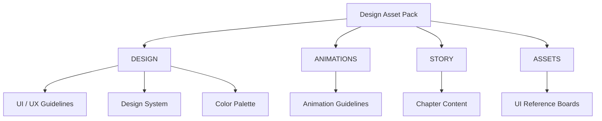
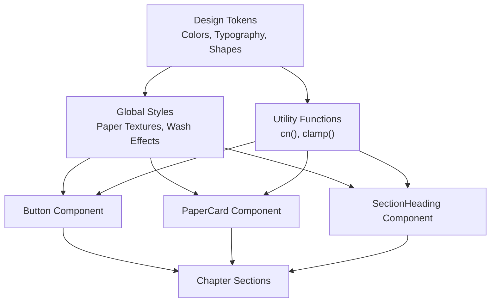
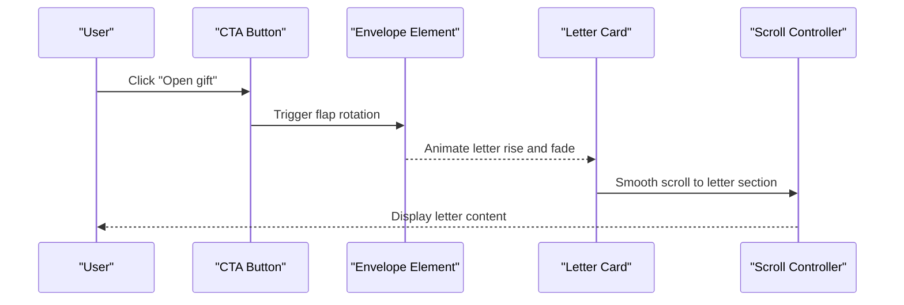
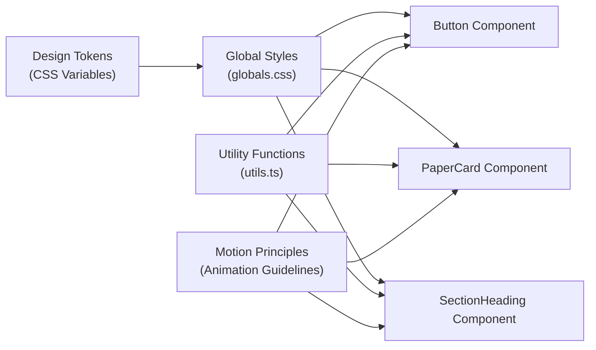

# UI Component Guidelines

<cite>
**Referenced Files in This Document**   
- [Button.tsx](file://src/components/ui/Button.tsx)
- [PaperCard.tsx](file://src/components/ui/PaperCard.tsx)
- [SectionHeading.tsx](file://src/components/ui/SectionHeading.tsx)
- [globals.css](file://src/app/globals.css)
- [utils.ts](file://src/lib/utils.ts)
- [ui-guidelines.md](file://A-Little-World-For-You-Design-Asset-Pack\DESIGN\ui-guidelines.md)
- [design-system.md](file://A-Little-World-For-You-Design-Asset-Pack\DESIGN\design-system.md)
- [color-palette.md](file://A-Little-World-For-You-Design-Asset-Pack\DESIGN\color-palette.md)
- [animation-guidelines.md](file://A-Little-World-For-You-Design-Asset-Pack\ANIMATIONS\animation-guidelines.md)
</cite>

## Update Summary
**Changes Made**   
- Added detailed documentation for the new Button, PaperCard, and SectionHeading components
- Updated component architecture section with actual implementation details
- Enhanced watercolor aesthetic application with specific CSS implementations
- Added practical React component patterns based on the new component library
- Updated accessibility requirements with specific focus management and ARIA attributes
- Included responsive behavior patterns from the actual codebase

## Table of Contents
1. [Introduction](#introduction)
2. [Project Structure](#project-structure)
3. [Core Components](#core-components)
4. [Architecture Overview](#architecture-overview)
5. [Detailed Component Analysis](#detailed-component-analysis)
6. [Dependency Analysis](#dependency-analysis)
7. [Performance Considerations](#performance-considerations)
8. [Troubleshooting Guide](#troubleshooting-guide)
9. [Conclusion](#conclusion)
10. [Appendices](#appendices)

## Introduction
This document defines the UI component guidelines for a romantic, intimate single-page experience built with a new component library featuring Button, PaperCard, and SectionHeading components. The design system emphasizes a gentle watercolor storybook aesthetic with warm paper-like surfaces, soft edges, and calm motion. The goal is to create buttons, cards, modals, and navigation components that feel handmade, sincere, and accessible, while supporting mobile-first responsive behavior and keyboard/screen reader interactions.

The overall emotional arc guides how components should behave: curiosity, sincerity, recognition, warmth, commitment, and gentle closure. UI elements must never pressure the recipient; they should remain readable without animation and support reduced-motion preferences.

**Section sources**
- [ui-guidelines.md:3-12](file://A-Little-World-For-You-Design-Asset-Pack\DESIGN\ui-guidelines.md#L3-L12)
- [design-system.md:3-5](file://A-Little-World-For-You-Design-Asset-Pack\DESIGN\design-system.md#L3-L5)

## Project Structure
The design asset pack organizes guidance into clear areas:
- DESIGN: design system, color palette, and UI/UX guidelines.
- ANIMATIONS: motion principles and technical requirements.
- STORY: chapter-by-chapter narrative context.
- ASSETS: concept boards and references.



**Diagram sources**
- [README.md:12-17](file://A-Little-World-For-You-Design-Asset-Pack\README.md#L12-L17)

**Section sources**
- [README.md:12-17](file://A-Little-World-For-You-Design-Asset-Pack\README.md#L12-L17)

## Core Components
This section establishes the three core reusable UI building blocks aligned with the design system. Each component follows the watercolor aesthetic, accessibility rules, and responsive patterns defined by the project.

### Button Component
The Button component provides three variants (primary, secondary, quiet) with two sizes (md, lg), implementing the watercolor aesthetic through soft rounded corners, rose accents, and gentle shadows.

**Key Features:**
- **Variants**: Primary (rose background), Secondary (paper surface with border), Quiet (transparent underline)
- **Sizes**: Medium (min-height 44px) and Large (min-height 52px) for comfortable tap targets
- **Accessibility**: Semantic `<button>` element with visible focus ring using `focus-visible`
- **Interactions**: Gentle hover effects with subtle lift (`-translate-y-0.5`) and smooth transitions
- **States**: Default, hover, focus, active, disabled with appropriate visual feedback

**Implementation Details:**
- Uses Tailwind classes with custom color tokens (`bg-rose-deep`, `text-paper`, `shadow-paper`)
- Implements pill shape with `rounded-full` for soft, organic appearance
- Focus styling uses `focus-visible:outline-2 focus-visible:outline-offset-3 focus-visible:outline-rose-deep`
- Transitions applied to transform, background-color, color, and box-shadow properties
- Disabled state includes `cursor-not-allowed` and reduced opacity

**Usage Example:**
```tsx
<Button variant="primary" size="lg" onClick={handleClick}>
  Open Gift
</Button>
```

**Section sources**
- [Button.tsx:1-36](file://src/components/ui/Button.tsx#L1-L36)
- [design-system.md:30-33](file://A-Little-World-For-You-Design-Asset-Pack\DESIGN\design-system.md#L30-L33)
- [ui-guidelines.md:49-55](file://A-Little-World-For-You-Design-Asset-Pack\DESIGN\ui-guidelines.md#L49-L55)

### PaperCard Component
The PaperCard component creates paper-like surfaces used throughout the interface for letters, promise cards, and scrapbook notes. It implements the watercolor aesthetic through texture, borders, and shadows.

**Key Features:**
- **Texture**: SVG-based paper grain overlay using `feTurbulence` filter for authentic paper feel
- **Surface**: Paper-colored background with subtle border and shadow elevation
- **Shape**: Rounded corners using CSS custom property `--radius-paper` (1.75rem)
- **Accessibility**: Semantic div container with proper ARIA attributes when needed
- **Composition**: Flexible children container supporting various content types

**Implementation Details:**
- Applies `.paper-texture` class which adds SVG noise overlay at 5.5% opacity
- Uses CSS custom properties for consistent spacing and shadows
- Shadow effect combines elevation shadow with inset white highlight for depth
- Border uses ink color at 8% opacity for subtle definition

**Usage Example:**
```tsx
<PaperCard className="p-8">
  <h3>Promise Card</h3>
  <p>I will listen before explaining.</p>
</PaperCard>
```

**Section sources**
- [PaperCard.tsx:1-21](file://src/components/ui/PaperCard.tsx#L1-L21)
- [globals.css:61-78](file://src/app/globals.css#L61-L78)
- [design-system.md:30-35](file://A-Little-World-For-You-Design-Asset-Pack\DESIGN\design-system.md#L30-L35)

### SectionHeading Component
The SectionHeading component provides structured heading layouts with optional eyebrow text and lead paragraphs, following the watercolor aesthetic through typography and spacing.

**Key Features:**
- **Structure**: Header element containing eyebrow, title, and optional lead paragraph
- **Typography**: Display font for headings, body font for lead text, handwritten accent for eyebrow
- **Alignment**: Center or left alignment options with responsive sizing
- **Accessibility**: Proper semantic structure with heading hierarchy and ID support
- **Styling**: Rose-deep eyebrow text, responsive heading sizes, muted lead text

**Implementation Details:**
- Eyebrow text uses uppercase tracking with rose-deep color for section identification
- Main heading uses display font with responsive sizing (1.75rem to 2.6rem)
- Lead paragraph limited to 38rem max-width for optimal reading comfort
- Supports anchor links through optional ID prop for navigation

**Usage Example:**
```tsx
<SectionHeading 
  eyebrow="Chapter Three"
  title="What I Didn't Realize"
  lead="Three illustrated story beats showing my growth."
  align="center"
/>
```

**Section sources**
- [SectionHeading.tsx:1-52](file://src/components/ui/SectionHeading.tsx#L1-L52)
- [design-system.md:22-28](file://A-Little-World-For-You-Design-Asset-Pack\DESIGN\design-system.md#L22-L28)

## Architecture Overview
The UI architecture centers on three core components built on shared design tokens and global styles. Components compose into chapter-based sections following a vertical narrative flow.



**Diagram sources**
- [Button.tsx:1-36](file://src/components/ui/Button.tsx#L1-L36)
- [PaperCard.tsx:1-21](file://src/components/ui/PaperCard.tsx#L1-L21)
- [SectionHeading.tsx:1-52](file://src/components/ui/SectionHeading.tsx#L1-L52)
- [globals.css:1-141](file://src/app/globals.css#L1-L141)
- [utils.ts:1-27](file://src/lib/utils.ts#L1-L27)

## Detailed Component Analysis

### Watercolor Aesthetic Application
The watercolor aesthetic is implemented through several key techniques across all components:

**Soft Edges and Organic Shapes:**
- Buttons use `rounded-full` for pill shapes
- Cards use CSS custom property `--radius-paper` (1.75rem) for consistent rounding
- Avoid sharp angles throughout the interface

**Gentle Shadows and Elevation:**
- Custom shadow token `--shadow-paper` combines elevation with inset highlights
- Subtle shadow values using ink color at controlled opacity
- Hover states include gentle lift transforms (`-translate-y-0.5`)

**Paper-like Textures:**
- SVG-based paper grain overlay using `feTurbulence` filter
- Low opacity (5.5%) blend mode for authentic paper feel
- Inset white highlights for depth and dimension

**Color Balance and Wash Effects:**
- Radial gradient washes behind illustrations and headings
- Alternating warm paper, pale sky, and botanical tones
- Controlled rose usage (5% of palette) to avoid overwhelming pink

**Section sources**
- [globals.css:21-26](file://src/app/globals.css#L21-L26)
- [globals.css:61-106](file://src/app/globals.css#L61-L106)
- [design-system.md:6-20](file://A-Little-World-For-You-Design-Asset-Pack\DESIGN\design-system.md#L6-L20)

### Component States and Interactions
All components follow consistent interaction patterns aligned with the watercolor aesthetic:

**Default State:**
- Calm, readable, inviting presentation
- Appropriate contrast ratios meeting WCAG AA standards
- Clear visual hierarchy with proper typography

**Hover State:**
- Gentle scale/fade transitions (350-700ms duration)
- Subtle lift effects for interactive elements
- Color transitions maintaining brand consistency

**Focus State:**
- Visible focus ring using `focus-visible` pseudo-class
- High contrast outline (rose-deep color)
- Proper outline offset for clarity

**Active State:**
- Subtle press effects maintaining readability
- Transform animations for tactile feedback
- Smooth transition back to default state

**Disabled State:**
- Muted appearance with reduced opacity
- Cursor not allowed for non-interactive elements
- Clear indication of non-interactivity

**Reduced Motion Support:**
- All animations respect `prefers-reduced-motion`
- Simplified transitions for accessibility
- No essential functionality dependent on animations

**Section sources**
- [Button.tsx:11-31](file://src/components/ui/Button.tsx#L11-L31)
- [globals.css:55-59](file://src/app/globals.css#L55-L59)
- [globals.css:128-141](file://src/app/globals.css#L128-L141)
- [animation-guidelines.md:5-11](file://A-Little-World-For-You-Design-Asset-Pack\ANIMATIONS\animation-guidelines.md#L5-L11)

### Responsive Behavior Patterns
Components implement mobile-first responsive design with careful attention to touch interactions:

**Mobile-First Layout:**
- Base styles optimized for small screens
- Fluid typography scaling from 1.75rem to 2.6rem
- Touch-friendly minimum tap targets (44px+)

**Breakpoint Strategy:**
- Small screens: Single column layout, compact spacing
- Tablet (768px+): Improved readability, larger text
- Desktop: Maximum content width constraints, enhanced spacing

**Touch and Mouse Interactions:**
- Hover effects enhanced but not required for functionality
- Tap targets sized appropriately for fingers
- Gesture-friendly spacing between interactive elements

**Content Constraints:**
- Maximum reading width of 38rem for lead paragraphs
- Comfortable line heights for extended reading
- Proper margins and padding for breathing room

**Section sources**
- [SectionHeading.tsx:22-48](file://src/components/ui/SectionHeading.tsx#L22-L48)
- [design-system.md:37-42](file://A-Little-World-For-You-Design-Asset-Pack\DESIGN\design-system.md#L37-L42)
- [ui-guidelines.md:49-57](file://A-Little-World-For-You-Design-Asset-Pack\DESIGN\ui-guidelines.md#L49-L57)

### Practical React Component Patterns
The new component library demonstrates best practices for reusable React components:

**Component Structure:**
- TypeScript interfaces for props validation
- Default prop values for sensible defaults
- Spread operator for additional HTML attributes
- Conditional rendering for optional content

**Styling Approach:**
- Utility-first CSS with Tailwind classes
- CSS custom properties for design tokens
- Class composition with utility function
- Consistent naming conventions

**Accessibility Implementation:**
- Semantic HTML elements as base
- Proper ARIA attributes when needed
- Keyboard navigation support
- Screen reader compatibility

**Recommended Patterns:**
```tsx
// Button usage
<Button variant="primary" size="lg" onClick={handleSubmit} aria-label="Submit form">
  Submit
</Button>

// PaperCard usage  
<PaperCard className="mb-8 p-6">
  <h3>Card Title</h3>
  <p>Card content goes here</p>
</PaperCard>

// SectionHeading usage
<SectionHeading 
  eyebrow="Chapter One"
  title="The Beginning"
  lead="An introduction to our story."
  align="center"
  id="chapter-one"
/>
```

**Accessibility Checklist:**
- Keyboard operable with logical Tab order
- Enter/Space triggers actions appropriately
- Escape closes modals and dialogs
- Screen reader announcements for dynamic changes
- Descriptive labels and landmarks
- High contrast focus indicators
- Reduced motion support

**Section sources**
- [Button.tsx:6-9](file://src/components/ui/Button.tsx#L6-L9)
- [PaperCard.tsx:4-8](file://src/components/ui/PaperCard.tsx#L4-L8)
- [SectionHeading.tsx:3-10](file://src/components/ui/SectionHeading.tsx#L3-L10)
- [ui-guidelines.md:49-55](file://A-Little-World-For-You-Design-Asset-Pack\DESIGN\ui-guidelines.md#L49-L55)

### Sequence: Envelope Open and Letter Reveal


**Diagram sources**
- [ui-guidelines.md:6-12](file://A-Little-World-For-You-Design-Asset-Pack\DESIGN\ui-guidelines.md#L6-L12)
- [animation-guidelines.md:13-18](file://A-Little-World-For-You-Design-Asset-Pack\ANIMATIONS\animation-guidelines.md#L13-L18)

### Flowchart: Accessible Modal/Lightbox Interaction


**Diagram sources**
- [ui-guidelines.md:28-33](file://A-Little-World-For-You-Design-Asset-Pack\DESIGN\ui-guidelines.md#L28-L33)
- [ui-guidelines.md:48-55](file://A-Little-World-For-You-Design-Asset-Pack\DESIGN\ui-guidelines.md#L48-L55)

## Dependency Analysis
Components depend on shared design tokens, global styles, and utility functions. Coupling is minimized by keeping base styles separate from component logic.



**Diagram sources**
- [globals.css:9-32](file://src/app/globals.css#L9-L32)
- [utils.ts:1-27](file://src/lib/utils.ts#L1-L27)
- [Button.tsx:1-36](file://src/components/ui/Button.tsx#L1-L36)
- [PaperCard.tsx:1-21](file://src/components/ui/PaperCard.tsx#L1-L21)
- [SectionHeading.tsx:1-52](file://src/components/ui/SectionHeading.tsx#L1-L52)

**Section sources**
- [globals.css:1-141](file://src/app/globals.css#L1-L141)
- [utils.ts:1-27](file://src/lib/utils.ts#L1-L27)
- [animation-guidelines.md:5-11](file://A-Little-World-For-You-Design-Asset-Pack\ANIMATIONS\animation-guidelines.md#L5-L11)

## Performance Considerations
The component library prioritizes performance through efficient implementation:

**Animation Performance:**
- Prefer transform and opacity for animations over layout-heavy properties
- Use viewport-triggered reveals once per section
- Limit simultaneous particles and ambient loops
- Respect `prefers-reduced-motion` for all animations

**CSS Optimization:**
- Minimal CSS file size with focused selectors
- Efficient SVG filters for paper textures
- Optimized gradient calculations with CSS custom properties
- Reduced animation durations for accessibility

**JavaScript Efficiency:**
- Simple utility functions without heavy dependencies
- No unnecessary re-renders in React components
- Efficient event handling and state management
- Proper cleanup of event listeners and timers

**Mobile Performance:**
- Test on mid-range mobile devices
- Optimize image loading and caching
- Minimize bundle size by avoiding unnecessary libraries
- Ensure smooth scrolling and touch interactions

**Section sources**
- [animation-guidelines.md:21-29](file://A-Little-World-For-You-Design-Asset-Pack\ANIMATIONS\animation-guidelines.md#L21-L29)
- [globals.css:128-141](file://src/app/globals.css#L128-L141)

## Troubleshooting Guide
Common issues and resolutions for the UI component library:

**Missing Focus Ring:**
- Ensure `focus-visible` is supported in target browsers
- Verify focus styles are applied to interactive elements
- Check that custom focus styles have high contrast
- Test with keyboard navigation only

**Screen Reader Issues:**
- Add ARIA live regions for dynamic content updates
- Provide descriptive labels for icon-only controls
- Use semantic HTML elements appropriately
- Test with multiple screen readers (NVDA, JAWS, VoiceOver)

**Excessive Motion:**
- Honor `prefers-reduced-motion` media query
- Reduce animation amplitude and frequency
- Disable nonessential ambient animations
- Provide manual controls for motion preferences

**Tap Target Problems:**
- Increase interactive elements to minimum 44px
- Remove hover-only interactions
- Ensure adequate spacing between touch targets
- Test with touch simulators and real devices

**Image Accessibility:**
- Provide meaningful alt descriptions for content images
- Use empty alt attributes for decorative images
- Implement lazy loading for below-fold images
- Optimize image formats and sizes

**Section sources**
- [ui-guidelines.md:49-57](file://A-Little-World-For-You-Design-Asset-Pack\DESIGN\ui-guidelines.md#L49-L57)

## Conclusion
These UI component guidelines establish a cohesive, romantic, and accessible design system through the new Button, PaperCard, and SectionHeading components. By applying watercolor aesthetics through soft edges, gentle shadows, and paper-like textures, and by enforcing thoughtful interactions and responsive behavior, the interface feels intimate and sincere. The component library prioritizes accessibility and reduced-motion support, ensuring inclusivity across devices and abilities while maintaining the emotional tone of the romantic narrative.

## Appendices

### Color Usage Summary
- **Primary background**: Warm ivory `#FFF9F2`
- **Paper surface**: Off-white `#FFFDF9`
- **Accents**: Blush `#F7DCE2`, Rose `#D98FA0`, Peach `#F5C7AE`, Sky blue `#DCEAF2`, Sage `#C8D2BE`
- **Text**: Ink `#59464A` and Muted `#7A6466`
- **Balance**: 55% cream/paper, 20% blush, 10% peach, 10% sky/sage, 5% rose accents

**Section sources**
- [color-palette.md:1-22](file://A-Little-World-For-You-Design-Asset-Pack\DESIGN\color-palette.md#L1-L22)

### Typography Summary
- **Headings**: Playfair Display serif font
- **Body**: Nunito sans-serif font
- **Handwritten accents**: Pacifico cursive font, used sparingly for signatures and notes
- **Subset requirement**: Vietnamese subset for all fonts
- **Loading**: Next.js font optimization with display swap

**Section sources**
- [design-system.md:22-28](file://A-Little-World-For-You-Design-Asset-Pack\DESIGN\design-system.md#L22-L28)
- [globals.css:28-32](file://src/app/globals.css#L28-L32)

### Component API Reference

**Button Props:**
- `variant`: "primary" | "secondary" | "quiet"
- `size`: "md" | "lg"
- Standard button HTML attributes

**PaperCard Props:**
- Standard div HTML attributes
- className for additional styling

**SectionHeading Props:**
- `eyebrow`: string (optional)
- `title`: string (required)
- `lead`: string (optional)
- `align`: "left" | "center"
- `className`: string (optional)
- `id`: string (optional)

**Section sources**
- [Button.tsx:6-9](file://src/components/ui/Button.tsx#L6-L9)
- [PaperCard.tsx:4-8](file://src/components/ui/PaperCard.tsx#L4-L8)
- [SectionHeading.tsx:3-10](file://src/components/ui/SectionHeading.tsx#L3-L10)