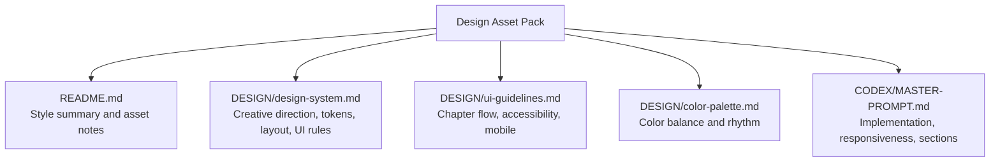
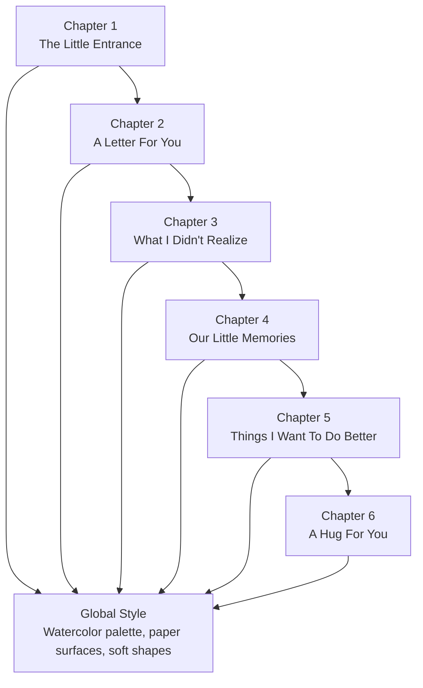
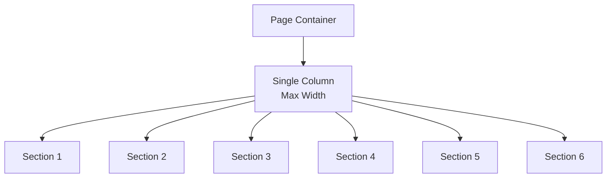
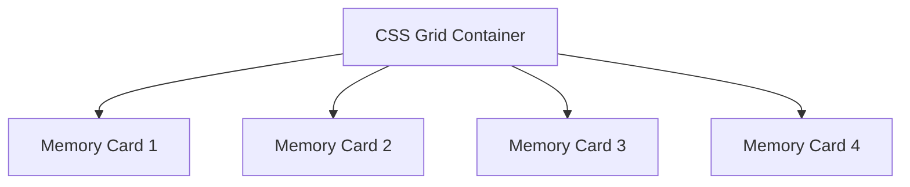
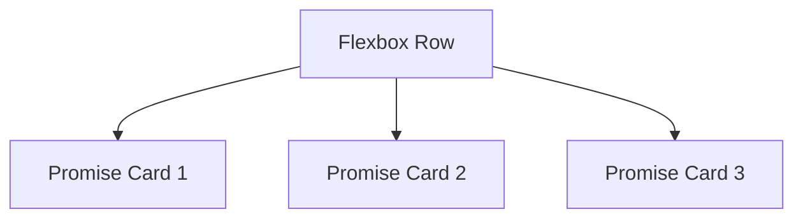
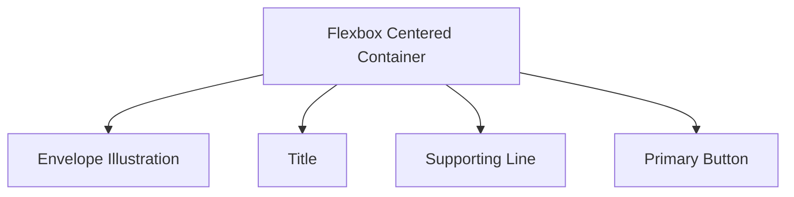
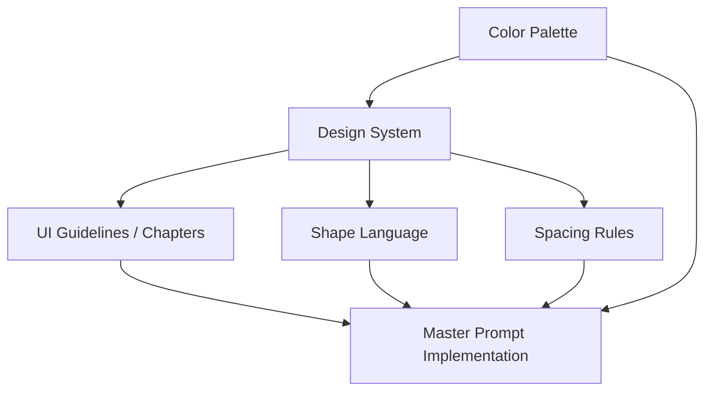

# Visual Principles & Layout

<cite>
**Referenced Files in This Document**   
- [README.md](file://A-Little-World-For-You-Design-Asset-Pack/README.md)
- [design-system.md](file://A-Little-World-For-You-Design-Asset-Pack/DESIGN/design-system.md)
- [ui-guidelines.md](file://A-Little-World-For-You-Design-Asset-Pack/DESIGN/ui-guidelines.md)
- [color-palette.md](file://A-Little-World-For-You-Design-Asset-Pack/DESIGN/color-palette.md)
- [MASTER-PROMPT.md](file://A-Little-World-For-You-Design-Asset-Pack/CODEX/MASTER-PROMPT.md)
</cite>

## Table of Contents
1. [Introduction](#introduction)
2. [Project Structure](#project-structure)
3. [Core Components](#core-components)
4. [Architecture Overview](#architecture-overview)
5. [Detailed Component Analysis](#detailed-component-analysis)
6. [Dependency Analysis](#dependency-analysis)
7. [Performance Considerations](#performance-considerations)
8. [Troubleshooting Guide](#troubleshooting-guide)
9. [Conclusion](#conclusion)

## Introduction
This document defines the visual principles and layout system for a romantic, watercolor-inspired personal website. The design should feel like a handmade storybook mixed with a gentle scrapbook: warm, intimate, sincere, and emotionally clear. It avoids glossy gradients, loud saturated pink, dense dashboards, and generic SaaS layouts. Instead, it emphasizes soft gradients, organic shapes, gentle transitions, generous negative space, and a vertical narrative that guides the reader from an entrance scene through six chapters to a quiet closing moment.

The goal is to maintain a consistent emotional tone across devices while ensuring readability, accessibility, and comfortable touch interaction on mobile.

## Project Structure
The visual and layout rules are defined inside the Design Asset Pack. The most relevant files are:
- `DESIGN/design-system.md`: creative direction, color tokens, typography, shape language, layout rules, and UI constraints.
- `DESIGN/ui-guidelines.md`: chapter-by-chapter experience, accessibility, and mobile considerations.
- `DESIGN/color-palette.md`: color balance and rhythm guidance.
- `CODEX/MASTER-PROMPT.md`: implementation expectations for responsive behavior, animation, and section structure.
- `README.md`: overall style confirmation and asset usage notes.

**Diagram sources**
- [README.md:5-10](file://A-Little-World-For-You-Design-Asset-Pack/README.md#L5-L10)
- [design-system.md:3-49](file://A-Little-World-For-You-Design-Asset-Pack/DESIGN/design-system.md#L3-L49)
- [ui-guidelines.md:3-56](file://A-Little-World-For-You-Design-Asset-Pack/DESIGN/ui-guidelines.md#L3-L56)
- [color-palette.md:1-22](file://A-Little-World-For-You-Design-Asset-Pack/DESIGN/color-palette.md#L1-L22)
- [MASTER-PROMPT.md:29-129](file://A-Little-World-For-You-Design-Asset-Pack/CODEX/MASTER-PROMPT.md#L29-L129)

**Section sources**
- [README.md:5-22](file://A-Little-World-For-You-Design-Asset-Pack/README.md#L5-L22)
- [design-system.md:3-49](file://A-Little-World-For-You-Design-Asset-Pack/DESIGN/design-system.md#L3-L49)
- [ui-guidelines.md:3-56](file://A-Little-World-For-You-Design-Asset-Pack/DESIGN/ui-guidelines.md#L3-L56)
- [color-palette.md:1-22](file://A-Little-World-For-You-Design-Asset-Pack/DESIGN/color-palette.md#L1-L22)
- [MASTER-PROMPT.md:29-129](file://A-Little-World-For-You-Design-Asset-Pack/CODEX/MASTER-PROMPT.md#L29-L129)

## Core Components
The visual and layout system rests on five core components:

1. **Watercolor-inspired design philosophy**
   - Soft watercolor washes, paper textures, warm cream base, blush pink, peach, muted rose, pale sky blue, and sage.
   - Organic decorations such as flowers, petals, tiny hearts, envelopes, Polaroids, and gentle garden scenes.
   - Avoid hard shadows, neon gradients, excessive glassmorphism, and corporate-looking layouts.

2. **Spacing and rhythm**
   - Generous vertical spacing between sections.
   - Comfortable reading width for long text.
   - Clear vertical narrative rather than dense grid-heavy layouts.

3. **Grid and layout system**
   - Mobile-first approach.
   - Main content constrained to a readable maximum width.
   - Section spacing tuned differently for desktop and mobile.

4. **Shape language and surface treatment**
   - Rounded cards and buttons.
   - Paper-like letter panels with subtle shadow and slightly imperfect decorative edges.
   - Polaroid-style frames with white borders and soft shadows.

5. **Emotional and accessibility principles**
   - One primary action per section.
   - No auto-play audio.
   - No pressure or guilt-inducing copy.
   - Reduced-motion support and keyboard-friendly interactions.

**Section sources**
- [design-system.md:3-49](file://A-Little-World-For-You-Design-Asset-Pack/DESIGN/design-system.md#L3-L49)
- [color-palette.md:1-22](file://A-Little-World-For-You-Design-Asset-Pack/DESIGN/color-palette.md#L1-L22)
- [ui-guidelines.md:3-56](file://A-Little-World-For-You-Design-Asset-Pack/DESIGN/ui-guidelines.md#L3-L56)

## Architecture Overview
The website is a single-page illustrated journey composed of six chapters. Each chapter has a distinct emotional purpose and visual treatment, but they share the same watercolor palette, typography, spacing system, and movement vocabulary.

**Diagram sources**
- [ui-guidelines.md:3-47](file://A-Little-World-For-You-Design-Asset-Pack/DESIGN/ui-guidelines.md#L3-L47)
- [MASTER-PROMPT.md:54-98](file://A-Little-World-For-You-Design-Asset-Pack/CODEX/MASTER-PROMPT.md#L54-L98)
- [design-system.md:3-49](file://A-Little-World-For-You-Design-Asset-Pack/DESIGN/design-system.md#L3-L49)

## Detailed Component Analysis

### Watercolor-Inspired Design Philosophy
The visual identity is built around warmth, intimacy, and sincerity. The watercolor aesthetic should be expressed through:
- Soft gradient washes instead of harsh linear gradients.
- Paper-like backgrounds and card surfaces.
- Gentle color transitions between sections.
- Organic shapes such as rounded corners, soft shadows, and hand-drawn-feeling decorations.
- A restrained use of accent colors so the page feels calm rather than visually noisy.

Practical implications:
- Use the warm cream background as the main canvas.
- Alternate between paper, blush, pale sky, and botanical tones to create visual rhythm.
- Keep accents limited to small areas such as buttons, highlights, and decorative elements.
- Avoid making every section pink; let the palette breathe.

**Section sources**
- [README.md:5-10](file://A-Little-World-For-You-Design-Asset-Pack/README.md#L5-L10)
- [design-system.md:3-4](file://A-Little-World-For-You-Design-Asset-Pack/DESIGN/design-system.md#L3-L4)
- [color-palette.md:14-22](file://A-Little-World-For-You-Design-Asset-Pack/DESIGN/color-palette.md#L14-L22)

### Spacing Systems and Negative Space
Negative space is essential to the intimate, personal feel. The spacing system should prioritize comfort over density:
- Vertical section spacing should feel generous, especially on desktop.
- Reading width should remain narrow enough to feel like a letter or storybook page.
- Decorative elements should not crowd text.
- Sections should have clear breathing room so the user can pause and absorb each emotional beat.

Recommended spacing behavior:
- Larger gaps between major chapters.
- Smaller internal gaps within cards or galleries.
- Consistent padding around letters, polaroids, and promise cards.
- Avoid tight packing of images or text blocks.

**Section sources**
- [design-system.md:35-40](file://A-Little-World-For-You-Design-Asset-Pack/DESIGN/design-system.md#L35-L40)
- [MASTER-PROMPT.md:112-129](file://A-Little-World-For-You-Design-Asset-Pack/CODEX/MASTER-PROMPT.md#L112-L129)

### Grid Layouts and Responsive Breakpoints
The layout follows a mobile-first approach with a clear vertical narrative. The grid should support both storytelling and practical usability:
- On mobile, stack content vertically.
- On tablet and desktop, allow multi-column arrangements only when they improve readability or storytelling.
- Keep the main content area constrained to a comfortable maximum width.
- Ensure no horizontal overflow at target breakpoints.

Target breakpoints mentioned by the project:
- 360px
- 390px
- 430px
- 768px
- 1024px
- 1440px and wider

Responsive priorities:
- Comfortable text width and line-height.
- Stacked scrapbook cards on narrow screens.
- Touch-friendly tap targets.
- Lazy loading for below-the-fold imagery.

**Section sources**
- [design-system.md:35-40](file://A-Little-World-For-You-Design-Asset-Pack/DESIGN/design-system.md#L35-L40)
- [ui-guidelines.md:48-56](file://A-Little-World-For-You-Design-Asset-Pack/DESIGN/ui-guidelines.md#L48-L56)
- [MASTER-PROMPT.md:112-129](file://A-Little-World-For-You-Design-Asset-Pack/CODEX/MASTER-PROMPT.md#L112-L129)

### Shape Language and Surface Treatment
Shapes should feel soft, organic, and slightly imperfect:
- Cards should use large border radii.
- Buttons should be pill-shaped or softly rounded.
- Letter panels should resemble paper with subtle shadows and decorative edges.
- Polaroids should include white borders, slight rotation, and soft shadows.
- Watercolor-like decorations should be used sparingly.

This shape language supports the romantic, scrapbook-like atmosphere without feeling rigid or corporate.

**Section sources**
- [design-system.md:28-34](file://A-Little-World-For-You-Design-Asset-Pack/DESIGN/design-system.md#L28-L34)

### Emotional Design Principles
Emotional design is central to this project. The interface should communicate sincerity, accountability, appreciation, and affection without pressuring the recipient. Key principles include:
- One primary action per section.
- No forced tasks or guilt-inducing copy.
- Optional interactions, such as a hug button, should never imply failure if ignored.
- Animations should be gentle and meaningful.
- Important text must remain readable even when animations are disabled.

Accessibility and reduced-motion support are part of emotional design because they ensure everyone can experience the site calmly and respectfully.

**Section sources**
- [design-system.md:42-49](file://A-Little-World-For-You-Design-Asset-Pack/DESIGN/design-system.md#L42-L49)
- [MASTER-PROMPT.md:99-110](file://A-Little-World-For-You-Design-Asset-Pack/CODEX/MASTER-PROMPT.md#L99-L110)

### Practical Layout Patterns Using CSS Grid and Flexbox
Below are conceptual layout patterns aligned with the design system. These describe how to structure pages using CSS Grid and Flexbox without including code snippets.

#### Single-Column Story Flow (Mobile-First)
Use a single-column layout for narrow screens:
- Center the main content.
- Apply comfortable max-width.
- Stack sections vertically with generous spacing.
- Keep decorative elements outside the text column.

#### Two-Column Memory Gallery (Tablet/Desktop)
Use CSS Grid for a memory gallery where two columns work comfortably:
- Define a grid with two equal columns.
- Allow items to wrap naturally.
- Maintain consistent gap spacing.
- Keep captions readable and aligned.

#### Three-Card Promise Row (Desktop)
Use Flexbox for three promise cards that stay evenly spaced:
- Use a flex container with wrapping.
- Distribute space evenly.
- Keep cards aligned vertically.
- Reduce to stacked cards on smaller screens.

#### Centered Envelope Entrance
Use Flexbox to center the envelope illustration and call-to-action:
- Align items vertically and horizontally.
- Add soft decorative elements around the centered content.
- Ensure the CTA remains accessible and clearly labeled.

[No diagram sources needed since these diagrams show conceptual layout patterns, not actual code structure]

### Mobile-First Responsive Design Considerations
Mobile-first means starting with the smallest common screen and progressively enhancing for larger viewports:
- Begin with a single-column layout.
- Increase columns or adjust spacing only when the viewport allows comfortable reading.
- Test portrait and landscape orientations.
- Avoid relying on hover for important actions.
- Ensure tap targets meet minimum comfortable sizes.
- Keep decorative elements away from interactive text.

Target testing sizes include 360px, 390px, 430px, 768px, 1024px, and 1440px+.

**Section sources**
- [ui-guidelines.md:48-56](file://A-Little-World-For-You-Design-Asset-Pack/DESIGN/ui-guidelines.md#L48-L56)
- [MASTER-PROMPT.md:112-129](file://A-Little-World-For-You-Design-Asset-Pack/CODEX/MASTER-PROMPT.md#L112-L129)

### Touch Interaction Guidelines for a Romantic User Experience
Touch interactions should feel gentle, intentional, and respectful:
- Provide visible focus states for keyboard users.
- Support tap interactions alongside hover effects.
- Make lightboxes and dialogs operable with Escape and close buttons.
- Avoid auto-playing audio or forcing the user into unnecessary steps.
- Keep animations subtle and optional through reduced-motion preferences.
- Ensure all primary interactions work reliably on touch screens.

These guidelines protect the emotional tone by preventing jarring or demanding interactions.

**Section sources**
- [ui-guidelines.md:48-56](file://A-Little-World-For-You-Design-Asset-Pack/DESIGN/ui-guidelines.md#L48-L56)
- [MASTER-PROMPT.md:99-110](file://A-Little-World-For-You-Design-Asset-Pack/CODEX/MASTER-PROMPT.md#L99-L110)

## Dependency Analysis
The visual principles and layout system depend on shared design tokens and behavioral rules:
- Colors and contrast rules come from the color palette and design system.
- Typography and shape language guide component styling.
- Chapter guidelines define content structure and emotional pacing.
- The master prompt ties everything together during implementation, specifying responsive breakpoints, animation behavior, and section composition.

**Diagram sources**
- [color-palette.md:1-22](file://A-Little-World-For-You-Design-Asset-Pack/DESIGN/color-palette.md#L1-L22)
- [design-system.md:3-49](file://A-Little-World-For-You-Design-Asset-Pack/DESIGN/design-system.md#L3-L49)
- [ui-guidelines.md:3-56](file://A-Little-World-For-You-Design-Asset-Pack/DESIGN/ui-guidelines.md#L3-L56)
- [MASTER-PROMPT.md:29-129](file://A-Little-World-For-You-Design-Asset-Pack/CODEX/MASTER-PROMPT.md#L29-L129)

**Section sources**
- [color-palette.md:1-22](file://A-Little-World-For-You-Design-Asset-Pack/DESIGN/color-palette.md#L1-L22)
- [design-system.md:3-49](file://A-Little-World-For-You-Design-Asset-Pack/DESIGN/design-system.md#L3-L49)
- [ui-guidelines.md:3-56](file://A-Little-World-For-You-Design-Asset-Pack/DESIGN/ui-guidelines.md#L3-L56)
- [MASTER-PROMPT.md:29-129](file://A-Little-World-For-You-Design-Asset-Pack/CODEX/MASTER-PROMPT.md#L29-L129)

## Performance Considerations
Performance supports the emotional experience by keeping the site calm and reliable:
- Optimize image loading and prevent layout shifts.
- Lazy-load below-the-fold imagery.
- Avoid expensive continuous animations.
- Prefer transform and opacity for motion.
- Respect reduced-motion preferences.
- No autoplay audio.
- Keep dependencies minimal and avoid unnecessary runtime overhead.

These practices help the watercolor aesthetic feel smooth rather than heavy.

**Section sources**
- [MASTER-PROMPT.md:99-110](file://A-Little-World-For-You-Design-Asset-Pack/CODEX/MASTER-PROMPT.md#L99-L110)
- [MASTER-PROMPT.md:173-185](file://A-Little-World-For-You-Design-Asset-Pack/CODEX/MASTER-PROMPT.md#L173-L185)

## Troubleshooting Guide
Common visual and layout issues and their remedies:
- **Too much pink**: Alternate between cream, paper, blush, sky, and botanical tones.
- **Dense dashboard-like layout**: Return to a vertical narrative with generous spacing.
- **Hard shadows or glossy gradients**: Replace with soft shadows, paper textures, and watercolor washes.
- **Small tap targets**: Increase interactive element size to at least the recommended comfortable minimum.
- **Horizontal overflow**: Constrain content width and test at all target breakpoints.
- **Animations blocking content**: Ensure animations do not delay access to information and respect reduced-motion settings.
- **Missing alt text**: Add meaningful alt text for content images and empty alt for decoration.

**Section sources**
- [color-palette.md:14-22](file://A-Little-World-For-You-Design-Asset-Pack/DESIGN/color-palette.md#L14-L22)
- [design-system.md:35-49](file://A-Little-World-For-You-Design-Asset-Pack/DESIGN/design-system.md#L35-L49)
- [ui-guidelines.md:48-56](file://A-Little-World-For-You-Design-Asset-Pack/DESIGN/ui-guidelines.md#L48-L56)
- [MASTER-PROMPT.md:112-129](file://A-Little-World-For-You-Design-Asset-Pack/CODEX/MASTER-PROMPT.md#L112-L129)

## Conclusion
The visual principles and layout system for this project are built around a watercolor-inspired, romantic, and intimate experience. Soft gradients, organic shapes, gentle transitions, and generous negative space work together to create a personal storybook feel. A mobile-first grid and spacing system keep the layout readable and emotionally calm across devices. Touch interactions and accessibility rules preserve sincerity and reduce pressure, while performance practices ensure the experience remains smooth and respectful. By following these principles, developers can implement layouts that feel warm, personal, and emotionally coherent on every screen size.