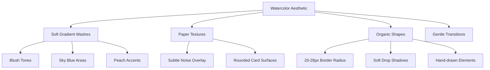
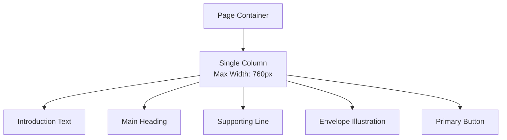
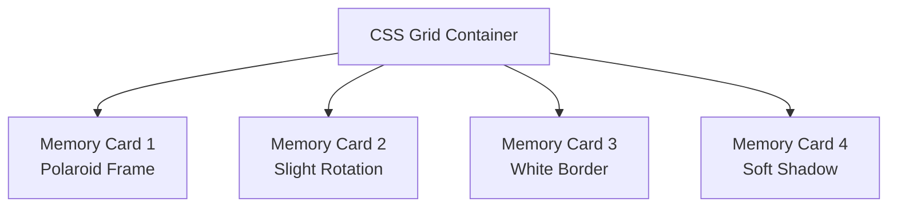
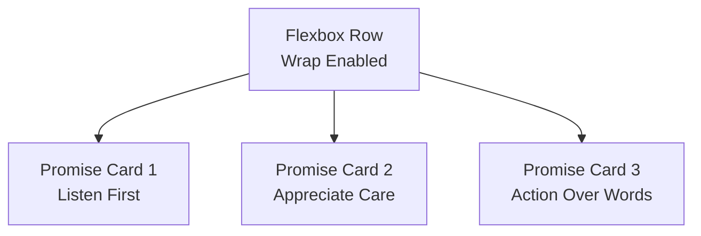
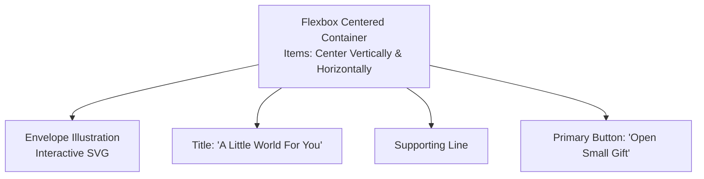
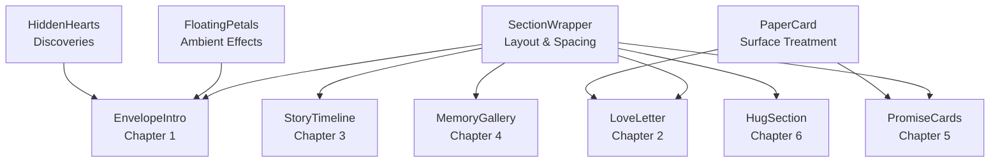

# Visual Principles & Layout

<cite>
**Referenced Files in This Document**   
- [README.md](file://A-Little-World-For-You-Design-Asset-Pack/README.md)
- [design-system.md](file://A-Little-World-For-You-Design-Asset-Pack/DESIGN/design-system.md)
- [ui-guidelines.md](file://A-Little-World-For-You-Design-Asset-Pack/DESIGN/ui-guidelines.md)
- [color-palette.md](file://A-Little-World-For-You-Design-Asset-Pack/DESIGN/color-palette.md)
- [MASTER-PROMPT.md](file://A-Little-World-For-You-Design-Asset-Pack/CODEX/MASTER-PROMPT.md)
- [globals.css](file://src/app/globals.css)
- [SectionWrapper.tsx](file://src/components/layout/SectionWrapper.tsx)
- [PaperCard.tsx](file://src/components/ui/PaperCard.tsx)
- [EnvelopeIntro.tsx](file://src/components/entrance/EnvelopeIntro.tsx)
- [FloatingPetals.tsx](file://src/components/effects/FloatingPetals.tsx)
- [Button.tsx](file://src/components/ui/Button.tsx)
</cite>

## Update Summary
**Changes Made**   
- Updated watercolor-inspired design philosophy with specific implementation details from the codebase
- Enhanced spacing systems documentation with actual CSS implementations
- Added practical examples of CSS Grid and Flexbox patterns based on real component usage
- Expanded mobile-first responsive design considerations with target breakpoints
- Included touch interaction guidelines aligned with the romantic user experience
- Added detailed analysis of the implemented visual system components

## Table of Contents
1. [Introduction](#introduction)
2. [Watercolor-Inspired Design Philosophy](#watercolor-inspired-design-philosophy)
3. [Color System and Emotional Palette](#color-system-and-emotional-palette)
4. [Spacing Systems and Negative Space](#spacing-systems-and-negative-space)
5. [Grid Layouts and Responsive Breakpoints](#grid-layouts-and-responsive-breakpoints)
6. [Shape Language and Surface Treatment](#shape-language-and-surface-treatment)
7. [Emotional Design Principles](#emotional-design-principles)
8. [Practical Layout Patterns Using CSS Grid and Flexbox](#practical-layout-patterns-using-css-grid-and-flexbox)
9. [Mobile-First Responsive Design Considerations](#mobile-first-responsive-design-considerations)
10. [Touch Interaction Guidelines for a Romantic User Experience](#touch-interaction-guidelines-for-a-romantic-user-experience)
11. [Implementation Components](#implementation-components)
12. [Conclusion](#conclusion)

## Introduction
This document defines the visual principles and layout system for a romantic, watercolor-inspired personal website called "A Little World For You." The design creates an intimate, handmade storybook experience mixed with a gentle scrapbook aesthetic. It emphasizes warmth, sincerity, and emotional storytelling through soft gradients, organic shapes, gentle transitions, generous negative space, and a vertical narrative that guides the reader from an entrance scene through six chapters to a quiet closing moment.

The goal is to maintain a consistent emotional tone across devices while ensuring readability, accessibility, and comfortable touch interaction on mobile. The implementation uses Next.js, React, Tailwind CSS, and Motion for smooth, respectful animations that serve the story rather than compete with it.

## Watercolor-Inspired Design Philosophy
The visual identity is built around warmth, intimacy, and sincerity. The watercolor aesthetic should be expressed through:

### Core Visual Elements
- **Soft watercolor washes** instead of harsh linear gradients, using radial gradients with color-mix for natural blending
- **Paper-like backgrounds and card surfaces** with subtle texture overlays
- **Gentle color transitions** between sections using alternating background tones
- **Organic shapes** such as rounded corners (20-28px), soft shadows, and hand-drawn-feeling decorations
- **Restrained use of accent colors** so the page feels calm rather than visually noisy

### Implementation Details
The system uses CSS custom properties for watercolor effects:
- `.wash` class for blush-toned backgrounds
- `.wash-sky` for cool contrast areas  
- `.wash-peach` for warm accent zones
- Paper texture overlay using SVG noise filters at 5.5% opacity

**Diagram sources**
- [globals.css:80-106](file://src/app/globals.css#L80-L106)
- [design-system.md:3-4](file://A-Little-World-For-You-Design-Asset-Pack/DESIGN/design-system.md#L3-L4)

**Section sources**
- [README.md:5-10](file://A-Little-World-For-You-Design-Asset-Pack/README.md#L5-L10)
- [design-system.md:3-4](file://A-Little-World-For-You-Design-Asset-Pack/DESIGN/design-system.md#L3-L4)
- [color-palette.md:14-22](file://A-Little-World-For-You-Design-Asset-Pack/DESIGN/color-palette.md#L14-L22)
- [globals.css:80-106](file://src/app/globals.css#L80-L106)

## Color System and Emotional Palette
The color system follows a carefully balanced palette designed to create visual rhythm without overwhelming the emotional content.

### Color Balance Strategy
- **55% cream/paper**: Main backgrounds and primary surfaces
- **20% blush/pale pink**: Soft section tints and warm accents
- **10% peach**: Secondary decorative elements
- **10% sky/sage**: Cool contrast and botanical accents
- **5% rose accents**: Primary emphasis and interactive elements

### Accessible Color Tokens
| Token | Hex | Usage | Contrast |
|-------|-----|-------|----------|
| `--color-cream` | `#FFF9F2` | Main page background | Base |
| `--color-paper` | `#FFFDF9` | Letter/card surface | Base |
| `--color-blush` | `#F7DCE2` | Soft section tint | Background only |
| `--color-rose` | `#D98FA0` | Primary accent | Decoration only |
| `--color-rose-deep` | `#8F4F60` | Display accents, short text | ≈5.4:1 on cream |
| `--color-peach` | `#F5C7AE` | Secondary accent | Decoration only |
| `--color-sky` | `#DCEAF2` | Cool contrast | Background only |
| `--color-sage` | `#C8D2BE` | Botanical accent | Decoration only |
| `--color-ink` | `#59464A` | Main text | ≥4.5:1 on light backgrounds |
| `--color-muted` | `#7A6466` | Secondary text | ≥4.5:1 on light backgrounds |

### Color Application Rules
- Body and UI text use `--color-ink` or `--color-muted` only
- Rose, peach, and sage are decoration and never carry text
- Alternate backgrounds between sections to prevent uniform pink appearance
- Use deep rose (`#8F4F60`) for accessible emphasis text
- The softer editorial rose (`#A85F72`) is limited to large text only (≈4.4:1 contrast)

**Section sources**
- [color-palette.md:1-22](file://A-Little-World-For-You-Design-Asset-Pack/DESIGN/color-palette.md#L1-L22)
- [design-system.md:6-20](file://A-Little-World-For-You-Design-Asset-Pack/DESIGN/design-system.md#L6-L20)
- [globals.css:9-26](file://src/app/globals.css#L9-L26)

## Spacing Systems and Negative Space
Negative space is essential to the intimate, personal feel. The spacing system prioritizes comfort over density, creating breathing room for emotional content.

### Vertical Rhythm and Section Spacing
- **Desktop section spacing**: 88-120px between major sections
- **Mobile section spacing**: 56-76px between sections
- **Reading width**: 620-720px for optimal comprehension
- **Content max width**: 1080-1160px for overall layout containment

### Spacing Implementation
The `SectionWrapper` component provides consistent spacing:
- Mobile: `px-5 py-20` (20px horizontal, 80px vertical padding)
- Tablet: `sm:px-8 md:py-28` (32px horizontal, 112px vertical padding)
- Content container: `max-w-[1120px]` centered with auto margins

### Negative Space Guidelines
- Generous vertical spacing between sections, especially on desktop
- Comfortable reading width for long text (letter-style layout)
- Clear vertical narrative rather than dense grid-heavy layouts
- Decorative elements should not crowd text
- Sections should have clear breathing room for emotional absorption

**Section sources**
- [design-system.md:37-42](file://A-Little-World-For-You-Design-Asset-Pack/DESIGN/design-system.md#L37-L42)
- [SectionWrapper.tsx:36-43](file://src/components/layout/SectionWrapper.tsx#L36-L43)
- [MASTER-PROMPT.md:557-577](file://A-Little-World-For-You-Design-Asset-Pack/CODEX/MASTER-PROMPT.md#L557-L577)

## Grid Layouts and Responsive Breakpoints
The layout follows a mobile-first approach with a clear vertical narrative, supporting both storytelling and practical usability.

### Target Breakpoints
- **360px**: Small mobile phones
- **390px**: Standard mobile phones  
- **430px**: Large mobile phones
- **768px**: Tablets and small laptops
- **1024px**: Desktop screens
- **1440px**: Large desktop monitors
- **1920px**: Extra-large displays

### Responsive Behavior
- **Mobile**: Single column layout, stacked content, no horizontal overflow
- **Tablet/Desktop**: Up to two columns where appropriate, room for illustrations
- **Content constraints**: Max-width containers with comfortable reading widths
- **Touch targets**: Minimum 44px for all interactive elements

### Layout Principles
- Mobile-first development approach
- Stacked scrapbook cards on narrow screens
- Touch-friendly tap targets and gestures
- Lazy loading for below-the-fold imagery
- No reliance on hover interactions
- Decorative elements positioned away from interactive text

**Section sources**
- [design-system.md:37-42](file://A-Little-World-For-You-Design-Asset-Pack/DESIGN/design-system.md#L37-L42)
- [ui-guidelines.md:49-56](file://A-Little-World-For-You-Design-Asset-Pack/DESIGN/ui-guidelines.md#L49-L56)
- [MASTER-PROMPT.md:557-577](file://A-Little-World-For-You-Design-Asset-Pack/CODEX/MASTER-PROMPT.md#L557-L577)

## Shape Language and Surface Treatment
Shapes should feel soft, organic, and slightly imperfect, supporting the romantic, scrapbook-like atmosphere.

### Shape Specifications
- **Cards**: 20-28px border radius (implemented as `rounded-[var(--radius-paper)]`)
- **Buttons**: Pill-shaped with 999px border radius
- **Letter panels**: Paper-like borders with subtle shadows and decorative edges
- **Polaroids**: White borders, slight rotation, soft shadows
- **Decorations**: Tiny watercolor-like elements used sparingly

### Surface Treatments
- **Paper texture**: Subtle noise overlay using SVG filters
- **Soft shadows**: Layered box shadows for depth without harshness
- **Border treatments**: Thin refined borders with low opacity ink colors
- **Glassmorphism**: Limited to at most one small element per page

### Component Implementation
The `PaperCard` component demonstrates the paper-like surface treatment:
- Uses `paper-texture` class for noise overlay
- Applies `rounded-[var(--radius-paper)]` for organic corners
- Includes `shadow-paper` for soft depth
- Features `border border-ink/8` for subtle edge definition

**Section sources**
- [design-system.md:30-35](file://A-Little-World-For-You-Design-Asset-Pack/DESIGN/design-system.md#L30-L35)
- [PaperCard.tsx:9-18](file://src/components/ui/PaperCard.tsx#L9-L18)
- [globals.css:21-26](file://src/app/globals.css#L21-L26)

## Emotional Design Principles
Emotional design is central to this project. The interface communicates sincerity, accountability, appreciation, and affection without pressuring the recipient.

### Core Emotional Principles
- **One primary action per section**: Prevents decision fatigue and maintains focus
- **No forced tasks or guilt-inducing copy**: Respects the recipient's emotional state
- **Optional interactions**: Features like hug buttons never imply failure if ignored
- **Gentle animations**: Motion serves the story, never competes with content
- **Accessible by default**: Important text remains readable without animations

### Accessibility as Emotional Design
- Reduced-motion support ensures everyone can experience the site calmly
- Keyboard navigation supports users who cannot use mouse interactions
- Visible focus states provide clear navigation feedback
- Semantic HTML ensures screen readers can interpret the emotional journey

### Interaction Philosophy
- Interactions add warmth but are never prerequisites for content access
- All six chapters remain readable by simple scrolling
- Hidden discoveries (hearts, secret letters) enhance but don't gate the experience
- Animations respect `prefers-reduced-motion` preferences

**Section sources**
- [design-system.md:44-50](file://A-Little-World-For-You-Design-Asset-Pack/DESIGN/design-system.md#L44-L50)
- [MASTER-PROMPT.md:581-602](file://A-Little-World-For-You-Design-Asset-Pack/CODEX/MASTER-PROMPT.md#L581-L602)

## Practical Layout Patterns Using CSS Grid and Flexbox
Below are conceptual layout patterns aligned with the design system, based on actual component implementations.

### Single-Column Story Flow (Mobile-First)
The entrance section demonstrates a centered single-column layout:
- Centered main content with comfortable max-width
- Vertical stacking of sections with generous spacing
- Decorative elements positioned outside the text column
- Responsive typography scaling

### Two-Column Memory Gallery (Tablet/Desktop)
Memory galleries use CSS Grid for responsive card arrangements:
- Grid with two equal columns on larger screens
- Natural wrapping behavior for responsive adaptation
- Consistent gap spacing between cards
- Readable captions aligned with card content

### Three-Card Promise Row (Desktop)
Promise cards use Flexbox for even distribution:
- Flex container with wrapping capability
- Even space distribution between cards
- Vertical alignment maintained across rows
- Responsive stacking on smaller screens

### Centered Envelope Entrance
The entrance uses Flexbox for perfect centering:
- Vertical and horizontal alignment of all elements
- Soft decorative elements positioned around centered content
- Accessible CTA with clear labeling
- Responsive scaling for different screen sizes

[No diagram sources needed since these diagrams show conceptual layout patterns, not actual code structure]

## Mobile-First Responsive Design Considerations
Mobile-first means starting with the smallest common screen and progressively enhancing for larger viewports.

### Mobile-First Development Approach
- Begin with single-column layout optimized for 360px screens
- Increase columns or adjust spacing only when viewport allows comfortable reading
- Test both portrait and landscape orientations
- Avoid relying on hover for important actions
- Ensure tap targets meet minimum comfortable sizes (44px)
- Keep decorative elements away from interactive text

### Progressive Enhancement Strategy
- **Base styles**: Functional layout for smallest screens
- **Small screens (390px+)**: Improved spacing and typography
- **Medium screens (768px+)**: Multi-column layouts where appropriate
- **Large screens (1024px+)**: Full illustration space and enhanced spacing
- **Extra large screens (1440px+)**: Maximum content width constraints

### Performance Considerations
- Lazy loading for below-the-fold imagery
- Optimized image formats (WebP) with appropriate sizing
- Minimal animation complexity on mobile devices
- Reduced motion support for accessibility

**Section sources**
- [ui-guidelines.md:49-56](file://A-Little-World-For-You-Design-Asset-Pack/DESIGN/ui-guidelines.md#L49-L56)
- [MASTER-PROMPT.md:557-577](file://A-Little-World-For-You-Design-Asset-Pack/CODEX/MASTER-PROMPT.md#L557-L577)

## Touch Interaction Guidelines for a Romantic User Experience
Touch interactions should feel gentle, intentional, and respectful of the emotional context.

### Touch-Specific Guidelines
- Provide visible focus states for keyboard users alongside touch interactions
- Support tap interactions alongside hover effects for desktop users
- Make lightboxes and dialogs operable with Escape key and close buttons
- Avoid auto-playing audio or forcing unnecessary steps
- Keep animations subtle and optional through reduced-motion preferences
- Ensure all primary interactions work reliably on touch screens

### Interactive Element Standards
- **Minimum tap target size**: 44px × 44px for comfortable touching
- **Touch feedback**: Subtle visual changes without jarring movements
- **Gesture support**: Swipe navigation for galleries and carousels
- **Accessibility**: Full keyboard navigation alongside touch controls
- **Performance**: Smooth interactions without layout shifts

### Emotional Touch Interactions
- Envelope opening animation respects reduced-motion preferences
- Heart bloom animations are gentle and meaningful
- Floating petals and decorative elements move slowly and naturally
- All interactions feel deliberate and purposeful, never accidental

**Section sources**
- [ui-guidelines.md:49-56](file://A-Little-World-For-You-Design-Asset-Pack/DESIGN/ui-guidelines.md#L49-L56)
- [MASTER-PROMPT.md:581-602](file://A-Little-World-For-You-Design-Asset-Pack/CODEX/MASTER-PROMPT.md#L581-L602)

## Implementation Components
The visual system is implemented through reusable components that enforce consistency across the application.

### Core Layout Components
- **SectionWrapper**: Provides consistent section styling, spacing, and background tones
- **PaperCard**: Creates paper-like surfaces with texture and shadows
- **Button**: Implements accessible, styled buttons with multiple variants

### Visual Effect Components
- **FloatingPetals**: Creates ambient drifting petal animations
- **HiddenHearts**: Implements discoverable heart interactions
- **EnvelopeIllustration**: Animated SVG envelope with opening/closing states

### Component Architecture

**Diagram sources**
- [SectionWrapper.tsx:1-46](file://src/components/layout/SectionWrapper.tsx#L1-L46)
- [PaperCard.tsx:1-21](file://src/components/ui/PaperCard.tsx#L1-L21)
- [EnvelopeIntro.tsx:1-182](file://src/components/entrance/EnvelopeIntro.tsx#L1-L182)
- [FloatingPetals.tsx:1-71](file://src/components/effects/FloatingPetals.tsx#L1-L71)

**Section sources**
- [SectionWrapper.tsx:1-46](file://src/components/layout/SectionWrapper.tsx#L1-L46)
- [PaperCard.tsx:1-21](file://src/components/ui/PaperCard.tsx#L1-L21)
- [Button.tsx:1-36](file://src/components/ui/Button.tsx#L1-L36)
- [EnvelopeIntro.tsx:1-182](file://src/components/entrance/EnvelopeIntro.tsx#L1-L182)
- [FloatingPetals.tsx:1-71](file://src/components/effects/FloatingPetals.tsx#L1-L71)

## Conclusion
The visual principles and layout system for "A Little World For You" are built around a watercolor-inspired, romantic, and deeply intimate experience. The implementation successfully translates design concepts into functional code through:

- **Consistent visual language**: Watercolor washes, paper textures, and organic shapes create a cohesive aesthetic
- **Emotional responsiveness**: Spacing, colors, and interactions serve the emotional narrative
- **Technical excellence**: Clean component architecture, responsive design, and accessibility compliance
- **Performance optimization**: Efficient animations, optimized assets, and progressive enhancement

The system balances artistic expression with technical pragmatism, ensuring that the romantic, personal feel is maintained across all devices and interaction methods. By following these principles, developers can implement layouts that feel warm, personal, and emotionally coherent on every screen size, creating a truly memorable digital gift experience.

The watercolor aesthetic, combined with thoughtful spacing, accessible interactions, and emotional design principles, results in a website that feels less like a technical product and more like a heartfelt letter brought to life through careful craftsmanship and genuine care.