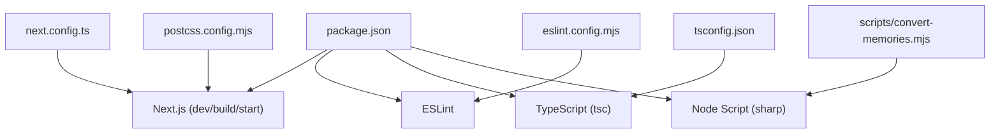
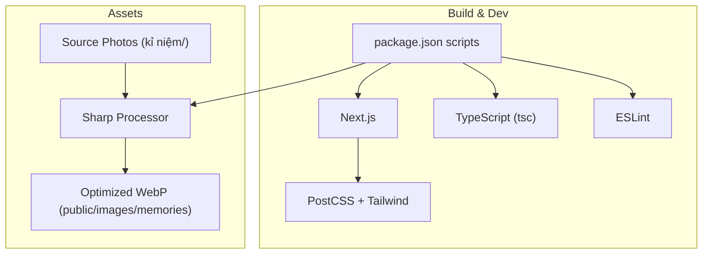
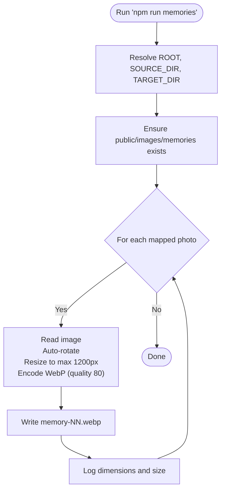
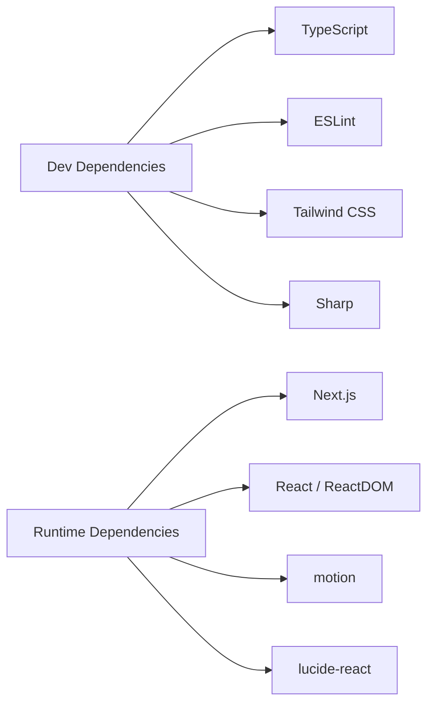

# Build Tooling and Configuration

<cite>
**Referenced Files in This Document**
- [package.json](file://package.json)
- [next.config.ts](file://next.config.ts)
- [tsconfig.json](file://tsconfig.json)
- [eslint.config.mjs](file://eslint.config.mjs)
- [postcss.config.mjs](file://postcss.config.mjs)
- [convert-memories.mjs](file://scripts/convert-memories.mjs)
</cite>

## Table of Contents
1. [Introduction](#introduction)
2. [Project Structure](#project-structure)
3. [Core Components](#core-components)
4. [Architecture Overview](#architecture-overview)
5. [Detailed Component Analysis](#detailed-component-analysis)
6. [Dependency Analysis](#dependency-analysis)
7. [Performance Considerations](#performance-considerations)
8. [Troubleshooting Guide](#troubleshooting-guide)
9. [Conclusion](#conclusion)

## Introduction
This document explains the build tooling and configuration for the project, focusing on how development, building, linting, type checking, styling, and asset processing are set up. It also documents a custom script that converts source photos into web-ready assets.

## Project Structure
The build-related files live at the repository root and under scripts:
- package.json defines scripts and dependencies
- next.config.ts configures Next.js
- tsconfig.json configures TypeScript
- eslint.config.mjs configures ESLint
- postcss.config.mjs configures PostCSS/Tailwind
- scripts/convert-memories.mjs is a Node script for image conversion

**Diagram sources**
- [package.json:5-11](file://package.json#L5-L11)
- [next.config.ts:1-8](file://next.config.ts#L1-L8)
- [tsconfig.json:1-28](file://tsconfig.json#L1-L28)
- [eslint.config.mjs:1-26](file://eslint.config.mjs#L1-L26)
- [postcss.config.mjs:1-6](file://postcss.config.mjs#L1-L6)
- [convert-memories.mjs:1-42](file://scripts/convert-memories.mjs#L1-L42)

**Section sources**
- [package.json:1-33](file://package.json#L1-L33)

## Core Components
- Development server and build pipeline via Next.js
- TypeScript compilation and path aliases
- Linting with ESLint using Next.js recommended configs
- Styling pipeline with Tailwind CSS via PostCSS
- Asset conversion script using Sharp to produce optimized WebP images

Key responsibilities:
- package.json: orchestrates scripts and declares runtime and dev dependencies
- next.config.ts: extends Next.js defaults (currently empty config object)
- tsconfig.json: strict TS settings, bundler module resolution, path alias @/*
- eslint.config.mjs: flat config extending Next.js rules and ignoring generated folders
- postcss.config.mjs: enables Tailwind through @tailwindcss/postcss
- convert-memories.mjs: resizes and optimizes photos to public/images/memories

**Section sources**
- [package.json:5-31](file://package.json#L5-L31)
- [next.config.ts:1-8](file://next.config.ts#L1-L8)
- [tsconfig.json:1-28](file://tsconfig.json#L1-L28)
- [eslint.config.mjs:1-26](file://eslint.config.mjs#L1-L26)
- [postcss.config.mjs:1-6](file://postcss.config.mjs#L1-L6)
- [convert-memories.mjs:1-42](file://scripts/convert-memories.mjs#L1-L42)

## Architecture Overview
The build architecture centers around Next.js as the application framework, with TypeScript, ESLint, and Tailwind integrated through their respective configuration files. The custom script operates independently to pre-process images before they are served by Next.js.

**Diagram sources**
- [package.json:5-11](file://package.json#L5-L11)
- [next.config.ts:1-8](file://next.config.ts#L1-L8)
- [tsconfig.json:1-28](file://tsconfig.json#L1-L28)
- [eslint.config.mjs:1-26](file://eslint.config.mjs#L1-L26)
- [postcss.config.mjs:1-6](file://postcss.config.mjs#L1-L6)
- [convert-memories.mjs:1-42](file://scripts/convert-memories.mjs#L1-L42)

## Detailed Component Analysis

### Package Scripts and Dependencies
- Scripts:
  - dev: starts the Next.js development server
  - build: builds the app for production
  - start: runs the production server
  - lint: runs ESLint
  - typecheck: runs TypeScript type-checking without emitting
  - memories: runs the image conversion script
- Dependencies:
  - Runtime: React, ReactDOM, Next.js, motion, lucide-react
  - Dev: TypeScript, ESLint, Tailwind CSS, Sharp, and related types

Operational notes:
- Use npm run dev for local development
- Use npm run build to generate production assets
- Use npm run start to serve the built app
- Use npm run lint to check code quality
- Use npm run typecheck to validate types
- Use npm run memories to process photos

**Section sources**
- [package.json:5-31](file://package.json#L5-L31)

### Next.js Configuration
- next.config.ts exports an empty NextConfig object, inheriting all default behaviors.
- No custom routes, rewrites, or image domains are configured here.

Implications:
- Image optimization relies on Next.js defaults unless extended later.
- Adding domains or paths can be done by populating this file.

**Section sources**
- [next.config.ts:1-8](file://next.config.ts#L1-L8)

### TypeScript Configuration
- Target: ES2017
- Strict mode enabled
- Module: esnext with bundler resolution
- JSX: preserve (handled by Next.js)
- Path alias: @/* maps to ./src/*
- Includes generated .next/types and declaration files
- Excludes node_modules

Usage tips:
- Import from src using @/ prefix (e.g., "@/components/...")
- Type checking is enforced via npm run typecheck

**Section sources**
- [tsconfig.json:1-28](file://tsconfig.json#L1-L28)

### ESLint Configuration
- Uses Flat Config format
- Extends Next.js core-web-vitals and TypeScript rule sets
- Ignores common generated directories: node_modules, .next, out, build, next-env.d.ts

Usage tips:
- Run npm run lint to enforce consistent code style and catch issues early

**Section sources**
- [eslint.config.mjs:1-26](file://eslint.config.mjs#L1-L26)

### PostCSS and Tailwind Integration
- postcss.config.mjs registers @tailwindcss/postcss plugin
- Tailwind processes CSS during build and dev

Usage tips:
- Ensure Tailwind directives are present in global styles if needed
- Styles are compiled through Next.js’ PostCSS integration

**Section sources**
- [postcss.config.mjs:1-6](file://postcss.config.mjs#L1-L6)

### Image Conversion Script
Purpose:
- Converts owner-supplied photos from kỉ niệm/ into optimized WebP files under public/images/memories
- Resizes to a maximum long edge of 1200px, maintains aspect ratio, and applies quality 80
- Strips EXIF/GPS metadata automatically via Sharp’s WebP output

Inputs and outputs:
- Input directory: kỉ niệm/
- Output directory: public/images/memories
- Output naming: memory-NN.webp based on a predefined mapping

Processing steps:
1. Resolve project root and target directory
2. Create target directory if missing
3. For each mapped photo:
   - Read original image
   - Auto-rotate based on EXIF
   - Resize to fit within 1200x1200 without enlarging
   - Encode as WebP at quality 80
   - Write to output path
   - Log dimensions and size

**Diagram sources**
- [convert-memories.mjs:16-41](file://scripts/convert-memories.mjs#L16-L41)

Operational notes:
- Re-running the script safely overwrites existing outputs
- Source filenames are hardcoded; update the mapping when adding new photos
- Requires Sharp to be installed (declared in devDependencies)

**Section sources**
- [convert-memories.mjs:1-42](file://scripts/convert-memories.mjs#L1-L42)

## Dependency Analysis
Runtime vs. dev-time boundaries:
- Runtime dependencies include Next.js, React, ReactDOM, motion, and lucide-react
- Dev-time dependencies include TypeScript, ESLint, Tailwind CSS, Sharp, and type definitions
- Scripts orchestrate these tools during development and build

**Diagram sources**
- [package.json:13-31](file://package.json#L13-L31)

**Section sources**
- [package.json:13-31](file://package.json#L13-L31)

## Performance Considerations
- Image optimization:
  - Pre-convert large photos to WebP with controlled dimensions and quality to reduce payload
  - Avoid serving oversized originals; rely on converted assets in public/images/memories
- Build performance:
  - Keep tsconfig incremental enabled for faster rebuilds
  - Use npm run typecheck to avoid unnecessary emits
- Styling:
  - Tailwind via PostCSS is efficient; ensure unused styles are purged by Tailwind’s default behavior

[No sources needed since this section provides general guidance]

## Troubleshooting Guide
Common issues and resolutions:
- npm run memories fails due to missing source files:
  - Ensure the source photos exist in kỉ niệm/ and match the names defined in the script
- Sharp errors while converting:
  - Verify Sharp is installed and compatible with your Node version
  - Check permissions for writing to public/images/memories
- Lint errors:
  - Run npm run lint and follow suggestions; ignore patterns exclude generated folders
- TypeScript errors:
  - Run npm run typecheck to identify type mismatches; verify @/* imports resolve correctly
- Tailwind not applying:
  - Confirm PostCSS is configured and Tailwind directives are included in styles

**Section sources**
- [convert-memories.mjs:16-41](file://scripts/convert-memories.mjs#L16-L41)
- [eslint.config.mjs:12-23](file://eslint.config.mjs#L12-L23)
- [tsconfig.json:21-23](file://tsconfig.json#L21-L23)
- [postcss.config.mjs:1-6](file://postcss.config.mjs#L1-L6)

## Conclusion
The project uses a modern, minimal setup centered on Next.js with TypeScript, ESLint, and Tailwind CSS. A dedicated script handles image preprocessing to ensure fast loading and consistent presentation. The configuration is straightforward and extensible, allowing you to add Next.js features, refine linting rules, or expand the asset pipeline as the project grows.