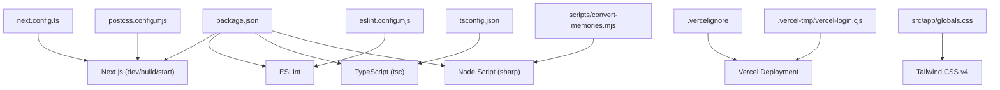
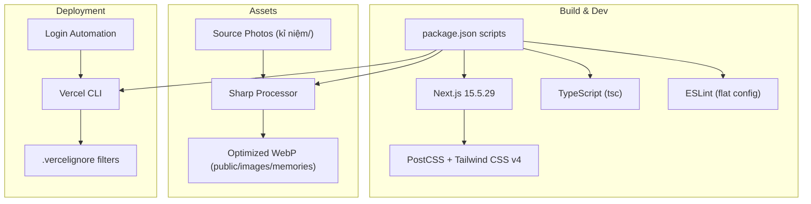
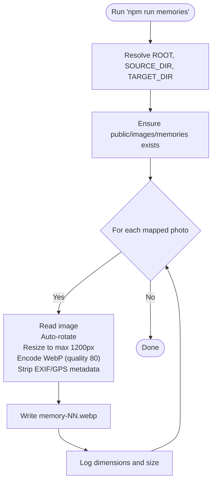
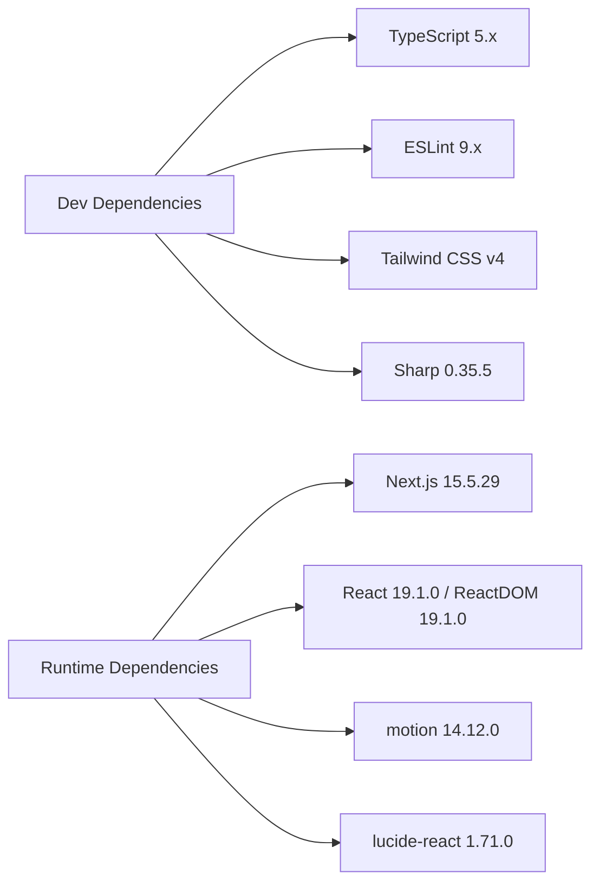

# Build Tooling and Configuration

<cite>
**Referenced Files in This Document**
- [package.json](file://package.json)
- [next.config.ts](file://next.config.ts)
- [tsconfig.json](file://tsconfig.json)
- [eslint.config.mjs](file://eslint.config.mjs)
- [postcss.config.mjs](file://postcss.config.mjs)
- [convert-memories.mjs](file://scripts/convert-memories.mjs)
- [.vercelignore](file://.vercelignore)
- [vercel-login.cjs](file://.vercel-tmp/vercel-login.cjs)
- [globals.css](file://src/app/globals.css)
</cite>

## Update Summary
**Changes Made**
- Added Vercel deployment configuration with `.vercelignore` for optimized builds
- Enhanced Sharp image optimization script with detailed metadata stripping
- Updated Tailwind CSS integration to use v4 with `@tailwindcss/postcss` plugin
- Added comprehensive development scripts including type checking and memory processing
- Integrated Vercel CLI login automation for seamless deployment workflow

## Table of Contents
1. [Introduction](#introduction)
2. [Project Structure](#project-structure)
3. [Core Components](#core-components)
4. [Architecture Overview](#architecture-overview)
5. [Detailed Component Analysis](#detailed-component-analysis)
6. [Dependency Analysis](#dependency-analysis)
7. [Performance Considerations](#performance-considerations)
8. [Troubleshooting Guide](#troubleshooting-guide)
9. [Conclusion](#conclusion)

## Introduction
This document explains the enhanced build tooling and configuration for the project, focusing on how development, building, linting, type checking, styling, and asset processing are set up. The project now includes Vercel deployment optimization, advanced image processing with Sharp, Tailwind CSS v4 integration, and comprehensive development scripts for streamlined workflows.

## Project Structure
The build-related files live at the repository root and under scripts:
- package.json defines scripts and dependencies with enhanced tooling
- next.config.ts configures Next.js with modern defaults
- tsconfig.json configures TypeScript with strict settings
- eslint.config.mjs configures ESLint with flat config format
- postcss.config.mjs configures PostCSS/Tailwind CSS v4
- scripts/convert-memories.mjs is an advanced Node script for image conversion
- .vercelignore optimizes Vercel deployments by excluding unnecessary files
- .vercel-tmp/ contains Vercel CLI automation scripts

**Diagram sources**
- [package.json:5-11](file://package.json#L5-L11)
- [next.config.ts:1-8](file://next.config.ts#L1-L8)
- [tsconfig.json:1-28](file://tsconfig.json#L1-L28)
- [eslint.config.mjs:1-26](file://eslint.config.mjs#L1-L26)
- [postcss.config.mjs:1-6](file://postcss.config.mjs#L1-L6)
- [convert-memories.mjs:1-42](file://scripts/convert-memories.mjs#L1-L42)
- [.vercelignore:1-12](file://.vercelignore#L1-L12)
- [vercel-login.cjs:1-184](file://.vercel-tmp/vercel-login.cjs#L1-L184)
- [globals.css:1-141](file://src/app/globals.css#L1-L141)

**Section sources**
- [package.json:1-33](file://package.json#L1-L33)

## Core Components
- Development server and build pipeline via Next.js 15.5.29
- TypeScript compilation with strict mode and path aliases
- Linting with ESLint using Next.js recommended configs in flat config format
- Styling pipeline with Tailwind CSS v4 via @tailwindcss/postcss
- Advanced asset conversion script using Sharp for optimized WebP images
- Vercel deployment optimization with custom ignore patterns
- Automated Vercel CLI login process for seamless deployment

Key responsibilities:
- package.json: orchestrates scripts and declares runtime and dev dependencies with latest versions
- next.config.ts: extends Next.js defaults with modern configuration
- tsconfig.json: strict TS settings, bundler module resolution, path alias @/*
- eslint.config.mjs: flat config extending Next.js rules and ignoring generated folders
- postcss.config.mjs: enables Tailwind CSS v4 through @tailwindcss/postcss
- convert-memories.mjs: resizes and optimizes photos with EXIF/GPS metadata stripping
- .vercelignore: optimizes deployment by excluding source assets and design packs
- vercel-login.cjs: automates Vercel CLI authentication process

**Section sources**
- [package.json:5-31](file://package.json#L5-L31)
- [next.config.ts:1-8](file://next.config.ts#L1-L8)
- [tsconfig.json:1-28](file://tsconfig.json#L1-L28)
- [eslint.config.mjs:1-26](file://eslint.config.mjs#L1-L26)
- [postcss.config.mjs:1-6](file://postcss.config.mjs#L1-L6)
- [convert-memories.mjs:1-42](file://scripts/convert-memories.mjs#L1-L42)
- [.vercelignore:1-12](file://.vercelignore#L1-L12)
- [vercel-login.cjs:1-184](file://.vercel-tmp/vercel-login.cjs#L1-L184)

## Architecture Overview
The enhanced build architecture centers around Next.js as the application framework, with TypeScript, ESLint, and Tailwind CSS v4 integrated through their respective configuration files. The custom script operates independently to pre-process images before they are served by Next.js, while Vercel deployment optimizations ensure efficient production builds.

**Diagram sources**
- [package.json:5-11](file://package.json#L5-L11)
- [next.config.ts:1-8](file://next.config.ts#L1-L8)
- [tsconfig.json:1-28](file://tsconfig.json#L1-L28)
- [eslint.config.mjs:1-26](file://eslint.config.mjs#L1-L26)
- [postcss.config.mjs:1-6](file://postcss.config.mjs#L1-L6)
- [convert-memories.mjs:1-42](file://scripts/convert-memories.mjs#L1-L42)
- [.vercelignore:1-12](file://.vercelignore#L1-L12)
- [vercel-login.cjs:1-184](file://.vercel-tmp/vercel-login.cjs#L1-L184)

## Detailed Component Analysis

### Package Scripts and Dependencies
Enhanced scripts provide comprehensive development and deployment capabilities:
- Scripts:
  - dev: starts the Next.js development server
  - build: builds the app for production
  - start: runs the production server
  - lint: runs ESLint with flat config
  - typecheck: runs TypeScript type-checking without emitting
  - memories: runs the advanced image conversion script
- Dependencies:
  - Runtime: React 19.1.0, ReactDOM 19.1.0, Next.js 15.5.29, motion 14.12.0, lucide-react 1.71.0
  - Dev: TypeScript 5.x, ESLint 9.x, Tailwind CSS v4, Sharp 0.35.5, and related types

Operational notes:
- Use npm run dev for local development with hot reloading
- Use npm run build to generate production assets optimized for Vercel
- Use npm run start to serve the built app locally
- Use npm run lint to check code quality with modern ESLint rules
- Use npm run typecheck to validate types without file generation
- Use npm run memories to process photos with advanced optimization

**Section sources**
- [package.json:5-31](file://package.json#L5-L31)

### Next.js Configuration
- next.config.ts exports a typed NextConfig object with placeholder for future enhancements
- Inherits all default behaviors from Next.js 15.5.29
- No custom routes, rewrites, or image domains are configured here yet

Implications:
- Image optimization relies on Next.js 15 defaults unless extended later
- Adding domains or paths can be done by populating this file
- Compatible with Vercel's optimized build pipeline

**Section sources**
- [next.config.ts:1-8](file://next.config.ts#L1-L8)

### TypeScript Configuration
- Target: ES2017 with modern DOM APIs
- Strict mode enabled for type safety
- Module: esnext with bundler resolution for optimal tree-shaking
- JSX: preserve (handled by Next.js)
- Path alias: @/* maps to ./src/* for clean imports
- Includes generated .next/types and declaration files
- Excludes node_modules for faster compilation

Usage tips:
- Import from src using @/ prefix (e.g., "@/components/...")
- Type checking is enforced via npm run typecheck
- Incremental compilation enabled for faster rebuilds

**Section sources**
- [tsconfig.json:1-28](file://tsconfig.json#L1-L28)

### ESLint Configuration
- Uses Flat Config format for improved performance and clarity
- Extends Next.js core-web-vitals and TypeScript rule sets
- Ignores common generated directories: node_modules, .next, out, build, next-env.d.ts
- Modern ESLint 9.x configuration structure

Usage tips:
- Run npm run lint to enforce consistent code style and catch issues early
- Flat config provides better performance than legacy .eslintrc files

**Section sources**
- [eslint.config.mjs:1-26](file://eslint.config.mjs#L1-L26)

### PostCSS and Tailwind CSS v4 Integration
- postcss.config.mjs registers @tailwindcss/postcss plugin for Tailwind CSS v4
- Tailwind processes CSS during build and dev with enhanced performance
- Global styles utilize Tailwind CSS v4's new import syntax and theme system

Usage tips:
- Ensure Tailwind directives are present in global styles if needed
- Styles are compiled through Next.js' PostCSS integration
- Leverage Tailwind CSS v4's improved performance and new features

**Section sources**
- [postcss.config.mjs:1-6](file://postcss.config.mjs#L1-L6)
- [globals.css:1-141](file://src/app/globals.css#L1-L141)

### Advanced Image Conversion Script
Purpose:
- Converts owner-supplied photos from kỉ niệm/ into optimized WebP files under public/images/memories
- Resizes to a maximum long edge of 1200px, maintains aspect ratio, and applies quality 80
- Strips EXIF/GPS metadata automatically via Sharp's WebP output for privacy and performance
- Handles non-ASCII directory names and hash-like filenames gracefully

Inputs and outputs:
- Input directory: kỉ niệm/ (excluded from deployment via .vercelignore)
- Output directory: public/images/memories (optimized for web delivery)
- Output naming: memory-NN.webp based on predefined mapping

Processing steps:
1. Resolve project root and target directory with proper path handling
2. Create target directory if missing with recursive option
3. For each mapped photo:
   - Read original image with error handling
   - Auto-rotate based on EXIF orientation
   - Resize to fit within 1200x1200 without enlarging
   - Encode as WebP at quality 80 with metadata stripping
   - Write to output path with progress logging
   - Log dimensions and size for verification

**Diagram sources**
- [convert-memories.mjs:16-41](file://scripts/convert-memories.mjs#L16-L41)

Operational notes:
- Re-running the script safely overwrites existing outputs
- Source filenames are hardcoded; update the mapping when adding new photos
- Requires Sharp to be installed (declared in devDependencies)
- Original photos are excluded from deployment via .vercelignore

**Section sources**
- [convert-memories.mjs:1-42](file://scripts/convert-memories.mjs#L1-L42)
- [.vercelignore:1-12](file://.vercelignore#L1-L12)

### Vercel Deployment Configuration
- .vercelignore optimizes deployment by excluding:
  - Original photos (kỉ niệm/) to reduce bundle size
  - Design asset pack (not part of the built site)
  - Local deployment scratch files (.vercel-tmp/)
- Prevents sensitive or unnecessary files from being deployed

Benefits:
- Smaller deployment bundles for faster uploads
- Improved security by excluding source assets
- Optimized build times on Vercel platform

**Section sources**
- [.vercelignore:1-12](file://.vercelignore#L1-L12)

### Vercel CLI Login Automation
- Automated login process for seamless Vercel deployment
- Cross-platform compatibility (Windows, macOS, Linux)
- Background process management for authentication
- Automatic browser opening for OAuth flow
- Secure log file handling with proper permissions

Features:
- Checks Vercel CLI installation status
- Validates login credentials automatically
- Opens browser for OAuth authorization
- Manages background login processes
- Provides detailed logging for troubleshooting

**Section sources**
- [vercel-login.cjs:1-184](file://.vercel-tmp/vercel-login.cjs#L1-L184)

## Dependency Analysis
Enhanced runtime vs. dev-time boundaries with latest versions:
- Runtime dependencies include Next.js 15.5.29, React 19.1.0, ReactDOM 19.1.0, motion 14.12.0, and lucide-react 1.71.0
- Dev-time dependencies include TypeScript 5.x, ESLint 9.x, Tailwind CSS v4, Sharp 0.35.5, and type definitions
- Scripts orchestrate these tools during development, building, and deployment

**Diagram sources**
- [package.json:13-31](file://package.json#L13-L31)

**Section sources**
- [package.json:13-31](file://package.json#L13-L31)

## Performance Considerations
Enhanced performance optimizations across the build pipeline:
- Image optimization:
  - Pre-convert large photos to WebP with controlled dimensions and quality to reduce payload
  - Strip EXIF/GPS metadata for privacy and smaller file sizes
  - Avoid serving oversized originals; rely on converted assets in public/images/memories
- Build performance:
  - Keep tsconfig incremental enabled for faster rebuilds
  - Use npm run typecheck to avoid unnecessary emits
  - Vercel deployment optimizations exclude unnecessary files
- Styling:
  - Tailwind CSS v4 via PostCSS is more efficient than previous versions
  - Ensure unused styles are purged by Tailwind's default behavior
  - Modern import syntax reduces bundle size

## Troubleshooting Guide
Common issues and resolutions with enhanced tooling:
- npm run memories fails due to missing source files:
  - Ensure the source photos exist in kỉ niệm/ and match the names defined in the script
  - Verify Sharp is properly installed and compatible with your Node version
- Sharp errors while converting:
  - Check permissions for writing to public/images/memories
  - Verify file paths handle non-ASCII characters correctly
- Lint errors:
  - Run npm run lint and follow suggestions; ignore patterns exclude generated folders
  - Ensure flat config format is used with ESLint 9.x
- TypeScript errors:
  - Run npm run typecheck to identify type mismatches; verify @/* imports resolve correctly
  - Check that TypeScript version matches project requirements
- Tailwind not applying:
  - Confirm PostCSS is configured with @tailwindcss/postcss plugin
  - Verify Tailwind CSS v4 import syntax in globals.css
- Vercel deployment issues:
  - Check .vercelignore excludes appropriate files
  - Ensure Vercel CLI is installed and authenticated
  - Review deployment logs for specific error messages

**Section sources**
- [convert-memories.mjs:16-41](file://scripts/convert-memories.mjs#L16-L41)
- [eslint.config.mjs:12-23](file://eslint.config.mjs#L12-L23)
- [tsconfig.json:21-23](file://tsconfig.json#L21-L23)
- [postcss.config.mjs:1-6](file://postcss.config.mjs#L1-L6)
- [.vercelignore:1-12](file://.vercelignore#L1-L12)

## Conclusion
The project now uses a modern, enhanced setup centered on Next.js 15.5.29 with TypeScript, ESLint in flat config format, and Tailwind CSS v4. A dedicated script handles advanced image preprocessing with Sharp, ensuring fast loading and consistent presentation while stripping sensitive metadata. The configuration includes Vercel deployment optimizations and automated CLI login, making it straightforward and extensible for production deployment. The enhanced tooling provides better performance, improved security, and streamlined development workflows.