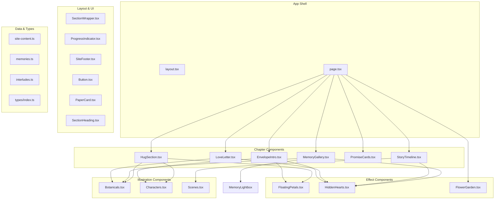
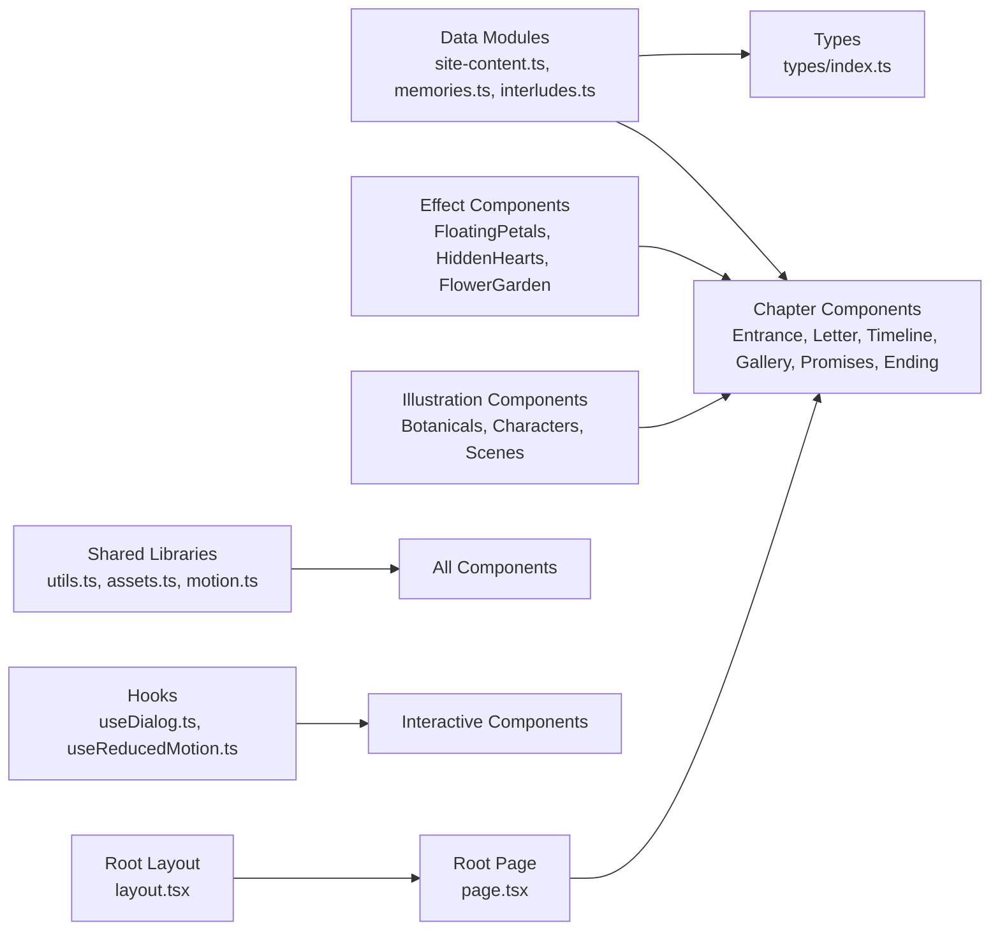
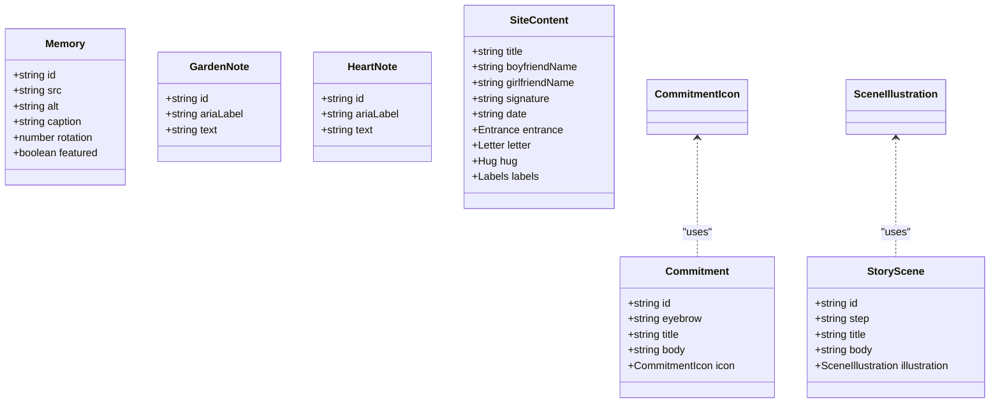
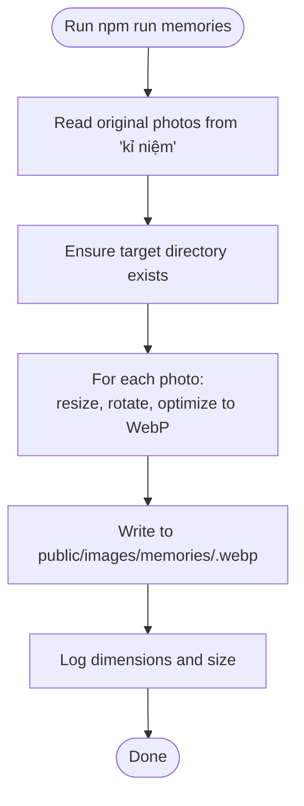
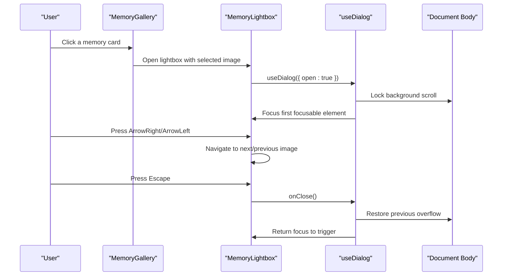
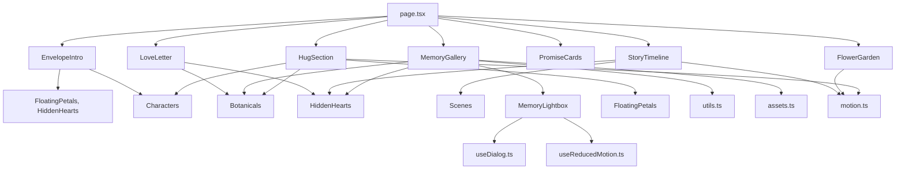

# Component Architecture

<cite>
**Referenced Files in This Document**
- [README.md](file://README.md)
- [package.json](file://package.json)
- [next.config.ts](file://next.config.ts)
- [src/app/layout.tsx](file://src/app/layout.tsx)
- [src/app/page.tsx](file://src/app/page.tsx)
- [src/types/index.ts](file://src/types/index.ts)
- [src/data/site-content.ts](file://src/data/site-content.ts)
- [src/data/memories.ts](file://src/data/memories.ts)
- [src/data/interludes.ts](file://src/data/interludes.ts)
- [src/lib/utils.ts](file://src/lib/utils.ts)
- [src/lib/assets.ts](file://src/lib/assets.ts)
- [src/lib/motion.ts](file://src/lib/motion.ts)
- [src/hooks/useDialog.ts](file://src/hooks/useDialog.ts)
- [src/hooks/useReducedMotion.ts](file://src/hooks/useReducedMotion.ts)
- [scripts/convert-memories.mjs](file://scripts/convert-memories.mjs)
- [src/components/entrance/EnvelopeIntro.tsx](file://src/components/entrance/EnvelopeIntro.tsx)
- [src/components/letter/LoveLetter.tsx](file://src/components/letter/LoveLetter.tsx)
- [src/components/story/StoryTimeline.tsx](file://src/components/story/StoryTimeline.tsx)
- [src/components/memories/MemoryGallery.tsx](file://src/components/memories/MemoryGallery.tsx)
- [src/components/memories/MemoryLightbox.tsx](file://src/components/memories/MemoryLightbox.tsx)
- [src/components/promises/PromiseCards.tsx](file://src/components/promises/PromiseCards.tsx)
- [src/components/ending/HugSection.tsx](file://src/components/ending/HugSection.tsx)
- [src/components/effects/FloatingPetals.tsx](file://src/components/effects/FloatingPetals.tsx)
- [src/components/effects/HiddenHearts.tsx](file://src/components/effects/HiddenHearts.tsx)
- [src/components/effects/FlowerGarden.tsx](file://src/components/effects/FlowerGarden.tsx)
- [src/components/illustrations/Botanicals.tsx](file://src/components/illustrations/Botanicals.tsx)
- [src/components/illustrations/Characters.tsx](file://src/components/illustrations/Characters.tsx)
</cite>

## Update Summary
**Changes Made**
- Updated component hierarchy to reflect complete separation of concerns with dedicated directories for each chapter and feature
- Added detailed documentation for new effect components (FloatingPetals, HiddenHearts, FlowerGarden)
- Added comprehensive coverage of illustration components (Botanicals, Characters)
- Enhanced MemoryGallery and MemoryLightbox component documentation
- Updated architecture diagrams to show the complete component tree structure

## Table of Contents
1. [Introduction](#introduction)
2. [Project Structure](#project-structure)
3. [Core Components](#core-components)
4. [Architecture Overview](#architecture-overview)
5. [Detailed Component Analysis](#detailed-component-analysis)
6. [Dependency Analysis](#dependency-analysis)
7. [Performance Considerations](#performance-considerations)
8. [Troubleshooting Guide](#troubleshooting-guide)
9. [Conclusion](#conclusion)

## Introduction
This project is a Next.js single-page gift site composed of narrative chapters: an entrance, a love letter, a story timeline, a memory gallery, promise cards, a small flower garden, and a closing hug section. The architecture separates content (data), types, shared utilities, motion configuration, hooks, and UI components. The root page composes the chapter components into one scrollable experience.

The repository also includes a build-time script that converts owner-supplied photos into optimized WebP assets for the gallery.

**Section sources**
- [README.md:1-37](file://README.md#L1-L37)
- [src/app/page.tsx:11-14](file://src/app/page.tsx#L11-L14)

## Project Structure
At a high level:
- App shell and layout live under `src/app`.
- Feature components are grouped by chapter or concern under `src/components` with clear directory organization:
  - `entrance/` - Opening envelope animation
  - `letter/` - Love letter display
  - `story/` - Story timeline
  - `memories/` - Photo gallery and lightbox
  - `promises/` - Commitment cards
  - `ending/` - Closing hug interaction
  - `effects/` - Ambient animations and interactive elements
  - `illustrations/` - SVG-based decorative graphics
  - `layout/` - Shared layout components
  - `ui/` - Reusable UI primitives
- Data lives under `src/data`, with typed models under `src/types`.
- Shared logic is split between `src/lib` (utilities, asset paths, motion constants) and `src/hooks` (dialog behavior, reduced motion).
- A Node script under `scripts` prepares image assets.

**Diagram sources**
- [src/app/page.tsx:1-52](file://src/app/page.tsx#L1-L52)
- [src/app/layout.tsx:1-55](file://src/app/layout.tsx#L1-L55)
- [src/components/entrance/EnvelopeIntro.tsx:1-182](file://src/components/entrance/EnvelopeIntro.tsx#L1-L182)
- [src/components/letter/LoveLetter.tsx:1-99](file://src/components/letter/LoveLetter.tsx#L1-L99)
- [src/components/story/StoryTimeline.tsx:1-88](file://src/components/story/StoryTimeline.tsx#L1-L88)
- [src/components/memories/MemoryGallery.tsx:1-120](file://src/components/memories/MemoryGallery.tsx#L1-L120)
- [src/components/effects/FloatingPetals.tsx:1-71](file://src/components/effects/FloatingPetals.tsx#L1-L71)
- [src/components/effects/HiddenHearts.tsx:1-98](file://src/components/effects/HiddenHearts.tsx#L1-L98)
- [src/components/effects/FlowerGarden.tsx:1-129](file://src/components/effects/FlowerGarden.tsx#L1-L129)
- [src/components/illustrations/Botanicals.tsx:1-191](file://src/components/illustrations/Botanicals.tsx#L1-L191)
- [src/components/illustrations/Characters.tsx:1-283](file://src/components/illustrations/Characters.tsx#L1-L283)

**Section sources**
- [src/app/page.tsx:1-52](file://src/app/page.tsx#L1-L52)
- [src/app/layout.tsx:1-55](file://src/app/layout.tsx#L1-L55)

## Core Components
- Root layout configures fonts, metadata, and global CSS. It sets language to Vietnamese and exposes font variables for consistent typography across chapters.
- Root page composes the narrative flow: entrance, letter, story timeline, memories, promises, garden strip, hug, plus shared progress indicator and footer.
- Data modules provide canonical copy and media references:
  - `site-content.ts` centralizes personal fields and chapter copy.
  - `memories.ts` defines photo entries and derived featured lists.
  - `interludes.ts` defines story scenes, commitments, secret letter text, garden notes, and heart notes.
- Shared libraries:
  - `utils.ts` provides class joining, seeded pseudo-random values, clamping, and caption resolution.
  - `assets.ts` centralizes asset paths and helper functions for memory images and optional music.
  - `motion.ts` defines easing, durations, viewport triggers, and reusable variants for animations.
- Hooks:
  - `useDialog.ts` implements accessible dialog behavior (focus trap, Escape to close, scroll lock).
  - `useReducedMotion.ts` wraps Motion's reduced-motion hook for accessibility.

**Section sources**
- [src/app/layout.tsx:1-55](file://src/app/layout.tsx#L1-L55)
- [src/app/page.tsx:1-52](file://src/app/page.tsx#L1-L52)
- [src/data/site-content.ts:1-65](file://src/data/site-content.ts#L1-L65)
- [src/data/memories.ts:1-59](file://src/data/memories.ts#L1-L59)
- [src/data/interludes.ts:1-111](file://src/data/interludes.ts#L1-L111)
- [src/lib/utils.ts:1-27](file://src/lib/utils.ts#L1-L27)
- [src/lib/assets.ts:1-25](file://src/lib/assets.ts#L1-L25)
- [src/lib/motion.ts:1-62](file://src/lib/motion.ts#L1-L62)
- [src/hooks/useDialog.ts:1-98](file://src/hooks/useDialog.ts#L1-L98)
- [src/hooks/useReducedMotion.ts:1-12](file://src/hooks/useReducedMotion.ts#L1-L12)

## Architecture Overview
The application follows a unidirectional data flow:
- Data modules export plain objects and arrays.
- Components consume data via imports and render UI.
- Shared hooks and libraries encapsulate cross-cutting concerns (accessibility, animation, utilities).
- The root page orchestrates chapter order and composition.

**Diagram sources**
- [src/app/page.tsx:1-52](file://src/app/page.tsx#L1-L52)
- [src/app/layout.tsx:1-55](file://src/app/layout.tsx#L1-L55)
- [src/data/site-content.ts:1-65](file://src/data/site-content.ts#L1-L65)
- [src/data/memories.ts:1-59](file://src/data/memories.ts#L1-L59)
- [src/data/interludes.ts:1-111](file://src/data/interludes.ts#L1-L111)
- [src/lib/utils.ts:1-27](file://src/lib/utils.ts#L1-L27)
- [src/lib/assets.ts:1-25](file://src/lib/assets.ts#L1-L25)
- [src/lib/motion.ts:1-62](file://src/lib/motion.ts#L1-L62)
- [src/hooks/useDialog.ts:1-98](file://src/hooks/useDialog.ts#L1-L98)
- [src/hooks/useReducedMotion.ts:1-12](file://src/hooks/useReducedMotion.ts#L1-L12)

## Detailed Component Analysis

### Root Layout and Metadata
Responsibilities:
- Define Google Fonts with required subsets and expose CSS variables.
- Set SEO metadata, including title, description, robots policy, and Open Graph fields.
- Provide the root HTML structure with language attribute and font variable classes.

Key behaviors:
- Fonts are loaded with swap display for performance.
- Robots are set to noindex/nofollow to keep the gift private.

**Section sources**
- [src/app/layout.tsx:1-55](file://src/app/layout.tsx#L1-L55)

### Root Page Composition
Responsibilities:
- Compose all chapters in narrative order.
- Include accessibility helpers (skip link, aria labels).
- Render shared UI elements (progress indicator, footer).

Flow:
- Entrance → Love Letter → Story Timeline → Memory Gallery → Promise Cards → Flower Garden → Hug Section.

**Section sources**
- [src/app/page.tsx:1-52](file://src/app/page.tsx#L1-L52)

### Chapter Components

#### EnvelopeIntro (Entrance)
The opening component that presents the envelope animation and entry point to the letter. Features:
- Animated envelope illustration with opening flap and floating petals
- Character illustrations on both sides
- Smooth scroll-to-letter functionality
- Hidden heart with secret message
- Reduced motion support

**Section sources**
- [src/components/entrance/EnvelopeIntro.tsx:1-182](file://src/components/entrance/EnvelopeIntro.tsx#L1-L182)

#### LoveLetter
Displays the apology letter with structured paragraphs and postscript. Key features:
- Paper card design with botanical decorations
- Staggered paragraph reveal animations
- Character illustrations positioned beside the letter
- Hidden heart integration
- Responsive typography scaling

**Section sources**
- [src/components/letter/LoveLetter.tsx:1-99](file://src/components/letter/LoveLetter.tsx#L1-L99)

#### StoryTimeline
Renders the two-day reflection and realization scene. Includes:
- Alternating left/right story panels
- Scene illustrations for each story beat
- Secret letter interaction
- Scroll-triggered animations
- Hidden heart placement

**Section sources**
- [src/components/story/StoryTimeline.tsx:1-88](file://src/components/story/StoryTimeline.tsx#L1-L88)

#### MemoryGallery and MemoryLightbox
Photo gallery with lightbox functionality:
- Grid display of featured memories with polaroid styling
- Full-screen lightbox with navigation controls
- Touch/swipe support for mobile
- Keyboard navigation (arrow keys, escape)
- Caption resolution system
- Accessible dialog implementation

**Section sources**
- [src/components/memories/MemoryGallery.tsx:1-120](file://src/components/memories/MemoryGallery.tsx#L1-L120)
- [src/components/memories/MemoryLightbox.tsx:1-170](file://src/components/memories/MemoryLightbox.tsx#L1-L170)

#### PromiseCards
Three commitment cards with icons:
- Card-based layout with hover effects
- Icon system for different commitment types
- Staggered reveal animations
- Reduced motion support

**Section sources**
- [src/components/promises/PromiseCards.tsx:1-72](file://src/components/promises/PromiseCards.tsx#L1-L72)

#### HugSection
Closing interactive hug interaction with confirmation state:
- Character animations showing hug sequence
- Heart glyph animation on hug completion
- Button state management
- Secondary note display
- Sunset garden background

**Section sources**
- [src/components/ending/HugSection.tsx:1-155](file://src/components/ending/HugSection.tsx#L1-L155)

### Effect Components

#### FloatingPetals
Ambient drifting petals with deterministic positioning:
- Configurable count and variant (petal/heart)
- Seeded random generation for consistent SSR/hydration
- Automatic removal when reduced motion is enabled
- Infinite looping animations

**Section sources**
- [src/components/effects/FloatingPetals.tsx:1-71](file://src/components/effects/FloatingPetals.tsx#L1-L71)

#### HiddenHearts
Interactive heart buttons revealing hidden messages:
- Accessible button with expand/collapse functionality
- Positioned panel with smooth animations
- Click-outside-to-close behavior
- Keyboard support (Escape to close)
- Configurable alignment and positioning

**Section sources**
- [src/components/effects/HiddenHearts.tsx:1-98](file://src/components/effects/HiddenHearts.tsx#L1-L98)

#### FlowerGarden
Interactive flower strip with hidden notes:
- Mix of decorative and interactive flowers
- Click/tap interactions to reveal messages
- Swaying animations for decorative flowers
- Live region announcements for accessibility
- Reduced motion support

**Section sources**
- [src/components/effects/FlowerGarden.tsx:1-129](file://src/components/effects/FlowerGarden.tsx#L1-L129)

### Illustration Components

#### Botanicals
SVG-based botanical illustrations:
- Flower component with configurable tones and petal counts
- Sprig and tape strip decorative elements
- Heart glyph and stamp illustrations
- Small envelope decoration
- Consistent color palette system

**Section sources**
- [src/components/illustrations/Botanicals.tsx:1-191](file://src/components/illustrations/Botanicals.tsx#L1-L191)

#### Characters
Character illustrations with pose and mood variations:
- Person component with female/male variants
- Multiple poses (sit, offer, hug, wave)
- Mood variations (smile, soft, shy, look)
- Mirrored rendering for character pairs
- Couple component for side-by-side arrangement
- Consistent 180×210 grid system

**Section sources**
- [src/components/illustrations/Characters.tsx:1-283](file://src/components/illustrations/Characters.tsx#L1-L283)

### Data Layer
- `site-content.ts`: Centralized copy for personalization and chapter text.
- `memories.ts`: Typed photo entries with rotation and featured flags; derives featured list.
- `interludes.ts`: Defines story scenes, commitments, secret letter, garden notes, and heart notes.

Relationships:
- All data conforms to types defined in `types/index.ts`.
- Components import these arrays/objects directly to render content.

**Section sources**
- [src/data/site-content.ts:1-65](file://src/data/site-content.ts#L1-L65)
- [src/data/memories.ts:1-59](file://src/data/memories.ts#L1-L59)
- [src/data/interludes.ts:1-111](file://src/data/interludes.ts#L1-L111)
- [src/types/index.ts:1-46](file://src/types/index.ts#L1-L46)

### Shared Utilities and Libraries
- `utils.ts`: Class joiner, seeded random, clamp, and caption resolver that replaces placeholder captions with neutral labels until the owner edits them.
- `assets.ts`: Centralizes asset paths and provides `memorySrc` for generating image URLs.
- `motion.ts`: Provides easing curves, duration presets, viewport trigger options, and reusable animation variants.

Usage patterns:
- Components use `cn` for conditional classes.
- Image galleries use `memorySrc` to resolve paths.
- Animated sections apply variants from `motion.ts`.

**Section sources**
- [src/lib/utils.ts:1-27](file://src/lib/utils.ts#L1-L27)
- [src/lib/assets.ts:1-25](file://src/lib/assets.ts#L1-L25)
- [src/lib/motion.ts:1-62](file://src/lib/motion.ts#L1-L62)

### Accessibility Hooks
- `useDialog.ts`: Implements focus trapping, Escape-to-close, scroll lock, and focus restoration. Used by modals such as the secret letter and lightbox.
- `useReducedMotion.ts`: Wraps Motion's reduced-motion hook to respect user preferences.

Behavioral guarantees:
- Keyboard navigation remains predictable inside dialogs.
- Background scrolling is disabled while a dialog is open.
- Focus returns to the trigger on close.

**Section sources**
- [src/hooks/useDialog.ts:1-98](file://src/hooks/useDialog.ts#L1-L98)
- [src/hooks/useReducedMotion.ts:1-12](file://src/hooks/useReducedMotion.ts#L1-L12)

### Data Models

**Diagram sources**
- [src/types/index.ts:1-46](file://src/types/index.ts#L1-L46)

**Section sources**
- [src/types/index.ts:1-46](file://src/types/index.ts#L1-L46)

### Asset Pipeline
The project ships a script to convert original photos into optimized WebP files suitable for web delivery.

**Diagram sources**
- [scripts/convert-memories.mjs:1-42](file://scripts/convert-memories.mjs#L1-L42)
- [package.json:5-12](file://package.json#L5-L12)

**Section sources**
- [scripts/convert-memories.mjs:1-42](file://scripts/convert-memories.mjs#L1-L42)
- [package.json:5-12](file://package.json#L5-L12)

### Dialog Interaction Flow (Lightbox Example)

**Diagram sources**
- [src/hooks/useDialog.ts:1-98](file://src/hooks/useDialog.ts#L1-L98)
- [src/components/memories/MemoryLightbox.tsx:39-51](file://src/components/memories/MemoryLightbox.tsx#L39-L51)

## Dependency Analysis
High-level dependencies:
- `page.tsx` depends on chapter components and shared layout components.
- Chapter components depend on data modules (`site-content.ts`, `memories.ts`, `interludes.ts`).
- Effect and illustration components are consumed by chapter components.
- Shared libraries (`utils.ts`, `assets.ts`, `motion.ts`) are consumed by multiple components.
- Hooks (`useDialog.ts`, `useReducedMotion.ts`) are used by interactive components (e.g., lightbox, secret letter).

**Diagram sources**
- [src/app/page.tsx:1-52](file://src/app/page.tsx#L1-L52)
- [src/data/site-content.ts:1-65](file://src/data/site-content.ts#L1-L65)
- [src/data/memories.ts:1-59](file://src/data/memories.ts#L1-L59)
- [src/data/interludes.ts:1-111](file://src/data/interludes.ts#L1-L111)
- [src/lib/utils.ts:1-27](file://src/lib/utils.ts#L1-L27)
- [src/lib/assets.ts:1-25](file://src/lib/assets.ts#L1-L25)
- [src/lib/motion.ts:1-62](file://src/lib/motion.ts#L1-L62)
- [src/hooks/useDialog.ts:1-98](file://src/hooks/useDialog.ts#L1-L98)
- [src/hooks/useReducedMotion.ts:1-12](file://src/hooks/useReducedMotion.ts#L1-L12)

**Section sources**
- [src/app/page.tsx:1-52](file://src/app/page.tsx#L1-L52)
- [src/data/site-content.ts:1-65](file://src/data/site-content.ts#L1-L65)
- [src/data/memories.ts:1-59](file://src/data/memories.ts#L1-L59)
- [src/data/interludes.ts:1-111](file://src/data/interludes.ts#L1-L111)
- [src/lib/utils.ts:1-27](file://src/lib/utils.ts#L1-L27)
- [src/lib/assets.ts:1-25](file://src/lib/assets.ts#L1-L25)
- [src/lib/motion.ts:1-62](file://src/lib/motion.ts#L1-L62)
- [src/hooks/useDialog.ts:1-98](file://src/hooks/useDialog.ts#L1-L98)
- [src/hooks/useReducedMotion.ts:1-12](file://src/hooks/useReducedMotion.ts#L1-L12)

## Performance Considerations
- Font loading uses `display: swap` to avoid invisible text during load.
- Images are preprocessed to WebP with controlled dimensions and quality to reduce payload.
- Animation timings and easings are centralized to maintain consistent, calm motion.
- Reduced motion support is provided through a dedicated hook to honor user preferences.
- The root layout avoids indexing the site to prevent unnecessary search engine crawling.
- Effect components like FloatingPetals automatically disable themselves when reduced motion is detected.
- SVG illustrations are lightweight and scalable without external dependencies.

[No sources needed since this section provides general guidance]

## Troubleshooting Guide
- Missing memory images:
  - Ensure the conversion script has been run so that `public/images/memories/*.webp` exist.
  - Verify file names match the IDs referenced in `memories.ts`.
- Placeholder captions still visible:
  - Replace `[CHÚ THÍCH]` captions in `memories.ts` with real captions.
  - Until replaced, the utility resolves placeholders to neutral labels automatically.
- Dialog not trapping focus:
  - Confirm the component using `useDialog` mounts its children before focus is requested.
  - Check that focusable elements have proper attributes and are visible when the dialog opens.
- Animations feel too fast/slow:
  - Adjust timing through the centralized `motion.ts` constants rather than ad-hoc values in components.
- Effect components not appearing:
  - Check if reduced motion is enabled in browser settings.
  - Verify that the parent component is passing correct props to effect components.
- Illustration components not rendering:
  - Ensure SVG viewBox attributes are correctly configured.
  - Check that color tokens in Botanicals.tsx match the design system.

**Section sources**
- [scripts/convert-memories.mjs:1-42](file://scripts/convert-memories.mjs#L1-L42)
- [src/data/memories.ts:1-59](file://src/data/memories.ts#L1-L59)
- [src/lib/utils.ts:16-26](file://src/lib/utils.ts#L16-L26)
- [src/hooks/useDialog.ts:21-96](file://src/hooks/useDialog.ts#L21-L96)
- [src/lib/motion.ts:1-62](file://src/lib/motion.ts#L1-L62)
- [src/components/effects/FloatingPetals.tsx:19-21](file://src/components/effects/FloatingPetals.tsx#L19-L21)
- [src/components/illustrations/Botanicals.tsx:5-10](file://src/components/illustrations/Botanicals.tsx#L5-L10)

## Conclusion
The codebase organizes a heartfelt, chapter-based single-page experience with clear separation of concerns: data, types, shared libraries, hooks, and components. The root page orchestrates the narrative flow, while shared utilities and hooks ensure consistency, accessibility, and performance. The component hierarchy is well-organized with dedicated directories for chapters, effects, and illustrations. The asset pipeline ensures images are optimized for web delivery, and the design keeps the experience calm and readable. The modular architecture allows for easy maintenance and extension of individual components while maintaining overall coherence.

[No sources needed since this section summarizes without analyzing specific files]