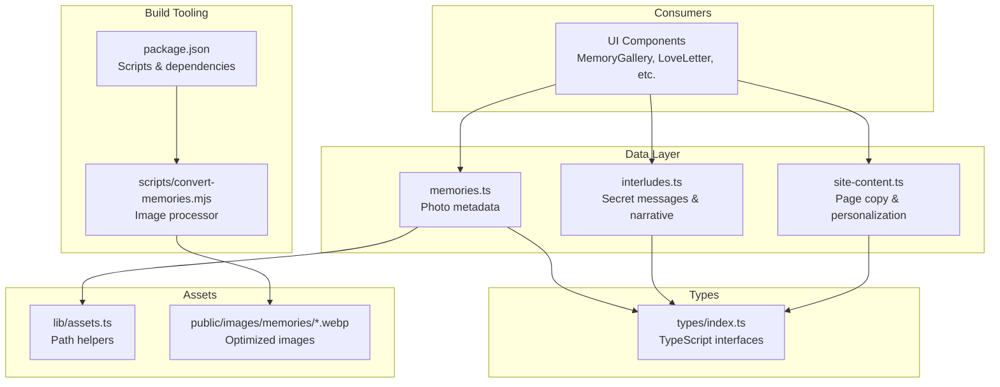
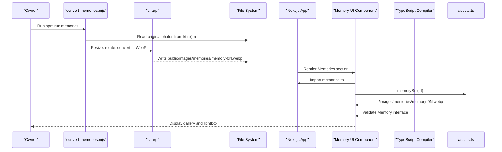
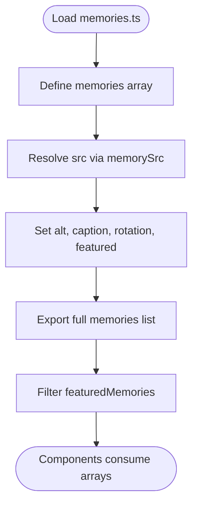
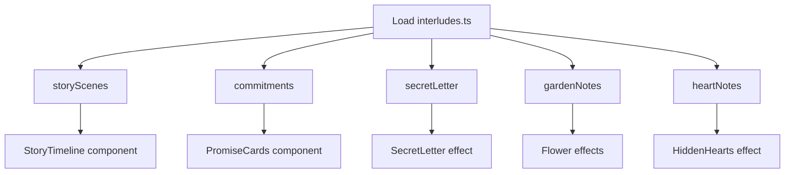
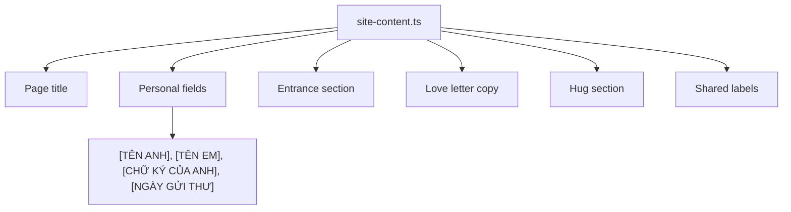
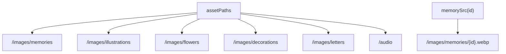
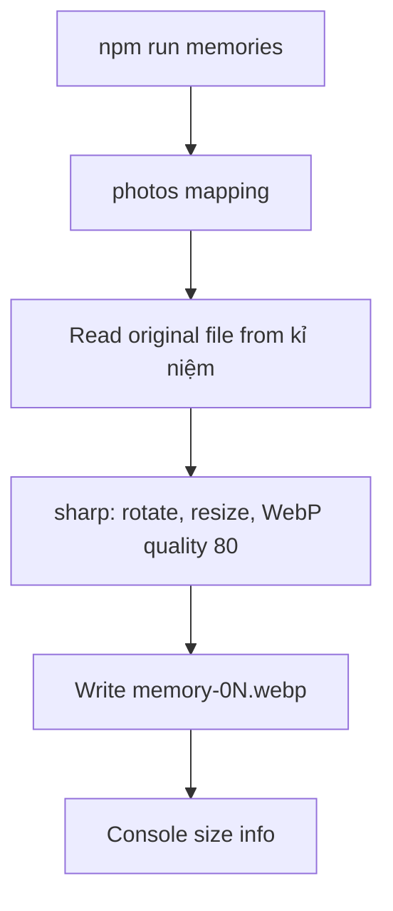
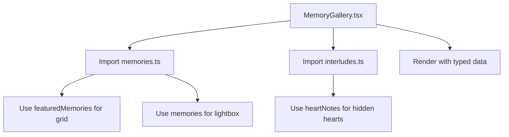
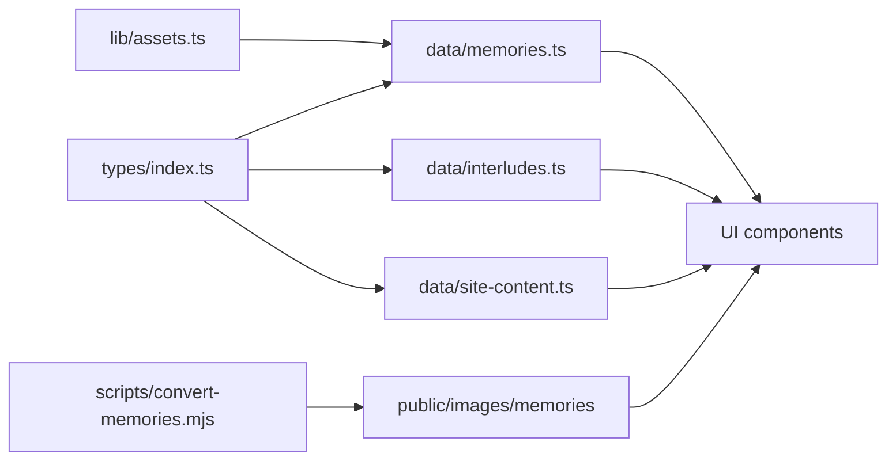

# Data Management

<cite>
**Referenced Files in This Document**   
- [site-content.ts](file://src/data/site-content.ts)
- [memories.ts](file://src/data/memories.ts)
- [interludes.ts](file://src/data/interludes.ts)
- [index.ts](file://src/types/index.ts)
- [assets.ts](file://src/lib/assets.ts)
- [convert-memories.mjs](file://scripts/convert-memories.mjs)
- [package.json](file://package.json)
- [MemoryGallery.tsx](file://src/components/memories/MemoryGallery.tsx)
- [LoveLetter.tsx](file://src/components/letter/LoveLetter.tsx)
</cite>

## Update Summary
**Changes Made**   
- Enhanced documentation to reflect the actual centralized data management architecture
- Added detailed analysis of TypeScript interfaces for type safety
- Updated component usage examples showing how data is consumed
- Clarified the separation between static content, media assets, and type definitions
- Strengthened the relationship between data modules and their consumers

## Table of Contents
1. [Introduction](#introduction)
2. [Project Structure](#project-structure)
3. [Core Components](#core-components)
4. [Architecture Overview](#architecture-overview)
5. [Detailed Component Analysis](#detailed-component-analysis)
6. [Dependency Analysis](#dependency-analysis)
7. [Performance Considerations](#performance-considerations)
8. [Troubleshooting Guide](#troubleshooting-guide)
9. [Conclusion](#conclusion)

## Introduction
This document explains how data is organized, transformed, and consumed in the project through a centralized data management approach. The application implements three distinct concerns with clear boundaries:

- **Static content**: site-wide text, letter copy, chapter scenes, commitments, hidden notes, and UI labels managed through `site-content.ts`
- **Media assets**: user-supplied photos converted into optimized WebP files served from `public/images/memories`, with metadata defined in `memories.ts`
- **Type definitions**: shared TypeScript interfaces that describe memories, story scenes, commitments, and interactive notes for compile-time safety

The design keeps content editable by the owner while preventing accidental fabrication of personal details. Asset paths are centralized so components never hardcode file locations. A Node script converts original photos into web-ready images with consistent sizing and metadata stripping. All data consumption is strongly typed through TypeScript interfaces.

## Project Structure
Data-related code lives under `src/data`, types under `src/types`, asset path helpers under `src/lib`, and the image conversion tool under `scripts`. Components import this data rather than managing it locally.



**Diagram sources**
- [memories.ts:1-59](file://src/data/memories.ts#L1-L59)
- [interludes.ts:1-111](file://src/data/interludes.ts#L1-L111)
- [site-content.ts:1-65](file://src/data/site-content.ts#L1-L65)
- [index.ts:1-46](file://src/types/index.ts#L1-L46)
- [assets.ts:1-25](file://src/lib/assets.ts#L1-L25)
- [convert-memories.mjs:1-42](file://scripts/convert-memories.mjs#L1-L42)
- [package.json:1-33](file://package.json#L1-33)
- [MemoryGallery.tsx:1-120](file://src/components/memories/MemoryGallery.tsx#L1-L120)
- [LoveLetter.tsx:1-99](file://src/components/letter/LoveLetter.tsx#L1-L99)

**Section sources**
- [memories.ts:1-59](file://src/data/memories.ts#L1-L59)
- [interludes.ts:1-111](file://src/data/interludes.ts#L1-L111)
- [site-content.ts:1-65](file://src/data/site-content.ts#L1-L65)
- [index.ts:1-46](file://src/types/index.ts#L1-L46)
- [assets.ts:1-25](file://src/lib/assets.ts#L1-L25)
- [convert-memories.mjs:1-42](file://scripts/convert-memories.mjs#L1-L42)
- [package.json:1-33](file://package.json#L1-33)

## Core Components
The data layer consists of three specialized modules plus shared types and asset helpers, each with distinct responsibilities and ownership levels.

| Module | Responsibility | Key Exports | Owner Editability | Type Safety |
|---|---|---|---|---|
| `src/data/memories.ts` | Defines photo entries for the Memories section with metadata | `memories`, `featuredMemories` | High; captions and rotation should be updated by the owner | Strong; uses `Memory` interface |
| `src/data/interludes.ts` | Defines story scenes, commitments, secret letter, garden notes, and heart notes | `storyScenes`, `commitments`, `secretLetter`, `gardenNotes`, `heartNotes` | Medium to high depending on section | Strong; uses dedicated interfaces |
| `src/data/site-content.ts` | Centralizes page titles, letter copy, hug section, and shared labels | `siteContent`, `SiteContent` type | High; contains placeholder fields for names and signature | Strong; exported as `typeof siteContent` |
| `src/types/index.ts` | Declares shared interfaces and literal union types | `Memory`, `Commitment`, `StoryScene`, `GardenNote`, `HeartNote`, etc. | Low; changes affect multiple modules | Foundation; defines all contracts |
| `src/lib/assets.ts` | Centralizes asset folder paths and memory URL builder | `assetPaths`, `memorySrc`, `musicTrack` | Low; change only when adding new asset folders | Strong; uses `as const` assertions |
| `scripts/convert-memories.mjs` | Converts original photos into optimized WebP files | Script entry point | Low; update mapping only if adding or renaming photos | None; runtime script |

**Section sources**
- [memories.ts:1-59](file://src/data/memories.ts#L1-L59)
- [interludes.ts:1-111](file://src/data/interludes.ts#L1-L111)
- [site-content.ts:1-65](file://src/data/site-content.ts#L1-L65)
- [index.ts:1-46](file://src/types/index.ts#L1-L46)
- [assets.ts:1-25](file://src/lib/assets.ts#L1-L25)
- [convert-memories.mjs:1-42](file://scripts/convert-memories.mjs#L1-L42)

## Architecture Overview
At runtime, components import typed data from `src/data` and use `memorySrc` to resolve image URLs. At build time, the owner runs a script that reads original photos from `kỉ niệm` and writes resized WebP files into `public/images/memories`. The entire system is strongly typed through TypeScript interfaces.



**Diagram sources**
- [convert-memories.mjs:1-42](file://scripts/convert-memories.mjs#L1-L42)
- [memories.ts:1-59](file://src/data/memories.ts#L1-L59)
- [assets.ts:1-25](file://src/lib/assets.ts#L1-L25)
- [index.ts:1-46](file://src/types/index.ts#L1-L46)

## Detailed Component Analysis

### TypeScript Interface Foundation
The type system provides compile-time safety across all data modules, ensuring consistency and preventing runtime errors.

```mermaid
classDiagram
class Memory {
+string id
+string src
+string alt
+string caption
+number rotation
+boolean featured
}
class SiteContent {
+string title
+string boyfriendName
+string girlfriendName
+string signature
+string date
+object entrance
+object letter
+object hug
+object labels
}
class StoryScene {
+string id
+string step
+string title
+string body
+SceneIllustration illustration
}
class Commitment {
+string id
+string eyebrow
+string title
+string body
+CommitmentIcon icon
}
class GardenNote {
+string id
+string ariaLabel
+string text
}
class HeartNote {
+string id
+string ariaLabel
+string text
}
SceneIllustration <|-- "avatar"
SceneIllustration <|-- "conversation"
SceneIllustration <|-- "garden"
CommitmentIcon <|-- "listen"
CommitmentIcon <|-- "appreciate"
CommitmentIcon <|-- "action"
```

**Diagram sources**
- [index.ts:1-46](file://src/types/index.ts#L1-L46)

Key modeling decisions:

- `Memory.src` is not a hardcoded string; it is produced by `memorySrc`, which composes `/images/memories/{id}.webp`.
- `Memory.featured` controls whether a photo appears as a grid card; non-featured photos remain available through the lightbox.
- `Memory.caption` is intentionally left as a placeholder until the owner fills it in.
- `Memory.rotation` adds a scrapbook-like tilt rather than relying on CSS transforms alone.
- `SiteContent` centralizes all visible copy and exposes a strongly typed shape via `SiteContent`.
- `StoryScene`, `Commitment`, `GardenNote`, and `HeartNote` separate narrative content from presentation logic.
- Literal union types (`SceneIllustration`, `CommitmentIcon`) ensure only valid values are used.

**Section sources**
- [index.ts:1-46](file://src/types/index.ts#L1-L46)
- [memories.ts:1-59](file://src/data/memories.ts#L1-L59)
- [site-content.ts:1-65](file://src/data/site-content.ts#L1-L65)

### Memory Data Source
The memory dataset defines five photos with strong typing and centralized source resolution. Three properties are especially important for data management:

1. **Identity**: each memory has a stable `id` such as `memory-01`.
2. **Source resolution**: `memorySrc` builds the final URL from the asset helper.
3. **Featured filtering**: `featuredMemories` derives a subset for the grid view.



**Diagram sources**
- [memories.ts:1-59](file://src/data/memories.ts#L1-L59)
- [assets.ts:1-25](file://src/lib/assets.ts#L1-L25)

Operational notes:

- The comment marks this module as the primary real content source for photos.
- Captions must remain placeholders unless the owner edits them.
- `memory-04` is intentionally non-featured because it is a near duplicate of another photo but still useful in the lightbox.
- All memory objects conform to the `Memory` interface for type safety.

**Section sources**
- [memories.ts:1-59](file://src/data/memories.ts#L1-L59)

### Narrative and Interactive Notes
Narrative data is split into chapters and interactive elements with strong typing:

- `storyScenes`: Chapter 03 timeline describing two days and a realization.
- `commitments`: Chapter 05 commitments with icons and structured bodies.
- `secretLetter`: Canonical copy for a hidden letter.
- `gardenNotes`: Interactive flower messages between chapters.
- `heartNotes`: Five hidden heart messages scattered across sections.



**Diagram sources**
- [interludes.ts:1-111](file://src/data/interludes.ts#L1-L111)

Important constraints:

- The secret letter is marked canonical and should not be rewritten casually.
- Each note includes an `ariaLabel` intended for accessibility.
- Icons and illustrations are represented as string literals, keeping rendering logic decoupled from content.
- All data conforms to their respective TypeScript interfaces.

**Section sources**
- [interludes.ts:1-111](file://src/data/interludes.ts#L1-L111)

### Site Content Configuration
`site-content.ts` is the single place for page-level text and personalization fields, with the entire object exported as a type.



**Diagram sources**
- [site-content.ts:1-65](file://src/data/site-content.ts#L1-L65)

Guidelines:

- Replace every placeholder before sharing the link.
- Do not invent personal details to fill gaps.
- The hug section direction is fixed to match the intended emotional flow.
- The entire configuration is typed as `SiteContent` for compile-time validation.

**Section sources**
- [site-content.ts:1-65](file://src/data/site-content.ts#L1-L65)

### Asset Path Helper
Asset paths are centralized to avoid scattered string literals, with all paths defined as constants.



**Diagram sources**
- [assets.ts:1-25](file://src/lib/assets.ts#L1-L25)

Benefits:

- Changing the output directory requires editing one location.
- Components stay focused on presentation rather than path construction.
- Future audio tracks can follow the same pattern.
- All paths are validated at compile time through `as const` assertions.

**Section sources**
- [assets.ts:1-25](file://src/lib/assets.ts#L1-L25)

### Photo Conversion Pipeline
The conversion script bridges raw owner photos and the web application with explicit file mappings.



**Diagram sources**
- [convert-memories.mjs:1-42](file://scripts/convert-memories.mjs#L1-L42)
- [package.json:1-33](file://package.json#L1-33)

Pipeline characteristics:

- Input directory: `kỉ niệm`.
- Output directory: `public/images/memories`.
- Output format: WebP.
- Resize behavior: fits within a 1200x1200 box without enlarging smaller images.
- Metadata handling: EXIF/GPS metadata is stripped by default through the pipeline.
- Re-running is safe and overwrites existing outputs.
- Explicit mapping between generated IDs and original filenames.

**Section sources**
- [convert-memories.mjs:1-42](file://scripts/convert-memories.mjs#L1-L42)
- [package.json:1-33](file://package.json#L1-33)

### Component Data Consumption
Components import and consume data directly from the centralized modules, demonstrating the clean separation of concerns.



**Diagram sources**
- [MemoryGallery.tsx:1-120](file://src/components/memories/MemoryGallery.tsx#L1-L120)
- [LoveLetter.tsx:1-99](file://src/components/letter/LoveLetter.tsx#L1-L99)

Usage patterns:

- Components import only what they need from each data module.
- Data is consumed as typed objects, providing IntelliSense and compile-time validation.
- Placeholders are handled gracefully in components (e.g., caption styling).
- No direct manipulation of asset paths in components.

**Section sources**
- [MemoryGallery.tsx:1-120](file://src/components/memories/MemoryGallery.tsx#L1-L120)
- [LoveLetter.tsx:1-99](file://src/components/letter/LoveLetter.tsx#L1-L99)

## Dependency Analysis
The data layer has clear ownership boundaries and minimal coupling, with TypeScript enforcing the contract between modules.



**Diagram sources**
- [index.ts:1-46](file://src/types/index.ts#L1-L46)
- [memories.ts:1-59](file://src/data/memories.ts#L1-L59)
- [interludes.ts:1-111](file://src/data/interludes.ts#L1-L111)
- [site-content.ts:1-65](file://src/data/site-content.ts#L1-L65)
- [assets.ts:1-25](file://src/lib/assets.ts#L1-L25)
- [convert-memories.mjs:1-42](file://scripts/convert-memories.mjs#L1-L42)

Observations:

- `types/index.ts` is a leaf dependency: other data modules depend on it, but it does not depend on data modules.
- `memories.ts` depends on both types and asset helpers.
- `interludes.ts` and `site-content.ts` depend only on types.
- The conversion script is independent of the runtime app and only interacts with the filesystem.
- There are no circular dependencies among data modules.
- Components depend on data modules but not on each other's data.

**Section sources**
- [index.ts:1-46](file://src/types/index.ts#L1-L46)
- [memories.ts:1-59](file://src/data/memories.ts#L1-L59)
- [interludes.ts:1-111](file://src/data/interludes.ts#L1-L111)
- [site-content.ts:1-65](file://src/data/site-content.ts#L1-L65)
- [assets.ts:1-25](file://src/lib/assets.ts#L1-L25)
- [convert-memories.mjs:1-42](file://scripts/convert-memories.mjs#L1-L42)

## Performance Considerations
- **Image optimization**: Original photos are large night shots around 2000px. The conversion script resizes them to a maximum long edge of 1200px and exports WebP at quality 80, reducing bandwidth and improving load times.
- **Metadata stripping**: Stripping EXIF and GPS metadata reduces file size and avoids leaking sensitive location information.
- **Featured vs non-featured**: Only featured memories appear as cards, reducing initial layout complexity. Non-featured photos are still available in the lightbox.
- **Centralized asset paths**: Avoids repeated path computation and makes future caching or CDN configuration easier.
- **Static data**: All data is statically defined, so there is no runtime API call overhead for content loading.
- **TypeScript compilation**: Compile-time type checking prevents runtime errors and improves development experience.
- **Module imports**: Components import only what they need, minimizing bundle size impact.

## Troubleshooting Guide

### Missing Memory Images
**Symptoms**: Gallery shows broken images or empty slots.

**Likely causes**:
- The conversion script was not run.
- The original photo mapping in the script does not match the actual filenames.
- The generated WebP files were deleted or moved.

**Resolution steps**:
1. Verify that `kỉ niệm` contains the expected original photos.
2. Run the conversion script using the package script.
3. Confirm that `public/images/memories` contains `memory-01.webp` through `memory-05.webp`.
4. Check that `memories.ts` references the same IDs used by the script.

**Section sources**
- [convert-memories.mjs:1-42](file://scripts/convert-memories.mjs#L1-L42)
- [memories.ts:1-59](file://src/data/memories.ts#L1-L59)
- [assets.ts:1-25](file://src/lib/assets.ts#L1-L25)
- [package.json:1-33](file://package.json#L1-33)

### Incorrect Image Size or Orientation
**Symptoms**: Images look too small, stretched, or rotated incorrectly.

**Likely causes**:
- The original photo has unusual orientation metadata.
- The resize configuration does not match the desired display size.

**Resolution steps**:
1. Inspect the original photo's orientation.
2. Re-run the conversion script after confirming the input file exists.
3. If the display needs different dimensions, adjust the resize settings in the conversion script.

**Section sources**
- [convert-memories.mjs:1-42](file://scripts/convert-memories.mjs#L1-L42)

### Placeholder Text Still Visible
**Symptoms**: The site shows `[TÊN ANH]`, `[TÊN EM]`, `[CHỮ KÝ CỦA ANH]`, or `[NGÀY GỬI THƯ]`.

**Likely causes**:
- The owner did not replace placeholders in `site-content.ts`.
- The wrong branch or local copy is being deployed.

**Resolution steps**:
1. Open `site-content.ts`.
2. Replace every placeholder with the intended personal values.
3. Rebuild and redeploy the application.

**Section sources**
- [site-content.ts:1-65](file://src/data/site-content.ts#L1-L65)

### Caption Not Updated
**Symptoms**: Memory captions show `[CHÚ THÍCH]`.

**Likely causes**:
- The owner has not edited the caption field.
- The deployment uses stale data.

**Resolution steps**:
1. Edit the caption in `memories.ts`.
2. Keep captions factual and owned by the recipient.
3. Rebuild the application.

**Section sources**
- [memories.ts:1-59](file://src/data/memories.ts#L1-L59)

### Type Errors After Adding New Content
**Symptoms**: TypeScript reports missing properties or invalid enum values.

**Likely causes**:
- New content does not match existing interfaces.
- Literal union types were extended without updating the type definition.

**Resolution steps**:
1. Update the relevant interface or literal union in `types/index.ts`.
2. Ensure all data modules conform to the new types.
3. Run the type checker to validate consistency.

**Section sources**
- [index.ts:1-46](file://src/types/index.ts#L1-L46)

### Component Import Errors
**Symptoms**: Components fail to import data or show undefined properties.

**Likely causes**:
- Data module exports changed without updating component imports.
- TypeScript compilation failed due to type mismatches.

**Resolution steps**:
1. Verify that the data module exports the expected properties.
2. Check that component imports match the current data structure.
3. Run `npm run typecheck` to identify type errors.
4. Ensure all required dependencies are installed.

**Section sources**
- [MemoryGallery.tsx:1-120](file://src/components/memories/MemoryGallery.tsx#L1-L120)
- [LoveLetter.tsx:1-99](file://src/components/letter/LoveLetter.tsx#L1-L99)

## Conclusion
The data management strategy in this project is intentionally simple, owner-friendly, and type-safe:

- Static content is centralized and strongly typed through TypeScript interfaces.
- Photos are converted once into optimized WebP files and referenced through a single asset helper.
- Placeholders guide the owner to provide real personal details without encouraging fabrication.
- The conversion script isolates heavy image processing from the runtime application.
- Components consume data through well-defined interfaces, ensuring consistency and maintainability.

For future changes, prefer extending data modules and types rather than scattering paths or copy throughout components. When adding new media, update the asset helper and conversion mapping together to keep the pipeline consistent. The strong typing system ensures that any changes propagate correctly through the entire application, catching errors at compile time rather than runtime.