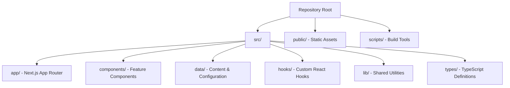
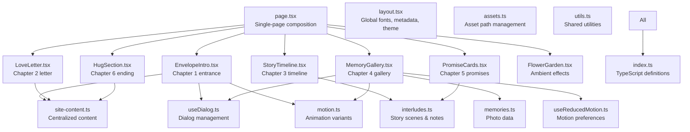
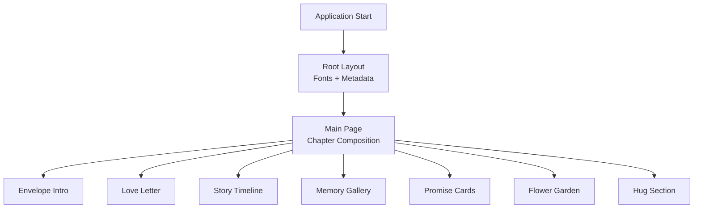

# Implementation Guide

<cite>
**Referenced Files in This Document**
- [package.json](file://package.json)
- [next.config.ts](file://next.config.ts)
- [tsconfig.json](file://tsconfig.json)
- [README.md](file://README.md)
- [src/app/layout.tsx](file://src/app/layout.tsx)
- [src/app/page.tsx](file://src/app/page.tsx)
- [src/types/index.ts](file://src/types/index.ts)
- [src/data/site-content.ts](file://src/data/site-content.ts)
- [src/data/memories.ts](file://src/data/memories.ts)
- [src/data/interludes.ts](file://src/data/interludes.ts)
- [src/lib/motion.ts](file://src/lib/motion.ts)
- [src/lib/assets.ts](file://src/lib/assets.ts)
- [src/lib/utils.ts](file://src/lib/utils.ts)
- [src/hooks/useDialog.ts](file://src/hooks/useDialog.ts)
- [src/hooks/useReducedMotion.ts](file://src/hooks/useReducedMotion.ts)
- [src/components/entrance/EnvelopeIntro.tsx](file://src/components/entrance/EnvelopeIntro.tsx)
- [src/components/letter/LoveLetter.tsx](file://src/components/letter/LoveLetter.tsx)
- [src/components/memories/MemoryGallery.tsx](file://src/components/memories/MemoryGallery.tsx)
</cite>

## Update Summary
**Changes Made**
- Updated project structure documentation to reflect actual Next.js App Router implementation with `src/app` layout and page architecture
- Revised technology stack to match React 19.1.0, Next.js 15.5.29, TypeScript 5, and Tailwind CSS v4 configuration
- Added detailed component organization analysis based on actual src/components folder structure
- Updated data management patterns to reflect centralized content files and type definitions
- Enhanced build tooling configuration documentation with actual tsconfig.json and next.config.ts settings
- Added comprehensive hook system documentation including useDialog and useReducedMotion implementations
- Updated dependency analysis to reflect actual package.json dependencies and development workflow

## Table of Contents
1. [Introduction](#introduction)
2. [Project Structure](#project-structure)
3. [Core Components](#core-components)
4. [Architecture Overview](#architecture-overview)
5. [Detailed Component Analysis](#detailed-component-analysis)
6. [Dependency Analysis](#dependency-analysis)
7. [Performance Considerations](#performance-considerations)
8. [Troubleshooting Guide](#troubleshooting-guide)
9. [Conclusion](#conclusion)
10. [Appendices](#appendices)

## Introduction
This implementation guide explains how to build the complete romantic apology website called "A Little World For You." The project is a personal, single-page storybook experience designed for a boyfriend to share sincerity, accountability, and affection with his girlfriend. It should feel like a watercolor illustrated story mixed with a romantic scrapbook, not an ecommerce page or generic template.

The repository provides a Design Asset Pack that defines the creative direction, design system, animation rules, story content, and a master prompt for AI coding assistants. The application has been fully implemented using Next.js App Router with React 19, TypeScript, and modern component architecture.

The recommended technology stack includes:
- Next.js 15.5.29 with App Router
- React 19.1.0 with TypeScript
- Tailwind CSS v4 with PostCSS integration
- Motion library (`motion/react`) for animations
- Lucide React for interface icons
- Vercel-compatible static deployment

No database, authentication, analytics, or backend is required unless explicitly requested later.

**Section sources**
- [README.md:1-37](file://README.md#L1-L37)
- [package.json:1-33](file://package.json#L1-L33)

## Project Structure
The application follows a clean Next.js App Router structure with organized components, data management, and shared utilities:

**Diagram sources**
- [src/app/layout.tsx:1-55](file://src/app/layout.tsx#L1-L55)
- [src/app/page.tsx:1-52](file://src/app/page.tsx#L1-L52)
- [src/components/entrance/EnvelopeIntro.tsx:1-177](file://src/components/entrance/EnvelopeIntro.tsx#L1-L177)

The application structure includes:
- **src/app/**: Next.js App Router pages and global layout configuration
- **src/components/**: Organized feature components (entrance, letter, memories, promises, ending, effects, illustrations, layout, ui)
- **src/data/**: Centralized content configuration and story data
- **src/hooks/**: Custom React hooks for dialog management and motion preferences
- **src/lib/**: Shared utilities, motion configuration, and asset management
- **src/types/**: TypeScript interfaces and type definitions

**Section sources**
- [src/app/layout.tsx:1-55](file://src/app/layout.tsx#L1-L55)
- [src/app/page.tsx:1-52](file://src/app/page.tsx#L1-L52)
- [src/components/entrance/EnvelopeIntro.tsx:1-177](file://src/components/entrance/EnvelopeIntro.tsx#L1-L177)

## Core Components
The website is structured as a single-page story with six sections, each implemented as dedicated React components:

| Section | Component | Purpose | Key Features |
|---|---|---|---|
| Chapter 1 — The Little Entrance | `EnvelopeIntro.tsx` | Invite recipient into sincere world | Animated envelope opening, smooth scroll navigation |
| Chapter 2 — A Letter For You | `LoveLetter.tsx` | Deliver main apology letter | Paper card design, paragraph reveal animations |
| Chapter 3 — What I Didn't Realize | `StoryTimeline.tsx` | Acknowledge mistakes without blame | Three illustrated story beats with accountability focus |
| Chapter 4 — Our Little Memories | `MemoryGallery.tsx` | Showcase real shared photos | Polaroid gallery with accessible lightbox |
| Chapter 5 — Things I Want To Do Better | `PromiseCards.tsx` | Present realistic commitments | Behavior-based promise cards with gentle icons |
| Chapter 6 — A Hug For You | `HugSection.tsx` | Close with warmth and no pressure | Optional hug button with heart bloom animation |

The emotional arc moves from curiosity to sincerity, recognition, warmth, commitment, and gentle closure. All components respect reduced motion preferences and maintain accessibility standards.

**Section sources**
- [src/app/page.tsx:15-51](file://src/app/page.tsx#L15-L51)
- [src/components/entrance/EnvelopeIntro.tsx:84-177](file://src/components/entrance/EnvelopeIntro.tsx#L84-L177)
- [src/components/letter/LoveLetter.tsx:22-99](file://src/components/letter/LoveLetter.tsx#L22-L99)
- [src/components/memories/MemoryGallery.tsx:22-115](file://src/components/memories/MemoryGallery.tsx#L22-L115)

## Architecture Overview
The implementation follows a layered approach with clear separation of concerns:

**Diagram sources**
- [src/app/page.tsx:1-52](file://src/app/page.tsx#L1-L52)
- [src/app/layout.tsx:1-55](file://src/app/layout.tsx#L1-L55)
- [src/components/entrance/EnvelopeIntro.tsx:1-177](file://src/components/entrance/EnvelopeIntro.tsx#L1-L177)
- [src/components/letter/LoveLetter.tsx:1-99](file://src/components/letter/LoveLetter.tsx#L1-L99)
- [src/components/memories/MemoryGallery.tsx:1-115](file://src/components/memories/MemoryGallery.tsx#L1-L115)

**Section sources**
- [src/app/page.tsx:1-52](file://src/app/page.tsx#L1-L52)
- [src/app/layout.tsx:1-55](file://src/app/layout.tsx#L1-L55)

## Detailed Component Analysis

### Application Entry Points
The Next.js App Router structure uses two primary entry points:

**Root Layout (`src/app/layout.tsx`)**: Configures global typography with Vietnamese font support, metadata for SEO and social sharing, and HTML structure with language attributes set to Vietnamese.

**Main Page (`src/app/page.tsx`)**: Composes all six chapters in narrative order with accessibility features including skip links, semantic HTML structure, and proper heading hierarchy.

**Diagram sources**
- [src/app/layout.tsx:31-54](file://src/app/layout.tsx#L31-L54)
- [src/app/page.tsx:15-51](file://src/app/page.tsx#L15-L51)

**Section sources**
- [src/app/layout.tsx:1-55](file://src/app/layout.tsx#L1-L55)
- [src/app/page.tsx:1-52](file://src/app/page.tsx#L1-L52)

### Envelope Intro Component
The entrance component implements the first chapter with sophisticated SVG animations:

- **Envelope Illustration**: Custom SVG with animated flap rotation and letter slide-out effects
- **Interaction Model**: Click-to-open with automatic scroll to letter section
- **Accessibility**: Proper ARIA attributes, keyboard navigation, and reduced motion support
- **Visual Elements**: Floating petals, character illustrations, and hidden heart messages

The component uses Motion for orchestrated animations while respecting user preferences through the `useReducedMotion` hook.

**Section sources**
- [src/components/entrance/EnvelopeIntro.tsx:15-177](file://src/components/entrance/EnvelopeIntro.tsx#L15-L177)

### Love Letter Component
The letter component presents the main apology message with paper-like aesthetics:

- **Typography**: Serif headings with handwritten accent text for signature
- **Content Structure**: Greeting, multiple paragraphs, closing, signature, date, and postscript
- **Animations**: Staggered paragraph reveals with gentle easing functions
- **Decorative Elements**: Botanical illustrations, stamp graphics, and hidden heart messages

The component reads content from centralized data files, making it easy to edit without modifying component logic.

**Section sources**
- [src/components/letter/LoveLetter.tsx:22-99](file://src/components/letter/LoveLetter.tsx#L22-L99)

### Memory Gallery Component
The memory gallery showcases real photos with polaroid-style presentation:

- **Grid Layout**: Responsive grid showing featured memories with alternating offsets
- **Lightbox System**: Accessible full-screen viewer with keyboard navigation and escape key support
- **Image Optimization**: Uses Next.js Image component with proper sizing and lazy loading
- **Caption Management**: Placeholder detection and resolution for editable captions

The component integrates with the custom dialog hook for accessible modal behavior and respects reduced motion preferences.

**Section sources**
- [src/components/memories/MemoryGallery.tsx:22-115](file://src/components/memories/MemoryGallery.tsx#L22-L115)

### Data Management Patterns
The application uses centralized data files for all content:

**Site Content (`src/data/site-content.ts`)**: Contains all editable text including personal fields, chapter copy, and shared labels. Personal fields are clearly marked as placeholders requiring replacement.

**Memory Data (`src/data/memories.ts`)**: Defines photo metadata including source paths, alt text, captions, rotation values, and featured status. Captions intentionally ship as placeholders to prevent fabrication.

**Interlude Data (`src/data/interludes.ts`)**: Contains story scenes, commitments, secret letters, garden notes, and hidden heart messages across multiple chapters.

**Section sources**
- [src/data/site-content.ts:8-65](file://src/data/site-content.ts#L8-L65)
- [src/data/memories.ts:15-59](file://src/data/memories.ts#L15-L59)
- [src/data/interludes.ts:3-111](file://src/data/interludes.ts#L3-L111)

### Custom Hook System
The application includes specialized hooks for common functionality:

**useDialog Hook**: Provides accessible dialog behavior including focus trapping, Escape key handling, scroll locking, and focus restoration. Used by both secret letter modals and photo lightboxes.

**useReducedMotion Hook**: Wraps Motion's reduced motion hook to provide a single source of truth for motion preferences throughout the application.

**Section sources**
- [src/hooks/useDialog.ts:21-98](file://src/hooks/useDialog.ts#L21-L98)
- [src/hooks/useReducedMotion.ts:9-12](file://src/hooks/useReducedMotion.ts#L9-L12)

### Animation and Motion System
The motion system centralizes animation configuration:

**Motion Configuration**: Defines consistent easing curves, duration values, viewport interaction settings, and reusable animation variants (fadeUp, fadeIn, scaleIn).

**Animation Principles**: Calm, organic movements with 350-700ms transitions, low amplitude ambient loops, and strict adherence to reduced motion preferences.

**Implementation Pattern**: Components use Motion's `whileInView` for scroll-triggered animations and explicit state management for interactive elements.

**Section sources**
- [src/lib/motion.ts:1-62](file://src/lib/motion.ts#L1-L62)

## Dependency Analysis
The project maintains minimal dependencies focused on core functionality:

| Category | Dependencies | Version | Purpose |
|---|---|---:|---|
| Framework | Next.js | 15.5.29 | App Router, routing, static generation |
| UI Library | React | 19.1.0 | Component rendering and state management |
| Runtime | react-dom | 19.1.0 | DOM rendering for React components |
| Styling | Tailwind CSS | ^4 | Utility-first responsive styling |
| Animation | Motion | ^14.12.0 | Orchestrated UI transitions and animations |
| Icons | Lucide React | ^1.71.0 | Simple interface icons |
| Development | TypeScript | ^5 | Type safety and developer experience |
| Development | ESLint | ^9 | Code quality and consistency |
| Development | Sharp | ^0.35.5 | Image optimization during build |

The build tooling includes TypeScript compiler options with strict mode enabled, path aliases for cleaner imports, and Next.js plugin integration.

**Section sources**
- [package.json:13-31](file://package.json#L13-L31)
- [tsconfig.json:1-28](file://tsconfig.json#L1-L28)

## Performance Considerations
The implementation prioritizes performance and accessibility:

- **Animation Performance**: Transform and opacity-only animations for smooth 60fps performance
- **Image Optimization**: Next.js Image component with proper sizing, lazy loading, and WebP format conversion
- **Bundle Size**: Minimal dependencies and tree-shaking compatible imports
- **Accessibility**: Full keyboard navigation, screen reader support, and reduced motion compliance
- **SEO**: Proper metadata configuration with robots directives to prevent indexing of personal content
- **Font Loading**: Optimized font loading with Vietnamese subset support and display swap

The application avoids autoplay audio, excessive particles, and layout-heavy animations that could impact mobile performance.

**Section sources**
- [src/app/layout.tsx:31-44](file://src/app/layout.tsx#L31-L44)
- [src/components/memories/MemoryGallery.tsx:74-80](file://src/components/memories/MemoryGallery.tsx#L74-L80)

## Troubleshooting Guide

### Common Implementation Challenges
- **Font Loading Issues**: Ensure Vietnamese subsets are properly configured in Next.js font loader
- **Image Path Resolution**: Verify asset paths through the centralized assets utility rather than hardcoding
- **Animation Conflicts**: Check for conflicting Motion configurations and ensure reduced motion is respected
- **Accessibility Problems**: Validate keyboard navigation, focus management, and ARIA attributes
- **Build Errors**: Confirm TypeScript strict mode compliance and proper type definitions

### Debugging Approaches
- **Component Inspection**: Use React DevTools to verify prop passing and state management
- **Network Monitoring**: Check image loading and asset optimization during development
- **Console Validation**: Monitor for hydration warnings and console errors
- **Responsive Testing**: Test across breakpoints at 360px, 390px, 430px, 768px, 1024px, and 1440px+
- **Accessibility Audit**: Validate screen reader compatibility and keyboard navigation

### Testing Strategies for Romantic User Experience
- **Emotional Flow**: Ensure the narrative progression feels natural and respectful
- **Content Authenticity**: Verify no fabricated memories, dates, or personal details
- **Animation subtlety**: Confirm animations enhance rather than distract from the emotional content
- **Mobile Experience**: Test touch interactions and responsive layouts thoroughly
- **Personalization Safety**: Validate placeholder replacement process for sensitive personal content

**Section sources**
- [src/hooks/useDialog.ts:5-98](file://src/hooks/useDialog.ts#L5-L98)
- [src/lib/utils.ts:16-27](file://src/lib/utils.ts#L16-L27)

## Conclusion
Building "A Little World For You" requires creating a sincere, visually warm, and emotionally clear apology experience using modern web technologies. The implemented architecture provides a solid foundation with Next.js App Router, React 19, TypeScript, and Motion for animations.

Key success factors include maintaining the intimate tone, ensuring accessibility compliance, optimizing performance for mobile devices, and providing clear pathways for personalization while protecting sensitive content. The centralized data management pattern makes content updates straightforward while the component architecture ensures maintainability and reusability.

When deploying, prioritize Vercel's static hosting capabilities and ensure all personal content is properly replaced before sharing the link. The application is designed to work seamlessly across devices while maintaining the tender, readable experience appropriate for its emotional purpose.

[No sources needed since this section summarizes without analyzing specific files]

## Appendices

### Development Workflow Summary
1. **Setup**: Initialize Next.js App Router with React 19, TypeScript, Tailwind CSS v4, and Motion
2. **Configuration**: Establish font loading, metadata, and global styles in root layout
3. **Content**: Populate centralized data files with personal content and placeholder markers
4. **Components**: Implement six chapters as dedicated React components with proper accessibility
5. **Animations**: Apply Motion animations following established easing and timing patterns
6. **Testing**: Validate responsive layouts, accessibility features, and reduced motion support
7. **Optimization**: Run build tools, optimize images, and verify production performance
8. **Deployment**: Configure Vercel deployment with proper environment variables and build commands

**Section sources**
- [package.json:5-12](file://package.json#L5-L12)
- [README.md:3-17](file://README.md#L3-L17)

### Personalization Checklist
- Replace `[TÊN ANH]`, `[TÊN EM]`, `[CHỮ KÝ CỦA ANH]`, and `[NGÀY GỬI THƯ]` in site content
- Add real photos to `public/images/memories/` and run `npm run memories` script
- Update memory captions from `[CHÚ THÍCH]` to meaningful descriptions
- Review and adjust story scenes and commitments in interlude data
- Remove or configure music player if adding audio content
- Verify all placeholder text has been replaced before deployment

**Section sources**
- [src/data/site-content.ts:11-15](file://src/data/site-content.ts#L11-L15)
- [src/data/memories.ts:5-14](file://src/data/memories.ts#L5-L14)
- [package.json:11](file://package.json#L11)

### Build Tooling Configuration
The application uses modern build tooling optimized for performance and developer experience:

**TypeScript Configuration**: Strict mode enabled with ES2017 target, bundler module resolution, and Next.js plugin integration. Path aliases enable clean import statements with `@/*` prefix.

**Next.js Configuration**: Minimal configuration file ready for customization. Default settings handle most requirements for static site generation and client-side rendering.

**Development Scripts**: Comprehensive npm scripts for development, building, linting, type checking, and memory processing utilities.

**Section sources**
- [tsconfig.json:1-28](file://tsconfig.json#L1-L28)
- [next.config.ts:1-8](file://next.config.ts#L1-L8)
- [package.json:5-12](file://package.json#L5-L12)