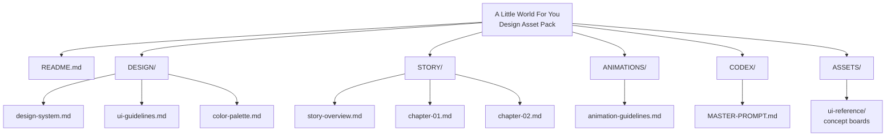
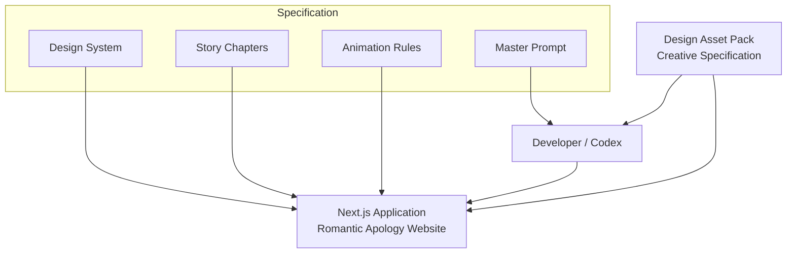
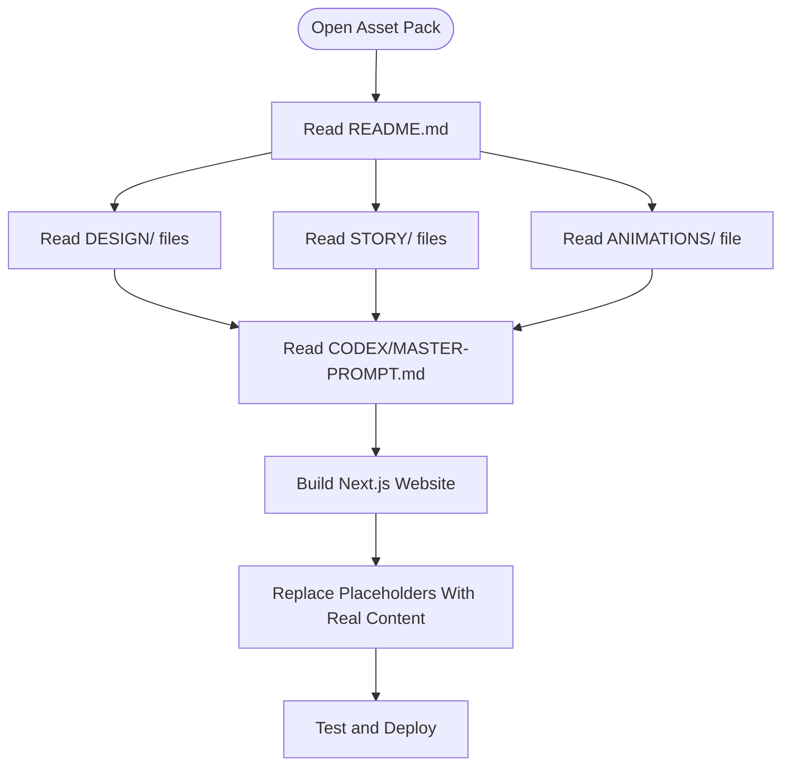
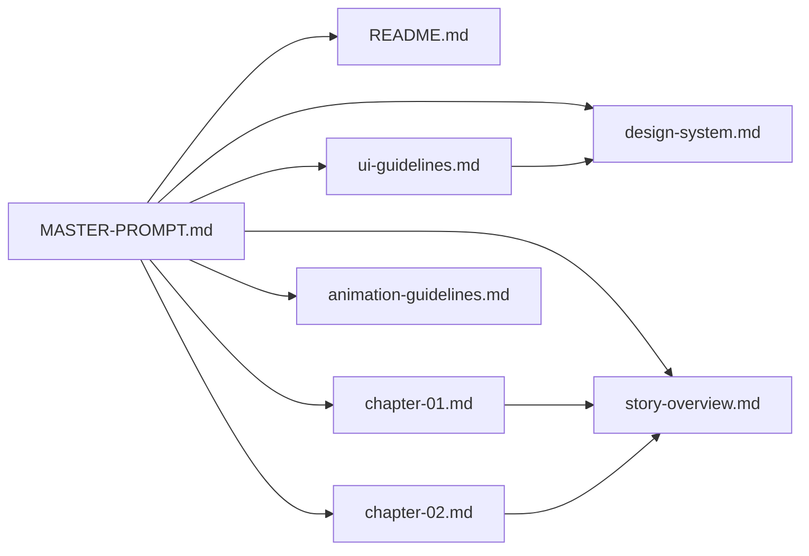

# Project Overview

<cite>
**Referenced Files in This Document**
- [README.md](file://A-Little-World-For-You-Design-Asset-Pack/README.md)
- [MASTER-PROMPT.md](file://A-Little-World-For-You-Design-Asset-Pack/CODEX/MASTER-PROMPT.md)
- [story-overview.md](file://A-Little-World-For-You-Design-Asset-Pack/STORY/story-overview.md)
- [chapter-01.md](file://A-Little-World-For-You-Design-Asset-Pack/STORY/chapter-01.md)
- [chapter-02.md](file://A-Little-World-For-You-Design-Asset-Pack/STORY/chapter-02.md)
- [design-system.md](file://A-Little-World-For-You-Design-Asset-Pack/DESIGN/design-system.md)
- [ui-guidelines.md](file://A-Little-World-For-You-Design-Asset-Pack/DESIGN/ui-guidelines.md)
- [color-palette.md](file://A-Little-World-For-You-Design-Asset-Pack/DESIGN/color-palette.md)
- [animation-guidelines.md](file://A-Little-World-For-You-Design-Asset-Pack/ANIMATIONS/animation-guidelines.md)
</cite>

## Table of Contents
1. [Introduction](#introduction)
2. [Project Structure](#project-structure)
3. [Core Components](#core-components)
4. [Architecture Overview](#architecture-overview)
5. [Detailed Component Analysis](#detailed-component-analysis)
6. [Dependency Analysis](#dependency-analysis)
7. [Performance Considerations](#performance-considerations)
8. [Troubleshooting Guide](#troubleshooting-guide)
9. [Conclusion](#conclusion)

## Introduction
This project is a creative specification and design direction document for building a romantic apology website called **A Little World For You**. It is not the final application itself; it is the blueprint that guides developers to implement a complete, emotionally sincere, and visually polished Next.js experience.

The asset pack defines:
- A watercolor aesthetic with warm cream, blush pink, peach, sky blue, and sage tones.
- A consistent illustrated couple and scrapbook-like visual language.
- A six-chapter emotional story written in intimate Vietnamese using “anh” and “em.”
- Clear UI, typography, color, animation, and accessibility rules.
- Concrete instructions for how a developer or AI coding assistant should build the final website.

The target audience is a romantic gift recipient — typically a girlfriend receiving a personal apology from her boyfriend. The cultural context is Vietnamese intimacy, where “anh/em” establishes closeness, respect, and tenderness. The tone must avoid pressure, guilt, blame, or dramatic manipulation. The website should feel like a small, handmade world prepared with sincerity.

## Project Structure
The asset pack is organized into focused areas that together form a complete creative and technical brief:

**Diagram sources**
- [README.md:12-17](file://A-Little-World-For-You-Design-Asset-Pack/README.md#L12-L17)
- [design-system.md:1-49](file://A-Little-World-For-You-Design-Asset-Pack/DESIGN/design-system.md#L1-L49)
- [ui-guidelines.md:1-56](file://A-Little-World-For-You-Design-Asset-Pack/DESIGN/ui-guidelines.md#L1-L56)
- [color-palette.md:1-22](file://A-Little-World-For-You-Design-Asset-Pack/DESIGN/color-palette.md#L1-L22)
- [story-overview.md:1-20](file://A-Little-World-For-You-Design-Asset-Pack/STORY/story-overview.md#L1-L20)
- [chapter-01.md:1-10](file://A-Little-World-For-You-Design-Asset-Pack/STORY/chapter-01.md#L1-L10)
- [chapter-02.md:1-23](file://A-Little-World-For-You-Design-Asset-Pack/STORY/chapter-02.md#L1-L23)
- [animation-guidelines.md:1-29](file://A-Little-World-For-You-Design-Asset-Pack/ANIMATIONS/animation-guidelines.md#L1-L29)
- [MASTER-PROMPT.md:1-223](file://A-Little-World-For-You-Design-Asset-Pack/CODEX/MASTER-PROMPT.md#L1-L223)

**Section sources**
- [README.md:1-30](file://A-Little-World-For-You-Design-Asset-Pack/README.md#L1-L30)

## Core Components
The asset pack can be understood as five core components:

| Component | Purpose | Key Guidance |
|---|---|---|
| Creative Direction | Defines the watercolor, scrapbook, and romantic tone | Warm, handmade, intimate, non-generic, non-pressure |
| Design System | Provides colors, typography, shape language, layout, and UI rules | Cream background, serif display, friendly sans-serif body, readable contrast |
| Story Content | Supplies the emotional arc and Vietnamese copy | Six chapters, “anh/em” voice, accountability without blame |
| Animation Guidelines | Specifies motion principles and implementation constraints | Calm, organic, reduced-motion aware, no autoplay audio |
| Implementation Prompt | Tells developers how to build the final Next.js site | App Router, React, TypeScript, Tailwind, Motion, Lucide, Vercel-ready |

These components work together so that the final website feels like a cohesive romantic story rather than a generic template.

**Section sources**
- [design-system.md:1-49](file://A-Little-World-For-You-Design-Asset-Pack/DESIGN/design-system.md#L1-L49)
- [ui-guidelines.md:1-56](file://A-Little-World-For-You-Design-Asset-Pack/DESIGN/ui-guidelines.md#L1-L56)
- [color-palette.md:1-22](file://A-Little-World-For-You-Design-Asset-Pack/DESIGN/color-palette.md#L1-L22)
- [story-overview.md:1-20](file://A-Little-World-For-You-Design-Asset-Pack/STORY/story-overview.md#L1-L20)
- [animation-guidelines.md:1-29](file://A-Little-World-For-You-Design-Asset-Pack/ANIMATIONS/animation-guidelines.md#L1-L29)
- [MASTER-PROMPT.md:13-28](file://A-Little-World-For-You-Design-Asset-Pack/CODEX/MASTER-PROMPT.md#L13-L28)

## Architecture Overview
At a high level, this asset pack sits beside the final Next.js application as its creative and technical specification. The relationship is:

**Diagram sources**
- [README.md:24-30](file://A-Little-World-For-You-Design-Asset-Pack/README.md#L24-L30)
- [MASTER-PROMPT.md:1-11](file://A-Little-World-For-You-Design-Asset-Pack/CODEX/MASTER-PROMPT.md#L1-L11)
- [MASTER-PROMPT.md:18-27](file://A-Little-World-For-You-Design-Asset-Pack/CODEX/MASTER-PROMPT.md#L18-L27)

The asset pack does not replace the application code. Instead, it tells the developer what to build, how it should look, how it should behave, and which content should be used.

**Section sources**
- [README.md:24-30](file://A-Little-World-For-You-Design-Asset-Pack/README.md#L24-L30)
- [MASTER-PROMPT.md:1-27](file://A-Little-World-For-You-Design-Asset-Pack/CODEX/MASTER-PROMPT.md#L1-L27)

## Detailed Component Analysis

### Creative Direction and Watercolor Aesthetic
The design direction emphasizes a gentle watercolor storybook mixed with a romantic scrapbook. It avoids glossy gradients, hard shadows, neon effects, corporate layouts, and excessive glassmorphism. The intended feeling is handmade, warm, intimate, and sincere.

Key aesthetic requirements include:
- Soft watercolor washes and paper texture.
- Warm cream base with blush, peach, muted rose, pale sky blue, and sage accents.
- Hand-painted flowers, petals, letters, envelopes, Polaroids, and garden scenery.
- Consistent illustrated characters representing a young man and young woman.
- Elegant, warm, intimate, and slightly playful visuals.

The color palette reinforces this direction by balancing cream/paper backgrounds with soft blush, peach, sky/sage tones, and small rose accents.

**Section sources**
- [README.md:5-10](file://A-Little-World-For-You-Design-Asset-Pack/README.md#L5-L10)
- [design-system.md:3-4](file://A-Little-World-For-You-Design-Asset-Pack/DESIGN/design-system.md#L3-L4)
- [color-palette.md:1-22](file://A-Little-World-For-You-Design-Asset-Pack/DESIGN/color-palette.md#L1-L22)
- [MASTER-PROMPT.md:29-43](file://A-Little-World-For-You-Design-Asset-Pack/CODEX/MASTER-PROMPT.md#L29-L43)

### Character Design Approach
The character design approach centers on two illustrated human figures — one male, one female — whose appearance remains consistent across the website. They are part of a comic-style illustration and scrapbook aesthetic, not realistic photography.

Important constraints:
- Keep their visual treatment consistent wherever they appear.
- Do not treat concept boards as transparent PNG layers.
- If individual assets are unavailable, use restrained CSS/SVG decorations or simple vector shapes consistent with the watercolor direction.
- Replace placeholder illustrations with real assets only when production-ready files exist.

**Section sources**
- [README.md:6-8](file://A-Little-World-For-You-Design-Asset-Pack/README.md#L6-L8)
- [README.md:19-23](file://A-Little-World-For-You-Design-Asset-Pack/README.md#L19-L23)
- [MASTER-PROMPT.md:32-38](file://A-Little-World-For-You-Design-Asset-Pack/CODEX/MASTER-PROMPT.md#L32-L38)
- [MASTER-PROMPT.md:44-52](file://A-Little-World-For-You-Design-Asset-Pack/CODEX/MASTER-PROMPT.md#L44-L52)

### Emotional Storytelling Goals
The storytelling goal is an apology that communicates accountability, sincerity, appreciation, and affection without pressuring the recipient to forgive immediately. The emotional arc moves through curiosity, sincerity, recognition, warmth, commitment, and gentle closure.

The core message is about understanding why his reaction hurt her, learning to care better for her emotions, and showing change through behavior rather than just words. The tone must remain natural, intimate, and warm in Vietnamese, using “anh” and “em,” while avoiding over-dramatic guilt, manipulation, blame, or pressure.

**Section sources**
- [story-overview.md:3-19](file://A-Little-World-For-You-Design-Asset-Pack/STORY/story-overview.md#L3-L19)
- [MASTER-PROMPT.md:13-17](file://A-Little-World-For-You-Design-Asset-Pack/CODEX/MASTER-PROMPT.md#L13-L17)
- [MASTER-PROMPT.md:164-172](file://A-Little-World-For-You-Design-Asset-Pack/CODEX/MASTER-PROMPT.md#L164-L172)

### Relationship Between Asset Pack and Final Next.js Application
The asset pack is meant to be read alongside a Next.js repository. Developers should:
- Inspect the existing repository structure.
- Use the design system, story content, and animation guidelines as constraints.
- Build a single-page story with six sections.
- Preserve existing useful setup if a Next.js project already exists.
- Create a clean Next.js App Router + TypeScript project if none exists.
- Treat the asset pack as authoritative guidance, not optional inspiration.

The final application should be a static personal experience without unnecessary backend features unless explicitly requested.

**Section sources**
- [README.md:24-30](file://A-Little-World-For-You-Design-Asset-Pack/README.md#L24-L30)
- [MASTER-PROMPT.md:5-11](file://A-Little-World-For-You-Design-Asset-Pack/CODEX/MASTER-PROMPT.md#L5-L11)
- [MASTER-PROMPT.md:18-27](file://A-Little-World-For-You-Design-Asset-Pack/CODEX/MASTER-PROMPT.md#L18-L27)

### Target Audience and Cultural Context
The recipient is a romantic partner receiving a personal apology. The cultural context is Vietnamese intimacy, where “anh” and “em” establish closeness and tenderness. The website should feel like a small world prepared specifically for her, not a public marketing page.

Guidance includes:
- Use Vietnamese as the primary language.
- Preserve the affectionate “anh/em” voice.
- Leave editable placeholders for names, dates, photos, and inside jokes.
- Never invent private memories or personal details.
- Avoid language that demands forgiveness or creates guilt.

**Section sources**
- [story-overview.md:14-19](file://A-Little-World-For-You-Design-Asset-Pack/STORY/story-overview.md#L14-L19)
- [MASTER-PROMPT.md:164-172](file://A-Little-World-For-You-Design-Asset-Pack/CODEX/MASTER-PROMPT.md#L164-L172)

### How Developers Should Use This Documentation
Developers should treat this asset pack as the source of truth for design, tone, content, and interaction behavior. The recommended workflow is:

1. Read `README.md` to understand the package purpose and contents.
2. Read `DESIGN/design-system.md`, `DESIGN/ui-guidelines.md`, and `DESIGN/color-palette.md`.
3. Read `STORY/story-overview.md` and relevant chapter files.
4. Read `ANIMATIONS/animation-guidelines.md`.
5. Open `CODEX/MASTER-PROMPT.md` and follow its implementation instructions.
6. Build the six-section website using the specified stack and architecture.
7. Replace placeholders with real personal content only when available.

**Diagram sources**
- [README.md:24-30](file://A-Little-World-For-You-Design-Asset-Pack/README.md#L24-L30)
- [MASTER-PROMPT.md:187-198](file://A-Little-World-For-You-Design-Asset-Pack/CODEX/MASTER-PROMPT.md#L187-L198)

**Section sources**
- [README.md:24-30](file://A-Little-World-For-You-Design-Asset-Pack/README.md#L24-L30)
- [MASTER-PROMPT.md:187-223](file://A-Little-World-For-You-Design-Asset-Pack/CODEX/MASTER-PROMPT.md#L187-L223)

## Dependency Analysis
The asset pack has clear internal dependencies:

- The master prompt depends on the README, design system, story, and animation guidelines.
- The UI guidelines depend on the design system’s visual direction.
- The story chapters depend on the story overview’s emotional arc and tone.
- The animation guidelines depend on the overall calm, organic, and accessible interaction philosophy.
- The final Next.js application depends on all of these documents for correct implementation.

**Diagram sources**
- [MASTER-PROMPT.md:5-11](file://A-Little-World-For-You-Design-Asset-Pack/CODEX/MASTER-PROMPT.md#L5-L11)
- [ui-guidelines.md:1-56](file://A-Little-World-For-You-Design-Asset-Pack/DESIGN/ui-guidelines.md#L1-L56)
- [story-overview.md:1-20](file://A-Little-World-For-You-Design-Asset-Pack/STORY/story-overview.md#L1-L20)
- [chapter-01.md:1-10](file://A-Little-World-For-You-Design-Asset-Pack/STORY/chapter-01.md#L1-L10)
- [chapter-02.md:1-23](file://A-Little-World-For-You-Design-Asset-Pack/STORY/chapter-02.md#L1-L23)

**Section sources**
- [MASTER-PROMPT.md:5-11](file://A-Little-World-For-You-Design-Asset-Pack/CODEX/MASTER-PROMPT.md#L5-L11)
- [ui-guidelines.md:1-56](file://A-Little-World-For-You-Design-Asset-Pack/DESIGN/ui-guidelines.md#L1-L56)
- [story-overview.md:1-20](file://A-Little-World-For-You-Design-Asset-Pack/STORY/story-overview.md#L1-L20)

## Performance Considerations
Although this section focuses on general guidance derived from the asset pack, the key performance and interaction constraints are explicit:

- Prefer transform and opacity animations over layout-heavy properties.
- Respect `prefers-reduced-motion`.
- Avoid autoplay audio.
- Keep ambient loops calm and low-amplitude.
- Avoid dozens of simultaneous particles.
- Lazy-load below-the-fold imagery.
- Prevent horizontal overflow and layout shifts.
- Ensure touch-friendly tap targets and interactions.

These constraints ensure the website remains tender, readable, and performant on mobile devices.

**Section sources**
- [animation-guidelines.md:5-29](file://A-Little-World-For-You-Design-Asset-Pack/ANIMATIONS/animation-guidelines.md#L5-L29)
- [MASTER-PROMPT.md:112-130](file://A-Little-World-For-You-Design-Asset-Pack/CODEX/MASTER-PROMPT.md#L112-L130)
- [MASTER-PROMPT.md:173-186](file://A-Little-World-For-You-Design-Asset-Pack/CODEX/MASTER-PROMPT.md#L173-L186)

## Troubleshooting Guide
Common issues and how to resolve them based on the asset pack:

| Issue | Cause | Resolution |
|---|---|---|
| Using moodboard images as full-screen backgrounds | Misunderstanding asset integrity | Concept boards are references, not production backgrounds |
| Treating concept boards as transparent PNG layers | Incorrect asset interpretation | Create separate assets or use CSS/SVG until proper assets exist |
| Inventing real photos or personal memories | Placeholder misuse | Use clearly marked placeholders and never fabricate private details |
| Overly fast or flashy animations | Ignoring animation principles | Follow calm, organic timing and reduced-motion support |
| Autoplaying music | Violating accessibility and UX rules | Require explicit user action for audio |
| Poor readability | Using pale pink for body text | Follow design system contrast rules |
| Non-responsive layout | Ignoring mobile-first rules | Test at 360px, 390px, 430px, 768px, 1024px, and wider |
| Missing keyboard or focus support | Accessibility oversight | Add semantic HTML, visible focus states, and keyboard controls |

**Section sources**
- [README.md:19-23](file://A-Little-World-For-You-Design-Asset-Pack/README.md#L19-L23)
- [design-system.md:20-49](file://A-Little-World-For-You-Design-Asset-Pack/DESIGN/design-system.md#L20-L49)
- [animation-guidelines.md:5-29](file://A-Little-World-For-You-Design-Asset-Pack/ANIMATIONS/animation-guidelines.md#L5-L29)
- [MASTER-PROMPT.md:44-52](file://A-Little-World-For-You-Design-Asset-Pack/CODEX/MASTER-PROMPT.md#L44-L52)
- [MASTER-PROMPT.md:173-186](file://A-Little-World-For-You-Design-Asset-Pack/CODEX/MASTER-PROMPT.md#L173-L186)

## Conclusion
**A Little World For You** is a carefully scoped creative specification for a romantic apology website. Its purpose is to guide developers toward a sincere, watercolor-styled, emotionally coherent Next.js application that respects Vietnamese cultural intimacy and the feelings of the recipient.

The most important principle is consistency: the watercolor aesthetic, character design, emotional tone, accessibility, and interaction behavior should all reinforce the same message — a genuine apology delivered gently, without pressure.

When building the final application, always return to this asset pack. Let the design system define the visuals, the story define the emotion, the animation guidelines define the motion, and the master prompt define the implementation path.