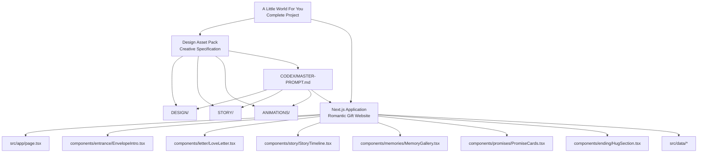
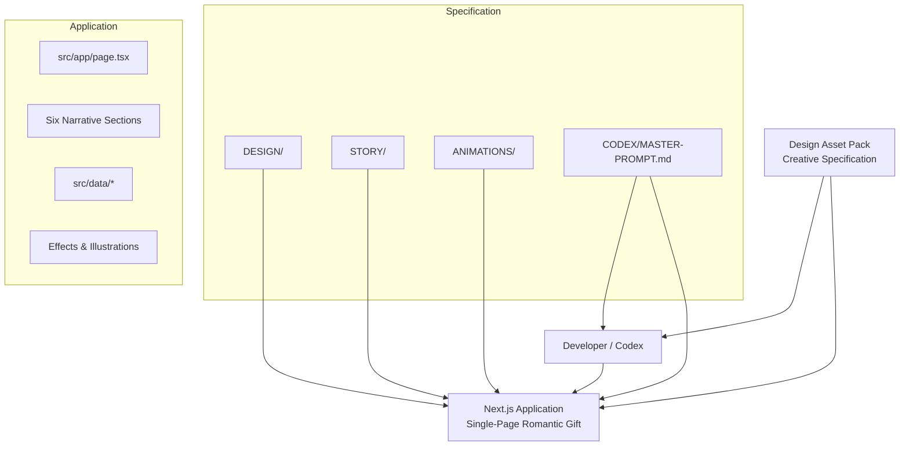
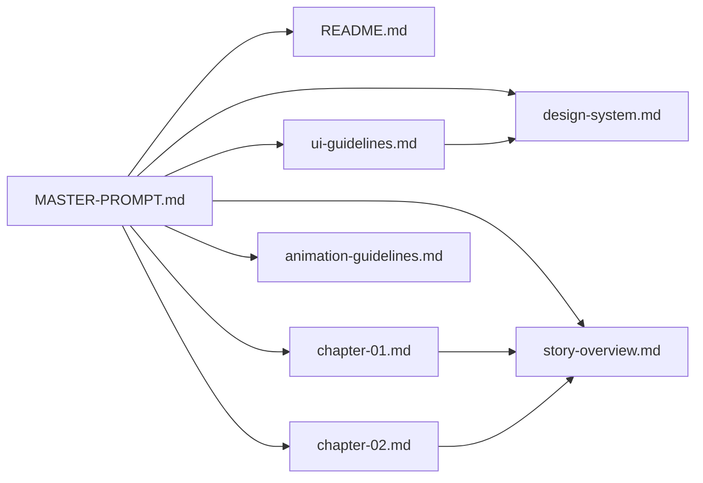

# Project Overview

<cite>
**Referenced Files in This Document**
- [README.md](file://A-Little-World-For-You-Design-Asset-Pack/README.md)
- [MASTER-PROMPT.md](file://A-Little-World-For-You-Design-Asset-Pack/CODEX/MASTER-PROMPT.md)
- [story-overview.md](file://A-Little-World-For-You-Design-Asset-Pack/STORY/story-overview.md)
- [chapter-01.md](file://A-Little-World-For-You-Design-Asset-Pack/STORY/chapter-01.md)
- [chapter-02.md](file://A-Little-World-For-You-Design-Asset-Pack/STORY/chapter-02.md)
- [design-system.md](file://A-Little-World-For-You-Design-Asset-Pack/DESIGN/design-system.md)
- [ui-guidelines.md](file://A-Little-World-For-You-Design-Asset-Pack/DESIGN/ui-guidelines.md)
- [color-palette.md](file://A-Little-World-For-You-Design-Asset-Pack/DESIGN/color-palette.md)
- [animation-guidelines.md](file://A-Little-World-For-You-Design-Asset-Pack/ANIMATIONS/animation-guidelines.md)
- [page.tsx](file://src/app/page.tsx)
- [EnvelopeIntro.tsx](file://src/components/entrance/EnvelopeIntro.tsx)
- [LoveLetter.tsx](file://src/components/letter/LoveLetter.tsx)
- [StoryTimeline.tsx](file://src/components/story/StoryTimeline.tsx)
- [MemoryGallery.tsx](file://src/components/memories/MemoryGallery.tsx)
- [PromiseCards.tsx](file://src/components/promises/PromiseCards.tsx)
- [HugSection.tsx](file://src/components/ending/HugSection.tsx)
- [site-content.ts](file://src/data/site-content.ts)
- [memories.ts](file://src/data/memories.ts)
- [interludes.ts](file://src/data/interludes.ts)
- [package.json](file://package.json)
</cite>

## Update Summary
**Changes Made**
- Updated the project overview to reflect the complete transformation from a standard Next.js template into the fully implemented “A Little World For You” romantic gift website.
- Added documentation for the six single-page narrative sections: envelope introduction, love letter, story timeline, memory gallery, promise cards, and closing hug.
- Updated architecture diagrams to map directly to the actual Next.js components and data files.
- Revised developer guidance to describe how the design asset pack now drives a concrete, runnable application rather than only a specification document.
- Added section-level sources for all newly analyzed implementation files.

## Table of Contents
1. [Introduction](#introduction)
2. [Project Structure](#project-structure)
3. [Core Components](#core-components)
4. [Architecture Overview](#architecture-overview)
5. [Detailed Component Analysis](#detailed-component-analysis)
6. [Dependency Analysis](#dependency-analysis)
7. [Performance Considerations](#performance-considerations)
8. [Troubleshooting Guide](#troubleshooting-guide)
9. [Conclusion](#conclusion)

## Introduction
This project is both a creative specification and a fully implemented romantic apology website called **A Little World For You**. The `A-Little-World-For-You-Design-Asset-Pack` defines the watercolor aesthetic, character design approach, emotional storytelling goals, and Vietnamese cultural context. The repository under `` is the finished Next.js application that brings that specification to life as a single-page narrative experience.

The website is not a generic template or commercial landing page. It is a personal gift built by a boyfriend for his girlfriend after a misunderstanding hurt her. Its purpose is to communicate accountability, sincerity, appreciation, and affection without pressuring her to forgive immediately. The tone uses intimate Vietnamese with “anh” and “em,” establishing closeness, respect, and tenderness.

The final application follows the design asset pack’s direction through six scrollable chapters:
1. Envelope introduction — a gentle entry into a small world made for her.
2. Love letter — a sincere apology written on paper-like cardstock.
3. Story timeline — two days that went wrong and what he understood afterward.
4. Memory gallery — real photos presented as Polaroid-style scrapbook cards.
5. Promise cards — three realistic commitments about behavior change.
6. Closing hug — a warm, non-demanding ending where he gives a hug and she receives it.

**Section sources**
- [README.md:1-8](file://A-Little-World-For-You-Design-Asset-Pack/README.md#L1-L8)
- [MASTER-PROMPT.md:17-33](file://A-Little-World-For-You-Design-Asset-Pack/CODEX/MASTER-PROMPT.md#L17-L33)
- [MASTER-PROMPT.md:36-72](file://A-Little-World-For-You-Design-Asset-Pack/CODEX/MASTER-PROMPT.md#L36-L72)
- [page.tsx:11-14](file://src/app/page.tsx#L11-L14)

## Project Structure
The completed project consists of two cooperating layers:

- The **design asset pack**, which is the authoritative creative and technical specification.
- The **Next.js application**, which implements that specification as a static, single-page romantic gift website.

**Diagram sources**
- [README.md:12-17](file://A-Little-World-For-You-Design-Asset-Pack/README.md#L12-L17)
- [MASTER-PROMPT.md:127-180](file://A-Little-World-For-You-Design-Asset-Pack/CODEX/MASTER-PROMPT.md#L127-L180)
- [page.tsx:1-49](file://src/app/page.tsx#L1-L49)

The design asset pack remains the source of truth for tone, copy, visual direction, animation principles, and accessibility rules. The Next.js application is the runnable result of following those instructions.

**Section sources**
- [README.md:1-8](file://A-Little-World-For-You-Design-Asset-Pack/README.md#L1-L8)
- [MASTER-PROMPT.md:75-84](file://A-Little-World-For-You-Design-Asset-Pack/CODEX/MASTER-PROMPT.md#L75-L84)
- [page.tsx:1-49](file://src/app/page.tsx#L1-L49)

## Core Components
The implemented website can be understood as six narrative sections plus shared infrastructure:

| Section | Purpose | Implementation |
|---|---|---|
| Envelope Introduction | Welcomes the recipient into a small, personal world | `components/entrance/EnvelopeIntro.tsx` |
| Love Letter | Delivers the core apology with signature and date | `components/letter/LoveLetter.tsx` |
| Story Timeline | Narrates the two mistakes and the realization | `components/story/StoryTimeline.tsx` |
| Memory Gallery | Shows real photos as Polaroid-style cards with lightbox | `components/memories/MemoryGallery.tsx` |
| Promise Cards | Presents three behavioral commitments | `components/promises/PromiseCards.tsx` |
| Closing Hug | Ends with a warm, non-demanding interaction | `components/ending/HugSection.tsx` |

Shared infrastructure includes:
- Single-page composition in `src/app/page.tsx`.
- Canonical copy in `src/data/site-content.ts`, `src/data/memories.ts`, and `src/data/interludes.ts`.
- Motion tokens, utilities, and reduced-motion handling.
- Watercolor-inspired UI components such as buttons, paper cards, and section headings.

These components work together so the final site feels like one cohesive romantic story rather than a collection of unrelated pages.

**Section sources**
- [page.tsx:1-49](file://src/app/page.tsx#L1-L49)
- [EnvelopeIntro.tsx:1-182](file://src/components/entrance/EnvelopeIntro.tsx#L1-L182)
- [LoveLetter.tsx:1-99](file://src/components/letter/LoveLetter.tsx#L1-L99)
- [StoryTimeline.tsx:1-88](file://src/components/story/StoryTimeline.tsx#L1-L88)
- [MemoryGallery.tsx:1-120](file://src/components/memories/MemoryGallery.tsx#L1-L120)
- [PromiseCards.tsx:1-72](file://src/components/promises/PromiseCards.tsx#L1-L72)
- [HugSection.tsx:1-155](file://src/components/ending/HugSection.tsx#L1-L155)

## Architecture Overview
At a high level, the relationship between the design asset pack and the Next.js application is now concrete: the specification defines the experience, and the application renders it as a single-page scrollable narrative.

**Diagram sources**
- [README.md:24-30](file://A-Little-World-For-You-Design-Asset-Pack/README.md#L24-L30)
- [MASTER-PROMPT.md:478-524](file://A-Little-World-For-You-Design-Asset-Pack/CODEX/MASTER-PROMPT.md#L478-L524)
- [page.tsx:1-49](file://src/app/page.tsx#L1-L49)

The asset pack does not replace the application code. Instead, it tells developers what to build, how it should look, how it should behave, and which content should be used. The current repository already contains the resulting Next.js App Router + TypeScript application built with React 19, Tailwind CSS v4, Motion, and Lucide React.

**Section sources**
- [README.md:24-30](file://A-Little-World-For-You-Design-Asset-Pack/README.md#L24-L30)
- [MASTER-PROMPT.md:88-99](file://A-Little-World-For-You-Design-Asset-Pack/CODEX/MASTER-PROMPT.md#L88-L99)
- [package.json:13-18](file://package.json#L13-L18)

## Detailed Component Analysis

### Envelope Introduction
The envelope introduction is Chapter 01. It opens with a cream background, an illustrated envelope, floating petals, hidden hearts, and the two consistent characters. Clicking the button animates the envelope flap, slides the letter up, releases petals, and scrolls smoothly to the love letter. If the user never clicks, the site remains fully readable by scrolling.

Key behaviors:
- Envelope illustration is visible from load; it does not fade in after loading.
- Button toggles between opening the envelope and reading the letter.
- Hidden heart discovery adds warmth without gating progress.
- Reduced motion is respected.

**Section sources**
- [EnvelopeIntro.tsx:15-182](file://src/components/entrance/EnvelopeIntro.tsx#L15-L182)
- [MASTER-PROMPT.md:188-209](file://A-Little-World-For-You-Design-Asset-Pack/CODEX/MASTER-PROMPT.md#L188-L209)

### Love Letter
The love letter is Chapter 02. It presents the canonical apology on a paper-like card with floral decorations, a stamp, handwritten signature, and date. Paragraphs reveal gently on scroll, and the postscript clarifies that forgiveness is not required immediately.

Key behaviors:
- Uses canonical copy from `site-content.ts`.
- Reveals paragraphs with staggered motion.
- Keeps Pacifico only for short handwritten accents.
- Includes a hidden heart near the end.

**Section sources**
- [LoveLetter.tsx:22-99](file://src/components/letter/LoveLetter.tsx#L22-L99)
- [site-content.ts:25-38](file://src/data/site-content.ts#L25-L38)
- [MASTER-PROMPT.md:210-237](file://A-Little-World-For-You-Design-Asset-Pack/CODEX/MASTER-PROMPT.md#L210-L237)

### Story Timeline
The story timeline is Chapter 03. It narrates the two days that went wrong and the realization that the problem was not really about the avatar but about accepting care gently and listening to emotions. Each scene alternates illustration and text along a vertical timeline.

Key behaviors:
- Three scenes with scroll-triggered reveals.
- Illustrated scenes using consistent watercolor style.
- Secret letter interlude embedded near Scene 3.
- Hidden heart discovery integrated into the chapter.

**Section sources**
- [StoryTimeline.tsx:13-88](file://src/components/story/StoryTimeline.tsx#L13-L88)
- [interludes.ts:3-26](file://src/data/interludes.ts#L3-L26)
- [MASTER-PROMPT.md:238-259](file://A-Little-World-For-You-Design-Asset-Pack/CODEX/MASTER-PROMPT.md#L238-L259)

### Memory Gallery
The memory gallery is Chapter 04. It shows four Polaroid-style cards in the grid while keeping all five real photos available in the lightbox. The near-duplicate photo stays accessible without taking a card slot. Captions are intentionally placeholders until the owner fills them in.

Key behaviors:
- Four featured cards in a responsive grid.
- All five photos in the lightbox.
- Paper matting, tape strips, and slight rotation.
- Lightbox supports keyboard navigation, Escape, focus trap, and touch.
- Alt text describes real photo content; captions remain editable.

**Section sources**
- [MemoryGallery.tsx:17-120](file://src/components/memories/MemoryGallery.tsx#L17-L120)
- [memories.ts:4-59](file://src/data/memories.ts#L4-L59)
- [MASTER-PROMPT.md:260-309](file://A-Little-World-For-You-Design-Asset-Pack/CODEX/MASTER-PROMPT.md#L260-L309)

### Promise Cards
The promise cards are Chapter 05. They present three realistic commitments about behavior change rather than demanding immediate trust or forgiveness. Each card has an icon, eyebrow label, title, and body.

Key behaviors:
- Sequential reveal with subtle scale and opacity.
- Focuses on listening, appreciating care, and changing through action.
- Explicitly avoids framing promises as a demand for forgiveness.

**Section sources**
- [PromiseCards.tsx:12-72](file://src/components/promises/PromiseCards.tsx#L12-L72)
- [interludes.ts:28-51](file://src/data/interludes.ts#L28-L51)
- [MASTER-PROMPT.md:310-326](file://A-Little-World-For-You-Design-Asset-Pack/CODEX/MASTER-PROMPT.md#L310-L326)

### Closing Hug
The closing hug is Chapter 06. It is the emotional closure of the website. The direction is fixed: he sends the hug, she receives it. The button says “Nhận cái ôm của anh,” and the confirmation reads “Anh đã gửi em một cái ôm. Cảm ơn em ❤️.” Nothing is transmitted anywhere; the state is local.

Key behaviors:
- Characters move toward each other when hugged.
- A heart blooms between them.
- Confirmation appears without pressure.
- Secondary note invites reciprocity only if she wants to.

**Section sources**
- [HugSection.tsx:16-155](file://src/components/ending/HugSection.tsx#L16-L155)
- [site-content.ts:40-55](file://src/data/site-content.ts#L40-L55)
- [MASTER-PROMPT.md:327-358](file://A-Little-World-For-You-Design-Asset-Pack/CODEX/MASTER-PROMPT.md#L327-L358)

### Relationship Between Asset Pack and Final Next.js Application
The asset pack is meant to be read alongside the Next.js repository. Developers should:
- Inspect the existing repository structure.
- Use the design system, story content, and animation guidelines as constraints.
- Build a single-page story with six sections.
- Preserve existing useful setup if a Next.js project already exists.
- Create a clean Next.js App Router + TypeScript project if none exists.
- Treat the asset pack as authoritative guidance, not optional inspiration.

The final application is a static personal experience without unnecessary backend features unless explicitly requested.

**Section sources**
- [README.md:24-30](file://A-Little-World-For-You-Design-Asset-Pack/README.md#L24-L30)
- [MASTER-PROMPT.md:75-84](file://A-Little-World-For-You-Design-Asset-Pack/CODEX/MASTER-PROMPT.md#L75-L84)
- [MASTER-PROMPT.md:478-524](file://A-Little-World-For-You-Design-Asset-Pack/CODEX/MASTER-PROMPT.md#L478-L524)

### Target Audience and Cultural Context
The recipient is a romantic partner receiving a personal apology. The cultural context is Vietnamese intimacy, where “anh” and “em” establish closeness and tenderness. The website should feel like a small world prepared specifically for her, not a public marketing page.

Guidance includes:
- Use Vietnamese as the primary language.
- Preserve the affectionate “anh/em” voice.
- Leave editable placeholders for names, dates, photos, and inside jokes.
- Never invent private memories or personal details.
- Avoid language that demands forgiveness or creates guilt.

**Section sources**
- [story-overview.md:14-19](file://A-Little-World-For-You-Design-Asset-Pack/STORY/story-overview.md#L14-L19)
- [MASTER-PROMPT.md:63-72](file://A-Little-World-For-You-Design-Asset-Pack/CODEX/MASTER-PROMPT.md#L63-L72)

### How Developers Should Use This Documentation
Developers should treat this asset pack as the source of truth for design, tone, content, and interaction behavior. The recommended workflow is:

1. Read `README.md` to understand the package purpose and contents.
2. Read `DESIGN/design-system.md`, `DESIGN/ui-guidelines.md`, and `DESIGN/color-palette.md`.
3. Read `STORY/story-overview.md` and relevant chapter files.
4. Read `ANIMATIONS/animation-guidelines.md`.
5. Open `CODEX/MASTER-PROMPT.md` and follow its implementation instructions.
6. Build the six-section website using the specified stack and architecture.
7. Replace placeholders with real personal content only when available.

**Diagram sources**
- [README.md:24-30](file://A-Little-World-For-You-Design-Asset-Pack/README.md#L24-L30)
- [MASTER-PROMPT.md:615-636](file://A-Little-World-For-You-Design-Asset-Pack/CODEX/MASTER-PROMPT.md#L615-L636)

**Section sources**
- [README.md:24-30](file://A-Little-World-For-You-Design-Asset-Pack/README.md#L24-L30)
- [MASTER-PROMPT.md:615-636](file://A-Little-World-For-You-Design-Asset-Pack/CODEX/MASTER-PROMPT.md#L615-L636)

## Dependency Analysis
The asset pack has clear internal dependencies, and the application depends on those documents for correct implementation:

- The master prompt depends on the README, design system, story, and animation guidelines.
- The UI guidelines depend on the design system’s visual direction.
- The story chapters depend on the story overview’s emotional arc and tone.
- The animation guidelines depend on the overall calm, organic, and accessible interaction philosophy.
- The final Next.js application depends on all of these documents for correct implementation.

**Diagram sources**
- [MASTER-PROMPT.md:1-14](file://A-Little-World-For-You-Design-Asset-Pack/CODEX/MASTER-PROMPT.md#L1-L14)
- [ui-guidelines.md:1-56](file://A-Little-World-For-You-Design-Asset-Pack/DESIGN/ui-guidelines.md#L1-L56)
- [story-overview.md:1-20](file://A-Little-World-For-You-Design-Asset-Pack/STORY/story-overview.md#L1-L20)
- [chapter-01.md:1-10](file://A-Little-World-For-You-Design-Asset-Pack/STORY/chapter-01.md#L1-L10)
- [chapter-02.md:1-23](file://A-Little-World-For-You-Design-Asset-Pack/STORY/chapter-02.md#L1-L23)

**Section sources**
- [MASTER-PROMPT.md:1-14](file://A-Little-World-For-You-Design-Asset-Pack/CODEX/MASTER-PROMPT.md#L1-L14)
- [ui-guidelines.md:1-56](file://A-Little-World-For-You-Design-Asset-Pack/DESIGN/ui-guidelines.md#L1-L56)
- [story-overview.md:1-20](file://A-Little-World-For-You-Design-Asset-Pack/STORY/story-overview.md#L1-L20)

## Performance Considerations
Although this section focuses on general guidance derived from the asset pack, the key performance and interaction constraints are explicit:

- Prefer transform and opacity animations over layout-heavy properties.
- Respect `prefers-reduced-motion`.
- Avoid autoplay audio.
- Keep ambient loops calm and low-amplitude.
- Avoid dozens of simultaneous particles.
- Lazy-load below-the-fold imagery.
- Prevent horizontal overflow and layout shifts.
- Ensure touch-friendly tap targets and interactions.

These constraints ensure the website remains tender, readable, and performant on mobile devices.

**Section sources**
- [animation-guidelines.md:5-29](file://A-Little-World-For-You-Design-Asset-Pack/ANIMATIONS/animation-guidelines.md#L5-L29)
- [MASTER-PROMPT.md:422-446](file://A-Little-World-For-You-Design-Asset-Pack/CODEX/MASTER-PROMPT.md#L422-L446)
- [MASTER-PROMPT.md:605-612](file://A-Little-World-For-You-Design-Asset-Pack/CODEX/MASTER-PROMPT.md#L605-L612)

## Troubleshooting Guide
Common issues and how to resolve them based on the asset pack:

| Issue | Cause | Resolution |
|---|---|---|
| Using moodboard images as full-screen backgrounds | Misunderstanding asset integrity | Concept boards are references, not production backgrounds |
| Treating concept boards as transparent PNG layers | Incorrect asset interpretation | Create separate assets or use CSS/SVG until proper assets exist |
| Inventing real photos or personal memories | Placeholder misuse | Use clearly marked placeholders and never fabricate private details |
| Overly fast or flashy animations | Ignoring animation principles | Follow calm, organic timing and reduced-motion support |
| Autoplaying music | Violating accessibility and UX rules | Require explicit user action for audio |
| Poor readability | Using pale pink for body text | Follow design system contrast rules |
| Non-responsive layout | Ignoring mobile-first rules | Test at 360px, 390px, 430px, 768px, 1024px, and wider |
| Missing keyboard or focus support | Accessibility oversight | Add semantic HTML, visible focus states, and keyboard controls |
| Wrong hug direction | Confusing sender and recipient roles | Use “Nhận cái ôm của anh”; he gives, she receives |
| Missing real photos | Skipping the memory pipeline | Convert originals to WebP and place them in `public/images/memories/` |

**Section sources**
- [README.md:19-23](file://A-Little-World-For-You-Design-Asset-Pack/README.md#L19-L23)
- [design-system.md:20-49](file://A-Little-World-For-You-Design-Asset-Pack/DESIGN/design-system.md#L20-L49)
- [animation-guidelines.md:5-29](file://A-Little-World-For-You-Design-Asset-Pack/ANIMATIONS/animation-guidelines.md#L5-L29)
- [MASTER-PROMPT.md:44-52](file://A-Little-World-For-You-Design-Asset-Pack/CODEX/MASTER-PROMPT.md#L44-L52)
- [MASTER-PROMPT.md:327-358](file://A-Little-World-For-You-Design-Asset-Pack/CODEX/MASTER-PROMPT.md#L327-L358)

## Conclusion
**A Little World For You** is a carefully scoped creative specification and a fully implemented romantic apology website. Its purpose is to guide developers toward a sincere, watercolor-styled, emotionally coherent Next.js application that respects Vietnamese cultural intimacy and the feelings of the recipient.

The most important principle is consistency: the watercolor aesthetic, character design, emotional tone, accessibility, and interaction behavior should all reinforce the same message — a genuine apology delivered gently, without pressure.

When building or maintaining the final application, always return to the design asset pack. Let the design system define the visuals, the story define the emotion, the animation guidelines define the motion, and the master prompt define the implementation path. The six chapters — envelope introduction, love letter, story timeline, memory gallery, promise cards, and closing hug — should together feel like opening a little illustrated world made with love.