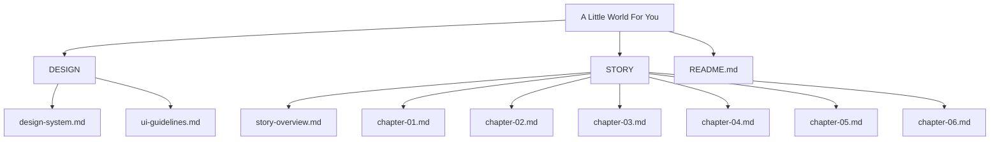
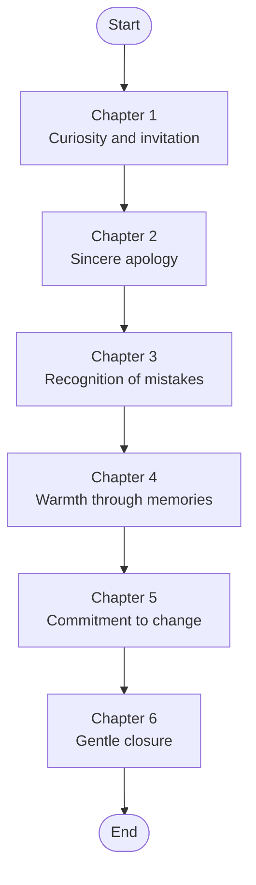
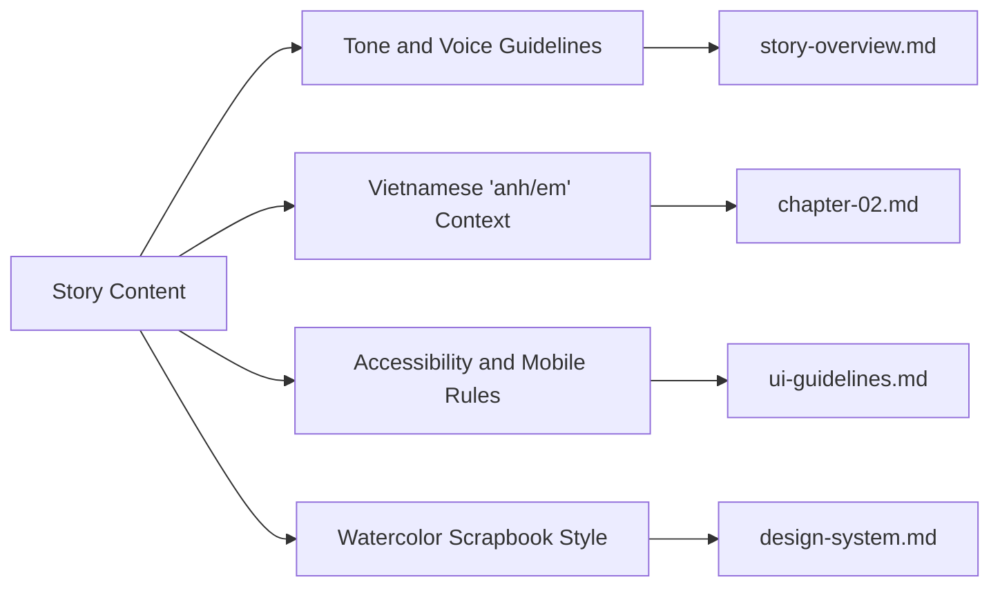

# Story Content and Narrative

<cite>
**Referenced Files in This Document**   
- [story-overview.md](file://A-Little-World-For-You-Design-Asset-Pack/STORY/story-overview.md)
- [chapter-01.md](file://A-Little-World-For-You-Design-Asset-Pack/STORY/chapter-01.md)
- [chapter-02.md](file://A-Little-World-For-You-Design-Asset-Pack/STORY/chapter-02.md)
- [chapter-03.md](file://A-Little-World-For-You-Design-Asset-Pack/STORY/chapter-03.md)
- [chapter-04.md](file://A-Little-World-For-You-Design-Asset-Pack/STORY/chapter-04.md)
- [chapter-05.md](file://A-Little-World-For-You-Design-Asset-Pack/STORY/chapter-05.md)
- [chapter-06.md](file://A-Little-World-For-You-Design-Asset-Pack/STORY/chapter-06.md)
- [design-system.md](file://A-Little-World-For-You-Design-Asset-Pack/DESIGN/design-system.md)
- [ui-guidelines.md](file://A-Little-World-For-You-Design-Asset-Pack/DESIGN/ui-guidelines.md)
- [README.md](file://A-Little-World-For-You-Design-Asset-Pack/README.md)
</cite>

## Table of Contents
1. [Introduction](#introduction)
2. [Project Structure](#project-structure)
3. [Core Components](#core-components)
4. [Architecture Overview](#architecture-overview)
5. [Detailed Component Analysis](#detailed-component-analysis)
6. [Dependency Analysis](#dependency-analysis)
7. [Performance Considerations](#performance-considerations)
8. [Troubleshooting Guide](#troubleshooting-guide)
9. [Conclusion](#conclusion)
10. [Appendices](#appendices)

## Introduction
This document explains the six-chapter story content for a romantic apology experience. The narrative moves from curiosity through sincerity, recognition, warmth, commitment, and gentle closure. It is written in Vietnamese with intimate “anh/em” terms, designed to feel sincere without pressure. The goal is to help creators adapt the story to real personal situations while preserving emotional authenticity, cultural sensitivity, and accessibility.

The project’s core message emphasizes understanding why his reaction hurt her, learning to care better about her feelings, and showing change through behavior rather than only words. The tone should be natural, warm, and respectful, avoiding over-dramatic guilt, manipulation, blame, or pressure.

**Section sources**
- [story-overview.md:3-19](file://A-Little-World-For-You-Design-Asset-Pack/STORY/story-overview.md#L3-L19)

## Project Structure
The story content lives under the STORY directory and is supported by design and UI guidelines that shape how the narrative is presented.

**Diagram sources**
- [README.md:12-17](file://A-Little-World-For-You-Design-Asset-Pack/README.md#L12-L17)
- [design-system.md:1-49](file://A-Little-World-For-You-Design-Asset-Pack/DESIGN/design-system.md#L1-L49)
- [ui-guidelines.md:1-56](file://A-Little-World-For-You-Design-Asset-Pack/DESIGN/ui-guidelines.md#L1-L56)
- [story-overview.md:1-20](file://A-Little-World-For-You-Design-Asset-Pack/STORY/story-overview.md#L1-L20)

**Section sources**
- [README.md:12-17](file://A-Little-World-For-You-Design-Asset-Pack/README.md#L12-L17)
- [design-system.md:1-49](file://A-Little-World-For-You-Design-Asset-Pack/DESIGN/design-system.md#L1-L49)
- [ui-guidelines.md:1-56](file://A-Little-World-For-You-Design-Asset-Pack/DESIGN/ui-guidelines.md#L1-L56)
- [story-overview.md:1-20](file://A-Little-World-For-You-Design-Asset-Pack/STORY/story-overview.md#L1-L20)

## Core Components
The story has six chapters, each with a clear purpose in the emotional arc:

- Chapter 1 — The Little Entrance: Curiosity and invitation.
- Chapter 2 — A Letter For You: Sincere apology and acknowledgment.
- Chapter 3 — What I Didn't Realize: Recognition of two mistakes and reflection.
- Chapter 4 — Our Little Memories: Warmth through shared memories.
- Chapter 5 — Things I Want To Do Better: Commitment to realistic changes.
- Chapter 6 — A Hug For You: Gentle closure without demanding forgiveness.

The emotional progression follows curiosity → sincerity → recognition → warmth → commitment → gentle closure.

**Section sources**
- [story-overview.md:6-12](file://A-Little-World-For-You-Design-Asset-Pack/STORY/story-overview.md#L6-L12)
- [chapter-01.md:1-10](file://A-Little-World-For-You-Design-Asset-Pack/STORY/chapter-01.md#L1-L10)
- [chapter-02.md:1-23](file://A-Little-World-For-You-Design-Asset-Pack/STORY/chapter-02.md#L1-L23)
- [chapter-03.md:1-13](file://A-Little-World-For-You-Design-Asset-Pack/STORY/chapter-03.md#L1-L13)
- [chapter-04.md:1-17](file://A-Little-World-For-You-Design-Asset-Pack/STORY/chapter-04.md#L1-L17)
- [chapter-05.md:1-13](file://A-Little-World-For-You-Design-Asset-Pack/STORY/chapter-05.md#L1-L13)
- [chapter-06.md:1-14](file://A-Little-World-For-You-Design-Asset-Pack/STORY/chapter-06.md#L1-L14)

## Architecture Overview
The user experiences the story as a single-page journey. Each chapter builds on the previous one, guiding the recipient through an emotionally safe path toward reconciliation.

**Diagram sources**
- [ui-guidelines.md:3-46](file://A-Little-World-For-You-Design-Asset-Pack/DESIGN/ui-guidelines.md#L3-L46)
- [story-overview.md:6-12](file://A-Little-World-For-You-Design-Asset-Pack/STORY/story-overview.md#L6-L12)

**Section sources**
- [ui-guidelines.md:3-46](file://A-Little-World-For-You-Design-Asset-Pack/DESIGN/ui-guidelines.md#L3-L46)
- [story-overview.md:6-12](file://A-Little-World-For-You-Design-Asset-Pack/STORY/story-overview.md#L6-L12)

## Detailed Component Analysis

### Chapter 1 — The Little Entrance
Purpose: Create curiosity and a gentle invitation into the little world prepared for her.

Key elements:
- Heading: “A Little World For You.”
- Short introductory line expressing sincerity.
- Button: “Mở món quà nhỏ.”
- Interaction: Tap/click opens an envelope; a letter slides out with softly floating petals. Respect reduced-motion settings.

Tone guidance:
- Keep it light and inviting.
- Avoid heavy emotion here; let curiosity lead.

Adaptation tips:
- Use a simple illustration or CSS/SVG envelope.
- Ensure the button label remains clear and accessible.
- If animations are disabled, still show the letter content clearly.

**Section sources**
- [chapter-01.md:1-10](file://A-Little-World-For-You-Design-Asset-Pack/STORY/chapter-01.md#L1-L10)
- [ui-guidelines.md:6-12](file://A-Little-World-For-You-Design-Asset-Pack/DESIGN/ui-guidelines.md#L6-L12)

### Chapter 2 — A Letter For You
Purpose: Deliver a direct, personal apology and acknowledge the two mistakes.

Key elements:
- Acknowledge making her sad twice.
- Explain the first mistake: rejecting her care about choosing a better avatar and over-explaining.
- Explain the second mistake: explaining again even after changing the avatar, not truly listening to her feelings.
- Apologize for turning a small matter into sadness.
- Emphasize listening and respect over immediate agreement.
- Promise to slow down, listen more, and avoid defensive explanations.
- Thank her for small cares he may have missed.
- Close with affection and a note that she does not need to stop being upset immediately.

Cultural context:
- Uses “anh/em,” which signals an intimate relationship in Vietnamese.
- The tone is sincere and non-demanding.

Adaptation tips:
- Replace editable placeholders such as name, signature, and date.
- Keep the letter readable on mobile.
- Do not claim the website itself can fix the disagreement.

**Section sources**
- [chapter-02.md:1-23](file://A-Little-World-For-You-Design-Asset-Pack/STORY/chapter-02.md#L1-L23)
- [story-overview.md:3-19](file://A-Little-World-For-You-Design-Asset-Pack/STORY/story-overview.md#L3-L19)

### Chapter 3 — What I Didn't Realize
Purpose: Clearly recognize the two mistakes and reflect on what matters most.

Structure:
- Scene 1: She wanted to choose a better avatar; he declined and explained instead of gently accepting her care.
- Scene 2: After reconciling, he explained again, thinking he was helping her understand, but realizing this could reopen old feelings.
- Scene 3: Realization that the issue was not who was right, but how he listened and treated her emotions.

Visual guidance:
- Depict both characters with gentle, neutral expressions.
- Final scene shows understanding, not anger or aggression.

Adaptation tips:
- Use three illustrated beats or cards.
- Keep captions concise and focused on feelings and learning.
- Avoid blaming language or implying she was wrong.

**Section sources**
- [chapter-03.md:1-13](file://A-Little-World-For-You-Design-Asset-Pack/STORY/chapter-03.md#L1-L13)
- [ui-guidelines.md:21-26](file://A-Little-World-For-You-Design-Asset-Pack/DESIGN/ui-guidelines.md#L21-L26)

### Chapter 4 — Our Little Memories
Purpose: Bring warmth by remembering shared moments.

Key elements:
- Owner-provided photos only.
- Four suggested memory cards with editable image and caption fields.
- Optional timeline with key moments like when they met, a special memory, and a recent moment.
- If no real photos are provided, render elegant watercolor placeholder cards and make replacement easy.
- Never invent dates, events, places, or shared experiences.

Accessibility and interaction:
- Polaroid-style gallery.
- Lightbox with close button and keyboard support.
- Editable captions.

Adaptation tips:
- Use real photos only if the owner provides them.
- Keep captions short and meaningful.
- Preserve privacy by avoiding sensitive locations or people unless explicitly approved.

**Section sources**
- [chapter-04.md:1-17](file://A-Little-World-For-You-Design-Asset-Pack/STORY/chapter-04.md#L1-L17)
- [ui-guidelines.md:28-33](file://A-Little-World-For-You-Design-Asset-Pack/DESIGN/ui-guidelines.md#L28-L33)

### Chapter 5 — Things I Want To Do Better
Purpose: Show commitment through realistic behavior changes.

Promises:
- Listen before explaining.
- Appreciate the care behind small gestures.
- Change through actions, not just promises.

Guidance:
- These are commitments, not demands for immediate trust or forgiveness.
- Avoid unrealistic forever-promises or grand claims.
- Focus on small, steady, repeatable behaviors.

Adaptation tips:
- Present as three promise cards.
- Keep language grounded and specific.
- Let the recipient see effort over time rather than perfection.

**Section sources**
- [chapter-05.md:1-13](file://A-Little-World-For-You-Design-Asset-Pack/STORY/chapter-05.md#L1-L13)
- [ui-guidelines.md:35-40](file://A-Little-World-For-You-Design-Asset-Pack/DESIGN/ui-guidelines.md#L35-L40)

### Chapter 6 — A Hug For You
Purpose: Provide gentle closure without pressure.

Key elements:
- Closing message acknowledging that she may still be upset.
- Reassurance that he sincerely apologizes, values her, and wants to learn to love her with more understanding.
- Invitation for a hug when she is ready.
- Optional button: “Gửi anh một cái ôm.”
- After click: show a small watercolor heart bloom and a thank-you message.
- No data transmission; do not imply a real message was sent.

Adaptation tips:
- Keep the button optional.
- Do not use guilt-inducing copy if not clicked.
- Ensure the animation respects reduced-motion preferences.

**Section sources**
- [chapter-06.md:1-14](file://A-Little-World-For-You-Design-Asset-Pack/STORY/chapter-06.md#L1-L14)
- [ui-guidelines.md:42-46](file://A-Little-World-For-You-Design-Asset-Pack/DESIGN/ui-guidelines.md#L42-L46)

## Dependency Analysis
The story content depends on design and UI guidelines to maintain tone, pacing, and accessibility.

**Diagram sources**
- [story-overview.md:14-19](file://A-Little-World-For-You-Design-Asset-Pack/STORY/story-overview.md#L14-L19)
- [chapter-02.md:1-23](file://A-Little-World-For-You-Design-Asset-Pack/STORY/chapter-02.md#L1-L23)
- [ui-guidelines.md:48-56](file://A-Little-World-For-You-Design-Asset-Pack/DESIGN/ui-guidelines.md#L48-L56)
- [design-system.md:1-49](file://A-Little-World-For-You-Design-Asset-Pack/DESIGN/design-system.md#L1-L49)

**Section sources**
- [story-overview.md:14-19](file://A-Little-World-For-You-Design-Asset-Pack/STORY/story-overview.md#L14-L19)
- [ui-guidelines.md:48-56](file://A-Little-World-For-You-Design-Asset-Pack/DESIGN/ui-guidelines.md#L48-L56)
- [design-system.md:1-49](file://A-Little-World-For-You-Design-Asset-Pack/DESIGN/design-system.md#L1-L49)

## Performance Considerations
- Keep text readable without animation.
- Respect reduced-motion settings.
- Avoid auto-playing audio.
- Provide visible focus states and keyboard support.
- Test across mobile and desktop breakpoints.
- Use lightweight illustrations or CSS/SVG where possible.
- Ensure buttons and interactive elements meet minimum tap targets.

These rules protect the emotional experience by preventing overwhelming visuals or inaccessible interactions.

**Section sources**
- [design-system.md:42-49](file://A-Little-World-For-You-Design-Asset-Pack/DESIGN/design-system.md#L42-L49)
- [ui-guidelines.md:48-56](file://A-Little-World-For-You-Design-Asset-Pack/DESIGN/ui-guidelines.md#L48-L56)

## Troubleshooting Guide
Common issues and resolutions:

- Overly dramatic tone:
  - Remove guilt-tripping language.
  - Keep apologies sincere and focused on listening and caring.
  - Refer to the core message and tone guidelines.

- Pressure or manipulation:
  - Do not demand forgiveness.
  - Make closing interactions optional.
  - Avoid implying the website can fix the disagreement.

- Inappropriate depiction of emotions:
  - Do not show the girlfriend as angry or aggressive.
  - Use gentle, neutral expressions throughout.

- Fabricated memories:
  - Never invent dates, events, places, or shared experiences.
  - Use owner-provided photos or elegant placeholders.

- Accessibility failures:
  - Ensure semantic headings, landmarks, and buttons.
  - Support keyboard navigation and visible focus.
  - Provide alt text for meaningful images.

**Section sources**
- [story-overview.md:14-19](file://A-Little-World-For-You-Design-Asset-Pack/STORY/story-overview.md#L14-L19)
- [chapter-03.md:12-13](file://A-Little-World-For-You-Design-Asset-Pack/STORY/chapter-03.md#L12-L13)
- [chapter-04.md:16-17](file://A-Little-World-For-You-Design-Asset-Pack/STORY/chapter-04.md#L16-L17)
- [ui-guidelines.md:48-56](file://A-Little-World-For-You-Design-Asset-Pack/DESIGN/ui-guidelines.md#L48-L56)

## Conclusion
The six-chapter narrative guides the recipient from curiosity through sincerity, recognition, warmth, commitment, and gentle closure. It preserves Vietnamese cultural intimacy through “anh/em,” maintains a warm and sincere tone, and avoids pressure or manipulation. By adapting the story to real personal details while following the design and accessibility guidelines, creators can deliver an emotionally authentic apology experience that respects the recipient’s feelings and space.

[No sources needed since this section summarizes without analyzing specific files]

## Appendices

### Emotional Arc Summary
- Curiosity: Invite her into a small, thoughtful world.
- Sincerity: Offer a direct, personal apology.
- Recognition: Acknowledge the two mistakes clearly.
- Warmth: Remember shared good moments.
- Commitment: Promise realistic behavior changes.
- Closure: Express affection without demanding forgiveness.

**Section sources**
- [story-overview.md:6-12](file://A-Little-World-For-You-Design-Asset-Pack/STORY/story-overview.md#L6-L12)

### Vietnamese Cultural Context and ‘anh/em’ Usage
- “Anh/em” signals an intimate relationship and should be used consistently.
- The tone should be natural, intimate, and warm.
- Avoid over-dramatic guilt, manipulation, blame, or pressure.
- Leave room for her feelings and timing.

**Section sources**
- [story-overview.md:14-19](file://A-Little-World-For-You-Design-Asset-Pack/STORY/story-overview.md#L14-L19)
- [chapter-02.md:1-23](file://A-Little-World-For-You-Design-Asset-Pack/STORY/chapter-02.md#L1-L23)

### Adaptation Guidance for Different Personal Situations
- Replace placeholders with real names, signatures, and dates.
- Use real photos only when provided by the owner.
- Keep commitments realistic and action-oriented.
- Maintain the emotional arc even if details change.
- Preserve sincerity without claiming the website fixes the conflict.

**Section sources**
- [chapter-02.md:19-23](file://A-Little-World-For-You-Design-Asset-Pack/STORY/chapter-02.md#L19-L23)
- [chapter-04.md:1-17](file://A-Little-World-For-You-Design-Asset-Pack/STORY/chapter-04.md#L1-L17)
- [chapter-05.md:1-13](file://A-Little-World-For-You-Design-Asset-Pack/STORY/chapter-05.md#L1-L13)

### Localization and Cultural Sensitivity Requirements
- Write in natural Vietnamese with intimate “anh/em” terms.
- Keep the visual style warm, handmade, and watercolor-inspired.
- Avoid generic layouts, loud colors, or glossy effects.
- Ensure accessibility and mobile-first presentation.
- Never fabricate shared memories or press for forgiveness.

**Section sources**
- [README.md:5-10](file://A-Little-World-For-You-Design-Asset-Pack/README.md#L5-L10)
- [design-system.md:1-49](file://A-Little-World-For-You-Design-Asset-Pack/DESIGN/design-system.md#L1-L49)
- [ui-guidelines.md:48-56](file://A-Little-World-For-You-Design-Asset-Pack/DESIGN/ui-guidelines.md#L48-L56)