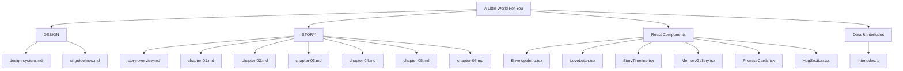
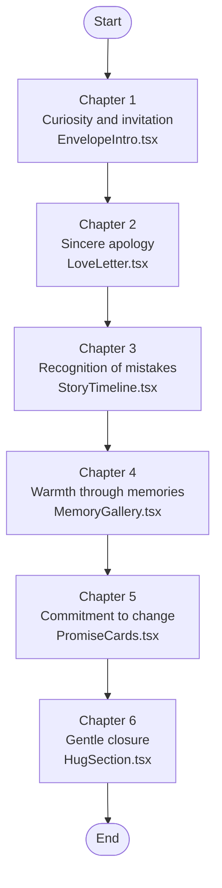
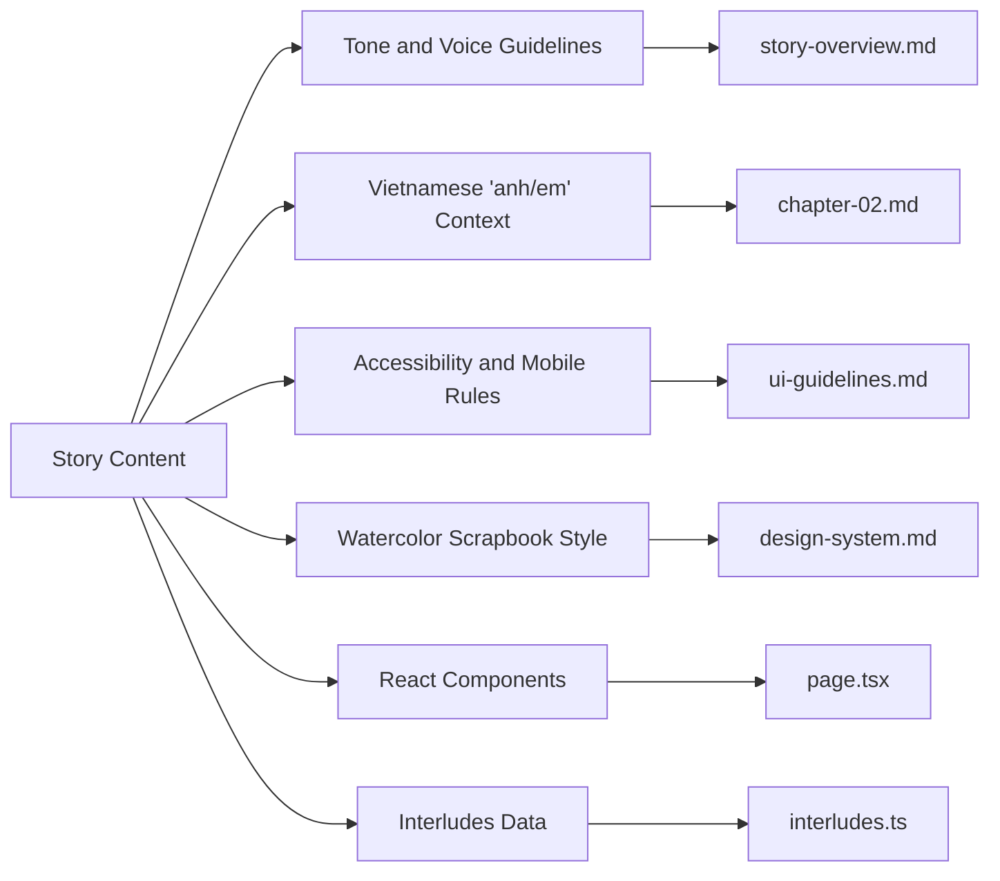

# Story Content and Narrative

<cite>
**Referenced Files in This Document**   
- [story-overview.md](file://A-Little-World-For-You-Design-Asset-Pack/STORY/story-overview.md)
- [chapter-01.md](file://A-Little-World-For-You-Design-Asset-Pack/STORY/chapter-01.md)
- [chapter-02.md](file://A-Little-World-For-You-Design-Asset-Pack/STORY/chapter-02.md)
- [chapter-03.md](file://A-Little-World-For-You-Design-Asset-Pack/STORY/chapter-03.md)
- [chapter-04.md](file://A-Little-World-For-You-Design-Asset-Pack/STORY/chapter-04.md)
- [chapter-05.md](file://A-Little-World-For-You-Design-Asset-Pack/STORY/chapter-05.md)
- [chapter-06.md](file://A-Little-World-For-You-Design-Asset-Pack/STORY/chapter-06.md)
- [interludes.ts](file://src/data/interludes.ts)
- [StoryTimeline.tsx](file://src/components/story/StoryTimeline.tsx)
- [EnvelopeIntro.tsx](file://src/components/entrance/EnvelopeIntro.tsx)
- [LoveLetter.tsx](file://src/components/letter/LoveLetter.tsx)
- [PromiseCards.tsx](file://src/components/promises/PromiseCards.tsx)
- [HugSection.tsx](file://src/components/ending/HugSection.tsx)
- [HiddenHearts.tsx](file://src/components/effects/HiddenHearts.tsx)
- [SecretLetter.tsx](file://src/components/effects/SecretLetter.tsx)
- [FloatingPetals.tsx](file://src/components/effects/FloatingPetals.tsx)
- [Scenes.tsx](file://src/components/illustrations/Scenes.tsx)
- [page.tsx](file://src/app/page.tsx)
- [ProgressIndicator.tsx](file://src/components/layout/ProgressIndicator.tsx)
- [design-system.md](file://A-Little-World-For-You-Design-Asset-Pack/DESIGN/design-system.md)
- [ui-guidelines.md](file://A-Little-World-For-You-Design-Asset-Pack/DESIGN/ui-guidelines.md)
- [README.md](file://A-Little-World-For-You-Design-Asset-Pack/README.md)
</cite>

## Update Summary
**Changes Made**   
- Updated narrative structure documentation to reflect the complete six-chapter implementation with relationship journey from meeting to promises
- Added documentation for story timeline visualization component and its three-scene structure
- Added comprehensive coverage of secret messages system including hidden hearts, secret letter, and flower garden notes
- Enhanced component mapping showing how each chapter connects to specific React components
- Updated emotional arc documentation to include interactive elements and accessibility features
- Added detailed coverage of Vietnamese cultural context through implemented components

## Table of Contents
1. [Introduction](#introduction)
2. [Project Structure](#project-structure)
3. [Core Components](#core-components)
4. [Architecture Overview](#architecture-overview)
5. [Detailed Component Analysis](#detailed-component-analysis)
6. [Interactive Elements and Secret Messages](#interactive-elements-and-secret-messages)
7. [Dependency Analysis](#dependency-analysis)
8. [Performance Considerations](#performance-considerations)
9. [Troubleshooting Guide](#troubleshooting-guide)
10. [Conclusion](#conclusion)
11. [Appendices](#appendices)

## Introduction
This document explains the complete six-chapter story content for a romantic apology experience, now fully implemented with a relationship journey from meeting to promises. The narrative moves from curiosity through sincerity, recognition, warmth, commitment, and gentle closure, supported by interactive elements like story timelines and secret messages. It is written in Vietnamese with intimate "anh/em" terms, designed to feel sincere without pressure.

The project's core message emphasizes understanding why his reaction hurt her, learning to care better about her feelings, and showing change through behavior rather than only words. The tone should be natural, warm, and respectful, avoiding over-dramatic guilt, manipulation, blame, or pressure.

**Section sources**
- [story-overview.md:3-19](file://A-Little-World-For-You-Design-Asset-Pack/STORY/story-overview.md#L3-L19)

## Project Structure
The story content lives under the STORY directory and is supported by design and UI guidelines that shape how the narrative is presented. The implementation uses React components to create an immersive single-page experience.

**Diagram sources**
- [README.md:12-17](file://A-Little-World-For-You-Design-Asset-Pack/README.md#L12-L17)
- [design-system.md:1-49](file://A-Little-World-For-You-Design-Asset-Pack/DESIGN/design-system.md#L1-L49)
- [ui-guidelines.md:1-56](file://A-Little-World-For-You-Design-Asset-Pack/DESIGN/ui-guidelines.md#L1-L56)
- [story-overview.md:1-20](file://A-Little-World-For-You-Design-Asset-Pack/STORY/story-overview.md#L1-L20)
- [page.tsx:1-32](file://src/app/page.tsx#L1-L32)

**Section sources**
- [README.md:12-17](file://A-Little-World-For-You-Design-Asset-Pack/README.md#L12-L17)
- [design-system.md:1-49](file://A-Little-World-For-You-Design-Asset-Pack/DESIGN/design-system.md#L1-L49)
- [ui-guidelines.md:1-56](file://A-Little-World-For-You-Design-Asset-Pack/DESIGN/ui-guidelines.md#L1-L56)
- [story-overview.md:1-20](file://A-Little-World-For-You-Design-Asset-Pack/STORY/story-overview.md#L1-L20)

## Core Components
The story has six chapters, each with a clear purpose in the emotional arc and implemented as dedicated React components:

- Chapter 1 — The Little Entrance: Curiosity and invitation via EnvelopeIntro component
- Chapter 2 — A Letter For You: Sincere apology and acknowledgment via LoveLetter component
- Chapter 3 — What I Didn't Realize: Recognition of two mistakes via StoryTimeline component
- Chapter 4 — Our Little Memories: Warmth through shared memories via MemoryGallery component
- Chapter 5 — Things I Want To Do Better: Commitment to realistic changes via PromiseCards component
- Chapter 6 — A Hug For You: Gentle closure without demanding forgiveness via HugSection component

The emotional progression follows curiosity → sincerity → recognition → warmth → commitment → gentle closure.

**Section sources**
- [story-overview.md:6-12](file://A-Little-World-For-You-Design-Asset-Pack/STORY/story-overview.md#L6-L12)
- [chapter-01.md:1-14](file://A-Little-World-For-You-Design-Asset-Pack/STORY/chapter-01.md#L1-L14)
- [chapter-02.md:1-23](file://A-Little-World-For-You-Design-Asset-Pack/STORY/chapter-02.md#L1-L23)
- [chapter-03.md:1-13](file://A-Little-World-For-You-Design-Asset-Pack/STORY/chapter-03.md#L1-L13)
- [chapter-04.md:1-29](file://A-Little-World-For-You-Design-Asset-Pack/STORY/chapter-04.md#L1-L29)
- [chapter-05.md:1-13](file://A-Little-World-For-You-Design-Asset-Pack/STORY/chapter-05.md#L1-L13)
- [chapter-06.md:1-16](file://A-Little-World-For-You-Design-Asset-Pack/STORY/chapter-06.md#L1-L16)

## Architecture Overview
The user experiences the story as a single-page journey where each chapter builds on the previous one, guiding the recipient through an emotionally safe path toward reconciliation. The implementation uses React components with motion animations and accessibility features.

**Diagram sources**
- [ui-guidelines.md:3-46](file://A-Little-World-For-You-Design-Asset-Pack/DESIGN/ui-guidelines.md#L3-L46)
- [story-overview.md:6-12](file://A-Little-World-For-You-Design-Asset-Pack/STORY/story-overview.md#L6-L12)
- [page.tsx:15-32](file://src/app/page.tsx#L15-L32)

**Section sources**
- [ui-guidelines.md:3-46](file://A-Little-World-For-You-Design-Asset-Pack/DESIGN/ui-guidelines.md#L3-L46)
- [story-overview.md:6-12](file://A-Little-World-For-You-Design-Asset-Pack/STORY/story-overview.md#L6-L12)

## Detailed Component Analysis

### Chapter 1 — The Little Entrance
Purpose: Create curiosity and a gentle invitation into the little world prepared for her.

Key elements:
- Heading: "A Little World For You."
- Short introductory line expressing sincerity.
- Button: "Mở món quà nhỏ."
- Interaction: Tap/click opens an envelope; a letter slides out with softly floating petals. Respect reduced-motion settings.

Tone guidance:
- Keep it light and inviting.
- Avoid heavy emotion here; let curiosity lead.

Implementation details:
- Uses EnvelopeIntro component with animated envelope illustration
- Includes FloatingPetals effect for atmospheric enhancement
- Hidden heart with personal message
- Non-gating rule ensures content remains accessible even without interaction

**Section sources**
- [chapter-01.md:1-14](file://A-Little-World-For-You-Design-Asset-Pack/STORY/chapter-01.md#L1-L14)
- [EnvelopeIntro.tsx:1-182](file://src/components/entrance/EnvelopeIntro.tsx#L1-L182)
- [FloatingPetals.tsx:38-70](file://src/components/effects/FloatingPetals.tsx#L38-L70)

### Chapter 2 — A Letter For You
Purpose: Deliver a direct, personal apology and acknowledge the two mistakes.

Key elements:
- Acknowledge making her sad twice.
- Explain the first mistake: rejecting her care about choosing a better avatar and over-explaining.
- Explain the second mistake: explaining again even after changing the avatar, not truly listening to her feelings.
- Apologize for turning a small matter into sadness.
- Emphasize listening and respect over immediate agreement.
- Promise to slow down, listen more, and avoid defensive explanations.
- Thank her for small cares he may have missed.
- Close with affection and a note that she does not need to stop being upset immediately.

Cultural context:
- Uses "anh/em," which signals an intimate relationship in Vietnamese.
- The tone is sincere and non-demanding.

Implementation details:
- Uses LoveLetter component with paper card styling
- Animated paragraph reveals on scroll
- Botanical decorations (flowers, stamp)
- Hidden heart with personal message
- Editable fields for name, signature, and date

**Section sources**
- [chapter-02.md:1-23](file://A-Little-World-For-You-Design-Asset-Pack/STORY/chapter-02.md#L1-L23)
- [LoveLetter.tsx:1-99](file://src/components/letter/LoveLetter.tsx#L1-L99)
- [story-overview.md:3-19](file://A-Little-World-For-You-Design-Asset-Pack/STORY/story-overview.md#L3-L19)

### Chapter 3 — What I Didn't Realize
Purpose: Clearly recognize the two mistakes and reflect on what matters most.

Structure:
- Scene 1: She wanted to choose a better avatar; he declined and explained instead of gently accepting her care.
- Scene 2: After reconciling, he explained again, thinking he was helping her understand, but realizing this could reopen old feelings.
- Scene 3: Realization that the issue was not who was right, but how he listened and treated her emotions.

Visual guidance:
- Depict both characters with gentle, neutral expressions.
- Final scene shows understanding, not anger or aggression.

Implementation details:
- Uses StoryTimeline component with illustrated timeline
- Three scenes with alternating layout
- StorySceneArt component for illustrations
- Hidden heart with personal message
- Secret letter interlude accessible via button

**Section sources**
- [chapter-03.md:1-13](file://A-Little-World-For-You-Design-Asset-Pack/STORY/chapter-03.md#L1-L13)
- [StoryTimeline.tsx:1-57](file://src/components/story/StoryTimeline.tsx#L1-L57)
- [Scenes.tsx:1-74](file://src/components/illustrations/Scenes.tsx#L1-L74)
- [ui-guidelines.md:21-26](file://A-Little-World-For-You-Design-Asset-Pack/DESIGN/ui-guidelines.md#L21-L26)

### Chapter 4 — Our Little Memories
Purpose: Bring warmth by remembering shared moments.

Key elements:
- Owner-provided photos only.
- Four suggested memory cards with editable image and caption fields.
- Optional timeline with key moments like when they met, a special memory, and a recent moment.
- If no real photos are provided, render elegant watercolor placeholder cards and make replacement easy.
- Never invent dates, events, places, or shared experiences.

Accessibility and interaction:
- Polaroid-style gallery.
- Lightbox with close button and keyboard support.
- Editable captions.

Implementation details:
- Uses MemoryGallery component
- WebP conversion and optimization
- 3:2 instant-photo frame with object-fit contain
- Grid layout with four cards, lightbox with all five photos

**Section sources**
- [chapter-04.md:1-29](file://A-Little-World-For-You-Design-Asset-Pack/STORY/chapter-04.md#L1-L29)
- [ui-guidelines.md:28-33](file://A-Little-World-For-You-Design-Asset-Pack/DESIGN/ui-guidelines.md#L28-L33)

### Chapter 5 — Things I Want To Do Better
Purpose: Show commitment through realistic behavior changes.

Promises:
- Listen before explaining.
- Appreciate the care behind small gestures.
- Change through actions, not just promises.

Guidance:
- These are commitments, not demands for immediate trust or forgiveness.
- Avoid unrealistic forever-promises or grand claims.
- Focus on small, steady, repeatable behaviors.

Implementation details:
- Uses PromiseCards component with three promise cards
- Each card has icon, eyebrow text, title, and body
- Animated reveal on scroll
- Grounded language emphasizing effort over perfection

**Section sources**
- [chapter-05.md:1-13](file://A-Little-World-For-You-Design-Asset-Pack/STORY/chapter-05.md#L1-L13)
- [PromiseCards.tsx:1-72](file://src/components/promises/PromiseCards.tsx#L1-L72)
- [ui-guidelines.md:35-40](file://A-Little-World-For-You-Design-Asset-Pack/DESIGN/ui-guidelines.md#L35-L40)

### Chapter 6 — A Hug For You
Purpose: Provide gentle closure without pressure.

Key elements:
- Closing message acknowledging that she may still be upset.
- Reassurance that he sincerely apologizes, values her, and wants to learn to love her with more understanding.
- Invitation for a hug when she is ready.
- Optional button: "Nhận cái ôm của anh."
- After click: show a small watercolor heart bloom and a thank-you message.
- No data transmission; do not imply a real message was sent.

Implementation details:
- Uses HugSection component with sunset garden background
- Animated character illustrations showing hug interaction
- Heart bloom animation between characters
- Accessible button with aria-live region for confirmation
- Hidden heart with closing message

**Section sources**
- [chapter-06.md:1-16](file://A-Little-World-For-You-Design-Asset-Pack/STORY/chapter-06.md#L1-L16)
- [HugSection.tsx:1-155](file://src/components/ending/HugSection.tsx#L1-L155)
- [ui-guidelines.md:42-46](file://A-Little-World-For-You-Design-Asset-Pack/DESIGN/ui-guidelines.md#L42-L46)

## Interactive Elements and Secret Messages
The story includes multiple layers of interactive elements that enhance the emotional experience while maintaining accessibility and respecting user preferences.

### Hidden Hearts System
Five hidden hearts are strategically placed throughout the story, each containing personal messages:

- Heart at entrance: "Em là người duy nhất được ở trong thế giới này."
- Heart at letter end: "Anh viết đi viết lại lá thư này mấy lần, vì sợ nói không đủ."
- Heart in story section: "Điều anh học được: em không cần anh thắng, em cần anh hiểu."
- Heart in memories section: "Trang này là nhờ em — những bức ảnh em chụp và những ngày em còn ở đây."
- Heart at ending: "Anh không cần thắng một cuộc tranh luận nào nữa."

Implementation:
- Uses HiddenHearts component with accessible dialog pattern
- Keyboard navigation with Escape key support
- Focus management and screen reader compatibility
- Independent of progress state - missing one never removes content

### Secret Letter Interlude
A special letter hidden within Chapter 3 that contains deeper personal reflections:

- Accessible via button labeled "Có một lá thư nhỏ ở đây…"
- Opens in modal dialog with proper accessibility attributes
- Contains canonical copy that should not be rewritten
- Provides additional emotional depth without pressuring the recipient

### Flower Garden Notes
Interactive flowers between Chapters 5 and 6 that reveal personal messages:

- Three flowers with different colors (pink rose, peach, green)
- Each reveals a specific promise or reflection
- Accessible aria labels describe each flower's purpose
- Reinforces the commitment theme from Chapter 5

**Section sources**
- [HiddenHearts.tsx:1-98](file://src/components/effects/HiddenHearts.tsx#L1-L98)
- [SecretLetter.tsx:1-95](file://src/components/effects/SecretLetter.tsx#L1-L95)
- [interludes.ts:83-111](file://src/data/interludes.ts#L83-L111)
- [interludes.ts:53-81](file://src/data/interludes.ts#L53-L81)

## Dependency Analysis
The story content depends on design and UI guidelines to maintain tone, pacing, and accessibility, with additional dependencies on React components and data structures.

**Diagram sources**
- [story-overview.md:14-19](file://A-Little-World-For-You-Design-Asset-Pack/STORY/story-overview.md#L14-L19)
- [chapter-02.md:1-23](file://A-Little-World-For-You-Design-Asset-Pack/STORY/chapter-02.md#L1-L23)
- [ui-guidelines.md:48-56](file://A-Little-World-For-You-Design-Asset-Pack/DESIGN/ui-guidelines.md#L48-L56)
- [design-system.md:1-49](file://A-Little-World-For-You-Design-Asset-Pack/DESIGN/design-system.md#L1-L49)
- [page.tsx:1-32](file://src/app/page.tsx#L1-L32)
- [interludes.ts:1-111](file://src/data/interludes.ts#L1-L111)

**Section sources**
- [story-overview.md:14-19](file://A-Little-World-For-You-Design-Asset-Pack/STORY/story-overview.md#L14-L19)
- [ui-guidelines.md:48-56](file://A-Little-World-For-You-Design-Asset-Pack/DESIGN/ui-guidelines.md#L48-L56)
- [design-system.md:1-49](file://A-Little-World-For-You-Design-Asset-Pack/DESIGN/design-system.md#L1-L49)

## Performance Considerations
- Keep text readable without animation.
- Respect reduced-motion settings.
- Avoid auto-playing audio.
- Provide visible focus states and keyboard support.
- Test across mobile and desktop breakpoints.
- Use lightweight illustrations or CSS/SVG where possible.
- Ensure buttons and interactive elements meet minimum tap targets.
- Optimize images for web delivery (WebP format).
- Implement lazy loading for heavy components.

These rules protect the emotional experience by preventing overwhelming visuals or inaccessible interactions.

**Section sources**
- [design-system.md:42-49](file://A-Little-World-For-You-Design-Asset-Pack/DESIGN/design-system.md#L42-L49)
- [ui-guidelines.md:48-56](file://A-Little-World-For-You-Design-Asset-Pack/DESIGN/ui-guidelines.md#L48-L56)

## Troubleshooting Guide
Common issues and resolutions:

- Overly dramatic tone:
  - Remove guilt-tripping language.
  - Keep apologies sincere and focused on listening and caring.
  - Refer to the core message and tone guidelines.

- Pressure or manipulation:
  - Do not demand forgiveness.
  - Make closing interactions optional.
  - Avoid implying the website can fix the disagreement.

- Inappropriate depiction of emotions:
  - Do not show the girlfriend as angry or aggressive.
  - Use gentle, neutral expressions throughout.

- Fabricated memories:
  - Never invent dates, events, places, or shared experiences.
  - Use owner-provided photos or elegant placeholders.

- Accessibility failures:
  - Ensure semantic headings, landmarks, and buttons.
  - Support keyboard navigation and visible focus.
  - Provide alt text for meaningful images.

- Interactive element issues:
  - Verify hidden hearts are accessible via keyboard.
  - Check secret letter modal functionality.
  - Ensure reduced-motion settings work properly.

**Section sources**
- [story-overview.md:14-19](file://A-Little-World-For-You-Design-Asset-Pack/STORY/story-overview.md#L14-L19)
- [chapter-03.md:12-13](file://A-Little-World-For-You-Design-Asset-Pack/STORY/chapter-03.md#L12-L13)
- [chapter-04.md:16-17](file://A-Little-World-For-You-Design-Asset-Pack/STORY/chapter-04.md#L16-L17)
- [ui-guidelines.md:48-56](file://A-Little-World-For-You-Design-Asset-Pack/DESIGN/ui-guidelines.md#L48-L56)

## Conclusion
The six-chapter narrative guides the recipient from curiosity through sincerity, recognition, warmth, commitment, and gentle closure. It preserves Vietnamese cultural intimacy through "anh/em," maintains a warm and sincere tone, and avoids pressure or manipulation. By adapting the story to real personal details while following the design and accessibility guidelines, creators can deliver an emotionally authentic apology experience that respects the recipient's feelings and space.

The complete implementation includes interactive elements like hidden hearts, secret letters, and animated illustrations that enhance the emotional journey while maintaining full accessibility and respecting user preferences.

## Appendices

### Emotional Arc Summary
- Curiosity: Invite her into a small, thoughtful world.
- Sincerity: Offer a direct, personal apology.
- Recognition: Acknowledge the two mistakes clearly.
- Warmth: Remember shared good moments.
- Commitment: Promise realistic behavior changes.
- Closure: Express affection without demanding forgiveness.

**Section sources**
- [story-overview.md:6-12](file://A-Little-World-For-You-Design-Asset-Pack/STORY/story-overview.md#L6-L12)

### Vietnamese Cultural Context and 'anh/em' Usage
- "Anh/em" signals an intimate relationship and should be used consistently.
- The tone should be natural, intimate, and warm.
- Avoid over-dramatic guilt, manipulation, blame, or pressure.
- Leave room for her feelings and timing.

**Section sources**
- [story-overview.md:14-19](file://A-Little-World-For-You-Design-Asset-Pack/STORY/story-overview.md#L14-L19)
- [chapter-02.md:1-23](file://A-Little-World-For-You-Design-Asset-Pack/STORY/chapter-02.md#L1-L23)

### Adaptation Guidance for Different Personal Situations
- Replace placeholders with real names, signatures, and dates.
- Use real photos only when provided by the owner.
- Keep commitments realistic and action-oriented.
- Maintain the emotional arc even if details change.
- Preserve sincerity without claiming the website fixes the conflict.

**Section sources**
- [chapter-02.md:19-23](file://A-Little-World-For-You-Design-Asset-Pack/STORY/chapter-02.md#L19-L23)
- [chapter-04.md:1-29](file://A-Little-World-For-You-Design-Asset-Pack/STORY/chapter-04.md#L1-L29)
- [chapter-05.md:1-13](file://A-Little-World-For-You-Design-Asset-Pack/STORY/chapter-05.md#L1-L13)

### Localization and Cultural Sensitivity Requirements
- Write in natural Vietnamese with intimate "anh/em" terms.
- Keep the visual style warm, handmade, and watercolor-inspired.
- Avoid generic layouts, loud colors, or glossy effects.
- Ensure accessibility and mobile-first presentation.
- Never fabricate shared memories or press for forgiveness.

**Section sources**
- [README.md:5-10](file://A-Little-World-For-You-Design-Asset-Pack/README.md#L5-L10)
- [design-system.md:1-49](file://A-Little-World-For-You-Design-Asset-Pack/DESIGN/design-system.md#L1-L49)
- [ui-guidelines.md:48-56](file://A-Little-World-For-You-Design-Asset-Pack/DESIGN/ui-guidelines.md#L48-L56)

### Story Timeline Visualization
The story timeline component creates an illustrated narrative of the two-day conflict and resolution:

- Three scenes with alternating left/right layout
- Each scene includes Vietnamese text and corresponding illustration
- Scroll-triggered animations for smooth reveal
- Character illustrations maintain consistent visual style
- Hidden heart provides additional personal message

**Section sources**
- [StoryTimeline.tsx:1-57](file://src/components/story/StoryTimeline.tsx#L1-L57)
- [interludes.ts:3-26](file://src/data/interludes.ts#L3-L26)
- [Scenes.tsx:63-74](file://src/components/illustrations/Scenes.tsx#L63-L74)

### Secret Messages System
The secret messages system provides layered emotional content through multiple interactive elements:

- Five hidden hearts with personal messages
- Secret letter modal with canonical copy
- Flower garden notes with promises
- All elements respect reduced-motion preferences
- Full keyboard and screen reader accessibility

**Section sources**
- [HiddenHearts.tsx:1-98](file://src/components/effects/HiddenHearts.tsx#L1-L98)
- [SecretLetter.tsx:1-95](file://src/components/effects/SecretLetter.tsx#L1-L95)
- [interludes.ts:53-111](file://src/data/interludes.ts#L53-L111)